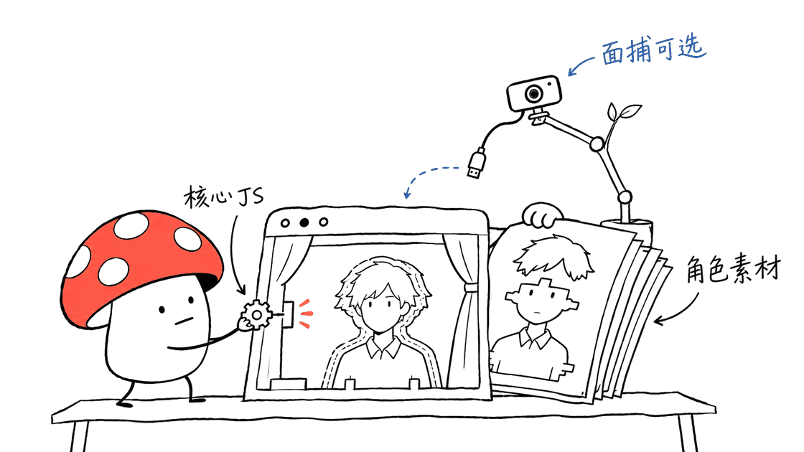
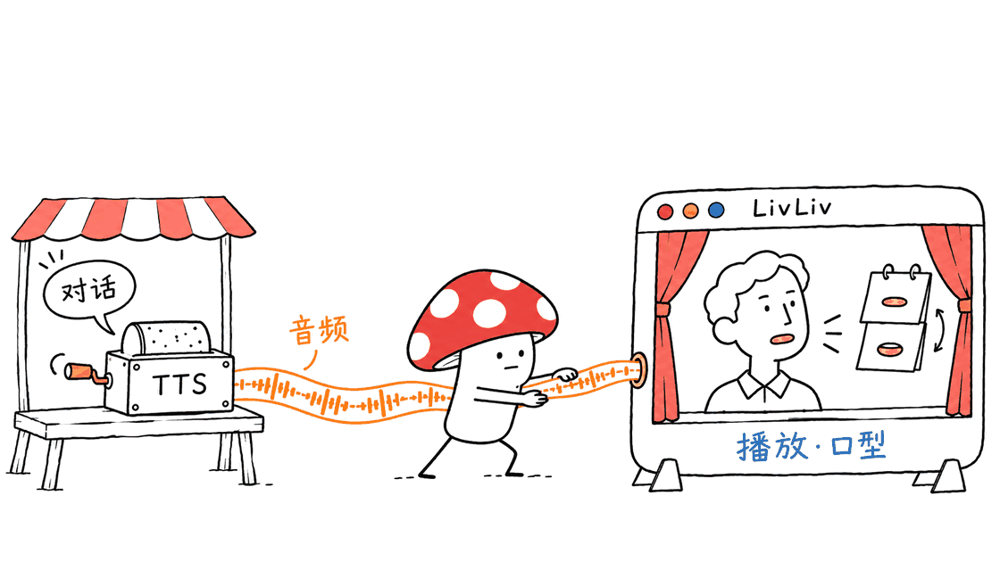
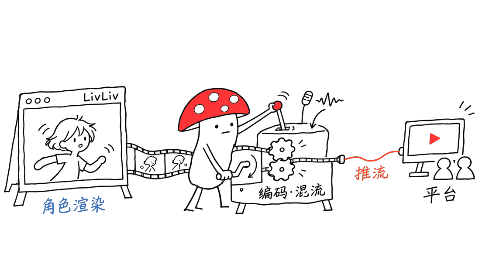

LivLiv Player 能让一个网页里的角色呼吸、眨眼、转头，并跟着声音张嘴。它把“显示一个会动的虚拟形象”做成了轻量组件，适合网页助手、角色互动页面和直播叠加层；完整的角色素材、面捕和推流仍各有成本与接入要求。

官方仓库是 https://github.com/livliv-dev/player ，代码采用 Apache-2.0。本次固定提交 `011b1f54d62c189cee49f29d3427c6d22fafdffd`，仓库与 npm 当前版本均为 `0.3.0`，核查日期为 2026 年 11 月 9 日。在线示例在：
https://livliv-dev.github.io/player/

## “约30KB”到底包括什么？

README 的说法是核心 gzip 后约 30KB、核心无依赖。我们实际构建后，递归统计 `dist/index.js` 的静态 JS 导入闭包，包括三个共享模块，逐文件以 gzip level 9 压缩并求和，得到 **33,596 字节，约33.6KB（32.8KiB）**。这说明轻量定位成立，也说明不能只看入口文件的压缩数字。

这是一组固定构建产物的压缩体积，不是浏览器实测流量、运行内存或帧率。HTTP 头、缓存、压缩等级和服务器是否真的启用压缩，都会影响真实传输；未压缩文件与运行中的 GPU 纹理占用更不能用这个数字代表。

| 部分 | 核查结果 | 是否包含在核心数字里 |
| --- | --- | --- |
| LivLiv 播放器核心及静态共享 JS | gzip level 9 合计 33,596 字节，无外部静态导入 | 是 |
| 示例 `k01.livliv` 角色包 | 717,989 字节 | 否 |
| 精修 `d03ft.livliv` 角色包 | 1,883,819 字节 | 否 |
| 21 个构建后的示例角色包 | 合计 12,868,489 字节 | 否 |
| 面捕运行时与模型 | 官方文档称首次约8MB，还需 MediaPipe 包 | 否 |
| VRM 路线 | 另需 three.js 与 three-vrm | 否 |

因此，“一个网页就是皮套”可以描述使用体验，但不应被理解为 30KB 包含全部角色、摄像头模型和直播软件功能。我们的 npm 打包清单检查也确认，播放器包不包含 `characters/`，角色要另外准备。



## 它是怎样让2D角色产生立体感的？

LivLiv 角色由多层图像、锚点、绑定参数与表情组成，在 WebGL2 的 canvas 中绘制。转头时让不同层按深度移动，再结合形变与关键姿态，形成 2.5D 的观感；精修角色还能使用额外 keyforms 与摆动部件。

可以把它理解成网页里的可编程提线木偶。开发者可以触发 `setExpression()`、`act()`，也可以直接设置 `mouthOpen` 等参数，让外部声音或跟踪数据驱动动作。

它采用自己的 `.livliv` 包与开放格式；`.livliv` 本质上是包含模型与素材的 ZIP。官方明确说明没有使用 Live2D Cubism SDK，也不读取 `.moc3`、`.cmo3`。所以已经拥有 Live2D 模型的人，需要先确认转换路径，不能直接改后缀加载。

另有两条路线：PNGTuber 用嘴闭、嘴开等图片切换；VRM 通过 `BodyPlayer` 配合 `VrmBody` 接入三维模型。这里的“统一 API”指控制接口相近，并不是把 VRM 交给 LivLiv 的 `Player.load()` 就能自动播放，也不是每条路线都无依赖。

## 怎样先在本机看到角色？

最短体验路径是先打开官方示例，不需要先安装桌面虚拟主播软件。想在自己机器上跑源码，可以使用：

```bash
git clone https://github.com/livliv-dev/player.git
cd player
git checkout 011b1f54d62c189cee49f29d3427c6d22fafdffd
npm install
npm run build
python3 -m http.server 8000 --bind 127.0.0.1
```

随后打开：
`http://localhost:8000/example/demo.html`

构建会生成播放器模块和示例 `.livliv` 包。直接双击 HTML 的 `file://` 路径容易遇到模块加载或资源访问限制，使用本地静态服务更稳妥。摄像头、麦克风和音频播放还受浏览器权限与安全上下文约束，公网部署应使用 HTTPS。

项目要求 WebGL2，并建议用 `Player.isSupported()` 做能力检查。不支持时显示静态海报和说明，比空白 canvas 更有用。README 当前说主要测试桌面浏览器，尚未在手机上验证；不能据此保证所有手机都流畅运行。

## 怎样嵌入自己的页面，并接上语音？

前端项目可安装固定版本：

```bash
npm install @livliv-dev/player@0.3.0
```

把有合适许可的角色放进网站静态目录，如 `/characters/my-avatar.livliv`。页面准备一个 canvas 和播放按钮，再接入：

```html
<canvas id="avatar" width="480" height="640"></canvas>
<button id="reply">播放回复</button>
```

```js
import { Player } from '@livliv-dev/player'
import { createSpeech } from '@livliv-dev/player/voice'

if (!Player.isSupported()) {
  throw new Error('此浏览器无法启动 WebGL2')
}
const player = new Player(document.querySelector('#avatar'))
await player.load('/characters/my-avatar.livliv')
const speech = createSpeech(player)
document.querySelector('#reply').onclick = () => {
  speech.unlock()
  speech.say('/audio/reply.mp3')
}
window.addEventListener('pagehide', () => {
  speech.stop()
  player.dispose()
})
```

这是接入示例，需放进能处理 npm ES 模块的前端构建环境；播放器不会替你创建角色文件或 `reply.mp3`。`unlock()` 放在用户点击里，是为了满足浏览器音频播放限制。

`createSpeech` 播放音频队列，并根据声音强弱与元音特征驱动口型。它接收音频 URL、Blob 或 ArrayBuffer，并不自己生成语音，也不理解用户问题。若要做 AI 主播，仍需“对话模型 → TTS 音频 → 播放队列 → 角色口型”的链路。

例如我们此前分析的 Higgs Audio v2，可以作为独立的 TTS 后端候选，再把合成音频交给 LivLiv。这里是工程组合建议，没有官方集成插件或端到端效果验证：
https://blog.mushroom.cv/blog/higgs-audio-v2-engineering-deployment-guide/

如果跟随麦克风或已有 `<audio>` 元素，可使用 `startLipSync()`。对自己创建的媒体流，应用要明确管理停止与释放；文档说明传入流或元素仍归调用方所有，不能假定停止口型就停止音源。



## 摄像头在本地处理，为什么还要检查网络？

面捕通过可选 `@livliv-dev/player/tracking` 模块和 MediaPipe Face Landmarker 实现。它读取脸部姿态并映射给角色，图像在浏览器内处理；这项能力会另外加载运行时与模型。

官方 API 文档进一步说明，默认会向 jsDelivr 和 Google 模型存储下载文件，MediaPipe 还会向 `odml.pa.googleapis.com` 发送使用统计。因此，不能仅凭“摄像头画面留在本机”就推断页面完全不联网：
https://github.com/livliv-dev/player/blob/main/API.md

需要减少第三方请求时，可自行托管 wasm 与模型，通过 `wasmUrl`、`modelUrl` 指向本地资源，并按自己的 TTS、角色 CDN 等来源配置 CSP。若所有资源均同源，可参考文档限制 `connect-src 'self'`；它也会拦截不在允许列表中的远端语音接口，需要一起设计。

我的建议是让摄像头在用户点击“开启面捕”后再加载与授权，失败时保留鼠标跟随和待机动作。关闭页面或组件时释放跟踪器与媒体资源。本文未开启真实摄像头、麦克风，也未审计 MediaPipe 实际统计内容；网络行为描述来自文档与源码核对。

## 代码开源，21个角色就都能商用吗？

代码与角色需要分别看许可。大部分示例角色采用 LivLiv 精选角色许可，允许署名的个人非商业使用；条款特别把个人创作者从平台获得广告分成、打赏、会员收入的直播和视频也计入允许范围。公司广告、产品推广、收费应用或服务等用途需要先取得许可，不能直接把这些素材当作 Apache-2.0 资产。

还有三个例外：Kujira 与 Kujira Q 按 CC BY-NC-SA 4.0 及对应署名要求使用；Pen 不在 Apache 或精选角色许可覆盖内，仓库声明不授予该角色权利。Nana 另有吉祥物身份限制。具体看：
https://github.com/livliv-dev/player/blob/main/characters/LICENSE.md
https://github.com/livliv-dev/player/blob/main/characters/CREDITS.md

使用 LivLiv 制作的角色公开展示时，README 还要求说明 AI 参与制作，不能宣称为手绘或手工绑定。角色包的作者、许可和标记应保留。商业团队最省心的路线，是使用自己拥有明确权利的角色素材，并分别确认生成或制作工具的条款。

## 网页能显示角色，离真正开播还有什么？

官方提供透明背景 iframe 页面，也支持作为 OBS Browser Source。它解决的是角色渲染与驱动；直播平台的编码、混流、推流、录制和观众互动，需要另选工具或网页方案完成。无需 OBS 就能在网页看到角色，不等于播放器已经包含完整直播间。

角色制作也有同样的边界：开源仓库提供播放器与格式，单张图片生成分层、绑定好的角色属于另一条制作链路。使用 livliv.ai 在线制作与下载模型包时，要查看相应服务、套餐和标记要求，不能从播放器 Apache 许可推导在线制作无限免费。



## 我们实际验证了哪些部分？

Mycelium Protocol 在固定提交上完成 `npm run check`、构建和 91 项 Node 单元／模糊测试，并测量核心模块压缩体积与角色包大小。无头 Chromium 在 SwiftShader 软件图形后端上完成了21个角色的绘制检查，也覆盖部分异常资源、加载中断与上下文释放场景；上游测试中的媒体设备使用模拟输入。另一次实际示例页检查确认 Sena 角色正常播放、表情返回成功、嘴部参数可设置并能生成 PNG 快照，该基础播放路径未观察到外站请求。它不代表完整面捕模式没有第三方网络行为。

这次没有测试真实面捕、麦克风口型、手机性能或直播平台推流，也没有测量帧率、首屏耗时和运行内存。自托管隐私方案和 AI 主播链路是基于公开接口提出的接入建议，应在自己的页面上做端到端验收。

## 常见问题

### LivLiv Player 是完整的 AI 虚拟主播吗？
它主要负责形象播放、动作与口型。对话、语音识别、语音生成、直播编码与业务操作，需要应用提供；有了播放器，可以更容易把这些能力挂到角色上。

### 完整体验真的只有30KB吗？
约30KB是核心 JS 的量级。本次构建静态闭包 gzip 合计33,596字节；角色、贴图、语音文件、面捕和 VRM 依赖都要另外计算。

### 只有图片，没有专业模型，可以试吗？
可以先使用 PNGTuber 的嘴开、嘴闭图片。更复杂的 LivLiv 分层角色与 VRM 则需要相应资产和制作流程；使用示例素材前仍要检查角色许可。

---

> © 2026 Author: Mycelium Protocol. 本文采用 [CC BY 4.0](https://creativecommons.org/licenses/by/4.0/deed.zh) 授权——欢迎转载和引用，须注明作者姓名及原文链接，不得去除署名后以原创发布。

<!--EN-->

LivLiv Player puts an animated character into a browser page: breathing, blinking, head movement and audio-driven mouth motion. It is a lightweight building block for character interfaces, assistants and stream overlays. Assets, tracking and broadcast delivery remain separate parts of the system.

Official source: https://github.com/livliv-dev/player

We inspected commit `011b1f54d62c189cee49f29d3427c6d22fafdffd` on November 9, 2026. The repository and npm version were `0.3.0`; code is Apache-2.0. The public demo is:
https://livliv-dev.github.io/player/

## What does “about 30KB” include?

We built the package, followed the static imports from `dist/index.js` through three shared modules, compressed each file with gzip level 9, and summed the results: **33,596 bytes, approximately 33.6KB or 32.8KiB**. The core had no external static imports. Measuring just the entry file would omit required shared code.

This is a deterministic measurement of build artifacts, not observed browser traffic, RAM or frame rate. Headers, compression configuration and caching affect actual transfers. GPU textures and decoded assets have a different memory footprint.

| Component | Inspected result | Included in core size? |
| --- | --- | --- |
| Core and required static JS modules | 33,596 gzip bytes | Yes |
| `k01.livliv` character | 717,989 bytes | No |
| Refined `d03ft.livliv` character | 1,883,819 bytes | No |
| All 21 built character packages | 12,868,489 bytes | No |
| Face tracking | Documentation estimates about 8MB initially, plus MediaPipe package | No |
| VRM path | Requires three.js and three-vrm | No |

An npm packing-manifest check also confirmed that `characters/` is not in the player package. “A web page becomes your avatar” describes a user experience, not a complete 30KB download including every feature.


## How does a flat character acquire depth?

A LivLiv model contains layered artwork, anchors, rig parameters and expressions rendered on a WebGL2 canvas. Layer displacement, deformation and key poses produce a 2.5D head-turn effect. Refined characters can include additional keyforms and swinging parts.

Applications can call `setExpression()`, `act()` or manipulate parameters such as `mouthOpen`. This makes the character a programmable visual component rather than a fixed animation clip.

The open `.livliv` format packages model files and artwork in a ZIP. It does not use the Live2D Cubism SDK or read `.moc3` and `.cmo3` files. Existing Live2D assets therefore need a verified conversion path, not a renamed extension.

PNGTuber and VRM are additional routes. PNGTuber switches between supplied mouth/eye images. VRM uses `BodyPlayer` with `VrmBody` and extra three.js/three-vrm dependencies. Similar control APIs do not mean that the LivLiv `Player.load()` accepts every format or that all paths are dependency-free.

## How do you run the demo locally?

```bash
git clone https://github.com/livliv-dev/player.git
cd player
git checkout 011b1f54d62c189cee49f29d3427c6d22fafdffd
npm install
npm run build
python3 -m http.server 8000 --bind 127.0.0.1
```

Open `http://localhost:8000/example/demo.html`. The build produces runtime modules and sample character packages. A static HTTP server avoids the module/resource restrictions of opening HTML directly through `file://`.

Public deployment should use HTTPS for camera/microphone access, and audio remains subject to browser permissions and playback policies. Check `Player.isSupported()` and provide a poster fallback when WebGL2 is unavailable. The README says testing focuses on desktop browsers and phones have not yet been tested; universal phone performance is not established.

## How do you embed a talking character?

```bash
npm install @livliv-dev/player@0.3.0
```

Provide an appropriately licensed model under `/characters/my-avatar.livliv`, a canvas and a button:

```html
<canvas id="avatar" width="480" height="640"></canvas>
<button id="reply">Play reply</button>
```

```js
import { Player } from '@livliv-dev/player'
import { createSpeech } from '@livliv-dev/player/voice'

if (!Player.isSupported()) throw new Error('WebGL2 unavailable')
const player = new Player(document.querySelector('#avatar'))
await player.load('/characters/my-avatar.livliv')
const speech = createSpeech(player)
document.querySelector('#reply').onclick = () => {
  speech.unlock()
  speech.say('/audio/reply.mp3')
}
window.addEventListener('pagehide', () => {
  speech.stop()
  player.dispose()
})
```

This example belongs in a frontend build environment that resolves npm ES modules. It does not create the character or audio file. Call `unlock()` inside a user gesture to satisfy audio playback restrictions.

The speech helper queues audio clips and drives the mouth from audio features. It accepts URLs, Blobs or ArrayBuffers. It neither synthesizes speech nor understands a conversation. An AI host still needs dialogue generation, TTS, audio delivery and playback control.

A separate TTS backend such as Higgs Audio v2 could supply audio. This is an integration proposal, not a verified official plugin or end-to-end demonstration:
https://blog.mushroom.cv/blog/higgs-audio-v2-engineering-deployment-guide/

For microphone, MediaStream or existing audio/video elements, use `startLipSync()`. The documentation says externally supplied media remain owned by the caller; stopping the lip-sync controller does not necessarily stop that source.


## What does local face tracking imply for networking?

The optional tracking module uses MediaPipe Face Landmarker in the browser. Camera frames remain on the device, but the default setup downloads wasm and model assets from jsDelivr and Google storage. The API guide also documents MediaPipe usage-statistics requests to `odml.pa.googleapis.com`:
https://github.com/livliv-dev/player/blob/main/API.md

Host the runtime and model yourself and configure `wasmUrl` and `modelUrl` when third-party downloads are undesirable. A suitable CSP can block unwanted connections. If all resources are same-origin, the documented `connect-src 'self'` approach applies; remote TTS or asset hosts must be allowed deliberately if the application needs them.

Request camera access only after an explicit action, load tracking lazily and retain idle/pointer motion when access fails. Stop tracking and release application-owned media when leaving the page. We did not enable a real camera or microphone or inspect actual MediaPipe telemetry payloads; these network details are documentation/source findings.

## Are the included characters commercially reusable?

Most sample characters use a separate LivLiv character license. It allows credited personal noncommercial use and explicitly includes individual creators earning platform ad revenue, tips or memberships from streams/videos. Company advertising, product promotion, paid applications/services and similar commercial uses require permission. The code's Apache license does not grant these asset rights.

Kujira and Kujira Q instead use CC BY-NC-SA 4.0 with their specified credits. Pen is outside both the Apache and featured-character licenses; the repository grants no rights to it. Nana has additional mascot restrictions:
https://github.com/livliv-dev/player/blob/main/characters/LICENSE.md
https://github.com/livliv-dev/player/blob/main/characters/CREDITS.md

The README also requires disclosure of AI involvement when publicly showing LivLiv-made characters, rather than presenting them as hand-drawn or hand-rigged. Preserve authorship, license metadata and required marks. Commercial teams should use assets with clear rights and check the separate terms of their production tools.

## What remains before going live?

The project offers transparent iframe pages and OBS Browser Source support. LivLiv renders and drives a character; encoding, mixing, streaming, recording and platform audience interaction require a separate broadcast pipeline. Displaying an avatar without OBS does not establish that the player is a complete broadcasting application.

Creation is another distinct workflow. The open player and format do not automatically provide a free local single-image-to-rig authoring pipeline. Check the service, plan and mark requirements when using livliv.ai to generate and export a model package.


## What did we verify?

Mycelium Protocol ran type checking, the build and 91 Node unit/fuzz tests at the pinned commit. We also inspected package contents and measured compressed core modules and built character packages. Headless Chromium with SwiftShader also passed drawing checks for all 21 featured characters, plus selected invalid-resource, interrupted-load and context-release scenarios. Upstream media tests use simulated inputs. A separate actual demo-page check verified Sena playback, an accepted expression, a mouth parameter and a PNG snapshot, with no external requests on that basic path. This does not establish that face tracking makes no third-party requests.

We did not test real webcam tracking, microphone behavior, phones or platform streaming, and did not benchmark FPS, first paint or memory use. The self-hosting and AI-presenter architecture is a proposed application design that needs end-to-end acceptance tests on the target deployment.

## FAQ

### Is this a complete AI VTuber?
It handles character playback, movement and lip sync. Recognition, dialogue, speech generation, business actions and broadcast delivery must come from other components.

### Is the whole experience just 30KB?
That describes the core's size class. Our required static-module closure totaled 33,596 gzip bytes. Character assets, speech files, face runtime and VRM dependencies are additional.

### Can I start with pictures rather than a professional rig?
Yes: PNGTuber can use mouth-open and mouth-closed images. Richer LivLiv and VRM characters require their corresponding assets and authoring processes. Check the rights to every sample or imported model.

---

> © 2026 Author: Mycelium Protocol. Licensed under [CC BY 4.0](https://creativecommons.org/licenses/by/4.0/) — free to share and adapt with attribution. You must credit the author and link to the original; removing attribution and republishing as original is not permitted.
