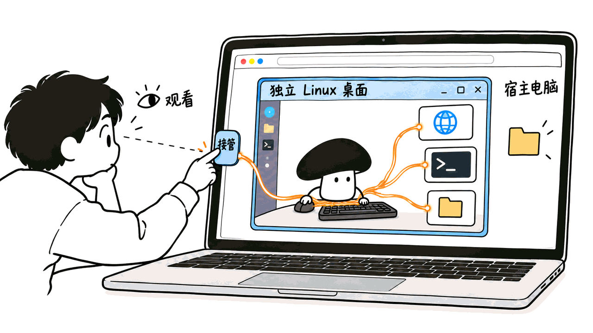
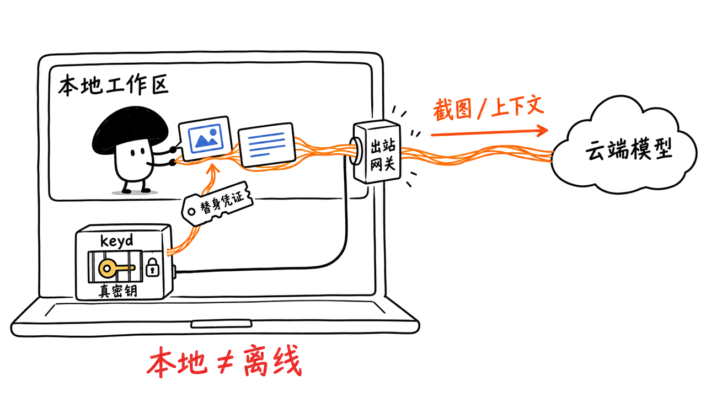
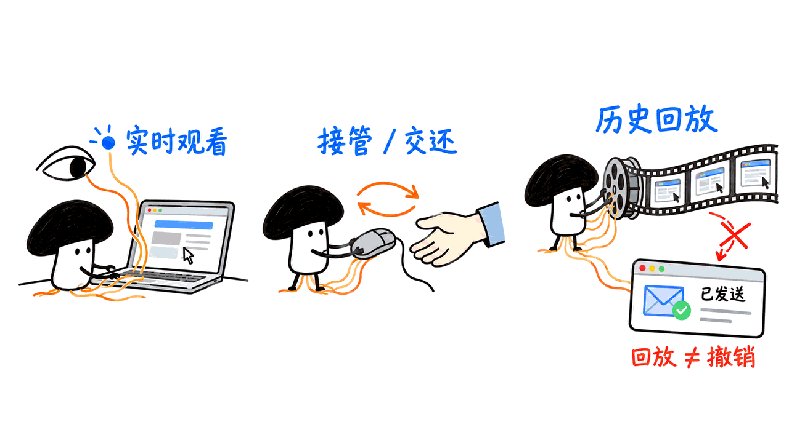

localDot 是一个让 AI 在本机独立 Linux 桌面里做事的助手：你给任务，它使用浏览器、终端和文件，你可以实时观看、随时接管，再回看过程。

先回答最重要的问题：官网对应的开源仓库就是下面这个，不需要在同名项目里猜。

**https://github.com/Shadowhusky/localdot**

官网：https://localdot.dev/

我们通过官网页脚的 GitHub 链接找到仓库，仓库又把官网列为项目主页，双方链接一致。仓库公开包含应用和执行系统源码，根目录 `LICENSE` 为 MIT。本文固定到提交 `e5054494125d09c6db86aba322be5e46cb8618ca`，不把之后的更新自动算进来。安装文档仍将打包版本称为 alpha，适合按早期版本试用。

## 它给 AI 的“电脑”到底是什么？

不是另外买一台硬件，也不是默认把你正在工作的桌面交出去。localDot 在 Docker 中组织一套 Linux 工作环境，供 Agent 打开网页、使用应用、操作终端和处理文件。

从用户角度看，入口是浏览器里的聊天与桌面画面。你既能看 AI 做什么，也能点“接管”自己操作，再把控制权交还。手机可以成为查看与控制入口，但这不意味着手机本身在运行那套容器。

仓库描述的工作方式是：提出任务、计划、动手、观察、说明进展，循环到完成或需要你介入。比起只给一段最终答案，这种界面更适合“我要看它实际在哪个页面做了什么”的工作。

适合拿来探索的任务包括网页资料整理、下载后处理文件、表格工作和应用操作。这些是产品面向的场景；不能仅凭宣传演示，就认定它已经能稳定完成任意网站或复杂业务流程。



## 开放的是哪些代码？

这次找到的不是只有 README 的展示仓库。源码按界面、执行、通信和凭证服务拆开：

| 路径 | 作用 |
|---|---|
| `apps/web` | React 网页界面，用户在这里聊天和看桌面 |
| `apps/daemon` | TypeScript 守护进程，提供 API、任务循环、工具与记录 |
| `packages/protocol` | 界面与守护进程共用的协议类型 |
| `cells/` | 桌面、浏览器、brain、网络 gate 等容器组件 |
| `keyd/` | Go 凭证服务、出站控制及模型预算相关逻辑 |
| `apps/site` | localdot.dev 官网与宣传内容 |

MIT 覆盖的是相应项目代码，不意味着模型服务、Docker Desktop 或所有第三方组件都没有独立条款和使用成本。第三方声明见仓库的 `THIRD-PARTY.md`。

我们请求 GitHub 的“最新 Release”接口得到 404，但这不等于没有开源或无法安装。项目的公开安装脚本配置了自己的下载通道；普通用户获取预编译包与开发者从源码构建，是两条路径。

## 普通用户怎么装？

根据固定版本的安装文档，先对照平台，而不是看到一个命令就以为所有电脑都支持。

| 平台 | 文档中的支持范围 |
|---|---|
| macOS | Apple Silicon，使用 Docker Desktop |
| Linux | x86-64、glibc、systemd，Docker Engine 28+ |
| Windows | 通过 WSL 2；仍属 alpha，需配置 Docker 与发行版集成 |
| Intel Mac / Linux ARM64 | 目前没有对应的公开安装包 |

macOS 与 Linux 的官方入口是：

```bash
curl -fsSL https://downloads.localdot.dev/install.sh | bash
```

Windows 的 PowerShell 入口是：

```powershell
irm https://downloads.localdot.dev/install.ps1 | iex
```

安装以普通用户运行。缺少依赖时，程序会引导设置；Docker 安装、系统授权和首次配置仍需要你完成，Windows 还可能涉及 WSL 用户创建与重启。这里的“一行”是安装入口，不是保证完全无人参与。

安装结束会打印登录链接。按文档，该链接单次有效，一分钟后过期；需要新链接时运行 `localdot open`。随后在设置里添加模型，再启动 dot 的电脑并给出第一个小任务。

建议先让它完成一个不涉及账号修改的任务，例如把公开网页的资料整理成文件，检查结果和过程后，再逐步接入自己的登录态与工作流程。这是我们的试用顺序建议，不是本次已经跑通的演示。

常用维护命令：

```bash
localdot open       # 重新取得登录链接
localdot doctor     # 检查环境和运行状态
localdot logs --follow
localdot stop       # 停止 dot 的动作
localdot down       # 停止服务与电脑容器，保留数据
localdot update     # 更新安装
```

应用默认位于 `~/.local/share/localdot`，配置、历史与日志等数据通常位于 `~/.localdot`。卸载也保留数据，不等于清理全部容器镜像和录制资料。文档尚未验证安装峰值磁盘占用，不宜凭空给出“只要几 GB 就够”的建议。

开发者则应读 `docs/development.md`：源码开发需要 Node 24+、pnpm 10，以及相应的 Go 和容器构建环境。不要把源码初次构建的成本和下载预编译包混为一谈。

## 模型能换，但不等于任意模型都能干活

README 宣称支持 25 家服务商，也列有通过 Claude Code、Codex 接入相应会员套餐的路径，以及 Ollama、LM Studio 或兼容接口服务。

这里要分清两件事：能配置某种 API，不代表任何文字模型都能可靠操作电脑。README 明确要求模型能理解截图并使用工具；实际效果还取决于模型能力、上下文、工具适配和任务难度。

同样，套餐入口不等于无限额度或免费的 API 余额。是否可用、支持哪些模型及相关限额，要以项目实现和你自己的账号条件为准。本文没有登录这些套餐，也没有逐家调用模型服务。

官网展示的日常助手、程序员、研究员、财务、剪辑师和设计师，更适合理解为按任务选择技能的角色配置，而不是六个独立训练的大模型。只装载相关技能有助于控制上下文，但具体能节省多少 token，这里没有实测数据。

## 权限、凭证和“本地”应该怎么理解？

localDot 把应用、工作电脑和任务记录放在本机，但它通常仍要访问网页，使用云端模型时也会发送截图和任务上下文。README 对此有明确说明。

它提供三类审批模式，文档描述如下：

| 模式 | 主要行为 |
|---|---|
| Custom，默认 | 以用户身份发送或发布、付款、上传文件、变更账号安全及修改网上内容前询问 |
| Auto | 审核模型可批准日常步骤；购物、登录和网上删除仍问用户 |
| Full access | 减少询问，但每次购买、网上删除等指定动作仍保留确认 |

因此，Full access 不是取消全部边界。另一方面，审批模型判断与用户确认也不能被当作“永远不会误操作”的保证。

文档中的 keyd 负责保管真实凭证，给工作容器提供有范围限制的替身，在允许的目标请求出站时使用真实密钥。网络 gate 与相关策略用于限制目的地，项目也描述了局域网、路由器和云元数据地址的防护。

这是架构与预期规则，不是本文完成了一次完整安全审计。域名规则、DNS/IP 检查、网关部署和密钥替换是不同环节；测过其中一环，不能替其余环节背书。



## 手机上看、回放和恢复，有什么边界？

服务默认监听 `127.0.0.1`。在本机打开的登录链接，直接复制到手机不一定能连接。文档提供 SSH 隧道、Tailscale，以及默认关闭的可选域名中继。

SSH 更适合电脑访问服务器；Tailscale 可让同一 tailnet 内的设备连接。若启用项目的中继，流量会经过 localDot 中继和 Cloudflare，不能继续把访问路径描述成“完全不经第三方”。

回放可以帮助检查过程，并按片段导出视频。README 介绍了裁剪、字幕和最高 16 倍加速。它的用途是观察与分享历史，不要把“倒回去看”理解为已经撤销目标网站上的操作。

同理，网页隐藏后任务可以继续，并不等于断电或进程异常后每个任务都能无损续跑。安装文档对旧原生任务的恢复有专门流程；日常使用应分清停止动作、停止服务、替换电脑和清除数据。



## 我们实际检查了什么？

除了核对官方链接、MIT 许可与公开源码，我们还做了两项范围有限的检查。

第一，下载公开 Shell 安装脚本，实际取得 HTTP 200，并通过 `bash -n` 语法检查。该文件为 76,952 字节。与固定提交中的源码安装脚本相比，差异是预编译发布通道与 bootstrap 校验值的配置；这解释了为什么官网命令与源码开发入口不同。

第二，从固定提交取出 `keyd/internal/policy` 及其未修改的上游测试，在 Go 1.27.1 / macOS arm64 下执行：

```bash
go test -json -count=1 ./internal/policy
```

22 项测试函数通过，没有失败。测试涉及角色、主机名、端口与目标授权规则；它们不是整套 DNS 防护、容器隔离、凭证注入或真实网页任务的端到端验收。

我们没有运行安装器、下载桌面镜像、启动完整 localDot，也没有调用付费模型、接入个人账号、测任务成功率或性能。介绍中的产品功能来自官方文档与源码，只有上述检查属于本次执行结果。

## 怎么判断值不值得试？

如果你希望 AI 操作一个独立工作区，而自己能看得见、接得住、查得到过程，localDot 的组合值得研究。它把桌面、控制界面、模型选择、凭证与回放放进同一条链路，降低了自己拼装这些部分的工作量。

实际选型仍要验证三件事：目标模型能否完成你的任务；登录态、文件和恢复流程是否符合预期；模型与远程访问配置是否满足数据要求。先用小任务验收，再扩大权限，比直接开启完整自主执行更容易判断问题在哪。

相关技术报告：https://blog.mushroom.cv/blog/pine-computer-agent-runtime-engineering/

## 常见问题

### 官方开源仓库到底在哪里？

https://github.com/Shadowhusky/localdot 。这是官网直接链接、仓库反向链接确认的公开项目，采用 MIT 许可，包含前端、守护进程、容器组件和 keyd 等源码。

### 本地部署后，截图和资料一定不会出电脑吗？

不会自动获得这种保证。云端模型会接收截图和任务上下文，网页操作本身也涉及外网；可选中继还会改变访问路径。要按实际模型、工具和远程访问设置逐段判断。

### 这是已经做过完整实测的安装教程吗？

这是基于固定官方源码与文档的介绍和安装指引。我们检查了公开安装脚本，并跑了 22 项出站策略单元测试；未验证完整安装、桌面任务、模型表现或整体安全性。

## 一手来源

官网：https://localdot.dev/
官方仓库：https://github.com/Shadowhusky/localdot
固定 README：https://github.com/Shadowhusky/localdot/blob/e5054494125d09c6db86aba322be5e46cb8618ca/README.zh-CN.md
安装说明：https://github.com/Shadowhusky/localdot/blob/e5054494125d09c6db86aba322be5e46cb8618ca/docs/install.md
开发说明：https://github.com/Shadowhusky/localdot/blob/e5054494125d09c6db86aba322be5e46cb8618ca/docs/development.md
策略源码：https://github.com/Shadowhusky/localdot/tree/e5054494125d09c6db86aba322be5e46cb8618ca/keyd/internal/policy

---

> © 2026 Author: Mycelium Protocol. 本文采用 [CC BY 4.0](https://creativecommons.org/licenses/by/4.0/deed.zh) 授权——欢迎转载和引用，须注明作者姓名及原文链接，不得去除署名后以原创发布。

<!--EN-->

localDot is an assistant that gives AI a separate Linux desktop on your computer. It uses a browser, terminal and files while you watch, take control and review the task history.

The official open-source repository is:

**https://github.com/Shadowhusky/localdot**

Website: https://localdot.dev/

We followed the website's GitHub link and verified that the repository links back to the same site. The public repository contains application and execution-system source, with an MIT license at its root. This article pins commit `e5054494125d09c6db86aba322be5e46cb8618ca` rather than assuming future changes are covered. The installation guide calls the packaged build an alpha; treat it as early software.

## What Is the AI's “Computer”?

It is a Linux environment assembled with Docker, not a separate hardware purchase or the default handover of your active personal desktop. The agent can browse, use applications, run terminal work and handle files in its own workspace.

You interact through a browser interface showing the conversation and desktop. You can take over manually and hand control back. A phone can be a viewer and control surface; that does not mean it runs the containers itself.

The documented task cycle is to plan, act, observe and explain progress until completion or a request for help. It is useful when you need to inspect what happened on a real page rather than receive only a final answer.

Research, downloaded-file processing, spreadsheets and application operations are candidate uses. Demonstrations alone do not establish reliable completion on every website or business process.


## Which Parts Are Open Source?

This is more than a README-only showcase.

| Path | Responsibility |
|---|---|
| `apps/web` | React interface for conversation and desktop viewing |
| `apps/daemon` | TypeScript daemon, APIs, task loop, tools and recording |
| `packages/protocol` | Shared interface/daemon protocol types |
| `cells/` | Desktop, browser, brain and network-gate components |
| `keyd/` | Go credential service, outbound controls and model budgets |
| `apps/site` | Website and promotional content |

The MIT license applies to the relevant project code. Model services, Docker Desktop and other dependencies can have separate terms and costs; see `THIRD-PARTY.md`.

GitHub's latest-release endpoint returned 404 during research. That does not establish a lack of source or an unavailable installation path: the public installer uses its own download channel. Prebuilt installation and source development are separate workflows.

## How Do You Install It?

Check platform support first.

| Platform | Documented support |
|---|---|
| macOS | Apple Silicon with Docker Desktop |
| Linux | x86-64, glibc, systemd and Docker Engine 28+ |
| Windows | WSL 2 alpha; Docker integration with the selected distribution |
| Intel Mac / Linux ARM64 | No published packages currently |

Official macOS/Linux entry point:

```bash
curl -fsSL https://downloads.localdot.dev/install.sh | bash
```

Windows PowerShell entry point:

```powershell
irm https://downloads.localdot.dev/install.ps1 | iex
```

Run installation as your normal user. Setup guides prerequisite installation, but operating-system approval, Docker first-run setup and possibly WSL account creation or a restart still require attention. One command is the entry point, not a promise of unattended setup.

The installer prints a single-use sign-in link that expires after one minute. Run `localdot open` for a new one, add a model in settings, start dot's computer and send a small initial task.

We recommend starting with public information and an output file before adding account-changing workflows. That is a suggested acceptance sequence, not a task we ran in this review.

Useful maintenance commands:

```bash
localdot open
localdot doctor
localdot logs --follow
localdot stop
localdot down
localdot update
```

`stop` stops actions, while `down` stops services and computer containers while retaining data. The app normally lives in `~/.local/share/localdot`; settings, history and logs normally live in `~/.localdot`. Uninstalling preserves data and does not mean all images and recordings are erased. Peak installation disk use is not yet validated in the documentation, so this guide does not invent a minimum capacity.

For source development, read `docs/development.md`: it calls for Node 24+, pnpm 10 and the relevant Go/container build environment. Do not equate a first source build with downloading a prebuilt package.

## Which Models Can Actually Do the Work?

The README advertises 25 providers and describes plan integrations through Claude Code and Codex, plus Ollama, LM Studio and compatible servers.

API compatibility does not make every text model a capable computer operator. The README requires screenshot understanding and tool use; results still depend on model capability, context, integration and task difficulty.

Plan integration also does not imply unlimited usage or free API credit. Account eligibility, limits and supported models remain relevant. We did not sign into those plans or call every provider.

The everyday, coder, researcher, finance, video-editor and designer dots are best understood as task-oriented skill profiles, not six separately trained models. Loading relevant skills can control context size, but we have no measured token-saving figure here.

## What Do Permissions and “Local” Mean?

The application, work computer and recordings stay on the host by design. Browsing still uses the network, and hosted models receive screenshots and task context, as the README explicitly states.

The documented approval modes are:

| Mode | Behavior |
|---|---|
| Custom, default | Ask before acting as you, paying, uploading files, changing account security or modifying online content |
| Auto | A reviewer model can approve routine steps; purchases, sign-ins and online deletion still ask |
| Full access | Fewer prompts, with specified purchase and online-deletion confirmations retained |

Full access does not remove every boundary. Conversely, reviewer approval and user prompts do not guarantee that no mistaken operation can occur.

The documented keyd service keeps real credentials and supplies scoped stand-ins to work containers, using the real credential for allowed outbound destinations. A network gate and related policies constrain connections, including documented protections for LAN, router and cloud-metadata addresses.

Those are architectural claims and intended rules, not the result of a full security audit here. Domain policy, DNS/IP validation, gateway deployment and credential substitution are separate components; testing one does not validate all of them.


## What About Phone Access, Replay and Recovery?

The service defaults to `127.0.0.1`. Copying a host-local link to your phone does not make it reachable. Documentation covers SSH tunnels, Tailscale and an optional domain relay that is off by default.

SSH suits desktop-to-server access; Tailscale can connect devices on the same tailnet. Enabling the project relay sends traffic through that relay and Cloudflare, changing the claim about third-party involvement.

Replay lets you inspect history and export selected video, with trimming, captions and up to 16× speed in the README. Reviewing the past is not the same as undoing an operation already made on an external website.

Tasks continuing while a tab is hidden also does not establish lossless recovery after power or process failure. The install guide has a dedicated recovery flow for older native tasks. Distinguish stopping actions, stopping services, replacing a computer and deleting data.


## What Did We Actually Verify?

Beyond tracing official links, checking the MIT license and inspecting the public source layout, we performed two limited checks.

First, we fetched the public Shell installer with HTTP 200 and checked it with `bash -n`. The file was 76,952 bytes. Its differences from the pinned repository installer were the configured prebuilt-release channel and bootstrap checksum, explaining the distinction between packaged and source paths.

Second, we fetched the unchanged upstream `keyd/internal/policy` module and tests from the pinned commit and ran them with Go 1.27.1 on macOS arm64:

```bash
go test -json -count=1 ./internal/policy
```

All 22 test functions passed. These exercise role, host, port and target authorization rules, not the complete DNS guard, container isolation, credential substitution or end-to-end desktop behavior.

We did not run the installer, download desktop images, launch the complete stack, call paid models, connect personal accounts or measure task success and performance. Product capabilities in this introduction come from official documentation and source; only the checks above are our executed results.

## Who Should Explore It?

localDot is worth exploring if you want AI to use a separate workspace that you can watch, take over and review. It puts the desktop, control interface, model choices, credentials and replay into one system rather than leaving you to assemble all of them.

Before adopting it, validate your target model on your tasks, check file/login/recovery behavior and examine the data paths created by your model and remote-access settings. Begin with a small accepted outcome before expanding permissions.

Related engineering report: https://blog.mushroom.cv/blog/pine-computer-agent-runtime-engineering/

## FAQ

### Where Is the Official Open-Source Repository?

https://github.com/Shadowhusky/localdot . The website links to it and the repository links back. It is a public MIT-licensed project containing frontend, daemon, container components and keyd source.

### Does Local Deployment Guarantee That Screenshots Stay On-Device?

No. Hosted models receive screenshots and task context; web actions use external services, and optional relaying adds another path. Evaluate the actual model, tools and remote-access configuration.

### Was the Complete Installation and Desktop Experience Tested Here?

No. We checked the public installer and ran 22 outbound-policy unit tests. We did not validate complete installation, desktop tasks, model performance or whole-system security.

## Primary Sources

Website: https://localdot.dev/
Repository: https://github.com/Shadowhusky/localdot
Pinned README: https://github.com/Shadowhusky/localdot/blob/e5054494125d09c6db86aba322be5e46cb8618ca/README.md
Installation: https://github.com/Shadowhusky/localdot/blob/e5054494125d09c6db86aba322be5e46cb8618ca/docs/install.md
Development: https://github.com/Shadowhusky/localdot/blob/e5054494125d09c6db86aba322be5e46cb8618ca/docs/development.md
Policy source: https://github.com/Shadowhusky/localdot/tree/e5054494125d09c6db86aba322be5e46cb8618ca/keyd/internal/policy

---

> © 2026 Author: Mycelium Protocol. Licensed under [CC BY 4.0](https://creativecommons.org/licenses/by/4.0/) — free to share and adapt with attribution. You must credit the author and link to the original; removing attribution and republishing as original is not permitted.
