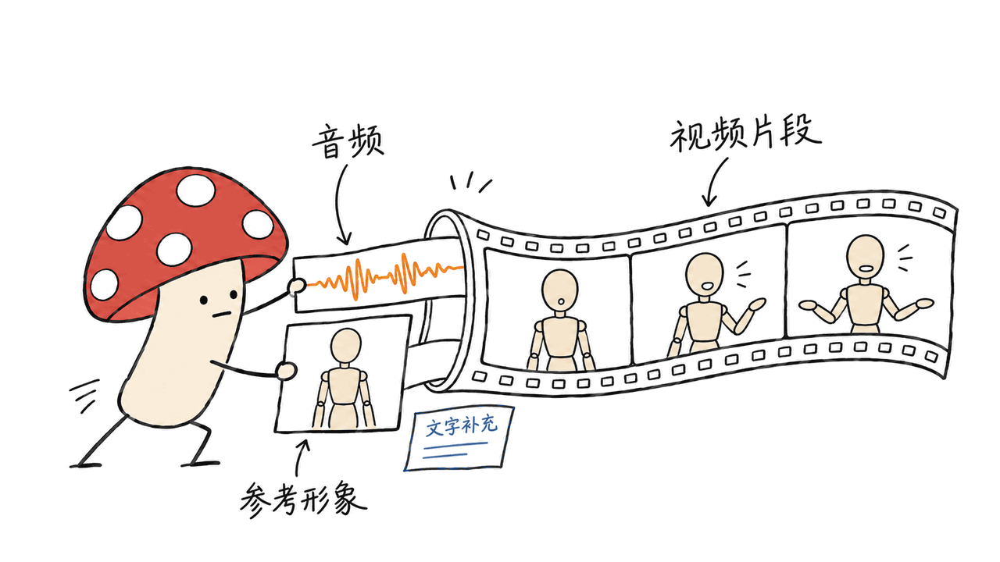
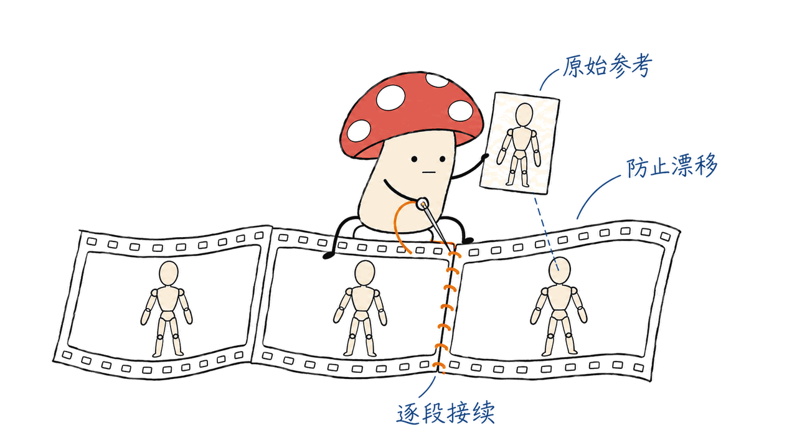
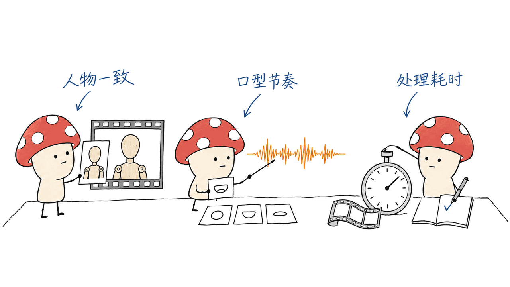

LongCat-Video-Avatar 1.6 是美团开源的音频驱动人物视频模型，目标是让口型、表情和身体动作更自然，并降低长视频续生成时的画面漂移。“超过十分钟”是官方展示的能力，不是任何输入都能十分钟不变脸的保证。

项目 README 记录于 2026 年 11 月 15 日发布 1.6，代码与模型权重采用 MIT 许可。本次核对了仓库、模型卡、技术报告和推理入口，没有下载大规模权重或执行 CUDA 视频生成，因此不提供本机速度、显存或长片稳定性成绩。

代码：https://github.com/meituan-longcat/LongCat-Video
权重：https://huggingface.co/meituan-longcat/LongCat-Video-Avatar-1.6
技术报告：https://github.com/meituan-longcat/LongCat-Video/blob/main/assets/LongCat-Video-Avatar-1.6-Tech-Report.pdf

## 输入到底是什么？

单人入口支持两条主要路径：音频配文字描述，使用 at2v；音频配参考图像，使用 ai2v。音频是驱动条件，文字用来描述人物、动作与环境。它不是只给一段文字就自动完成配音的语音合成器。

源码示例 JSON 包含 prompt、cond_image，以及 cond_audio 下的 person1 音频路径。可先沿用官方目录验证流程，再替换成自己有权使用的人像和音频。多人任务使用另一个推理入口，还要处理不同人物与音轨的对应关系。



## 为什么长视频会越生成越不像？

技术报告采用跨片段自回归续生成：后一段继承前一段末尾的上下文，并继续接入对应音频；片段内部仍采用双向注意力去噪。这和“一个模型一次性记住整条十分钟视频”不同。

问题在于，模型要继续使用自己先前生成的画面。前一段出现的轻微色偏、细节损失或嘴部异常，可能被带进下一段，再逐步放大。

报告把改进放在后训练：强化学习调整动作与表情偏好；DMD 少步蒸馏减少推理步骤；长视频 rollout 与同策略自蒸馏，让模型在自己的生成历史上学习保持外观。这里的价值是减少训练与实际续生成之间的差距，而非宣称长片永远不累积误差。

我的工程判断是：要同时检查时间上的连续性和对原始参考的忠实度。相邻片段看着顺，不代表末尾的人物仍与开头一致。



## 工程接入要注意哪些文件和参数？

1.6 沿用 1.5 的基础架构，模型包提供 DMD 与 OPSD 两个 LoRA。官方默认混合设置 mix_steps=4、mix_alpha=1.0：八步去噪中，前四步使用 DMD，后四步使用 OPSD。修改这些参数是在改变质量与生成行为，不能简单当成越大越好。

推理脚本还会从相邻的 LongCat-Video 目录加载 tokenizer、文本编码器、VAE 等资源。只下载 Avatar 权重，并不等于推理所需文件已经齐全。应按官方说明准备基础模型和 Avatar 模型，并保留预期目录关系。

官方参考环境包含 PyTorch、CUDA、FlashAttention、音频处理依赖和 FFmpeg。示例使用两个 GPU 进程及对应的 context parallel 配置；这是示例配置，不是我们核验出的最低显卡数量或显存门槛，也不能据此承诺普通笔记本可直接运行。

一个官方单人图像驱动入口如下，需先完成其依赖与权重准备，本次没有执行这条 GPU 命令：

```bash
torchrun --nproc_per_node=2 run_demo_avatar_single_audio_to_video.py \
  --context_parallel_size=2 \
  --checkpoint_dir=./weights/LongCat-Video-Avatar-1.6 \
  --stage_1=ai2v \
  --input_json=assets/avatar/single_example_1.json \
  --use_distill --lora_path loraB/lora.safetensors \
  --model_type avatar-v1.6 --mix_steps=4 --mix_alpha=1.0
```

源码明确拒绝同时开启 use_fp8 与 use_int8。FP8 还需要配套 Transformer Engine 与 CUDA 支持。量化模式应分别评估效果；减少部分权重的精度，也不意味着所有组件的内存与耗时都会同比减少。

## 怎样验收“十分钟数字人”？

以下是 Mycelium Protocol 的建议验收方法，并非本次已完成的实验。

先固定模型版本、输入、随机种子、分辨率、片段设置和量化模式，跑短片确认管线，再延长时长。观察口型是否同步、静音时嘴部是否乱动、头身动作是否协调，以及参考人物的外观和颜色是否逐渐变化。

不要只挑开头和结尾两张图。片段交接、长停顿、语速变化和高动作段落，更容易暴露问题。应保存原始输出、失败片段与配置，给每次修改留下可复核依据。

性能也应拆开：音频预处理、模型加载、编译预热、生成、解码和视频封装。官方提示编译首次运行会有额外开销；冷启动与固定形状的后续运行应分别记录。成片十分钟，与十分钟内生成完，是不同指标。



## 常见问题

### 能实时打电话吗？

不能仅凭这个项目的长视频能力这样推断。双向实时通话需要输入输出流、打断、延迟与并发等另一套验证，本文未做。

### MIT 是否代表使用完全没有成本？

模型许可与运行成本不同。显卡、存储、预处理、编码和交付仍要付出资源；自己提供的素材也需要有合适的使用权限。

### 普通开发者最值得借鉴什么？

先学习把长任务拆成可检查片段，并专门处理“下一步会读到自己前一步错误”的问题。长视频 rollout 的思路，对其他需要反复消费自身输出的生成流程也有启发。

源码与模型卡核查版本已记录。本次是文档及代码分析，没有完成模型推理、十分钟验脸或音画质量实测。封面是录制场景概念图，正文为解释配图。

---

> © 2026 Author: Mycelium Protocol. 本文采用 [CC BY 4.0](https://creativecommons.org/licenses/by/4.0/deed.zh) 授权——欢迎转载和引用，须注明作者姓名及原文链接，不得去除署名后以原创发布。

<!--EN-->

LongCat-Video-Avatar 1.6 is Meituan’s open audio-driven human video model. It targets more natural articulation and coordinated motion while reducing visual drift during long continuation. The vendor’s beyond-ten-minute capability is not a guarantee that every input preserves identity perfectly.

The README dates the release to November 15, 2026; code and weights use MIT licensing. We reviewed the repository, model card, technical report and inference entry point. We did not download the large checkpoints or run CUDA generation, so no local speed, VRAM or long-video quality result is claimed.

Code: https://github.com/meituan-longcat/LongCat-Video
Weights: https://huggingface.co/meituan-longcat/LongCat-Video-Avatar-1.6
Report: https://github.com/meituan-longcat/LongCat-Video/blob/main/assets/LongCat-Video-Avatar-1.6-Tech-Report.pdf

## What does it take as input?

Single-person generation supports audio with text description through at2v, or audio with a reference image through ai2v. Audio drives the performance; text describes appearance, action and setting. This is not a text-only speech synthesizer.

The example JSON contains prompt, cond_image and a person1 audio path under cond_audio. Start with the official directory structure, then substitute authorized material. Multi-person generation uses another entry point and requires correct speaker-to-track alignment.


## Why does identity drift during long continuation?

The report continues video clip by clip, using the previous clip’s ending context and the corresponding audio window. Attention within each clip remains bidirectional. Small color, detail or mouth-region errors can become the next clip’s conditioning and grow over time.

The proposed post-training combines reward-guided motion refinement, DMD few-step distillation, long rollouts and on-policy self-distillation. The aim is to improve behavior on the model’s own generated history, rather than only on clean training context.

Our practical takeaway is to evaluate both local continuity and fidelity to the original reference. Smooth transitions alone do not establish stable identity over the full sequence.


## Which integration details matter?

The 1.6 package retains the 1.5 architecture and provides DMD and OPSD LoRAs. With the documented default mix_steps=4 and mix_alpha=1.0, four of eight denoising steps use DMD, followed by four OPSD steps. These settings affect generation behavior and should be evaluated, not maximized blindly.

The script also loads tokenizer, text encoder and VAE assets from the sibling LongCat-Video directory. The Avatar checkpoint alone does not complete the dependency set.

The reference stack uses CUDA, PyTorch, FlashAttention, audio dependencies and FFmpeg. Official examples use two GPU processes and matching context parallelism. That is an example, not our verified minimum GPU count or memory requirement.

This official image-conditioned command requires the documented environment and weights. It was not executed here:

```bash
torchrun --nproc_per_node=2 run_demo_avatar_single_audio_to_video.py \
  --context_parallel_size=2 \
  --checkpoint_dir=./weights/LongCat-Video-Avatar-1.6 \
  --stage_1=ai2v \
  --input_json=assets/avatar/single_example_1.json \
  --use_distill --lora_path loraB/lora.safetensors \
  --model_type avatar-v1.6 --mix_steps=4 --mix_alpha=1.0
```

The parser rejects enabling FP8 and INT8 together. FP8 also requires the corresponding Transformer Engine/CUDA support. Quantization should be checked separately for quality and actual resource use; changing weight precision does not proportionally shrink every component.

## How should teams evaluate a ten-minute avatar?

The following is our proposed acceptance process, not a completed experiment. Fix model revision, inputs, seed, resolution, segment settings and precision. Establish a working short clip before extending duration.

Inspect lip synchronization, silence, head/body coordination and appearance drift. Include joins, pauses, speech-rate changes and active motion, rather than selecting only attractive opening and closing frames. Retain failures and exact configurations.

Separate preprocessing, loading, compilation warm-up, generation, decoding and muxing. Initial compilation overhead and subsequent fixed-shape runs need separate reporting. Ten minutes of output does not mean ten minutes of computation.


## FAQ

### Does it establish real-time calling?

No. Duplex streaming, interruption, latency and concurrency require separate tests; none were performed here.

### Does MIT mean no operating cost?

No. Licensing and GPU, storage, processing and delivery costs are separate. Use appropriately authorized input material.

### What can developers learn without running the full model?

Study how long tasks consume earlier imperfect outputs, then design checkpoints and evaluation around that feedback. This is useful beyond video generation.

This article is document and source analysis, not a model inference or ten-minute identity/quality test. The banner is a conceptual recording scene and body figures explain the workflow.

---

> © 2026 Author: Mycelium Protocol. Licensed under [CC BY 4.0](https://creativecommons.org/licenses/by/4.0/) — free to share and adapt with attribution. You must credit the author and link to the original; removing attribution and republishing as original is not permitted.
