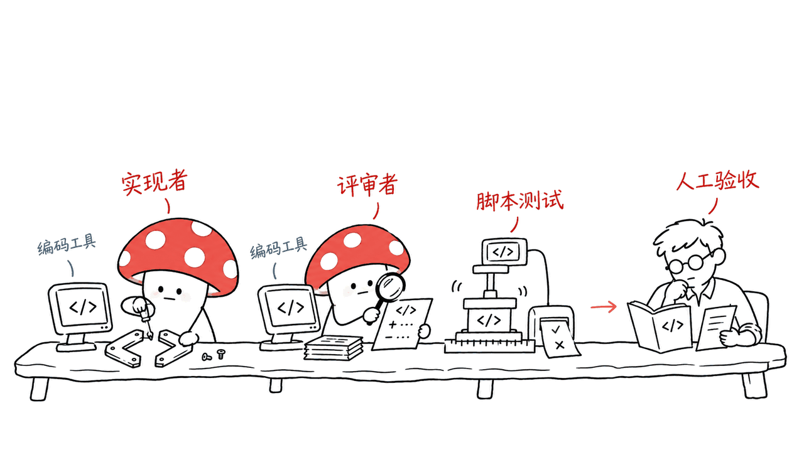
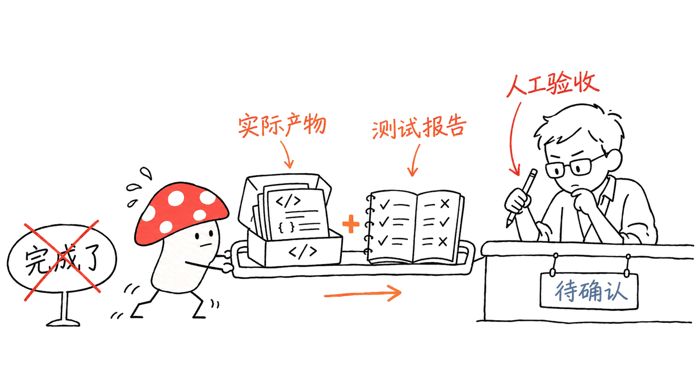
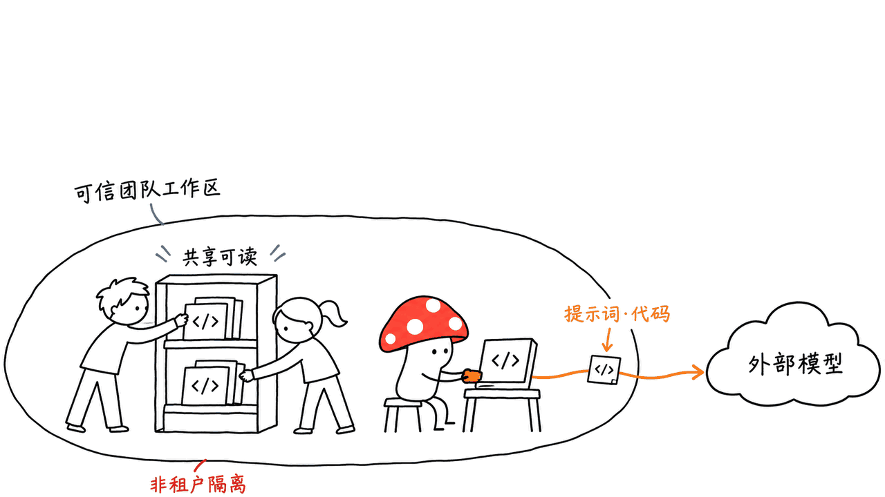

LoopForge 是一个自托管的编程 Agent 交付工作台：把谁来实现、谁来评审、跑什么测试、何时等人确认，以及失败后怎么继续，组织成可以复用的流程。它的价值取决于这些环节是否产生有效证据，而不只是画布里连了多少个节点。

项目由腾讯在 `Tencent/LoopForge` 发布，核心代码采用 MIT，第三方组件保留各自许可。真正执行编码任务的是 CodeBuddy、Codex、Claude Code 等 CLI；LoopForge 为它们提供角色、工作区、调度、审批和留痕，不是训练一个新的基础模型。

官方仓库：https://github.com/Tencent/LoopForge

架构说明：https://github.com/Tencent/LoopForge/blob/main/docs/architecture.md

本文核对源码提交 `eb2e368f14d004e6a22ee25940f5a03c0b5d9f38`，并运行选定的原有测试。腾讯云社区 11 月 9 日的项目介绍明确称它由腾讯轻量云团队打造；本次未独立核对 GitHub 历史榜单，不把 Trending 当作采用依据。封面是本地生成的流程工作台示意。

## Main Bot 与 SOP，分别解决什么问题？

先区分探索与重复交付。Main Bot 适合对话、快速修复和反复澄清；需要处理代码时，它按需打开包含仓库的工作区，并可调用项目角色。SOP 适合已经明确阶段、产物和验收条件的任务，按依赖推进 Agent、脚本、人工关口、子 SOP 与预览构建节点。

例如，一次缺陷修复可以写成“复现材料→方案→实现→独立评审→脚本测试→人工验收→交付”。有些阶段需要模型理解，有些只需确定性命令，有些必须停下来等人签字。把三类工作显式区分，比把所有步骤都包装成一次大对话更便于判断卡在哪里。

角色可以分别配置提示词、模型、执行器、规则、Skills 和 MCP。同一角色既能放进 SOP，也能在对话中被调用。但“实现者与评审者分开”是职责划分，不等于他们的错误自动独立；如果共享同样的错误前提，仍需要真实测试或人工发现。

## 一个流程怎样从“执行完”变成“可以验收”？

最有用的机制是把产物和检查写进节点契约。节点不只返回一段“完成了”，还要声明文档或代码证据，自动检查再决定它是否能进入审批或下游阶段。失败可以停止，也可以按已配置的返工路径回到上游。

我们阅读并实际运行的一个原有测试，会先用真实 Shell 生成 `evidence.md`，用模拟执行器进入后续节点，核对产物已冻结、产物契约验证先于自动检查，然后确认流程停在等待人工审批的状态；显式批准后，运行才变为成功。

这验证了流程顺序，而不是那份文档的业务正确性。若门禁只是“文件存在且不为空”，Agent 写一段无意义文字仍可能通过。团队应把真正的验收放进去：原始故障能否复现、测试是否针对目标行为、变更范围是否符合需求、关键界面是否可用。

人工关口也需要明确含义。批准应当针对具体产物和当前证据，不能成为习惯性点击。流程模板能帮助落实已有标准，却不能替团队发明正确的标准。

## 失败续跑为什么比再点一次开始更复杂？

LoopForge 的 Go 引擎负责 SOP 图、任务租约、调度、沙箱生命周期和交付，MySQL 保存生产运行状态；Worker 与 Runner 负责具体执行。它需要区分节点失败、进程中断、执行机器离线、取消和人工等待，不能把这些都当作“重试一次”。

这次选中的测试也覆盖了取消后从节点继续、下游依赖尚未完成时拒绝重试、工作区恢复失败不冒充准备完成，以及审批失败后继续等待明确操作等场景。这样的恢复语义，比无限自动循环更值得团队关注。

不过，重试能力不是任意外部操作的幂等保证。推送分支、提交 PR、发通知或改外部系统都有各自状态，重跑前仍需核对结果。并行分支还可能共享同一次运行的工作区；允许并行不代表文件冲突会自动消失。应设计任务写入范围，避免两个节点同时改同一文件。

## 我们到底测到了哪一层？

在 Apple M4、16GB、macOS 26.6.2 上，用 Go 1.27.1 和 Node 26.10.0，对固定提交运行未修改的原有测试：

| 测试 | 结果与范围 |
| --- | --- |
| `internal/engine` 中名称匹配 Graph、Gate、Retry、Rerun、Dependency、Ready 的测试 | 57 个顶层测试通过；含子测试共 77 项通过、0 失败，1 个 MySQL 子测试跳过。 |
| `e2e/unit/flow-designer.test.mjs` | 13 项通过、0 失败、0 跳过；在 VM 中加载真实前端代码，DOM 与存储环境由测试替身提供。 |

引擎测试用 `OpenTest` 的测试数据库、临时目录、真实本地 Git/Shell 和模拟执行器检查部分运行行为。设计器测试检查连线去重、防止正常依赖形成环、返工路径、删除与撤销等操作。它们不是完整浏览器验收，也没有启动生产 MySQL 和整套 Docker 平台。

我们没有配置真实模型凭据，没有让 CodeBuddy、Codex 或 Claude Code 做一次真实修复，也没有调用 GitHub 创建 PR。仓库自己的实测记录包含历史候选版本的验证，不能把历史结果叠到本次提交上冒充全链路通过。原命令、日志、跳过项与源码哈希都已留档。

## 自托管之后，哪些边界仍然存在？

部署文档直说平台面向可信团队：已登录用户可以读取实例内各项目数据；项目成员配置不应被当作客户之间的严格租户隔离。默认 Compose 安装还把宿主机 Docker socket 挂给平台，用来启动沙箱容器；这些容器并不因此构成不可信多租户的安全边界。

执行器也有差异。文档列出十种 CLI，但有的预装，有的首次使用时下载，有的需要自己放入 PATH，部分工具的 SOP 沙箱接入与对话接入不同。不能把“支持列表有名字”当成任意角色、环境和认证方式已经等价。团队应固定版本，先验证实际要用的组合。

自托管保存的是平台与运行环境的控制权。若执行器仍调用远程模型，提示词与代码片段可能按该执行器的调用路径离开本机；LoopForge 不自带所有模型的免费额度。当前 README 也将 LoopForge Local 标为旧版，它与平台 SOP 是不同路线，不能把 Local 独立工作流的能力自动套到团队平台上。

成本页同样要读口径：它按公开标准 Token 价格作统计投影，存在模型归一化、缓存拆分、汇率和未知用量覆盖率，并不是供应商的最终账单。平台估算、真实发票与交付价值，是三张不同的账。

## 团队该从哪条 SOP 开始？

Mycelium Protocol 的建议是从已经做过几次、判断标准相对清楚的小流程开始，例如单仓库缺陷修复。把复现步骤、必跑命令、评审产物、批准人和交付状态写清楚，再把成功与失败样例都留下来。

先衡量一次完整交付中哪些节点真正发现了问题、哪些只是重复“看起来不错”，以及失败后保留了多少可用上下文。等这条流程稳定，再加入更多角色、并行和跨仓库操作。否则复杂画布只会把不清楚的责任隐藏得更深。

## 常见问题

### 它会替代现有 coding agent 吗？

不会。模型和编码 CLI 仍做实际工作。LoopForge 编排谁来做、在哪个环境做、经过哪些检查和由谁批准，能力上限仍受执行器、模型和验收质量影响。

### 无 API Key 能验证什么？

官方提供只包含脚本和人工审批的体验 SOP，可以先验证状态推进与人工等待。真正执行 Agent 步骤还需相应凭据；脚本体验通过不能证明编码模型链路可用。

### 适合直接做面向陌生客户的 SaaS 吗？

不能仅凭默认沙箱和账号功能就得出这个结论。官方部署范围是可信团队，实例项目读取与 Docker 权限边界需要单独设计。对外服务应重新审视认证、隔离、凭据和运行权限。

项目背景介绍：https://developer.cloud.tencent.com/article/2779233

部署边界：https://github.com/Tencent/LoopForge/blob/main/docs/deployment.md

成本口径：https://github.com/Tencent/LoopForge/blob/main/docs/token-pricing.md

相关工具比较：https://blog.mushroom.cv/blog/deskfleet-multi-machine-agent-collaboration-guide/

---

> © 2026 Author: Mycelium Protocol. 本文采用 [CC BY 4.0](https://creativecommons.org/licenses/by/4.0/deed.zh) 授权——欢迎转载和引用，须注明作者姓名及原文链接，不得去除署名后以原创发布。

<!--EN-->

LoopForge is a self-hosted workspace that makes coding-agent delivery repeatable: assign implementation and review roles, run checks, wait for approval and retain evidence for recovery. Its value depends on what those steps verify, rather than the number of boxes on a canvas.

Tencent publishes `Tencent/LoopForge` under MIT, with separate terms for third-party components. CodeBuddy, Codex, Claude Code and other CLIs still perform the coding. LoopForge organizes roles, workspaces, scheduling, gates and history; it is not a new foundation model.

Repository: https://github.com/Tencent/LoopForge

Architecture: https://github.com/Tencent/LoopForge/blob/main/docs/architecture.md

We audited commit `eb2e368f14d004e6a22ee25940f5a03c0b5d9f38` and ran selected original tests. A November 9 project introduction on Tencent Cloud identifies the Lighthouse team as its creators. We did not independently verify the historical GitHub Trending listing and do not use popularity as evidence of delivery quality. The cover is a locally generated explanatory workspace scene.

## When should a team use Main Bot or an SOP?

Main Bot supports exploration, clarification and iterative fixes. It opens a repository workspace when needed and can call project roles. SOPs serve work whose stages, outputs and acceptance conditions are already understood, linking Agent, Script, Human gate, Sub-SOP and Preview build nodes through dependencies.

A bug-fix workflow might move from reproduction to design, implementation, independent review, scripted tests, human acceptance and delivery. Some stages need a model, some need a deterministic command and some need a responsible person. Separating those jobs makes failures easier to locate than one oversized conversation.

Roles can specify prompts, executors, models, rules, skills and MCP tools and can be reused across chat and SOPs. Separate implementer and reviewer roles do not establish statistically independent judgment. Shared mistaken assumptions still require real tests or human review to challenge them.

## What turns a completed step into something acceptable?

Nodes can declare artifacts and verification gates instead of returning only a completion message. Automatic checks determine whether evidence can proceed to human approval or downstream work. Failure handling can stop the run or follow an explicitly configured rework route.

One original test we actually ran creates `evidence.md` through a real shell command, uses a mock executor for the next node and checks that the artifact is frozen and validated before the automatic gate. The run waits for a person; only explicit approval lets it succeed.

That establishes ordering, not business correctness. A gate that merely checks for a nonempty file can accept meaningless text. Teams still need behavioral tests, a reproducible defect, scope checks and interface verification that correspond to the actual requirement.

Approval should refer to specific artifacts and current evidence rather than become a routine click. Templates can enforce an existing standard; they cannot establish that the standard is sound.

## Why is recovery more than starting again?

The Go engine manages workflow graphs, leases, scheduling, sandbox lifecycle and delivery, while MySQL persists production state. Workers and runners execute tasks. Failure, process interruption, an offline machine, cancellation and a deliberate human wait require different recovery behavior.

Selected tests covered resuming after cancellation, rejecting retry while upstream work remains unfinished, preserving an explicit workspace-restore failure and waiting for a human after a gate fails. These distinctions are more useful than an unlimited automatic retry loop.

Recovery does not make arbitrary external actions idempotent. Before repeating a push, PR creation or notification, check what already happened. Ready parallel branches can share a run workspace; concurrency does not automatically resolve simultaneous edits to the same file. Define ownership of outputs before enabling parallel work.

## What did our local checks cover?

On an Apple M4 with 16GB memory and macOS 26.6.2, we used Go 1.27.1 and Node 26.10.0 to run unchanged upstream tests at the pinned commit.

| Original tests | Actual result and boundary |
| --- | --- |
| `internal/engine`, names matching Graph, Gate, Retry, Rerun, Dependency or Ready | 57 top-level tests passed; including subtests, 77 passed, zero failed and one MySQL subtest skipped. |
| `e2e/unit/flow-designer.test.mjs` | 13 passed, zero failed or skipped; real frontend code ran in a VM with test doubles for DOM and storage. |

Engine tests used the `OpenTest` database, temporary files, actual local Git/shell work and mock executors. Designer checks covered duplicate edges, dependency cycles, rework routes, deletion and undo. These are not a full browser acceptance run or a production MySQL/Docker deployment.

We supplied no model credentials, ran no real coding-agent repair and created no GitHub PR through LoopForge. The repository's own validation document describes historical candidates; those results do not certify our pinned revision. Commands, logs, the skipped case and source hashes are archived separately.

## Which boundaries remain after self-hosting?

Deployment guidance explicitly assumes a trusted team. Logged-in users can read project data across the instance; project membership should not be presented as strict customer-level tenant isolation. Default Compose deployment mounts the host Docker socket into the platform to create sandboxes. That does not establish an untrusted multi-tenant security boundary.

Executor support is also uneven by environment. Some CLIs are preinstalled, some download on first use, others need to exist on PATH, and chat versus SOP sandbox integration can differ. A name in a ten-executor list is not proof that every credential, role and environment combination is equivalent. Pin and validate the combination the team intends to use.

Self-hosting controls the platform and execution environment. A selected CLI may still send prompts or code to a remote model provider, and the platform does not bundle every provider's model allowance. The current README marks LoopForge Local as legacy; its standalone workflows are separate from the team's platform SOPs.

Cost dashboards likewise need interpretation. They project usage through public standard token prices, with normalization, cache treatment, currency conversion and incomplete-usage coverage. That is not the provider's final invoice. Estimated usage, billed cost and delivery value are different measures.

## Which SOP should a team start with?

Mycelium Protocol recommends a small, already familiar process such as a single-repository bug fix. Define reproduction, mandatory commands, review artifacts, the approver and the expected delivery state. Preserve failed examples alongside successful ones.

Measure which steps actually discover problems and which merely repeat reassuring language. Check how much useful context survives a failure. Add parallelism, more roles and cross-repository work after the initial workflow is understandable and reliable.

## FAQ

### Does LoopForge replace coding agents?

No. Models and CLIs still perform the work. LoopForge arranges responsibility, execution environment, checks and approval. Results still depend on those executors and the quality of acceptance criteria.

### What can be tested without an API key?

The official script-and-human-approval experience workflow can demonstrate state progression and waiting. Real agent nodes need the selected executor's credentials. Passing a script-only demonstration does not establish a working model integration.

### Is the default deployment ready for anonymous customer SaaS?

That conclusion is not supported. The documented scope is a trusted team, with instance-wide project reading and privileged Docker control to consider. Customer-facing deployments require separately designed access, isolation and credential boundaries.

Project background: https://developer.cloud.tencent.com/article/2779233

Deployment: https://github.com/Tencent/LoopForge/blob/main/docs/deployment.md

Cost methodology: https://github.com/Tencent/LoopForge/blob/main/docs/token-pricing.md

Related workspace analysis: https://blog.mushroom.cv/blog/deskfleet-multi-machine-agent-collaboration-guide/

---

> © 2026 Author: Mycelium Protocol. Licensed under [CC BY 4.0](https://creativecommons.org/licenses/by/4.0/) — free to share and adapt with attribution. You must credit the author and link to the original; removing attribution and republishing as original is not permitted.
