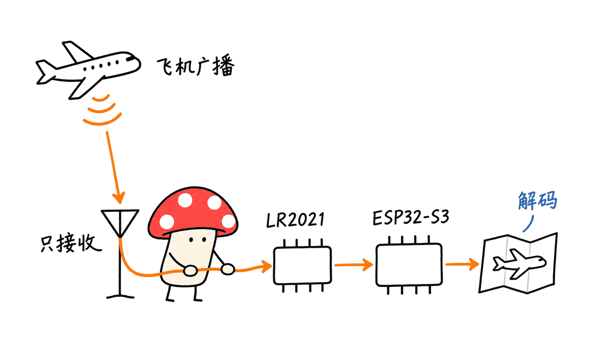

一块特定的ESP32 LoRa板，确实可以直接接收飞机的ADS-B广播，并在本地网页显示航迹。但这个项目依赖Meshnology W12与LR2021的实验性带外接收，远距离效果还涉及射频滤波器改造，不能理解成“任意LoRa开发板都能刷成航空接收机”。

Hackaday于2026年11月1日报道了这套装置，报道作者是Zoe Skyforest，制作者是thefatmoop。项目固件采用GPL-3.0-or-later许可，本次核对的提交为`ab0f225b78ec2622b2cbe64f8601136c66a4aa29`，日期为11月3日。

原始报道：https://hackaday.com/2026/11/01/building-an-ads-b-receiver-for-less-than-you-think/
项目仓库：https://github.com/thefatmoop/esp32s3-lr2021-adsb-receiver

## 它是真接收，还是从航班网站拉数据？

这套装置属于真实无线电接收：天线接收到1090MHz信号，LR2021捕获脉冲数据，ESP32-S3完成校验和字段解析，再维护飞机状态表、提供网页及TCP输出。接收过程不需要云端航班API，也不必另接树莓派或USB SDR。

GNSS模块是可选配件，主要让接收机知道自己的位置，便于显示距离、方位和地图跟随。代码中的空中位置解码采用成对的全局CPR报文，不是依靠本机GNSS去测量飞机坐标。

这与“ESP32连接Wi-Fi，再调用航班网站API”的桌面显示器不同；它也不是发射探测脉冲、根据回波测距的雷达。网页上出现飞机图标，是解析广播后绘图的结果。



## 飞机并没有使用LoRa，为什么LoRa芯片能帮忙？

“LoRa芯片”描述了LR2021的一项能力，不代表它只能处理LoRa调制。Semtech资料同时列出OOK等物理层模式，这个项目利用的是脉冲接收与解码能力，没有把飞机变成LoRa节点，也没有让它加入Meshtastic网络。

1090MHz Mode S下行使用脉冲位置调制PPM：每个数据位持续1微秒，脉冲出现在前半个还是后半个时间槽，用于区分0与1。每个半槽是0.5微秒。先把“有没有脉冲”读出来，就可以利用类似Manchester成对判决的结构继续解码。

`main/radio.c`将接收频率设为1090000000Hz，配置2 Mchip/s，并支持硬件Manchester路径；这对应每微秒两个半槽。硬件输出14字节报文后，S3继续校验CRC并解释内容。这里的Manchester配置是接收端实现手段，不能反过来把ADS-B空口称为LoRa协议。

调制与报文结构参考Junzi Sun的《The 1090 Megahertz Riddle》：
https://mode-s.org/1090mhz/content/introduction.html
芯片物理层能力：https://www.semtech.com/products/wireless-rf/lora-plus/lr2021
接收代码：https://github.com/thefatmoop/esp32s3-lr2021-adsb-receiver/blob/main/main/radio.c

## 最大的前提：1090MHz属于带外实验

仓库明确指出，1090MHz超出LR2021公布的接收频段，也超出W12前端原本面向的频段。本次能读取的Semtech v1.1数据手册列出了150–960MHz和1.5–2.5GHz两个频段，1090MHz处于中间空档；厂商产品页目前还提供更新版资料链接，不能把v1.1误称为最新版。

数据手册：https://www.mouser.com/pdfDocs/61979758LR2021_V1_1_datasheet.pdf

工程上必须区分三件事：软件允许填写一个频率、频率合成器能够调到那里，以及射频接收链在该频率具有得到保证的性能。前两项不自动证明第三项。项目通过了某块板子的实验，也不能推导出所有LR2021模组都有相同灵敏度。

`radio_range.h`中的宽频率检查范围只是固件逻辑，不是厂商的射频规格。实际接收还依赖输入路径、滤波、匹配、天线、增益和校准。正因为这些条件没有全部落在标称工作范围内，这个项目的定位应当是可研究的接收实验。

## 为什么要动板上的U12滤波器？

在作者记录的W12上，LF路径中的U12是B39921B2625P810 SAW滤波器，通带为902–928MHz。它原本用于保留目标频段、抑制其他信号，却也会衰减这次想接收的1090MHz广播。

作者为了获得较好的接收效果，移除了该器件并用短跳线跨接指定焊盘。这是实际拆焊，不是修改一个配置项。U12器件很小，文档还提醒实物方向与焊盘图的方向关系，必须对照板号、原理图与对应版本操作，不能凭“附近那个小零件”判断。

本文不把装配示意图当成焊点实拍。完整的器件定位、焊盘说明及接线方式以作者硬件文档为准：
https://github.com/thefatmoop/esp32s3-lr2021-adsb-receiver/blob/main/docs/HARDWARE.md

旁路带来的交换也很明确：1090MHz不再被原滤波器强烈压制，但其他带外强信号也可能更容易进入接收链，造成过载。若环境干扰较强，应对照实测考虑适合1090MHz的外部接收滤波，而不是把“拆掉滤波器”当成普遍的灵敏度升级方法。

不做U12改造时，作者也尝试了HF接口接收1090MHz，但报告的距离明显较短。它仍然是带外使用，不能据此认定HF口正式支持1090MHz。选择接口后，还必须同时匹配软件中的RF输入设置和天线连接。


## 150海里和不到50美元，应该怎样理解？

150海里换算为277.8公里。这个距离来自作者在改造后的LF路径、室内915MHz天线等特定条件下的观察，不是本文独立测得，也不是对新用户的覆盖保证。原仓库反而建议为正式搭建准备1090MHz、50欧姆的接收天线。

远处的高空飞机与低空飞机有不同的视距条件。天线高度、窗墙遮挡、同轴损耗、机场位置和干扰都会改变结果。一次看到最远目标，也不代表在那个半径内可以持续接收所有飞机，更不能直接换算成可靠覆盖面积。

Hackaday报道的“零件不到50美元”是报道中的成本口径，不是当前到手总价。采购时至少要核对W12、适配天线、射频转接线、USB数据线、可选GNSS、外壳，以及拆焊所需工具。已有工具与零件的人，和从零购买的人，成本结构不同。

这个方案的优势是把接收、解码和网页服务集中在一个小设备里。若已经有常开电脑，USB SDR路线也值得比较；若需要成熟接收性能、长期数据供给或精确时间戳，单凭板价无法决定哪种方案更合适。

## CRC、CPR和单比特修复各自负责什么？

`main/adsb.c`显示，当前主要接收DF17与部分DF18直接广播，执行CRC检查，解析呼号、速度、部分高度和空中位置。成对CPR位置报文还要通过时间与合理性条件，并不是收到任意一包就能得到完整航迹。

CRC用于检查报文一致性，不是身份认证。两个含义不同的数字也应分开统计：未经修复便通过校验的干净报文，以及经过单比特修复后被接受的报文。把两者混合，会让灵敏度与错误恢复的贡献难以比较。

修复逻辑相当保守：不改前32位，在后80位寻找候选；依赖已经被干净报文建立的飞机状态，并检查位置、速度等合理性。当前版本没有实现双比特修复，也不能从任意碰撞信号中恢复正确报文。

发布文档默认采用`Observe`模式，记录符合条件的候选修复而不转发；切到`Apply`才会接受并输出修复结果。验证接收链时，建议先看干净CRC报文，再单独评估开启修复后的收益和异常，避免把“看起来多收了”当成改造一定有效。

解码与恢复代码：
https://github.com/thefatmoop/esp32s3-lr2021-adsb-receiver/blob/main/main/adsb.c

## 地图在动，是否就代表刚收到飞机信号？

不一定。界面按2Hz更新本地数据，并使用约3秒位置缓冲。失联后，图标可以根据已知速度和方向短时外推：按高度区间，最长约5、10或30秒。预测只改变显示，不会产生新的无线电观测。

判断链路时应查看最后收到报文的时间、最后有效位置时间、干净报文率和失联标记。平滑的图标运动与真实接收能力是不同指标。作者还明确说明，高度是飞机报告的高度，不是离地高度。

底图也有范围边界：随固件提供的是美国离线地图，包含阿拉斯加和夏威夷，不是全球离线地图。其他地区的使用者需要确认在线底图或自行准备适用的地图数据；这项限制与1090MHz接收本身是两回事。

## 需要哪些硬件，怎样开始复现？

| 项目 | 需要确认的条件 |
|---|---|
| 开发板 | Meshnology W12，ESP32-S3与LR2021组合，16MB闪存；不是任意SX1262板 |
| 射频连接 | 匹配板上接口、转接线和1090MHz天线；区分LF、HF与Wi-Fi接口 |
| LF改造 | 对照当前板版和原理图核实U12，不具备微小器件返修条件时先别拆焊 |
| 供电与刷写 | USB-C数据线和稳定供电；仅充电线不能刷固件 |
| GNSS | 可选，用于接收机自身定位，并非无线电接收的必需条件 |
| 计算机 | 用于下载、编译或刷写；运行后可用同一局域网的浏览器查看 |

源码构建采用PlatformIO和ESP-IDF，固定的环境名是`w12_stable`：

```bash
python -m pip install platformio
pio run -e w12_stable
```

命令应在项目根目录执行，首次构建需要下载平台和工具链。本次没有执行完整固件构建，不能把本机软件测试说成已经编译并刷入W12。

也可以按发布页与安装文档使用现成镜像。首次安装的擦除/工厂镜像与保留设置的应用升级地址不同；要先确认自己的目的，不能把更新步骤当成首次安装照抄。

安装文档：https://github.com/thefatmoop/esp32s3-lr2021-adsb-receiver/blob/main/docs/INSTALL.md
发布页：https://github.com/thefatmoop/esp32s3-lr2021-adsb-receiver/releases

设备提供配网热点，之后连接自己的2.4GHz Wi-Fi，在局域网通过OLED显示的IP访问。网页与默认30005端口的Beast输出面向本地网络，没有提供可直接用于公网托管的认证边界。在线地图、飞机照片等可选功能需要联网，离线接收不等于所有界面功能都离线。

## 代码验证通过了什么，又没证明什么？

本次在上述固定提交上，实际执行了作者文档列出的六组原生检查，四组使用C11编译器，另两组使用Python及Node运行。

| 检查组 | 本次结果与覆盖范围 |
|---|---|
| ADS-B解码 | 通过；CRC、脉冲对、呼号、高度、速度及全局CPR |
| 单比特恢复 | 通过；覆盖参考报文的112个单比特扰动、6216个双比特组合及恢复保护条件 |
| Wi-Fi策略 | 通过；十分钟配网期限、长运行时间及状态条件 |
| 数据流 | 通过；Beast转义、软件时间戳与浏览器航迹兼容性 |
| Web序列化 | 通过；96架飞机、空表、缺失字段、分块与发送失败 |
| 浏览器轮询 | 通过；临时错误、断线、串行请求、2Hz节奏与有界退避 |

这些是程序逻辑与合成输入检查。测试中的“112个扰动”包含应拒绝的情况，不能理解为报文任意位置都可以纠正。没有W12实物参与，没有刷写、功耗测试、信号源校准、灵敏度测量或278公里接收实验。


若要进一步评估硬件，Mycelium Protocol建议在相近时间、同一位置，用对照接收机记录干净报文率、位置更新率、丢包和失联情况。比较改造前后时尽量固定天线与馈线；共享天线需计入分配损耗，使用两副天线也要说明它们并不完全等效。

距离最大值可以记录，但应同时记录飞机高度和接收条件；没有校准信号源，就不要把观察结果写成灵敏度或噪声系数。也不应把显示外推的时间戳当成新报文时间。

## 常见问题

### 普通ESP32加一块LoRa模块就行吗？

不能这样概括。当前固件针对W12的ESP32-S3、LR2021、射频路径和引脚，其他板卡是否具备所需物理层能力与带外接收效果，需要重新验证。

### 它能替代完整ADS-B接收站吗？

取决于需求。当前没有978MHz UAT和地面位置解码；TCP时间戳由软件产生，不适合精确MLAT。它是有研究价值的业余接收项目，不能将其航迹显示当作飞行安全依据。

### 最值得学习的地方是什么？

不是“LoRa也能收一切”，而是把特定射频芯片、前端改造、硬件解码与微控制器软件组合起来，并公开了限制和测试。它展示了规格之外的实验空间，也说明可运行与可保证性能之间仍有距离。

原作者实物照片用作本文封面，屏显是拍摄时状态，不是本次测试数据。作者致谢ADSBee、LakeShark等上游工作；这是独立实验项目，不是Semtech或Meshnology的官方1090MHz产品。代码、地图及相关贡献见：
https://github.com/thefatmoop/esp32s3-lr2021-adsb-receiver/blob/main/THIRD_PARTY.md

---

> © 2026 Author: Mycelium Protocol. 本文采用 [CC BY 4.0](https://creativecommons.org/licenses/by/4.0/deed.zh) 授权——欢迎转载和引用，须注明作者姓名及原文链接，不得去除署名后以原创发布。项目代码与原作者图片分别适用其自身许可。

<!--EN-->

A specific ESP32 LoRa board can receive aircraft ADS-B broadcasts directly and display decoded tracks in a local browser. The project depends on a Meshnology W12 and experimental out-of-band use of its LR2021 radio. The longer-range setup also involves RF filter rework. It does not establish that any LoRa development board can become an aviation receiver through firmware alone.

Hackaday covered the build on November 1, 2026. Zoe Skyforest wrote the report; thefatmoop built the receiver. The firmware is GPL-3.0-or-later. This review pins commit `ab0f225b78ec2622b2cbe64f8601136c66a4aa29`, checked November 3.

Original report: https://hackaday.com/2026/11/01/building-an-ads-b-receiver-for-less-than-you-think/
Repository: https://github.com/thefatmoop/esp32s3-lr2021-adsb-receiver

## Is it receiving RF or downloading aircraft data?

It receives RF. An antenna feeds 1090MHz signals to the LR2021, which captures the pulse data. The ESP32-S3 validates and interprets messages, maintains aircraft state, and serves web and TCP output. Reception does not require a cloud flight-data feed, Raspberry Pi or USB SDR.

An optional GNSS module supplies the receiver's location for relative distances and map following. The airborne position decoder uses paired global CPR messages; receiver GNSS is not how it measures aircraft coordinates.

This differs from an ESP32 display that retrieves tracks over Wi-Fi. It is also not an active radar measuring echoes. Aircraft icons are generated from decoded broadcasts.


## Why can a LoRa-capable radio help decode ADS-B?

LoRa is one capability of the LR2021, not its only physical layer. Semtech also lists OOK support. The project uses pulse reception and decoding rather than LoRa packets or a Meshtastic network.

1090MHz Mode S downlink uses pulse-position modulation. One bit occupies one microsecond, with a pulse in either the first or second half-microsecond slot. Converting pulse presence into paired symbols allows a Manchester-style decoder to recover the bit pattern.

In `main/radio.c`, the project selects 1090000000Hz and 2 Mchip/s, matching two half-slots per bit. Its hardware-Manchester path supplies 14 decoded bytes before software CRC checks and field interpretation. A receiver implementation setting should not be confused with the aircraft's over-the-air protocol.

Protocol reference, Junzi Sun's The 1090 Megahertz Riddle:
https://mode-s.org/1090mhz/content/introduction.html
Radio capabilities: https://www.semtech.com/products/wireless-rf/lora-plus/lr2021
Implementation: https://github.com/thefatmoop/esp32s3-lr2021-adsb-receiver/blob/main/main/radio.c

## Why is out-of-band operation the central caveat?

The project explicitly states that 1090MHz lies outside published LR2021 receive bands and the intended W12 front-end bands. The accessible Semtech v1.1 datasheet lists 150–960MHz and 1.5–2.5GHz bands, leaving 1090MHz in the gap. Semtech currently links newer documentation as well; v1.1 is not presented here as the latest revision.

Datasheet: https://www.mouser.com/pdfDocs/61979758LR2021_V1_1_datasheet.pdf

Software accepting a frequency, a synthesizer tuning to it, and an RF receive chain meeting guaranteed specifications there are different claims. The firmware's broad frequency validation in `radio_range.h` is not a manufacturer RF specification.

Input matching, filters, antenna, gain and calibration still matter. A successful experiment on one modified board cannot establish equal sensitivity across every module using the same chip. That makes this an interesting receiver experiment rather than a guaranteed replacement for a purpose-built front end.

## What does bypassing U12 change?

The documented LF path includes a B39921B2625P810 SAW filter with a 902–928MHz passband. It attenuates the desired 1090MHz signal. The author's better-performing arrangement removes this component and bridges the designated pads.

This is physical RF rework, not a firmware option. Component identification, pad orientation and board revision must match the hardware guide. The repository's assembly illustrations are not microscope photographs of solder joints.

Hardware guide:
https://github.com/thefatmoop/esp32s3-lr2021-adsb-receiver/blob/main/docs/HARDWARE.md

Bypassing the filter also admits signals that it previously rejected. Strong interferers can overload reception, so removing filtering is not a general sensitivity upgrade. An appropriate external 1090MHz receive filter may be useful in an interference-heavy environment, subject to measurement.

The author also received 1090MHz through the unmodified HF connector, with substantially less range in those tests. That does not make the HF path officially specified for 1090MHz. The selected RF input and physical antenna connection must agree.


## What do 150 nautical miles and under $50 establish?

The reported 150NM equals 277.8km. It is the author's observation using the modified LF arrangement and an indoor 915MHz antenna, not a range measurement made for this review. The current project recommends a suitable 1090MHz, 50-ohm antenna for a build.

Aircraft altitude, antenna height, walls, cable loss and interference affect line of sight and reception. Detecting one distant aircraft does not establish reliable coverage of every aircraft inside that radius.

Hackaday's under-$50 parts statement is a reported build-cost claim, not a current delivered-price quote. Account for the W12, antenna, RF adapters, USB data cable, optional GNSS and enclosure, as well as rework tools. Reusing equipment produces a different budget from buying everything anew.

Its attraction is integrating reception, decoding and the user interface in a compact device. A USB SDR can remain worth comparing when a computer is already running. Applications needing established RF performance or precise timestamps require more than a board-price comparison.

## What do CRC, CPR and correction contribute?

The checked decoder primarily accepts DF17 and selected directly broadcast DF18 messages, validates CRCs and interprets callsign, velocity, supported altitude encodings and airborne position. Paired CPR messages must meet timing and plausibility conditions; one arbitrary packet does not supply a complete track.

CRC is a consistency check, not source authentication. Keep clean CRC-valid messages separate from accepted repaired messages when comparing setups. Otherwise an RF improvement and a correction-policy change can look like the same gain.

Correction leaves the first 32 bits untouched and searches the remaining 80 bits for a candidate. It depends on aircraft state established by clean messages and checks plausible field changes. It does not implement two-bit recovery or reconstruct arbitrary overlapping transmissions.

The release defaults to `Observe`, which counts eligible repairs without forwarding them. `Apply` accepts and outputs eligible recoveries. Establish clean reception first, then evaluate recovery separately.

Decoder source:
https://github.com/thefatmoop/esp32s3-lr2021-adsb-receiver/blob/main/main/adsb.c

## Does a moving map icon prove a fresh observation?

No. Local data updates at 2Hz and the display uses a roughly three-second position buffer. After contact is lost, bounded extrapolation can move an icon for approximately five, ten or thirty seconds depending on altitude. Display prediction creates no new RF observation.

Check message age, last valid position age, clean-message rate and stale indicators. Smooth animation and receiver performance are separate measurements. Reported altitude is also not height above terrain.

The bundled offline basemap covers the USA, including Alaska and Hawaii. It is not a worldwide offline map. Readers elsewhere need suitable online tiles or replacement map data; that is separate from the receiver's RF operation.

## What is needed to reproduce the build?

| Item | Requirement to confirm |
|---|---|
| Board | Meshnology W12, ESP32-S3 plus LR2021, 16MB flash; not an interchangeable SX1262 board |
| RF connection | Correct connector, adapter and 1090MHz antenna; distinguish LF, HF and Wi-Fi paths |
| LF rework | Confirm U12 and the physical board revision against the schematic |
| Power and flashing | Stable power and a USB data cable |
| GNSS | Optional receiver positioning, not required for RF reception |
| Computer | Download, build or flash firmware; a LAN browser can view the running unit |

The documented source build uses PlatformIO and ESP-IDF:

```bash
python -m pip install platformio
pio run -e w12_stable
```

Run from the repository root. The initial build downloads its pinned platform and toolchain. This review did not perform a full firmware build or flash a board.

Prebuilt releases provide another route. First-install erase/factory-image instructions differ from an application-only update intended to preserve settings. Follow the path that matches the device state.

Installation: https://github.com/thefatmoop/esp32s3-lr2021-adsb-receiver/blob/main/docs/INSTALL.md
Releases: https://github.com/thefatmoop/esp32s3-lr2021-adsb-receiver/releases

After provisioning, the device joins a 2.4GHz Wi-Fi network and exposes its local IP on the OLED. The web interface and default Beast port 30005 are designed for a trusted LAN, without a public-hosting authentication boundary. Optional street tiles and aircraft photos require internet even though local reception does not.

## What was actually checked?

Six upstream native-check groups ran successfully on the pinned commit. Four used a C11 compiler; the remaining groups used Python and Node.

| Group | Observed passing coverage |
|---|---|
| Decoder | CRC, pulse pairs, identity, altitude, velocity and global CPR |
| Recovery | 112 single-bit perturbations, 6216 two-bit combinations on a reference frame, and safeguards |
| Wi-Fi policy | Ten-minute deadline, long uptime and connection/AP guards |
| Streams | Beast escaping, software timestamps and browser trail compatibility |
| Web serialization | 96 aircraft, empty state, missing fields, chunking and send failure |
| Browser polling | Transient errors, outages, serialized requests, 2Hz cadence and bounded backoff |

These are synthetic-input and program-logic checks. The single-bit perturbation set includes cases that must be rejected; it does not mean every bit can be repaired. No W12 hardware, flashing, power test, calibrated RF source, sensitivity measurement or long-distance reception test was involved.


For hardware evaluation, Mycelium Protocol recommends comparing clean-message rate, valid-position updates and dropouts with a reference receiver under similar conditions. Keep the antenna and cable fixed when comparing a modification; shared antennas add splitter loss, while separate antennas introduce their own differences.

Record aircraft altitude and setup conditions alongside maximum distance. Without a calibrated source, do not describe an observation as a sensitivity or noise-figure measurement. Do not count display extrapolation as a new reception timestamp.

## FAQ

### Will any ESP32 plus LoRa module work?

No. The firmware targets the W12's ESP32-S3, LR2021, RF paths and pin mapping. A different board requires separate validation of physical-layer features and out-of-band behavior.

### Can it replace a complete ADS-B ground station?

That depends on the requirement. The current project lacks 978MHz UAT and surface-position decoding. Software-derived TCP timestamps are unsuitable for precision MLAT. Treat it as an experimental hobby receiver, not a source for flight-safety decisions.

### What makes the project worth studying?

It combines a particular radio, front-end rework, hardware decoding and microcontroller software while documenting constraints and tests. The lesson is the distinction between an experiment working and RF performance being guaranteed, rather than a claim that LoRa can receive everything.

The cover uses the author's public hardware photograph; its screen readings are not measurements from this review. The project credits ADSBee, LakeShark and other upstream work. It is an independent experiment, not an official Semtech or Meshnology 1090MHz product. Code, map and upstream credits:
https://github.com/thefatmoop/esp32s3-lr2021-adsb-receiver/blob/main/THIRD_PARTY.md

---

> © 2026 Author: Mycelium Protocol. Licensed under [CC BY 4.0](https://creativecommons.org/licenses/by/4.0/) — free to share and adapt with attribution. You must credit the author and link to the original; removing attribution and republishing as original is not permitted. Project code and the original hardware photograph retain their respective licenses.
