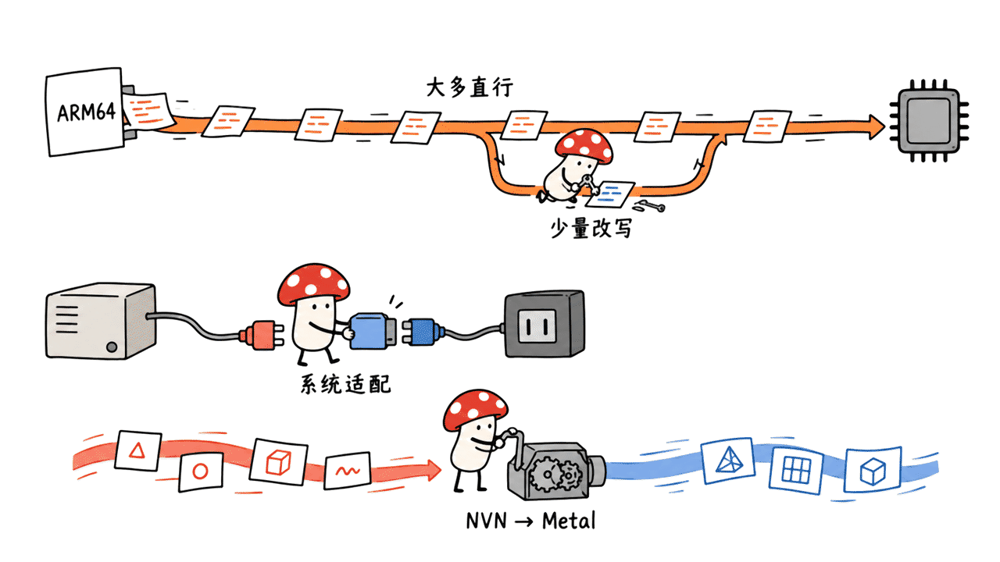

MacNativeGames 是一个面向 Apple Silicon Mac 的《塞尔达传说：王国之泪》运行与打包项目。它利用 Switch 与 Apple 芯片同属 ARM64 的条件，让大量游戏 CPU 指令直接执行，同时适配系统服务并把图形命令翻译到 Metal 4。用户仍需自备游戏文件、密钥及必要字体；仓库并不附带游戏。

截至 2026-10-18，项目只支持 Mac，且针对特定游戏版本。作者报告了 M4 设备上缓存预热后的帧率观察，本文只完成源码和合成数据测试，没有安装或运行游戏，不将这些观察写成本机性能结论。

项目：https://github.com/ly05010419/MacNativeGames

## “原生运行”具体是什么意思？

把它理解成三层更准确：CPU 指令复用、系统服务适配、GPU 图形翻译。共享 ARM64 指令集提供了机会，但不代表 Switch 可执行文件能直接交给 macOS 启动。

第一层，构建阶段改写 macOS 不允许按原方式使用的部分指令，例如 x18 平台寄存器、线程指针、系统调用与计数器访问。加载器再按原布局映射改写后的模块，处理模块之间的引用，进入游戏启动函数。大部分 CPU 指令不用经过通用 CPU 模拟器逐条解释，是项目“原生”表述的重点。

第二层，宿主实现游戏使用的 Horizon 系统服务：线程与同步、内存、文件系统、账户、输入、音频以及视频解码等。源码也有针对帧时序、输出分辨率等的固定补丁，不能简单称为完全不改游戏。

第三层，NVN 图形命令被映射为 Metal 4 资源、渲染通道和绘制操作。Maxwell 着色器则经 Ryujinx 翻译器转成 SPIR-V，再由 SPIRV-Cross 转成 Metal 着色语言，随后编译与缓存。因此，“CPU 代码大量直接执行”和“图形没有翻译”是两回事。



## 现在支持哪些设备、输入和版本？

| 项目 | 当前公开要求或边界 |
|---|---|
| 平台 | Apple Silicon Mac，macOS 26 或更新，使用 Metal 4 |
| 内存 | 作者建议至少16GB；不是本文验证的最低配置 |
| 游戏 | 《王国之泪》本体1.0.0，标题ID `0100F2C0115B6000` |
| 输入 | 用户自备XCI或NSP与 `prod.keys`；NSP还涉及共享字体来源 |
| 更新 | 本体加独立累计1.1.2更新NSP；不要求先叠加1.1.0 |
| 暂不支持 | 1.4.3可识别与校验，但运行时代码适配未完成；DLC、合并包等也有限制 |
| 移动平台 | iPhone/iPad在README中属于计划，当前没有可用的iOS构建选项 |

这一范围不是“任意 Switch 游戏在 Mac 上运行”。项目继承了 d2r-mobile 的部分通用组件，但《王国之泪》的地址表、数据覆盖与补丁仍按版本配置。另一个版本能被识别，不等于已经能打包游玩。

磁盘也要提前算清：README建议本体构建除游戏文件外，再留约25GB工作空间；输出应用与数据在同一APFS卷上可用克隆减少重复占用，跨卷时还可能增加约17GB副本。新建本体加更新的构建建议约60GB，已有本体缓存也需约35GB额外空间。这些是作者的容量建议，会随缓存和存储布局变化。

## 能照着README直接操作吗？

标准路径需要 Xcode 命令行工具、Homebrew、Python 3.14、opus 与 libvpx。以下是整理自上游、本文没有执行完整打包的示例；应在检出项目目录后运行，并使用自己的路径。

```bash
brew install opus libvpx python@3.14
python3.14 build_app.py /path/to/totk.xci -k /path/to/prod.keys
```

本体为NSP时，按文档提供解包后的固件NCA目录，或已提取且哈希匹配的共享字体目录。例如：

```bash
python3.14 build_app.py /path/to/totk.nsp \
  -k /path/to/prod.keys --firmware /path/to/firmware-nca-directory
```

仓库不替用户下载游戏、密钥或字体。MIT适用于项目代码，第三方组件保留各自许可证；游戏资产和用户输入不因代码开源而改变授权状态。

本次固定源码为 `b75994fb305d883004361e277f555596f286331e`。README写到了NSZ更新包，但当前 `--help` 将更新描述为NSP，导入实现中也未发现NCZ解压路径，技术文档另列出NSZ/XCZ不支持。文件扩展名本身不能证明内容受支持，所以本文只给出未压缩NSP更新的起步建议，不承诺压缩更新包可用。

如果构建1.1.2，需要退出当前游戏，再用同一输出路径和 `--update /path/to/1.1.2.nsp` 重建。最终仍是一个应用、一套选定版本的数据，没有版本切换菜单；不要把重建理解成两套版本同时安装。

## 为什么“预热后90FPS”不能直接当作选购依据？

作者称在 MacBook Air M4 与 Mac mini M4 上做过本地测试，收集到8,582个着色器，预热后约90FPS、菜单最高120FPS。该数量是当时已收集的缓存条目，不是游戏着色器总数，也不是收集上限。

这里缺少足以复现整套性能测试的统一场景、持续时间、画质、帧生成状态与分位帧时间。项目提供 MetalFX 和补帧切换，因此不同设置下显示的FPS也不能直接当作相同工作量的原始渲染帧率。README同时说明，全地图、长时间游玩以及1.0.0与1.1.2的公平性能对比仍待完成。

可采用的结论是：缓存复用有望减少重复编译；新场景遇到未见着色器时仍可能卡顿。不能推出所有M系列设备都能稳定90FPS，也不能把菜单帧率当作复杂场景帧率。


## 缓存、存档与更新为什么要分开管理？

存档位于 `~/Library/Application Support/MacNativeGames/TOTK/profile`；着色器缓存位于同级的 `shader-cache`；日志在 `~/Library/Logs/MacNativeGames`。三者用途不同，清理缓存会导致重新翻译着色器，不应连同存档一起处理。

项目启动时会预热兼容的流水线清单，游玩还会追加本地收集记录。作者说明，可分享的 `pso_collected.tsv` 存放着色器和流水线标识，不是存档或编译后的着色器二进制，且清单与翻译链版本有关。它并不能替另一台机器省掉所有编译工作。

首次启动1.1.2前，项目设计为先建立完整的 `profile-before-1.1.2` 备份，备份失败则停止启动。回退旧版时不要假定新版存档向下兼容。Mycelium Protocol 建议将应用重建、缓存失效和存档迁移视为三个独立步骤，各自保留可恢复的输入与证据。


## 我们实际验证了什么？

我们通过Jina Reader抓取仓库正文，并与固定提交的README、技术文档、CLI和源码交叉核对。本机没有找到指定的 `agent-reach` skill或命令，因此没有声称运行过其doctor。

独立环境使用Python 3.14.8，按仓库固定依赖安装 cryptography、lz4、capstone，然后运行原有测试：

```bash
python -m unittest discover -s /path/to/MacNativeGames/tests -v
```

16项全部通过。覆盖范围包括合成容器、票据解析、更新版本拒绝、临时票据处理与清理、仅包含选定版本的打包逻辑。这些测试使用人工生成的加密样例，不能证明零售游戏包兼容、真实更新合并正确、GPU渲染或游戏体验达标。

作者另外描述了真实设备与本地打包检查，其中部分日志留在作者机器上。本文没有获取这些私有日志，也没有取得游戏文件或真实密钥、执行预编译翻译器、完整构建应用、打开游戏或测量FPS。构建流程结束的启动器 `--check` 也只是包与可执行文件检查，不是自动游玩测试。

目前它更适合作为一项很具体的兼容层工程研究：展示如何复用同架构CPU代码，把操作系统与图形接口逐层补齐。是否适合实际游玩，还需要在相应版本、设备、场景和输入来源上另做验证。

## 常见问题

### 它能运行所有Switch游戏吗？

当前只针对《王国之泪》及列出的版本。不能从项目名称或共享指令集推断通用兼容性。

### iPhone和iPad现在能安装吗？

当前输出仅为macOS应用。README中的移动支持是计划，不是已发布功能。

### 测试通过就表示我能稳定90FPS吗？

16项本地测试验证合成数据上的导入和更新逻辑；90FPS是作者特定设备与预热条件下的观察。两种证据不能互相替代。

## 一手资料

仓库：https://github.com/ly05010419/MacNativeGames

固定版本源码：https://github.com/ly05010419/MacNativeGames/tree/b75994fb305d883004361e277f555596f286331e

技术说明：https://github.com/ly05010419/MacNativeGames/blob/b75994fb305d883004361e277f555596f286331e/docs/how-it-works.md

第三方许可：https://github.com/ly05010419/MacNativeGames/blob/b75994fb305d883004361e277f555596f286331e/THIRD_PARTY_NOTICES.md

相关原生运行研究：https://blog.mushroom.cv/blog/d2r-mobile-build-ios-macos/

封面为本地生成的主题场景，不是游戏截图或性能实测画面；正文小M图为概念示意。

---

> © 2026 Author: Mycelium Protocol. 本文采用 [CC BY 4.0](https://creativecommons.org/licenses/by/4.0/deed.zh) 授权——欢迎转载和引用，须注明作者姓名及原文链接，不得去除署名后以原创发布。

<!--EN-->

MacNativeGames packages a user's own The Legend of Zelda: Tears of the Kingdom files into an Apple silicon Mac app. It reuses the shared ARM64 instruction set, adapts operating-system services and translates graphics to Metal 4. The repository contains no game files and requires user-supplied inputs.

This review captures the project on October 18, 2026. Current support is Mac-only and version-specific. We inspected source and ran synthetic-data tests; we did not install or play the game or measure frame rates.

## What does native execution mean here?

Three layers matter. Most game CPU instructions run directly, while ahead-of-time rewriting handles operations that macOS cannot accept unchanged, including x18, thread-pointer access, system calls and counters. A loader maps the rewritten modules and starts the game.

A host supplies the Horizon services used by the game: memory, threading, files, input, audio and other interfaces. Fixed patches also modify timing and output behavior. This is not an unchanged Switch executable launched directly by macOS.

The NVN layer maps graphics resources and commands onto Metal 4. Maxwell shaders pass through the Ryujinx translator to SPIR-V, SPIRV-Cross to Metal Shading Language, and native compilation and caching. Direct CPU execution does not eliminate graphics translation.


## What hardware and versions are supported?

| Item | Published requirement or boundary |
|---|---|
| Platform | Apple silicon Mac, macOS 26 or later, Metal 4 |
| Memory | Author recommends at least 16GB; not our validated minimum |
| Base game | Tears of the Kingdom 1.0.0, title ID `0100F2C0115B6000` |
| Input | User-supplied XCI/NSP and keys; NSP also needs an appropriate shared-font source |
| Update | Separate cumulative 1.1.2 NSP over the base game |
| Other versions | 1.4.3 can be recognized and checked, but runtime rewrites/address tables are not supported |
| Mobile | iPhone/iPad support is planned, with no current iOS packaging option |

This is not universal Switch compatibility. Shared components originate partly from d2r-mobile, but game-specific patches, resource overlays and addresses remain version-dependent.

For a base build, the README recommends about 25GB of workspace beyond the game file. Same-volume APFS clones reduce duplication; another volume can require roughly 17GB more. A fresh update build calls for about 60GB free, or 35GB extra with base data cached. These are author recommendations, not measured storage guarantees.

## How does the documented setup work?

The build needs Xcode command-line tools, Homebrew, Python 3.14, opus and libvpx. The following upstream-style commands were not used to build a game here:

```bash
brew install opus libvpx python@3.14
python3.14 build_app.py /path/to/totk.xci -k /path/to/prod.keys
```

NSP inputs need shared fonts from a documented firmware directory or previously extracted verified font files:

```bash
python3.14 build_app.py /path/to/totk.nsp \
  -k /path/to/prod.keys --firmware /path/to/firmware-nca-directory
```

The project does not download game files, keys or fonts. Its MIT license applies to project code; third-party notices and game assets remain separate.

We reviewed revision `b75994fb305d883004361e277f555596f286331e`. The README mentions NSZ updates, but the current CLI describes NSP, the importer has no verified NCZ decompression path, and the technical document lists NSZ/XCZ as unsupported. A filename extension does not establish content support. We therefore present an uncompressed NSP update path without claiming compressed-update compatibility.

For version 1.1.2, quit the game and rebuild at the same output path with `--update /path/to/1.1.2.nsp`. The resulting app contains one selected version; there is no built-in version-switching menu.

## How should the reported 90 FPS be interpreted?

The author reports testing on MacBook Air M4 and Mac mini M4, collecting 8,582 shaders and observing about 90 FPS after cache warm-up and up to 120 FPS in menus. The shader count is a collected subset, not the game's total or a collection ceiling.

Those observations do not supply a controlled cross-device benchmark with fixed scenes, duration, quality settings, frame-generation status and frame-time percentiles. MetalFX and frame interpolation options also mean displayed FPS may represent different workloads. The README explicitly leaves full-map, long-session and fair 1.0.0-versus-1.1.2 comparisons unfinished.

Caching can reduce repeated compilation, while previously unseen shaders can still cause stutters. Neither menu FPS nor a warmed scene guarantees the same rate throughout the game or on other M-series devices.


## Why separate saves, caches and upgrades?

Saves live under `~/Library/Application Support/MacNativeGames/TOTK/profile`, shader caches under the neighboring `shader-cache`, and logs under `~/Library/Logs/MacNativeGames`. Deleting caches causes retranslation and should not involve deleting saves.

Startup prewarms compatible pipeline entries. The shareable `pso_collected.tsv` records identifiers rather than saves or compiled shader binaries and is tied to the translation-chain version. It cannot remove every compilation task on another machine.

Before the first 1.1.2 launch, the project creates a complete `profile-before-1.1.2` backup and stops if backup fails. Do not assume newer saves are backward-compatible. Mycelium Protocol recommends treating application rebuilding, cache invalidation and save migration as separate recoverable operations.


## What did we verify?

We fetched the repository through Jina Reader and cross-checked pinned documentation, source and CLI output. The requested agent-reach skill and command were unavailable locally; no doctor run is claimed.

In an isolated Python 3.14.8 environment, we installed the pinned cryptography, lz4 and capstone dependencies and ran the upstream tests:

```bash
python -m unittest discover -s /path/to/MacNativeGames/tests -v
```

All 16 tests passed. They cover generated containers, ticket parsing, rejected updates, private temporary-ticket handling and selected-version packaging logic. Synthetic encrypted fixtures do not establish retail-package compatibility, real update cryptography, GPU rendering or gameplay quality.

The author describes additional device and packaging checks, with some logs remaining local to the author. We did not inspect those private logs. We used no game image or real keys, executed no prebuilt translator, built no full app, and performed no gameplay or FPS test. The launcher's `--check` verifies package/executable conditions, not a playthrough.

The project is a focused compatibility-engineering experiment: reuse same-architecture CPU code while adapting system and graphics interfaces. Practical gameplay acceptance still depends on the exact version, hardware, scenes and inputs.

## FAQ

### Does it run every Switch game?

Current support targets Tears of the Kingdom and the listed versions. The repository name and shared ARM64 architecture do not establish universal compatibility.

### Can iPhone and iPad users install it now?

The current output is a macOS app. Mobile support is a plan, not an available build mode.

### Do passing tests establish stable 90 FPS?

No. Our 16 tests exercise synthetic-data importer/update logic. The frame-rate observations come from the author's device and cache conditions.

## Primary sources

Repository: https://github.com/ly05010419/MacNativeGames

Pinned source: https://github.com/ly05010419/MacNativeGames/tree/b75994fb305d883004361e277f555596f286331e

Technical notes: https://github.com/ly05010419/MacNativeGames/blob/b75994fb305d883004361e277f555596f286331e/docs/how-it-works.md

Third-party notices: https://github.com/ly05010419/MacNativeGames/blob/b75994fb305d883004361e277f555596f286331e/THIRD_PARTY_NOTICES.md

Related native-execution research: https://blog.mushroom.cv/blog/d2r-mobile-build-ios-macos/

The cover is a locally generated thematic scene, not a game screenshot or benchmark capture. XiaoM body figures are conceptual.

---

> © 2026 Author: Mycelium Protocol. Licensed under [CC BY 4.0](https://creativecommons.org/licenses/by/4.0/) — free to share and adapt with attribution. You must credit the author and link to the original; removing attribution and republishing as original is not permitted.
