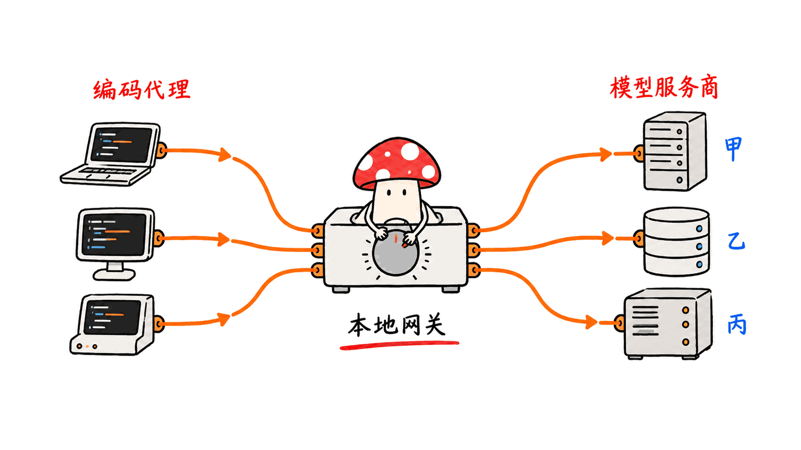
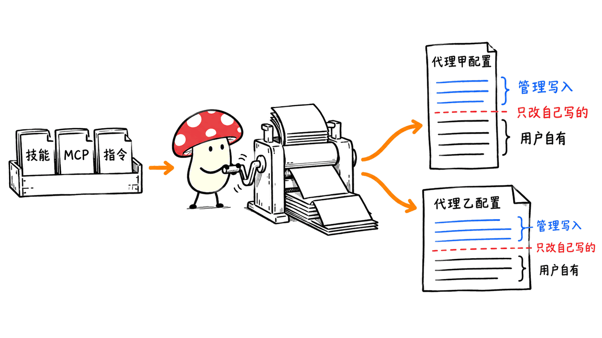
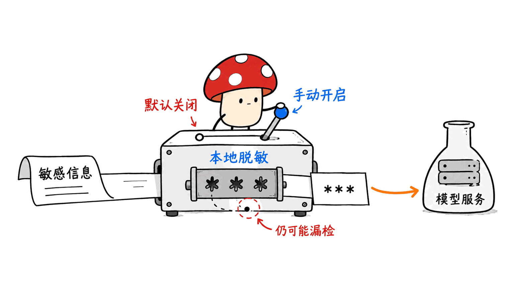

Magpie 是一个管理多款编程助手、模型供应商和共享配置的本地工具：让你少改几份配置，知道请求去了哪里、费用算给谁，并在可用账号耗尽时按规则切换。它适合已经在 Claude Code、Codex、Pi 等工具之间来回切换的人。

这次找到的项目是 yetone/magpie，MIT 许可。它不是 Apache 的同名项目，也不是一个自动替所有 Agent 分配任务、合并代码和传递记忆的协作框架。本文依据 2026-10-27 获取的官方 README 与子系统文档分析，未连接个人订阅、未修改本机 Agent 配置，也没有做端到端兼容性实测。

源码：https://github.com/yetone/magpie
官网与安装入口：https://usemagpie.ai
本文原文：https://blog.mushroom.cv/blog/magpie-multi-agent-model-gateway/

## 为什么工具越多，配置反而成了负担？

一个 Agent 用 Anthropic Messages，另一个用 OpenAI Responses；有 API Key，也有订阅账号和本地模型。每个工具还有各自的模型名、配置路径、技能目录、MCP 格式。真正麻烦的不是再接一个模型，而是改变之后能否知道影响了谁。

Magpie 把问题拆成两部分：请求走本地网关，配置由管理界面写回各 Agent 的原生文件。官方默认网关为 `127.0.0.1:3425`，支持 OpenAI Chat、Responses、Anthropic Messages 和 Gemini 协议转换，包含流式输出、工具调用和推理字段的适配。



这意味着“同一个编程助手可以换模型”，但不意味着换过去后每项能力都等价。工具参数、推理签名、上下文长度、图片输入和错误恢复，仍取决于具体上游与客户端。建议先用一个非关键项目验证：普通问答、一次读文件工具调用、一次写文件与测试、一次中断恢复。

## 账号切换、路由组和会话，各解决什么？

路由组把多个 `provider/model` 暴露成一个名字。官方给出五种策略：

| 策略 | 官方定义 | 选择时要注意 |
|---|---|---|
| smart | 在有额度的订阅中优先选择更早续期的账号 | 目标是利用额度，不等于自动挑最强模型 |
| order | 当前成员不能回答时使用下一个 | 需要预先排好故障转移顺序 |
| rotate | 按轮次轮换成员 | 要观察跨模型回答的一致性 |
| usage | 优先使用用量较少的成员 | 分摊使用量不等于最低现金账单 |
| pace | 按距离周额度重置的剩余时间分配 | 依赖上游额度信息可用 |

README 说明会尽量保持对话与已有账号的黏性，利用上游提示缓存；意图路由则可另选一个小模型分析新一轮请求。后者多了一次模型调用，不能当成零成本分类器。

账号用尽后能否继续，取决于是否真的配了下一个账号或路由成员。只有一个账号、没有备选组，错误仍会返回给 Agent。跨供应商切换也可能改变价格、输出风格和数据处理位置。

Sessions 页面提供会话标题、成本与终端重开入口；Context 页面展示请求上下文与缓存构成。这些是可观测性功能。它们不能证明 Claude 的某个中间状态能无损迁移到另一种 Agent。

官方另有 Claude Code 项目迁移功能，针对“项目目录改名或移动”：需关闭客户端、预览路径与备份，再迁移既有项目记录。历史消息中的路径不自动改写，也不支持把两个项目的会话合并。把“目录迁移”“同客户端恢复”和“跨 Agent 交接”分开理解，才能避免误用。

## Library 会不会覆盖自己的 AGENTS.md 和技能？

Library 管理指令、MCP、技能、hooks 和 subagents，并针对不同客户端生成对应格式。官方子系统文档给出了比“统一管理”更关键的边界：记录上次写入的内容，只撤销自己管理的部分；指令使用标记区块；用户改过的 subagent 文件不再被视为可任意覆盖。



但支持模型接入，不一定支持这个客户端的所有资源类型。项目级 MCP、用户级 subagent 目录、hooks、WSL 路径都有差异。文档还明确指出，当前备份与同步携带的 Library 数据并不包含全部 hooks 和 subagents。不能把“一键同步”当成完整工作环境备份。

实用做法是保留一份项目内的工作规则作为事实源，再逐个启用共享资源。每加一项就检查原生文件 diff，并从 Agent 里调用一次实际工具。验收标准是目标客户端真的读到了正确配置，而不是管理页显示了一个开关。

## 本地网关就一定更安全吗？

默认监听本机减少了暴露面，但请求仍会发送给所选上游。订阅桥接还涉及已有登录凭证：官方说明会读取客户端登录文件或 Keychain，支持在隐私设置关闭发现，也可用 `magpie accounts discovery off` 或单次环境变量 `MAGPIE_NO_ACCOUNTS=1` 禁用。

Claude 订阅桥接的官方实现描述是驱动本地 `claude` 二进制，并用 MCP 桥接工具。技术上能够桥接，并不自动给出任何供应商对转用场景的服务授权；生产使用前应核对对应账号条款与企业政策。

隐私脱敏默认关闭。启用后，规则及可选本地模型检测敏感值，发送前替换成占位符，回复和工具参数中再还原。官方称启用但无法执行时返回 503、阻止原文外发。不过检测会漏判或误判，已经脱敏的内容也可能失去完成任务所需的信息，不能替代数据分级与权限控制。



此外，当前 README 明确写了发行版每日使用统计，可在设置中关闭，或设置 `DO_NOT_TRACK=1`。合作方链接跳转、合作方列表获取、图标代理等也有独立说明。文章不能概括成“没有任何联网或遥测”。网关插件能观察或改写请求，同样应作为有权限的软件审核。

## 怎样接入，出问题怎样退回？

第一阶段只接一个 API Key 和一个 Agent。先从官网核验安装包，再选一个 provider；在 Agents 页面切模型后新建会话。官方安装命令为：

```sh
curl -fsSL https://usemagpie.ai/install.sh | sh
```

希望先审脚本，可下载阅读后再执行。源码构建以仓库 `go.mod` 为准，本次获取的版本要求 Go 1.26.8，不能套用旧教程的版本要求。这里没有执行安装或接管当前工作配置。

第二阶段备份客户端配置，再接第二个供应商。故意选一个无效测试 Key，验证错误可见、备用路由是否接管、账单和模型身份是否对应；不要拿生产任务来试可能重复执行的工具动作。

第三阶段才导入 Library。先一个只读 MCP，再一个技能，再共享指令。故障时关闭分发，检查 Magpie 撤回了哪些内容，按事先保存的 diff 恢复原生模型地址和 Key。不要一开始导入所有账号、同步所有目录、开启局域网共享，导致出了问题找不到责任边界。

如果多人共享网关，应给客户端独立 Key 与预算，限制网络可达范围，并把“有权调用模型”与“有权调用本机工具”分开。额度统计、日志和故障转移不能代替项目权限。

## 常见问题

### 一个 Agent、一个官方订阅，有必要装吗？

通常没有。官方 README 也这样界定适用人群。收益主要出现在配置、账号和资源管理已经成为日常负担时。

### 它能自动解决多 Agent 交接和代码冲突吗？

本次核对的文档不能支持这个结论。仍需要明确任务边界、交接文档、工作区隔离和合并验收。

### 能省多少费用或提速多少？

没有通用数字。路由策略、缓存、上游价格与额外分类调用都会改变结果。本文未做性能或费用对比。

## 结论与延伸阅读

Magpie 最有价值的地方，是把分散在各工具里的模型连接、账号额度和资源分发变成一个可查看、可切换的管理层。使用它之前先问：自己最常出错的是模型地址、账号额度，还是指令与工具不一致？从那个问题接入，比一口气接管整个环境更容易得到可验证的收益。

相关：本博客的工程工作流分析 https://blog.mushroom.cv/blog/pstack-engineering-workflow/

官方资料：
https://github.com/yetone/magpie/blob/main/README.md
https://github.com/yetone/magpie/blob/main/docs/subsystems/library.md
https://github.com/yetone/magpie/blob/main/docs/session-relocation.md

---

> © 2026 Author: Mycelium Protocol. 本文采用 [CC BY 4.0](https://creativecommons.org/licenses/by/4.0/deed.zh) 授权——欢迎转载和引用，须注明作者姓名及原文链接，不得去除署名后以原创发布。

<!--EN-->

Magpie manages model providers, accounts and shared resources for coding agents through a local gateway and native configuration adapters. It is useful when maintaining Claude Code, Codex, Pi and several upstream APIs has become a daily chore.

The matching repository is yetone/magpie, under MIT. This review is based on official documentation retrieved on October 27, 2026. We did not connect subscriptions, modify our agent configuration, or run an end-to-end compatibility benchmark.

Repository: https://github.com/yetone/magpie
Website: https://usemagpie.ai
Original article: https://blog.mushroom.cv/blog/magpie-multi-agent-model-gateway/

## What does the gateway centralize?

The default endpoint is `127.0.0.1:3425`. The documented gateway translates OpenAI Chat, OpenAI Responses, Anthropic Messages and Gemini protocols, including streaming, tools and reasoning fields. Separately, adapters write model choices into each client's native configuration.


Protocol translation does not establish feature parity. Test text, file-reading tools, a small edit-and-test loop, and interrupted-session recovery with the actual client/provider pair. Images, reasoning signatures and error behavior may differ.

## How do routing and sessions work?

Routing groups expose several models as one selection. `smart` prioritizes eligible subscriptions renewing soon; `order` provides ordered fallback; `rotate` changes members between turns; `usage` prefers less-used members; `pace` balances remaining weekly quota against time to reset. These policies have different objectives. None proves the selected model is always strongest or cheapest.

The README describes account stickiness to preserve useful prompt caches. Optional intent routing introduces another model call. Failover also requires a real alternative: one account without a group still returns its upstream error.

Sessions provide titles, costs and terminal reopening. Context inspection shows occupancy and cache composition. Those functions do not prove lossless transfer of internal state between different agent products.

The separate Claude Code project-relocation feature moves an existing project's stored sessions after its directory changes. It requires closing clients, previewing paths and retaining backups. It does not merge projects or rewrite historical paths inside messages.

## What does Library actually share?

Library distributes instructions, MCP servers, skills, hooks and subagents in client-specific formats. Its documented ownership records restrict removal to content it managed. Instruction blocks have markers; edited subagent files become user-owned.


Support varies by resource and client. Project MCP formats, user-level subagent directories and WSL paths differ. The subsystem documentation also says carried Library data does not yet include all hooks and subagents. A sync operation is therefore not a complete environment backup.

Keep project rules as a clear source of truth, inspect configuration diffs, and verify each resource from inside its target client. A toggle in a management page is insufficient evidence.

## What are the privacy boundaries?

Local listening does not mean local inference: selected providers receive requests. Subscription discovery can read existing client sign-ins and the Keychain. It can be disabled with `magpie accounts discovery off`, or for one run with `MAGPIE_NO_ACCOUNTS=1`.

The documented Claude bridge drives the real local `claude` binary and bridges tools through MCP. Technical support for a bridge does not itself establish provider authorization for every usage pattern.

Masking is off by default. When enabled, rules and an optional local model replace detected values before transmission and restore placeholders in replies and tool arguments. The README documents blocking requests with 503 when enabled masking cannot run. Detection can still miss values or remove information needed for a task.


The current README also documents daily release-build usage statistics, settings controls and `DO_NOT_TRACK=1`, plus separate partner-link and icon-fetch behavior. A blanket “no telemetry” claim would be inaccurate. Middleware plugins can inspect or modify traffic and deserve corresponding review.

## How should a team adopt it?

Start with one API provider and one noncritical client. Obtain the app from the official site. The documented installer is:

```sh
curl -fsSL https://usemagpie.ai/install.sh | sh
```

Download and inspect the script first if required. The retrieved source declares Go 1.26.8 in `go.mod`; use the pinned project's requirements for source builds.

Back up native configs before adding a second provider. Use a deliberately invalid test credential to check visible errors, fallback and accounting. Avoid production tasks with irreversible tool effects during these checks.

Then introduce one read-only MCP server, one skill and shared instructions, inspecting diffs at each step. Keep a documented route back to the original provider settings. For shared gateways, use individual client keys and budgets, restrict network reachability, and distinguish model access from permission to execute local tools.

## FAQ

### Is it needed for one agent and one subscription?

Usually no; the official README makes the same distinction.

### Does it solve task handoff and merge conflicts?

The reviewed documentation does not establish that. Explicit task boundaries, handoff records and integration checks remain necessary.

### What savings should I expect?

There is no general figure. Cache behavior, prices, routing and additional classifier calls determine the result. We measured no speedup or cost reduction.

## Assessment and sources

Magpie's practical contribution is a visible management layer for connections, accounts and distributed resources. Introduce it where an existing configuration problem can be reproduced and then verified as fixed.

Related workflow review: https://blog.mushroom.cv/blog/pstack-engineering-workflow/

Primary references:
https://github.com/yetone/magpie/blob/main/README.md
https://github.com/yetone/magpie/blob/main/docs/subsystems/library.md
https://github.com/yetone/magpie/blob/main/docs/session-relocation.md

---

> © 2026 Author: Mycelium Protocol. Licensed under [CC BY 4.0](https://creativecommons.org/licenses/by/4.0/) — free to share and adapt with attribution. You must credit the author and link to the original; removing attribution and republishing as original is not permitted.
