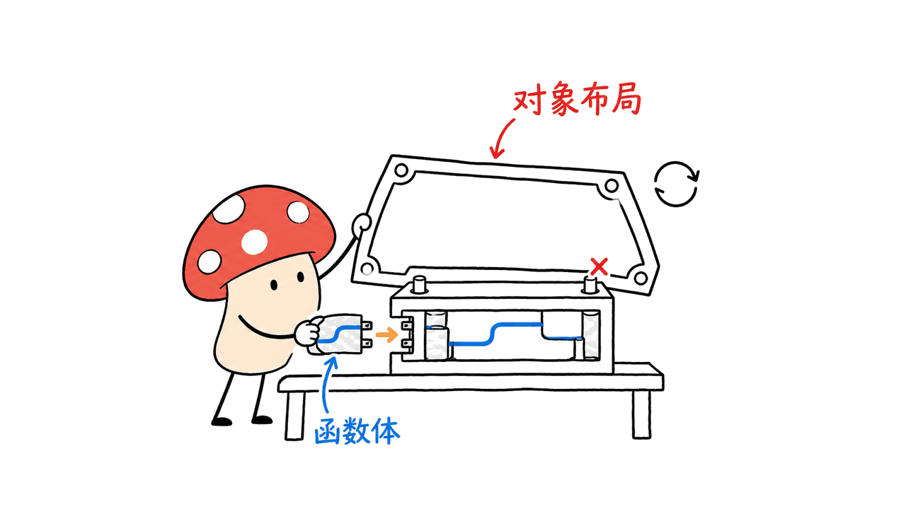

Relax 是把 Rust 源码编译与程序运行放到同一进程中的实验性工具。它通过按需生成函数、后台优化和保存后补丁，减少开发时的整包构建等待；发布构建仍建议使用 rustc。

官方仓库：https://github.com/makepad/relax

本文核对 Makepad 的提交 `436868926ffae73495a4b1eab8382024368d6663`。根目录许可证为 MIT，仓库还保留了移植自 Rust 等项目的第三方声明。项目自述约 43.8 万行 Rust、没有 crates.io 依赖；代码量说明工程规模，不能证明完整兼容所有 Rust 项目。

## “把 rustc 和 LLVM 换掉”指哪一层？

它不是给 Cargo 套一层缓存，也不是 LLVM 插件。在目标程序的 JIT 链路中，Relax 自己承担词法、解析、宏展开、类型分析、优化、寄存器分配和机器码生成，再把代码放进可执行内存。目前提供 x86-64 与 AArch64 后端。

这和“机器上完全不需要 Rust 工具链”是两回事。官方入门首先用 `cargo build --release` 构建 Relax 运行器，构建阶段仍由正常 Rust 工具链完成。之后运行目标源码时，才进入 Relax 的编译链路。

我们用 `cargo metadata --offline` 解析这个快照，得到 35 个本地包，外部 registry 包为零。它是由多个本地 crate 分层组织的工程，“零 crates.io 依赖”不能解读成只有一个 crate 或不依赖系统接口。

## 为什么能边运行，边继续编译？

普通 AOT 流程先构建程序，再执行生成的产物。Relax 尽量延迟尚未调用的函数的机器码工作：首次调用进入解释执行或 O1 路径，热点再在后台提升到 O3，运行中的下一次调用转向新版本。

它并没有免除所有前端分析。名字解析、类型与借用规则、宏和常量等仍需处理，只是工作被重新安排到实时运行系统中。把“没有等待整个发布二进制完成”说成“不用编译”，就丢掉了关键实现。

修改函数体时，运行器可重新检查并发布函数新版本，旧代码在仍可能被栈引用时继续保留。这让局部修改有机会不重启程序，但也让编译器、缓存和多份代码版本共同占用内存。


## 运行更早，不等于所有检查都提前完成

当前 README 明确写道：默认运行在函数执行前做类型检查，借用检查在后台推进；加 `--check-first` 才先等待借用检查。因此，不能把默认模式描述成“与 rustc 完全相同的全部检查时机”。

初次试用建议先了解这个区别，并使用显式检查入口：

```bash
relax check hello
relax run --check-first hello
```

这两个命令也不能证明新实现已经拥有与 rustc 完全等价的语义、兼容性或诊断。仓库维护 `KNOWN_GAPS.md`，列出宏名称解析、分配器相关实现等差异；有些条目仍在寻找稳定复现。接入现有项目，应以实际依赖图和测试结果判断支持程度。

## 热更新能保留所有状态吗？

函数体修改是它主要支持的路径。结构体布局、导入、trait/impl 头部或宏的变动，可能需要重启。新代码如何接替旧代码，与对象布局和已有栈是否仍然有效有关，不能只靠“替换地址”概括。

还要区分独立 Relax 仓库与 Makepad 应用集成。窗口内错误提示、带状态的原地重启、UI 远程控制和 devhub 多 Agent 开发环境，README 是在介绍 Makepad 如何使用 Relax；它们不是克隆这个独立运行器就自动得到的完整 UI 工作台。



## 工程师怎样开始试？

在临时目录先试无外部依赖的最小包。官方独立运行器的路径如下；固定快照方便复核：

```bash
git clone https://github.com/makepad/relax
cd relax
git checkout 436868926ffae73495a4b1eab8382024368d6663
cargo build --release -p relax-runner --bin relax
cd ..
cargo new hello
cd hello
../relax/target/release/relax check hello
../relax/target/release/relax run --quiet --check-first hello
../relax/target/release/relax test hello
```

运行时在目标包目录里传包名，而不是源码路径。保留构建 Relax 时的源码目录，因为运行器会从那里读取自己的标准库源码。缓存位于目标包的 `target/relax`；官方说明简单 hello 的缓存也可达约 120–190 MB，这不是零成本的解释器。

有 crates.io 依赖的目标程序可能需要下载依赖；Relax 自身没有外部 registry 包，不代表目标应用没有。先用 `RELAX_OFFLINE=1` 验证已有依赖是否齐全，可以把依赖获取与编译问题分开。

## 本机验证覆盖了什么？

我们在 Apple M4 上用 Rust 1.98.1、两路 Cargo 任务成功构建了固定版本，随后在临时目录以离线模式验证无外部依赖的小包：有效代码检查通过，两个单元测试在 JIT 下通过，故意制造的借用冲突被拒绝。

热更新样例中，循环每次打印计数器和函数返回值。计数为 2 时，我们把函数体的返回值从 1 改成 2；首次看到新值时计数为 7，随后继续到 31，进程正常退出，没有从 0 重新开始。这证明了这个小样例的函数体更新与循环状态保留，不代表任意对象布局都能迁移。

这些验证针对小样例，不是全套上游测试，也不是对 Rust 语义或整个生态的兼容认证。没有启动大型 3D 游戏、Makepad UI 或 devhub，没有复测官方启动时间与吞吐基准。构建日志含本机 MBX 包装器输出，不据此建立与其他机器的编译速度对比。

## 启动收益和运行性能，应该分开算

官方展示的 3D 游戏首帧 11 秒、第二次 1.15 秒，是团队特定项目与环境的报告，我们没有复现。热启动依赖缓存，也不能与 rustc 已构建二进制的启动时间混成相同口径。

当前 README 的 21 项负载表中，Relax 的几何平均运行耗时相对普通 `--release` 为 x64 1.12 倍、arm64 1.24 倍；相对 native-CPU 构建为 1.22 与 1.25 倍。这里比的是耗时，数值越高越慢，不是吞吐提升。官方也将部分内核微基准标记为待修正，不能拿旧搜索摘要拼成新的结论。


Mycelium Protocol 的判断是：Relax 首先值得借鉴的是开发反馈系统。对界面、游戏和长时间保留状态的程序，缩短“修改到看到结果”的时间可能很有价值；对长时间跑数值计算的发布程序，稳态优化仍是另一项任务。

团队试用时，可分别记录首次启动、暖缓存启动、一次局部修改反馈、常驻内存，以及用 rustc 执行的测试结果。先在实际项目中获得证据，再决定是否扩展；发布继续遵循上游建议使用 Rust 正式工具链。

## 常见问题

**可以卸载 rustc 吗？** 官方从源码构建运行器仍需 Cargo/rustc；被替换的是随后目标程序的 JIT 编译链路。

**它兼容全部 Rust crate 吗？** 上游明确说没有。已知差异列表和真实项目测试比代码量更能说明支持边界。

**能取代发布构建吗？** 上游将 Relax 定位为开发迭代工具，建议发布产物仍用 `cargo build --release`。

已知差异：https://github.com/makepad/relax/blob/main/libs/relax/KNOWN_GAPS.md
第三方声明：https://github.com/makepad/relax/blob/main/NOTICE
相关工程阅读：https://blog.mushroom.cv/blog/rust-apple-mole-mbx-disk-optimization/

---

> © 2026 Author: Mycelium Protocol. 本文采用 [CC BY 4.0](https://creativecommons.org/licenses/by/4.0/deed.zh) 授权——欢迎转载和引用，须注明作者姓名及原文链接，不得去除署名后以原创发布。

<!--EN-->

Relax is an experimental live Rust compiler and JIT runtime. It combines lazy function compilation, background optimization and live edits to improve the development loop. Upstream still recommends rustc for release artifacts.

Repository: https://github.com/makepad/relax

Our snapshot is `436868926ffae73495a4b1eab8382024368d6663`. The root license is MIT, with third-party notices retained. The project's approximately 438,000-line description is an engineering scale claim, not evidence of complete Rust compatibility.

## Which part of the toolchain does it replace?

Relax provides its own front end, analysis, optimization and x86-64/AArch64 machine-code backends. Target code enters executable memory without putting rustc, LLVM or a system linker in that JIT loop.

The bootstrap is different: the documented first step builds the Relax runner with Cargo and rustc. Our offline Cargo metadata check resolved 35 local packages and no external registry packages. Zero crates.io dependencies does not mean a single crate or no system interfaces.

## How can execution begin before all machine code is ready?

Functions are compiled when needed, starting with an interpreter or O1 path. Hot functions can move to O3 in the background. Front-end work still exists; lazy code generation is not the absence of compilation.

A changed function body can publish a new version while old code remains valid for active stacks. That supports live updates but retains compiler state, caches and multiple code versions inside the process.


## When does borrow checking happen?

The current README says a default run type-checks functions before execution and checks borrows in the background. `--check-first` waits for borrow checking. That timing distinction matters when comparing the experience with an ordinary rustc build.

```bash
relax check hello
relax run --check-first hello
```

Passing these commands is not proof of full semantic parity or ecosystem compatibility. Upstream maintains a known-gaps list covering macro resolution and allocator-related implementations among other issues, including observations without a stable reproduction.

## Can every edit retain application state?

Function-body patches are the primary supported path. Layout, imports, trait or impl headers, and macros can require a restart. A live process contains objects and active stacks, so replacement is more constrained than switching an address.

Distinguish this repository from Makepad's integration. Window diagnostics, application restart-state handling, UI control and devhub describe how Makepad uses Relax; they are not a complete UI workbench bundled into this independent runner.


## What is the starting workflow?

From a temporary workspace, clone and pin the source, build the runner, then create a separate dependency-free package:

```bash
git clone https://github.com/makepad/relax
cd relax
git checkout 436868926ffae73495a4b1eab8382024368d6663
cargo build --release -p relax-runner --bin relax
cd ..
cargo new hello
cd hello
../relax/target/release/relax check hello
../relax/target/release/relax run --quiet --check-first hello
../relax/target/release/relax test hello
```

Pass the package name from its directory. Keep the Relax checkout because the runner reads standard-library sources there. Its package cache lives in `target/relax`; upstream reports roughly 120–190 MB even for hello. Application dependencies can still require network access. `RELAX_OFFLINE=1` separates missing dependency downloads from compilation issues.

## What did our local validation cover?

The pinned runner built successfully on an Apple M4 with Rust 1.98.1 and two Cargo build jobs. An offline, dependency-free fixture passed checking and two JIT unit tests; an intentionally conflicting borrow was rejected.

For live replacement, the loop printed a counter and a function result. We changed the result from one to two at counter two. The new value appeared at counter seven, then the loop continued to 31 and exited normally without restarting at zero. This establishes function replacement and counter continuity in this fixture, not arbitrary object-layout migration.

This is not the full upstream suite, a Rust semantic certification or an ecosystem assessment. We did not launch the large game, Makepad UI or devhub, and did not reproduce official latency or throughput. Local build logs include the machine's MBX wrapper; they are not a comparative build-speed measurement.

## How should startup and steady-state performance be compared?

The team's game first-frame figures of 11 seconds and 1.15 seconds on the next run are reported examples, not our measurements. Cached JIT startup is also different from launching an already-built native binary.

The pinned README reports 21-workload geomean elapsed-time ratios of 1.12 on x64 and 1.24 on arm64 against stock release builds, or 1.22 and 1.25 against native-CPU builds. These are time ratios: higher is slower. Some separate kernel microbenchmarks are explicitly provisional. Do not combine stale search excerpts with a different source revision.


Mycelium Protocol sees the main lesson as feedback-loop design. Stateful interactive programs may benefit from faster edits, while sustained numerical throughput remains a separate concern. Measure first launch, warm launch, edit feedback, resident memory and rustc test results on your own project before broad adoption. Keep the upstream-recommended native release path.

## FAQ

**Can rustc be removed?** The documented source bootstrap still uses Cargo/rustc; the target program's subsequent JIT compilation takes a separate path.

**Does every Rust crate work?** Upstream explicitly says no. Known gaps and project-specific tests are stronger evidence than line count.

**Should releases use Relax?** Upstream positions it for development iteration and recommends `cargo build --release` for shipped artifacts.

Known gaps: https://github.com/makepad/relax/blob/main/libs/relax/KNOWN_GAPS.md
Notices: https://github.com/makepad/relax/blob/main/NOTICE
Related: https://blog.mushroom.cv/blog/rust-apple-mole-mbx-disk-optimization/

---

> © 2026 Author: Mycelium Protocol. Licensed under [CC BY 4.0](https://creativecommons.org/licenses/by/4.0/) — free to share and adapt with attribution. You must credit the author and link to the original; removing attribution and republishing as original is not permitted.
