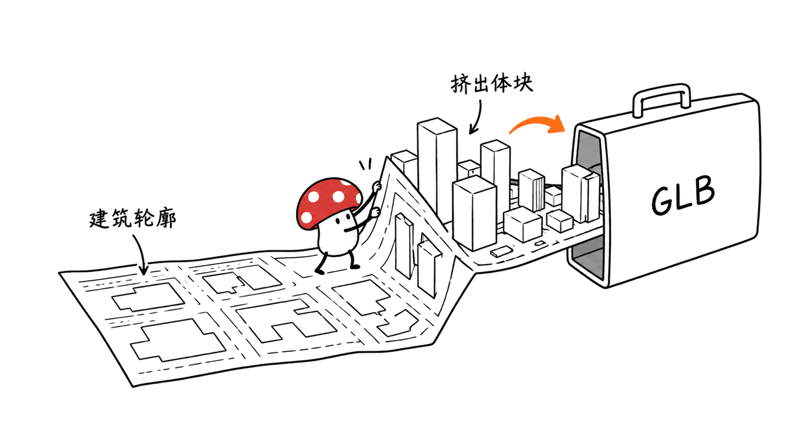
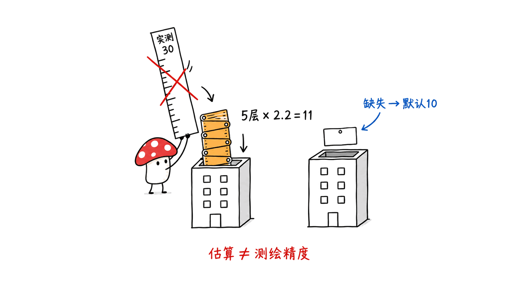
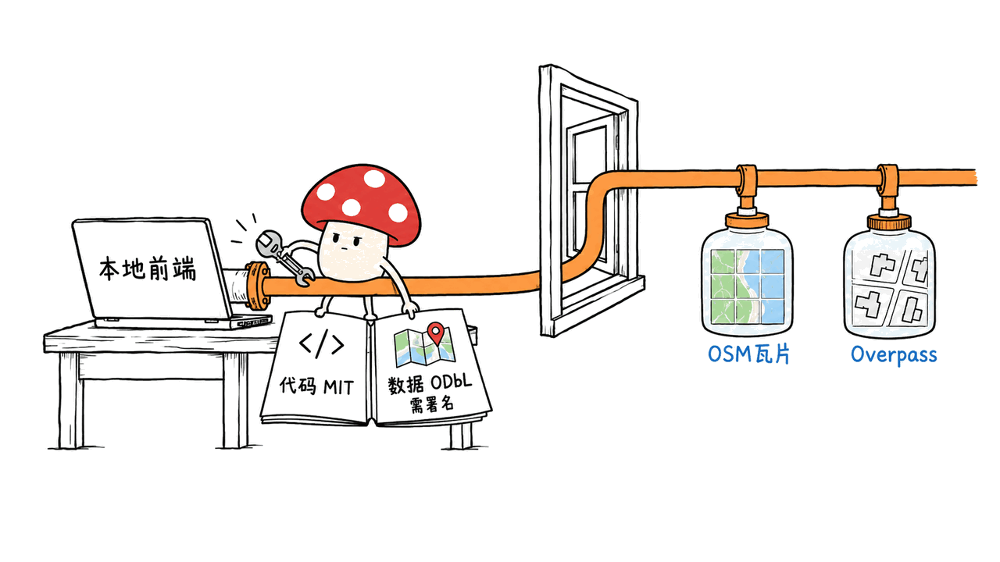

Map3d 把开放地图里的建筑轮廓与道路变成三维场景，并支持下载 GLB，适合快速搭建城市底图。

本文讨论的仓库是 cartesiancs/map3d，不是医学切片重建的同名 Map3D。它采用 MIT 许可证，使用 React、React Three Fiber 和 Three.js。我们核对源码并跑通一次合成地图数据的浏览器导出，不把这个检查称为真实城市精度实测。

GitHub：https://github.com/cartesiancs/map3d
项目演示：https://map.fleet.im/
核对版本：2c5d732477ba7c55995572aae926bf80303c00b9

## Map3d 如何从地图得到三维场景？

前端先用 Leaflet 显示二维地图，切换到 Select Box 模式框选区域。进入 Processing 后，第一次点击 Next Step 请求建筑信息；数据载入后再点一次，进入三维视图。道路数据另行请求。

建筑和道路来自 Overpass 接口。渲染层将经纬度投影到局部平面，把建筑轮廓挤出为体块，将道路画成线。GLB 导出器遍历场景，只复制标记了 `exportToGLB` 的对象，再生成二进制 glTF 文件 `scene.glb`。



这条链路的价值在于减少重复建模。需要一个现实街区的基本空间关系时，先拿开放数据生成底图，再进入自己的三维工具补材质、标记和交互，比从空场景逐栋搭建方便。

它没有用照片重建城市，也没有调用 AI 生成建筑。道路、GPS 标记、无人机测绘和数字孪生是可以继续开发的方向，不能把 README 中的应用设想都理解为现成产品能力。

## 建筑高度为何需要核对？

源码的高度规则很具体：先读取 `height`；解析失败则使用默认值 10。随后只要 `building:levels` 能解析，就改用层数乘 2.2，覆盖先前的高度值。

| 输入标签 | 当前代码采用的挤出深度 |
| --- | ---: |
| `height=30`，没有层数 | 30 |
| `height=30`，`building:levels=5` | 11 |
| 两者都缺失 | 10 |

表格与示意图中的高度 30 是假设输入，并非现场测高结果。这个顺序会影响最终体块。它不是“有真实高度就优先用真实高度”。不同地区的 OSM 标注完整度也不一样，缺失或错误的高度会直接传到模型。README 同样明确不保证数据准确性。



经纬度转换使用固定比例常数 51000，并对经度方向乘以纬度余弦。它是局部场景构造，不能直接视为完整 GIS 坐标转换或米级测量承诺。拿去和别的资产拼接时，应先核对尺度、原点与方向。

另外，查询虽包含 building relations，当前映射主要读取顶层 `geometry`；缺少该字段的元素不会生成体块。复杂建筑关系不能仅凭“接口查到了”就认为一定完整显示。

## 我们实际跑通了什么？

Mycelium Protocol 在 Mac 上安装锁文件对应依赖，完成 `tsc -b && vite build`。Vite 构建成功，同时提示主 JavaScript 块较大；这不是页面速度测试，也没有测超大城市的帧率。

随后启动未经修改的前端，用真实 Chromium 操作框选、处理、三维视图和下载。Overpass 请求替换为明确的合成 fixture：两栋建筑和一条道路。地图底图与场景环境资源仍属于网络依赖。

下载得到一个 6,344 字节的 GLB：文件头为 `glTF`，版本 2，声明长度与实际长度一致，包含 3 个 mesh。浏览器没有记录页面脚本异常。导出的建筑几何深度分别为 11 和 10，与上述“层数覆盖”和默认高度规则一致。

最初自动拖选过快，没有等到交互状态更新，Next Step 仍禁用；加入正常的按下、拖动、释放间隔后跑通。我们没有修改项目源码，也没有绕过按钮逻辑。这个结果证明小样本输入的界面与导出链路可运行，不证明真实 Overpass 数据覆盖、几何精度、所有 GLB 消费软件兼容性或道路语义完整性。

## 如何在本地启动 Map3d？

```bash
git clone https://github.com/cartesiancs/map3d.git
cd map3d
git checkout 2c5d732477ba7c55995572aae926bf80303c00b9
npm ci
npm run dev
# 生产构建
npm run build
```

使用支持 WebGL 的浏览器。先选一个小街区，查看建筑标签是否载入，再导出并检查模型。项目不是本地安装后就完全离线：源码请求 OSM 瓦片、Overpass 数据，场景还加载环境资源。生产部署要考虑这些服务的可用性和使用政策。

README 的路线图仍将建筑纹理、高度自定义、材质和高度图列为未完成。不要把白模底图当作有纹理、有地形、建筑高度已校正的完整城市模型。

代码许可证是 MIT，地图数据则遵循 OpenStreetMap 的 ODbL 及署名要求，两者不能混为一谈。展示与分发地图成果时，应保留数据来源署名，并按实际产物类型查看官方许可说明。



OSM 一手许可说明：https://www.openstreetmap.org/copyright

## Map3d 适合谁？

它适合需要城市体块的 Three.js 开发者、场景原型作者和教学演示。想把已有街区变成可编辑的起点，GLB 导出比只能在网页看一眼更有用。

如果目标是精准规划、导航或测绘，应先补地理坐标、尺度校验、复杂建筑解析和可靠高度来源，再验证导出到目标软件的效果。我们的判断是：Map3d 的优势是轻量、直接、可继续开发；实际边界由开放数据质量与几何处理方式决定。

相关可视化阅读：https://blog.mushroom.cv/blog/spun-hidden-infrastructure/

## 常见问题

### Map3d 的 GitHub 地址是什么？

本文对应 https://github.com/cartesiancs/map3d ，是城市三维地图项目。同名医学工具不是本文讨论对象。

### 能否导出到别的三维工具？

它支持下载 GLB 文件。本文验证了生成有效的 GLB 容器，但没有逐一测试 Blender、游戏引擎或其他软件的导入效果，尺度和材质仍应自行核对。

### Map3d 能直接用于精准数字孪生吗？

不能仅凭生成成功就确认精度。它挤出 OSM 建筑轮廓，包含默认高度和层数估算，部分复杂关系可能缺失，项目本身也不保证地图数据准确。

---

> © 2026 Author: Mycelium Protocol. 本文采用 [CC BY 4.0](https://creativecommons.org/licenses/by/4.0/deed.zh) 授权——欢迎转载和引用，须注明作者姓名及原文链接，不得去除署名后以原创发布。

<!--EN-->

Map3d turns open building footprints and roads into a three-dimensional scene, with GLB downloads for quick city blockouts.

This article covers cartesiancs/map3d, rather than the medical slide reconstruction project with the same name. Its MIT-licensed frontend uses React, React Three Fiber and Three.js. We inspected the source and completed one browser export using synthetic map inputs; this is not a survey of real-city accuracy.

GitHub: https://github.com/cartesiancs/map3d
Project demo: https://map.fleet.im/
Reviewed commit: 2c5d732477ba7c55995572aae926bf80303c00b9

## How does Map3d construct a city scene?

Leaflet displays a two-dimensional map. Select Box switches to area selection. In Processing, the first Next Step fetches building information; another click opens the 3D scene once it has loaded. Roads are fetched separately.

Overpass supplies building and road data. Coordinates are projected into a local plane, footprints are extruded into building blocks, and roads are rendered as lines. The exporter copies scene objects tagged `exportToGLB`, then writes a binary glTF download named `scene.glb`.


The practical benefit is reduced repetitive modeling. Developers can start from a real neighborhood's basic layout and add materials, markers and interaction in their own tools.

This is neither photographic reconstruction nor AI-generated architecture. Digital twins, drone surveying and GPS markers are suggested extension areas, rather than proof that those complete applications ship with the repository.

## Which building height does the code use?

The source reads `height` first and falls back to 10 if parsing fails. It then overrides the value with `building:levels × 2.2` whenever the level count parses successfully.

| Tags | Extrusion depth used |
| --- | ---: |
| `height=30`, no levels | 30 |
| `height=30`, `building:levels=5` | 11 |
| Neither present | 10 |

The height 30 in the table and illustration is a hypothetical input, not our field measurement. This is not a measured-height-first policy. OSM completeness varies across locations, and missing or inaccurate tags propagate into the model. The README explicitly disclaims data accuracy.


Coordinate conversion uses a fixed scale of 51000 and a latitude cosine adjustment for longitude. That constructs a local scene; it does not establish a complete GIS transform or meter-accurate measurements. Check scale, origin and axes before combining exports with other assets.

The building query includes relations, but the current mapping principally reads top-level `geometry`. Elements without that field do not produce blocks. Retrieving a complex building relation therefore does not guarantee complete rendering.

## What did our local check establish?

Mycelium Protocol installed the lockfile dependencies on a Mac and successfully ran `tsc -b && vite build`. Vite warned about a large main JavaScript chunk. We did not benchmark loading time or large-city frame rates.

We launched the unchanged frontend and used real Chromium interactions to select an area, fetch buildings, open the 3D view and download GLB. Overpass responses were replaced with an explicit synthetic fixture containing two buildings and one road. Map tiles and scene environment resources remained network dependencies.

The downloaded GLB was 6,344 bytes, with `glTF` magic, version 2, matching declared and actual lengths, and three meshes. No page script errors were recorded. Building extrusion depths were 11 and 10, consistent with level override and missing-height fallback.

An initial automated drag ran too quickly for selection state to update, leaving Next Step disabled. Normal press, drag and release intervals allowed the flow to complete. We changed no application source and bypassed no button logic. This verifies a small-input interface/export path, rather than real Overpass coverage, geographic accuracy, universal importer compatibility or complete road semantics.

## How do you run Map3d locally?

```bash
git clone https://github.com/cartesiancs/map3d.git
cd map3d
git checkout 2c5d732477ba7c55995572aae926bf80303c00b9
npm ci
npm run dev
# Production build
npm run build
```

Use a WebGL-capable browser and start with a small neighborhood. Check that building tags load, then export and inspect the result. Local hosting does not make the app fully offline: its source requests OSM tiles, Overpass data and scene environment resources. Deployment depends on their availability and usage policies.

The README roadmap still lists building textures, height customization, materials and heightmaps as unfinished. A blockout is not a textured, terrain-aware city model with corrected building heights.

The code's MIT license differs from the OSM data's ODbL and attribution requirements. Preserve map-data attribution and consult the official guidance for the type of result you distribute.


Official OSM guidance: https://www.openstreetmap.org/copyright

## Who should use Map3d?

It is a useful starting point for Three.js developers, scene prototyping and teaching. Exportability makes the city layout usable beyond the original webpage.

Precision planning, navigation and surveying need stronger coordinate handling, scale checks, complex-building parsing and trustworthy height sources. Our assessment is that Map3d offers a lightweight, direct foundation; data quality and geometry processing define its limits.

Related visualization reading: https://blog.mushroom.cv/blog/spun-hidden-infrastructure/

## FAQ

### What is the GitHub repository?

This article covers https://github.com/cartesiancs/map3d , the city map generator. It does not cover the same-named medical reconstruction tool.

### Can I export to other 3D software?

The app downloads GLB. We checked the generated container, but did not test every Blender or game-engine importer. Verify scale and materials in the intended consumer.

### Is it a precise digital twin out of the box?

Successful generation does not establish precision. OSM footprints are extruded using measured tags, level estimates or defaults, and complex relations can be missing. The project itself does not guarantee map-data accuracy.

---

> © 2026 Author: Mycelium Protocol. Licensed under [CC BY 4.0](https://creativecommons.org/licenses/by/4.0/) — free to share and adapt with attribution. You must credit the author and link to the original; removing attribution and republishing as original is not permitted.
