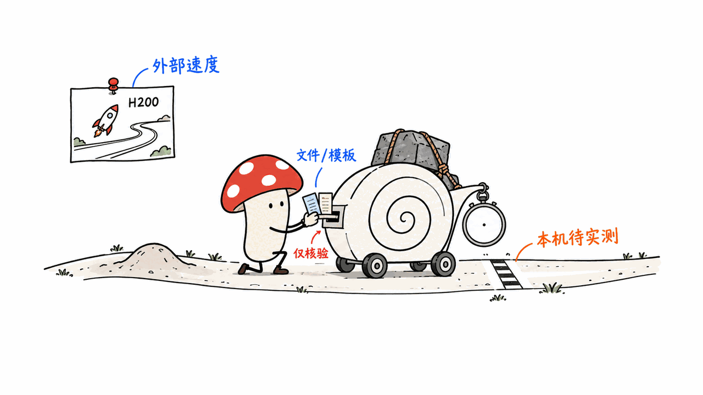

Mellum2.1 值得关注的地方，是让轻量代码模型在真实仓库中读文件、改代码、运行测试。JetBrains 没有扩大架构，而是加强了强化学习后训练；官方结果显示执行能力明显改善，但选型仍要看具体任务与部署成本。

用户提供的是 ModelScope 上的 `JetBrains/Mellum2.1-12B-A2.5B-Thinking`。Mycelium Protocol 于 2026 年 10 月 13 日复核了 ModelScope API、JetBrains 发布公告、Hugging Face 模型卡和官方量化文件。本文把官方评测、文件核验与我们的分析分开记录，没有把下载页面当作推理测试。

## Mellum2.1 改变了什么？


它仍是总参数 12B、每 token 激活约 2.5B 的 MoE 模型，权重采用 Apache 2.0 许可。2.1 的关键变化发生在预训练之后：软件工程任务进入真实仓库环境，模型使用 shell 和文件编辑工具，测试结果提供奖励反馈。

这条路线训练的是一个闭环：读懂失败现象，定位相关代码，提出修改，再检查修改是否有效。对于 coding agent，“能写一个函数”与“能修好现有项目”需要不同能力。训练过程中引入真实环境，正是在弥合这个差距。

我的判断是，小型执行模型的价值越来越依赖反馈质量。通过可验证任务训练的 worker，可以承担明确的修复步骤；规划、上下文选择、权限控制和验收，仍需要外围 agent 系统负责。模型权重本身不包含这些完整运行机制。

官方公告：
https://blog.jetbrains.com/ai/2026/10/mellum2-1-gets-to-work-a-fast-open-model-for-coding-agents/

## 官方成绩说明了什么，也留下了什么？

以下均为 JetBrains 自报百分比，不是本文复现结果。模型卡声明各模型使用同一评测管线、Thinking 模式；旧 Mellum2 也重新评测，因此不能直接拼接旧论文中的分数。

| 项目 | Mellum2.1 | Mellum2 | Qwen3.5-9B |
|---|---:|---:|---:|
| LiveCodeBench v6 | 82.0 | 69.4 | 75.4 |
| SWE-bench Verified | 47.0 | 2.0 | 50.0 |
| Terminal-Bench 2.1 | 17.4 | 0.6 | 21.7 |
| BFCL v4 | 62.3 | 49.6 | 58.5 |
| WorkBench | 44.6 | 45.1 | 39.7 |

这组数据支持“仓库执行能力相对上一代大幅改善”，但没有支持“全面超过同级模型”。Qwen3.5-9B 在这张表的仓库与终端任务中仍领先；Mellum2.1 的 WorkBench 还略低于上一代。单项工具成绩也不能代替真实业务流程的成功率。

评测配置同样影响解释。Agentic 项目使用 Pi v0.73.1 的 shell/文件工具框架、114K 上下文、每轮最多 16K token；Mellum2.1 温度为 1.0。非 agentic 项目采用贪心解码。这些设置比只报一个排行榜数字更有参考价值。

如果把它接到自己的 coding agent，我会优先测三类任务：定位已有测试失败、完成小范围跨文件修改、在工具失败后正确停止或重试。记录最终测试通过率与全过程资源消耗，避免只拿生成代码的观感判断模型是否适合干活。

官方模型卡：
https://huggingface.co/JetBrains/Mellum2.1-12B-A2.5B-Thinking

## 2.5B 激活参数，为什么文件仍有 8GB？


激活参数描述一次计算选用了多少权重；部署通常仍要保存整个专家集合。官方配置为 64 个专家、每 token 选择 8 个。不能用“2.5B 激活”推导出“只需要一个 2.5B 模型的内存”。

原模型卡和发布公告还保留着 GGUF“即将提供”的文字，但截至核验日，JetBrains 官方 GGUF 仓库已经列出五个真实文件。以文件树为准，尺寸如下；GB 使用十进制，并非 GiB。

| 官方文件 | 大小（GB） | 选型含义 |
|---|---:|---|
| BF16 | 24.312 | 未量化参考 |
| Q8_0 | 12.925 | 更高精度，文件较大 |
| Q6_K | 10.880 | 精度与容量之间的选择 |
| Q4_K_M | 8.071 | 官方推荐的均衡版本 |
| MXFP4_MOE | 7.030 | 专家权重使用 MXFP4，当前最小文件 |

官方量化卡还提供 Wikitext-2、512 上下文下相对 BF16 的 logits 差异与 top-token 一致率。Q4_K_M 的一致率为 88.0%，MXFP4_MOE 为 85.6%。这些是该数据集上的输出分布比较，不能写成“保留了 88% 的代码能力”，也不能替代量化后的工具调用评测。

128K 是模型声明的上下文上限。实际运行还要为 KV cache、推理工作区、服务进程和操作系统留内存。下载得下、加载得进、长上下文能跑稳，是三个需要分别验证的问题。

官方量化仓库：
https://huggingface.co/JetBrains/Mellum2.1-12B-A2.5B-Thinking-GGUF/tree/main

## 官方速度图，能直接套到本机吗？

不能。我们检查了公告中的速度图：它注明单张 H200、FP8、输入 2304 token、输出 256 token，并分别列出单请求与服务饱和吞吐量。

Mellum2.1 在单请求下从 339 token/s 到加 MTP 后的 557 token/s，约为自身基线的 1.64 倍；饱和吞吐从 7969 到 8533 token/s，约提高 7.1%。同一种优化，在两个运行场景中的收益并不相同。

这解释了为什么“更快”需要附带硬件、负载与推理栈。该图不能证明 Mac 上的 GGUF 也有相同比例的提升。GGUF 已上线也不等于 MTP head、Metal 算子与各客户端的推测解码集成全部可用；本次没有核验这条完整加速链。

原始速度图：
https://admin.blog.jetbrains.com/wp-content/uploads/2026/10/mellum21-speed.png

## 如何开始部署与验证？


服务器路线可按官方模型卡使用支持 Mellum 架构的 vLLM，并分别配置推理与工具解析器。版本支持必须先核对，不能因为协议兼容就认为模型架构已经兼容。

```bash
vllm serve JetBrains/Mellum2.1-12B-A2.5B-Thinking \
  --max-model-len 8192 \
  --reasoning-parser qwen3 \
  --enable-auto-tool-choice \
  --tool-call-parser hermes
```

这里把上下文收敛到 8192，作为首次部署的起点，不是模型能力上限，也不是本机已执行成功的命令。稳定后再根据任务长度和显存预算扩大。量化路线可选官方 Q4_K_M，并使用支持 Mellum 的新版 llama.cpp；Ollama、LM Studio 的具体版本支持也应实机确认。

```bash
hf download JetBrains/Mellum2.1-12B-A2.5B-Thinking-GGUF \
  Mellum2.1-12B-A2.5B-Thinking-Q4_K_M.gguf --local-dir ./mellum21

llama-server -m ./mellum21/Mellum2.1-12B-A2.5B-Thinking-Q4_K_M.gguf \
  --host 127.0.0.1 --ctx-size 8192 --jinja \
  --temp 0.6 --top-p 0.95 --top-k 20
```

本次完成的是轻量的接入核验：ModelScope API 返回 200，确认五个 BF16 分片总计约 24.301GB；官方 GGUF 文件树提供精确大小及哈希元数据；另以 HTTP 206 下载 Q4 文件前 64 字节，确认 GGUF v3 文件头，并完成 6 项官方工具对话模板渲染检查。完整核验结果保存在文章的研究记录中。

本机磁盘空闲约 8GiB，无法为完整权重下载和后续工作提供充足余量，因此没有运行模型推理。我们没有验证回答正确率、实际工具执行、吞吐、峰值内存或 SWE-bench。模板渲染通过也只能证明序列化规则可用，不能证明模型会正确选择工具。

模型配置固定在 `92ddae9fc7665e9f801d141d2e5a6b2caf2460c4`，GGUF 文件树固定在 `20b439426f1e997ba575eaccaf4856ac0f76f5d5`。完整文件 SHA-256 尚未在本地计算；仓库给出的哈希与本机算出的哈希不能混为一谈。

接下来适合做一个小而可验收的仓库任务：先提交基线，限定可编辑目录，给出一个失败测试，让模型完成修复，然后检查测试、差异和工具日志。把多轮失败成本算进去，才能判断这个 worker 是否比更大的模型更经济。

## 常见问题

### Mellum2.1 可以替代整个 coding agent 吗？

它提供可接入 agent 的模型能力。工具执行、沙箱、记忆、权限和验收仍由应用负责，官方评测也是把模型放进指定框架后运行。

### 官方 GGUF 现在能下载吗？

截至 2026 年 10 月 13 日，官方文件树已经提供五种版本。运行时是否支持 Mellum 架构、特定量化类型及完整工具解析，仍需检查所用软件版本。

### 应该选 Q4_K_M 还是最小的 MXFP4_MOE？

官方推荐 Q4_K_M 作为均衡版本。容量紧张时可考察 MXFP4_MOE，但先确认运行时支持，并用自己的修复与工具任务测量误差，不能只按文件大小决定。

用户提供的 ModelScope 入口：
https://modelscope.cn/models/JetBrains/Mellum2.1-12B-A2.5B-Thinking

相关的本地量化模型核验与工具调用测试方法：
https://blog.mushroom.cv/blog/saluki-27b-gguf-tools-bonsai2/

> © 2026 Author: Mycelium Protocol. 本文采用 [CC BY 4.0](https://creativecommons.org/licenses/by/4.0/deed.zh) 授权——欢迎转载和引用，须注明作者姓名及原文链接，不得去除署名后以原创发布。

<!--EN-->

Mellum2.1 is interesting because JetBrains trained a compact coding model to work inside repositories: inspect files, edit code, and check tests. Its architecture stays the same; reinforcement-learning post-training changes its ability to complete work. The deployment decision still depends on task quality and operating costs.

Mycelium Protocol checked the supplied ModelScope entry, JetBrains announcement, official Hugging Face card, and GGUF artifacts on October 13, 2026. We distinguish vendor evaluations, artifact checks, and our own analysis. This article does not report a local inference benchmark.

## What changed in Mellum2.1?


This remains a 12B-total, approximately 2.5B-active mixture-of-experts model under Apache 2.0. Software-engineering post-training uses real repositories, shell commands, file editing, and test-based rewards.

That creates a useful learning loop: interpret a failure, locate relevant code, propose an edit, and check the result. Writing an isolated function and repairing an existing project require different skills. Repository environments give the model feedback on the latter.

Our interpretation is that compact execution models increasingly depend on the quality of verifiable feedback. A worker can handle a bounded repair step, while the surrounding agent system supplies planning, context selection, permissions, and acceptance checks. Downloadable weights alone do not provide that complete system.

Official announcement:
https://blog.jetbrains.com/ai/2026/10/mellum2-1-gets-to-work-a-fast-open-model-for-coding-agents/

## What do the official benchmarks establish?

These percentages are self-reported by JetBrains, not reproduced here. The official card says the models used the same evaluation pipeline in thinking mode; Mellum2 was re-evaluated rather than copied from its older report.

| Benchmark | Mellum2.1 | Mellum2 | Qwen3.5-9B |
|---|---:|---:|---:|
| LiveCodeBench v6 | 82.0 | 69.4 | 75.4 |
| SWE-bench Verified | 47.0 | 2.0 | 50.0 |
| Terminal-Bench 2.1 | 17.4 | 0.6 | 21.7 |
| BFCL v4 | 62.3 | 49.6 | 58.5 |
| WorkBench | 44.6 | 45.1 | 39.7 |

The evidence supports a substantial improvement over the previous Mellum in repository work. It does not support universal superiority: Qwen leads these repository and terminal results, and WorkBench is slightly below the earlier Mellum score. Function-calling accuracy also does not determine end-to-end business workflow success.

Agentic evaluations used Pi v0.73.1 with shell and file tools, a 114K-token context, and up to 16K tokens per turn. Mellum2.1 used temperature 1.0. Non-agentic evaluations used greedy decoding. These details matter when comparing results.

For a private coding agent, our starting tests would be failure localization, a small cross-file repair, and recovery from a tool error. Measure completed repairs and the full resource cost, including failed rounds, rather than judging the appearance of generated code.

Official model card:
https://huggingface.co/JetBrains/Mellum2.1-12B-A2.5B-Thinking

## Why do 2.5B active parameters still need an 8GB file?


Active parameters describe computation per token. Deployment ordinarily retains the full expert set. The configuration has 64 experts and selects eight per token; it does not imply the memory footprint of a standalone 2.5B model.

The original announcement and model card retain stale “coming soon” language. The official GGUF repository already contains five files as of our check. Sizes below use decimal GB, not GiB.

| Official variant | GB | Deployment consideration |
|---|---:|---|
| BF16 | 24.312 | Unquantized reference |
| Q8_0 | 12.925 | Larger, higher-precision option |
| Q6_K | 10.880 | Intermediate capacity tradeoff |
| Q4_K_M | 8.071 | Official balanced recommendation |
| MXFP4_MOE | 7.030 | Smallest file; MXFP4 expert weights |

The quantization card reports logit comparisons on Wikitext-2 at a 512-token context. Top-token agreement is 88.0% for Q4_K_M and 85.6% for MXFP4_MOE. This does not mean “88% of coding ability retained”; distribution agreement on this dataset cannot substitute for quantized tool-use evaluations.

The advertised 128K context is a model limit. KV cache, inference workspaces, server processes, and the operating system require additional memory. Download capacity, successful loading, and stable long-context operation each need verification.

Official quantizations:
https://huggingface.co/JetBrains/Mellum2.1-12B-A2.5B-Thinking-GGUF/tree/main

## Does the speed chart predict laptop performance?

No. The chart specifies one H200, FP8, 2304 input tokens, and 256 output tokens, with separate single-request and saturated-server measurements.

Single-request Mellum throughput rises from 339 to 557 output tokens/s with MTP: about 1.64 times its own baseline. Saturated throughput rises from 7969 to 8533, approximately 7.1%. The benefit depends on the workload.

These figures do not establish the same speedup for Metal and GGUF. Available GGUF weights also do not establish that the MTP head, hardware kernels, and speculative-decoding integration are all available in a particular client. We did not verify that complete acceleration path.

Original speed chart:
https://admin.blog.jetbrains.com/wp-content/uploads/2026/10/mellum21-speed.png

## How should deployment validation begin?


The official server route uses vLLM with Mellum architecture support, a reasoning parser, and a separate tool-call parser. Check the installed version first: protocol compatibility alone does not establish architecture support.

```bash
vllm serve JetBrains/Mellum2.1-12B-A2.5B-Thinking \
  --max-model-len 8192 \
  --reasoning-parser qwen3 \
  --enable-auto-tool-choice \
  --tool-call-parser hermes
```

We reduce the initial context to 8192 as a deployment starting point. This is neither the model limit nor a command successfully executed on our machine. Increase it after measuring the available memory and actual task requirements. The quantized route uses the official Q4_K_M with a Mellum-capable llama.cpp build; specific Ollama and LM Studio versions need practical checks too.

```bash
hf download JetBrains/Mellum2.1-12B-A2.5B-Thinking-GGUF \
  Mellum2.1-12B-A2.5B-Thinking-Q4_K_M.gguf --local-dir ./mellum21

llama-server -m ./mellum21/Mellum2.1-12B-A2.5B-Thinking-Q4_K_M.gguf \
  --host 127.0.0.1 --ctx-size 8192 --jinja \
  --temp 0.6 --top-p 0.95 --top-k 20
```

Our checks cover integration artifacts. ModelScope returned HTTP/API success and identifies five BF16 shards totaling approximately 24.301GB. The official GGUF tree supplies exact file sizes and published hash metadata. An HTTP 206 response supplied the first 64 Q4 bytes, confirming a GGUF v3 header; six official conversation-template rendering checks passed. The detailed results are preserved in the publication research record.

Our machine had approximately 8GiB of disk space remaining, insufficient headroom for responsible full-weight downloading and subsequent work. We did not run inference, execute model-selected tools, measure throughput or peak memory, or reproduce SWE-bench. Template rendering establishes serialization behavior only.

The model revision is `92ddae9fc7665e9f801d141d2e5a6b2caf2460c4`; the GGUF revision is `20b439426f1e997ba575eaccaf4856ac0f76f5d5`. We did not calculate a full local file SHA-256. A publisher-provided hash is different evidence from a locally verified hash.

A useful next experiment is a bounded repository repair: commit the baseline, restrict writable paths, provide a failing test, and inspect tests, diffs, and tool logs afterward. Include failed attempts in the cost calculation before deciding whether a compact worker is more economical than a larger model.

## Frequently asked questions

### Does Mellum2.1 replace a complete coding agent?

It supplies model capabilities. Tool execution, sandboxing, memory, permissions, and acceptance checks belong to the application. Official agentic scores likewise depend on the stated harness.

### Are official GGUF files available now?

Yes, five variants appear in the official tree as of October 13, 2026. Runtime support for Mellum, each quantization type, and tool parsing still depends on the software version.

### Should I choose Q4_K_M or MXFP4_MOE?

JetBrains recommends Q4_K_M as the balanced option. Consider MXFP4_MOE when storage or memory is tight, but check runtime support and evaluate your own repair and tool tasks before trading precision for capacity.

Supplied ModelScope entry:
https://modelscope.cn/models/JetBrains/Mellum2.1-12B-A2.5B-Thinking

Related quantized-model verification and tool-call testing:
https://blog.mushroom.cv/blog/saluki-27b-gguf-tools-bonsai2/

> © 2026 Author: Mycelium Protocol. Licensed under [CC BY 4.0](https://creativecommons.org/licenses/by/4.0/) — free to share and adapt with attribution. You must credit the author and link to the original; removing attribution and republishing as original is not permitted.
