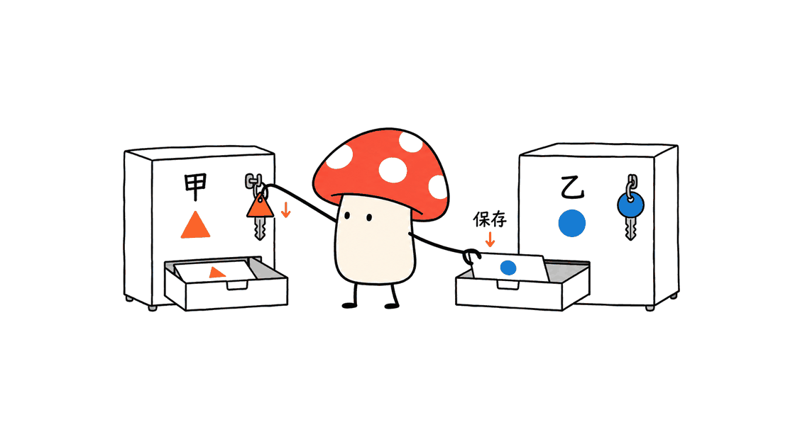

MemT 1.0把可更新的记忆状态放进模型计算，让历史信息不必每次都以原文进入提示词。它探索的是原生记忆能力，但固定容量不等于无限、无损记忆，也不能直接替代需要原文证据的RAG系统。

用户提供的截图包含三个有效线索：MemTensor团队的MemOS、7月底发布的Metis，以及新的MemT 1.0。沿这些线索，已经找到官方仓库、技术报告和权重入口。本文采用第三方分析视角，不将截图作者的经历或宣传说法写成本文作者的实测。

MemT仓库：https://github.com/MemTensor/MemT-1.0
MemT报告：https://arxiv.org/abs/2610.26825
模型集合：https://huggingface.co/collections/MemTensor/memt-1
团队发布稿：https://dev.to/memos/memt-10-is-launched-towards-memory-native-evolution-581c

核查日期为2026年11月1日。Mycelium Protocol在Apple Silicon上完成了七项官方启动器的CPU配置校验，没有下载模型权重，也没有测量记忆准确率、出字速度或GPU显存。下文会区分截图内容、作者报告和本次实际检查。

## 图片里哪些信息可以保留，哪些不能直接引用？

截图里的MemOS仓库显示约11.9k星，说明这是一次历史快照；核查时官方API为12,209星。星标能说明关注度，不能证明模型的记忆质量。截图仓库简介中的“35.24% token savings”属于MemOS的宣传描述，也不能直接挪作MemT模型的成绩。

高亮部分的核心判断可以保留：选定配置后，模型维护固定容量的内部记忆状态，并在后续生成中读取。配图下半部分已经裁切，具体更新机制与实现边界则必须回到完整报告和代码核对。

图片识别通过直接查看原图，并用本地Vision中文OCR辅助提取。OCR有漏字和图内英文误识别，最终实体名由原图与官方资料交叉确认。Mage-VL服务未运行，本次未声称使用该模型完成识别。

## MemOS、Metis与MemT分别解决什么？

| 项目 | 所在层次 | 更适合怎样理解 |
|---|---|---|
| MemOS | 模型外部的记忆系统与编排层 | 管理记忆内容、检索及应用集成 |
| Metis | 原生记忆研究原型 | 探索模型内部状态与学习到的存取过程 |
| MemT 1.0 | 后续原生记忆模型与推理实现 | 改进内部状态更新、容量扩展和有状态服务 |

MemOS：https://github.com/MemTensor/MemOS
Metis：https://github.com/MemTensor/Metis
Metis报告：https://arxiv.org/abs/2607.26760

Metis报告于2026年7月29日提交，符合截图中的“7月底”线索。MemT报告于10月19日提交，团队发布稿把正式发布日写为10月20日；DEV平台文章另有10月30日的发布时间，不宜把不同入口的时间混成一个日期。

这条演进线也不是“前一个项目被后一个取代”。外部系统擅长保留可定位的资料、来源和版本；模型内部状态则尝试把已积累的信息变成更紧凑、可直接参与计算的表示。一个应用可以同时使用两层。


## 固定容量的记忆，怎样参与下一次回答？

MemT在骨干注意力旁增加Native Memory Block。它包含动态的Local Memory状态，以及离线训练得到的Hyper Memory投影与门控参数。生成时，记忆读出参与当前计算；提交一轮或一段信息时，Stable GDN-2更新供后续使用的状态。

这里必须区分两种“变化”：在线交互时，已经训练好的模型参数保持固定；随交互变化的是当前轨迹的记忆状态。它不是每回答一次就重新做梯度训练，也不能据此宣称已经实现不受约束的递归自我改进。

固定容量描述的是状态形状不会随历史长度一直增长。它不保证每个数字、原句、时间线和细微更正都能无限保存。有限状态对信息进行选择与压缩，读取质量仍需要任务评测；扩大容量也是模型和部署配置的一部分。

论文还研究了Mixture-of-Storage（MoS）：将记忆块扩为多个记忆专家，分别路由读写，所有专家都参与计算。这是在研究容量如何扩展，不能理解成一个固定状态会在使用中自动无限扩容。

对工程人员来说，真正的变化是服务不再只处理“输入文本→输出文本”。它还要处理“读哪份状态、什么时候写入、失败后是否已写入、怎样保存与恢复”。这些问题不能靠一句“模型有记忆了”自动消失。


## 权重开放了，代码也能同样商用吗？

当前许可需要逐层看，不能只找一个“开源”标签。

| 对象 | 当前一手资料中的许可 |
|---|---|
| MemOS主体仓库 | Apache 2.0 |
| Metis与MemT原创仓库代码 | PolyForm Noncommercial 1.0.0，有非商用限制 |
| MemT仓库中的原创SGLang集成 | 同样受上述非商用许可约束，捆绑第三方组件保留各自许可 |
| MemT-1.0-Nano模型权重 | 官方模型卡标注Apache 2.0 |
| MemT-1.0-Flash模型权重 | 官方模型卡标注MIT |
| 技术报告与原创论文材料 | CC BY-NC-SA 4.0 |

代码许可：https://github.com/MemTensor/MemT-1.0/blob/main/LICENSE
Nano模型卡：https://huggingface.co/MemTensor/MemT-1.0-Nano
Flash模型卡：https://huggingface.co/MemTensor/MemT-1.0-Flash

因此，更准确的表述是：权重有独立的开放许可，相关研究代码可见，但其中原创软件带有非商用限制。不能因为Nano权重标注Apache 2.0，就推导出仓库内整套推理服务也能按Apache 2.0使用。

如果计划做商业产品，应按实际采用的权重、代码、服务组件和第三方依赖分别核对条款。本文不把“能在GitHub看到”写成“整套方案无条件免费商用”。

## Nano有多小，普通Mac能否直接跑？

“每个token激活3B参数”描述计算路径，不代表只需加载3B权重。官方Nano表格使用约36B的总参数口径，HF元数据约为35.11B；Flash约288B，激活参数约17B。

本次只获取了模型配置、模型卡和分片索引，没有下载权重。索引给出的文件体积如下，统一使用十进制GB与二进制GiB，避免混淆。

| 型号 | 索引中的权重文件总字节数 | 换算体积 | 官方SGLang示例 |
|---|---:|---:|---|
| Nano | 70,223,084,096 | 70.22GB / 65.40GiB | 两张GPU |
| Flash | 575,961,636,444 | 575.96GB / 536.41GiB | 八张GPU |

这是权重文件体积，不是整机内存或显存下限。运行时还需要KV Cache、原生记忆、临时缓冲和服务并发空间；多会话也会消耗各自的状态容量。两卡、八卡是官方示例配置，不是针对所有显卡的最低硬件认证。

当前官方服务路线要求Linux、NVIDIA CUDA和Python 3.11以上，使用固定版本SGLang与未量化BF16权重。该实现还要求eager执行，关闭部分常见推理优化，不能把其他推理引擎的量化支持直接套过来。

普通16GB或32GB的Mac无法仅凭“激活3B”得到可运行保证。官方未提供本文已核实的MPS或MLX服务路径；Mac可以作为HTTP客户端访问远端GPU服务，但这不等于模型在Mac本地运行，也不等于资料没有离开电脑。

部署文档：https://github.com/MemTensor/MemT-1.0/blob/main/inference/README.md

## 评测结果，支持多大的结论？

官方README的范围说得很清楚：两款模型在所评测的参数化记忆方法中平均领先，但较强的文本记忆系统总体仍在前面，尤其是需要从长历史检索细粒度证据的任务。不能把组内排名改写成“已经全面取代RAG”。

论文还报告Nano在128K历史下，相对完整上下文方案约有1.86倍端到端效率优势，持久状态存储约缩小66倍。这里比较的是特定实验：两张GPU、单并发单批次，端到端包含历史准备与固定128-token回答，排除模型加载和输入分词；短历史下原生记忆反而可能更慢。

66倍的分母是历史相关的完整KV缓存存储，不是整个模型权重、整台服务器显存或所有用户数据。本文没有复测这些数字。它们说明值得评估的取舍，不能直接写进任意部署的成本承诺。

另外，编程Agent实验会先检索程序性经验，再把它存入原生记忆。减少把经验原文放进任务上下文，不等于整个流程从此不需要检索。

## 已公开的接口，怎样变成可靠的Agent流程？

当前仓库公开了推理与SGLang集成。报告讲述完整训练过程，但不能据此认定完整训练数据和内部训练流水线都已公开。本文核对的提交为`563aba62cab0031421807039d9330f0dc58db86c`。

客户端的两个开关尤其容易混淆：记忆读取默认启用；`chat(..., enable_memory=False)`中的参数控制自动历史写入，不能解释成完全关闭记忆。要关闭读取，应单独调用`set_memory_read(False)`。

自动写入开启后，完整回合可提交到记忆，随后从后续提示词的明文历史里移除。但是客户端的`responses`和调用方日志不一定被删除；`save_state()`还会提交剩余历史，`close()`则不会自动保存。把这些操作混为一谈，会同时造成记忆丢失和隐私误判。

接口源码：https://github.com/MemTensor/MemT-1.0/blob/main/inference/memt_sglang/client/session.py
文档写入示例：https://github.com/MemTensor/MemT-1.0/blob/main/inference/examples/document_memory.py

### 一条建议的应用链路

下面是基于公开接口提出的工程方案，不是对现成产品能力的保证：

1. 网关先验证用户，把用户和项目映射到独立会话，限制谁能读写或导出快照。
2. 原始资料进入可追溯的证据存储，保留来源、版本与访问权限；RAG继续承担需要引用原文的查询。
3. 通过`ingest()`写入经过确认的资料或偏好。起步时关闭自动历史写入，避免把未经核实的模型回答一起长期固化。
4. 生成时同时利用会话记忆与当前所需证据，答案仍能回到外部来源核对。
5. 在明确的保存点导出状态，记录模型、分词器身份与快照版本；恢复时检查兼容性。

已有远端服务、匹配的`client`和`chat_format`、`parser`对象时，可以按公开接口组织如下流程。此片段是使用示意，本文没有对真实模型执行：

```python
with MemTSession(client, chat_format, parser) as session:
    session.ingest("已由用户确认：项目报告使用中文。")
    answer = session.chat("这次报告应该使用什么语言？", enable_memory=False)
    snapshot = session.save_state("project-memory.safetensors")

with MemTSession(client, chat_format, parser, state=snapshot["path"]) as restored:
    answer = restored.chat("继续整理报告。", enable_memory=False)
```

注意：示例中的`save_state()`也会提交尚未保存的问答历史，因此它不是“只保存最初那条资料”的接口。实际系统应明确决定哪些回合能够进入状态；`ingest()`也会先提交当前挂起的历史，因此只写入确认资料时，应使用干净的写入会话或严格管理待提交回合，不能把它当成过滤历史的接口。

服务端的会话租约、事务与epoch可以协助处理并发和重启后的旧请求，但不是现成的多租户授权策略。客户端设置`MEMT_API_KEY`只会影响请求认证头，不会自动替服务器开启鉴权。遇到写入确认丢失，先核对事务回执，再决定是否重试，避免重复写入。

快照保存在服务端配置目录，清空当前会话也不代表旧快照、外部资料、备份和调用日志已经删除。需要用户可控记忆的产品，应把查看、纠错、重建与删除流程一起设计，而不只做一个“记住我”的按钮。



## 本次真正跑了什么？

本地仅运行官方启动器的CPU `--dry-run`路径，输入是两款已发布模型的真实`config.json`。七项检查包括：Nano与Flash各自的直接启动校验、官方启动脚本校验，共四项；以及零会话容量、越界修改模型结构、未知记忆算法三项拒绝检查。

全部通过，但dry-run不加载权重，不验证GPU可用性，也不完成真实SGLang参数解析或模型推理。它证明配置边界在这组检查中可工作，不能证明模型记住了用户偏好。

有适当GPU环境、完整BF16检查点且许可符合用途时，官方路线的起步命令是：

```bash
git clone https://github.com/MemTensor/MemT-1.0.git
cd MemT-1.0/inference
uv pip install '.[server]'
python -m memt_sglang.launch --model-path /models/MemT-1.0-Nano --dry-run
sh start_memt_nano.sh /models/MemT-1.0-Nano
```

下一步应比较四种条件：无记忆、完整上下文、外部检索、原生记忆与外部证据协作。测试项除了回忆正确率，还应包含偏好更改、矛盾信息、过期事实、跨用户隔离、快照恢复与精确引用。

原生记忆值得关注的价值，是把一部分经验利用纳入模型能力；产品价值能否成立，还要同时回答准确性、可追溯性、资源和许可问题。

相关阅读：外部记忆系统里的写入模型，与原生记忆是不同层次，可对照本站的Hy Memory调研：
https://blog.mushroom.cv/blog/hy-memory-sdk-memhub-memory-writer/

## 常见问题

### MemT是给任意LLM安装的记忆插件吗？

不是。它涉及模型架构、训练得到的记忆模块与专门的推理实现。不能把普通聊天API换一个提示词，就得到同样的原生记忆能力。

### 固定容量是不是可以无限保存历史？

不是。固定的是状态容量，不是无损保存的信息量。需要逐字证据、版本和撤销能力时，应保留可追溯的外部资料与检索系统。

### 权重许可宽松，就能直接商用官方服务代码吗？

不能这样推导。Nano与Flash权重各有独立许可，而仓库原创代码含非商用限制；采用哪些组件，就应分别核对哪些条款。

---

> © 2026 Author: Mycelium Protocol. 本文采用 [CC BY 4.0](https://creativecommons.org/licenses/by/4.0/deed.zh) 授权——欢迎转载和引用，须注明作者姓名及原文链接，不得去除署名后以原创发布。

<!--EN-->

MemT 1.0 makes an updatable memory state part of model computation, reducing the need to replay historical text in each prompt. Fixed capacity does not mean unlimited, lossless recall, and native memory does not automatically replace retrieval systems that must return original evidence.

The supplied screenshot points to MemTensor's MemOS, its earlier Metis research and MemT 1.0. This review follows those clues to primary repositories, reports and model releases. It does not adopt the screenshot author's personal experience as its own.

Repository: https://github.com/MemTensor/MemT-1.0
Report: https://arxiv.org/abs/2610.26825
Models: https://huggingface.co/collections/MemTensor/memt-1
Team release post: https://dev.to/memos/memt-10-is-launched-towards-memory-native-evolution-581c

Checked November 1, 2026. Mycelium Protocol ran seven CPU-only launcher checks using published model configurations. It downloaded no model weights and measured no recall quality, generation speed or GPU memory use.

## What does the screenshot establish?

The image shows MemOS at approximately 11.9k stars; the inspected API later reported 12,209. The screenshot is historical evidence of the page, not a memory-quality evaluation. Its “35.24% token savings” belongs to a MemOS repository description and should not be presented as a MemT result.

The highlighted fixed-capacity state claim matches the research direction. The cropped architecture figure cannot establish implementation details on its own. Direct inspection and local Vision OCR were used; noisy OCR was corrected against the image and primary sources. Mage-VL was not running and was not used for model inference.

## How do MemOS, Metis and MemT differ?

| Project | Layer | Practical interpretation |
|---|---|---|
| MemOS | External memory system | Memory content, retrieval and integration |
| Metis | Native-memory research prototype | Internal states and learned storage/read procedures |
| MemT 1.0 | Later models and inference integration | Improved state updates, capacity scaling and stateful serving |

MemOS: https://github.com/MemTensor/MemOS
Metis: https://github.com/MemTensor/Metis
Metis report: https://arxiv.org/abs/2607.26760

Metis was submitted July 29, 2026. The MemT report dates to October 19; the team describes an October 20 release, while its DEV post carries a later publication date. These are distinct milestones.

The projects need not replace one another. External storage can retain evidence, provenance and versions. Internal memory provides another representation for using accumulated information during computation.


## What changes during an interaction?

A Native Memory Block runs alongside backbone attention. Dynamic Local Memory holds the state, while learned Hyper Memory projections and gates control writing and reading. Stable GDN-2 updates state for later use.

Learned weights remain fixed during online interaction; trajectory-specific memory changes through forward computation. This is not gradient training after every answer or proof of unrestricted recursive self-improvement.

The paper also studies Mixture-of-Storage: multiple memory experts with dense participation and separate read/write routing. This explores capacity scaling, not automatic unlimited growth during deployment.

A fixed state shape prevents persistent memory from growing with every historical token. It does not preserve unlimited facts verbatim. Capacity, compression and retrieval quality remain empirical trade-offs.


## Are the weights and serving code licensed alike?

No. The current releases use separate terms:

| Object | Inspected terms |
|---|---|
| MemOS repository | Apache 2.0 |
| Original Metis and MemT software | PolyForm Noncommercial 1.0.0 |
| Original MemT SGLang integration | The same noncommercial restriction; bundled components retain their own terms |
| Nano weights | Apache 2.0 in the official model card |
| Flash weights | MIT in the official model card |
| Report and original paper material | CC BY-NC-SA 4.0 |

Code license: https://github.com/MemTensor/MemT-1.0/blob/main/LICENSE
Nano: https://huggingface.co/MemTensor/MemT-1.0-Nano
Flash: https://huggingface.co/MemTensor/MemT-1.0-Flash

A permissive checkpoint license does not relicense the repository's original serving software. A commercial deployment must consider the actual combination of weights, code and dependencies rather than treating public source availability as unrestricted commercial permission.

## How large are the models in practice?

Activated parameters describe the computation path, not the full weight footprint. Nano is presented as roughly 36B total/3B active; HF tensor metadata lists about 35.11B. Flash is roughly 288B total/17B active.

Only configurations, model cards and shard indexes were retrieved. The indexes report:

| Model | Weight-file bytes | Converted size | Official serving example |
|---|---:|---:|---|
| Nano | 70,223,084,096 | 70.22GB / 65.40GiB | Two GPUs |
| Flash | 575,961,636,444 | 575.96GB / 536.41GiB | Eight GPUs |

These are file sizes, not runtime-memory minima. KV cache, native state, workspaces and concurrent sessions require more resources. The example GPU counts are not minimum-hardware certifications.

The documented serving path is Linux/NVIDIA CUDA with unquantized BF16 weights and pinned SGLang dependencies. Several ordinary inference optimizations are disabled. No official MPS or MLX serving path was verified. A Mac can be a remote HTTP client; that is different from local inference and local-only data processing.

Serving guide: https://github.com/MemTensor/MemT-1.0/blob/main/inference/README.md

## What do the reported results support?

The README limits its ranking to evaluated parametric-memory methods and acknowledges that strong textual-memory systems remain ahead overall, especially on detailed evidence recall. This does not establish general replacement of RAG.

The paper reports about 1.86× end-to-end advantage and 66× smaller persistent storage at 128K history. The comparison uses two GPUs, batch/concurrency one, history preparation plus a fixed 128-token response, excluding model loading and input tokenization. Short histories can be slower. The storage denominator is historical full-context KV cache, not all model weights or server VRAM. These results were not reproduced here.

The coding application also retrieves procedural experience before internalizing it. Removing experience text from the task prompt does not remove retrieval from the entire workflow.

## How can an agent use the public interfaces responsibly?

The audited commit is `563aba62cab0031421807039d9330f0dc58db86c`. The repository provides inference integration, not evidence that every internal training dataset and pipeline has been released.

Memory reading defaults to enabled. `chat(..., enable_memory=False)` disables automatic history writes; it does not disable reads. Use `set_memory_read(False)` separately when needed.

Automatic commits can clear committed plaintext turns from later prompts while retaining client responses or caller logs. `save_state()` commits pending history; `close()` does not automatically save. These distinctions matter for both recovery and privacy.

Session code: https://github.com/MemTensor/MemT-1.0/blob/main/inference/memt_sglang/client/session.py
Document example: https://github.com/MemTensor/MemT-1.0/blob/main/inference/examples/document_memory.py

A proposed application design is:

1. Authenticate users at a gateway and map each user/project to an isolated session.
2. Retain original evidence, versions and permissions externally; use retrieval when exact citations are needed.
3. Start with automatic history writes disabled. Use `ingest()` for confirmed material rather than silently committing unverified generated answers.
4. Combine state with current evidence during generation and retain source traceability.
5. Save explicit snapshots and check model/tokenizer compatibility on restoration.

The following illustrative fragment assumes an existing server and matching client, chat format and parser. It was not executed against a model here:

```python
with MemTSession(client, chat_format, parser) as session:
    session.ingest("Confirmed by the user: project reports should be in Chinese.")
    answer = session.chat("Which language should this report use?", enable_memory=False)
    snapshot = session.save_state("project-memory.safetensors")

with MemTSession(client, chat_format, parser, state=snapshot["path"]) as restored:
    answer = restored.chat("Continue the report.", enable_memory=False)
```

Importantly, `save_state()` also commits the pending question and answer above. It is not a “save only the initial document” operation. `ingest()` also commits pending history first. A strict confirmed-only policy therefore needs a clean write session or careful control of pending turns; ingest is not a history filter.

Leases, transactions and server epochs support state coordination; they are not a complete tenant-authorization system. A client-side `MEMT_API_KEY` sets a request header, not the server's authentication policy. If acknowledgement of a write is lost, reconcile its receipt before replaying it.

Snapshots live on the server. Resetting a session does not establish deletion of older snapshots, backups, evidence stores or logs. A product needs correction, reconstruction and deletion workflows alongside its memory feature.


## What did the local checks verify?

Four successful CPU dry-runs covered Nano and Flash, both directly and through the supplied startup scripts. Three negative cases rejected zero session capacity, model-structure overrides and an unsupported memory algorithm. All used real published configurations.

Dry-run does not load weights, establish GPU availability, validate actual SGLang ServerArgs or measure model inference. The seven passing checks establish a limited configuration boundary, not memory accuracy.

With suitable GPUs, a complete BF16 checkpoint and appropriate licensing, the documented starting route is:

```bash
git clone https://github.com/MemTensor/MemT-1.0.git
cd MemT-1.0/inference
uv pip install '.[server]'
python -m memt_sglang.launch --model-path /models/MemT-1.0-Nano --dry-run
sh start_memt_nano.sh /models/MemT-1.0-Nano
```

A useful next evaluation compares no memory, full context, retrieval and native memory combined with external evidence. Include preference changes, contradictory and expired facts, cross-user isolation, snapshot recovery and exact citations, rather than recall alone.

Related external-memory writer review:
https://blog.mushroom.cv/blog/hy-memory-sdk-memhub-memory-writer/

## FAQ

### Is MemT a memory plugin for any language-model API?

No. It requires architectural changes, learned memory components and compatible inference code. A different prompt cannot give an ordinary API the same native state.

### Can fixed capacity retain unlimited history?

No. Fixed state size does not imply lossless retention. Keep external evidence when exact wording, provenance, revisions or reliable reconstruction matter.

### Do permissive weights make the official server code commercially unrestricted?

No. The weights and original software have separate terms. Evaluate the licenses of every component actually used.

---

> © 2026 Author: Mycelium Protocol. Licensed under [CC BY 4.0](https://creativecommons.org/licenses/by/4.0/) — free to share and adapt with attribution. You must credit the author and link to the original; removing attribution and republishing as original is not permitted.
