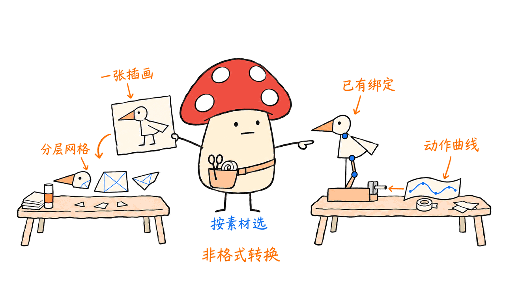
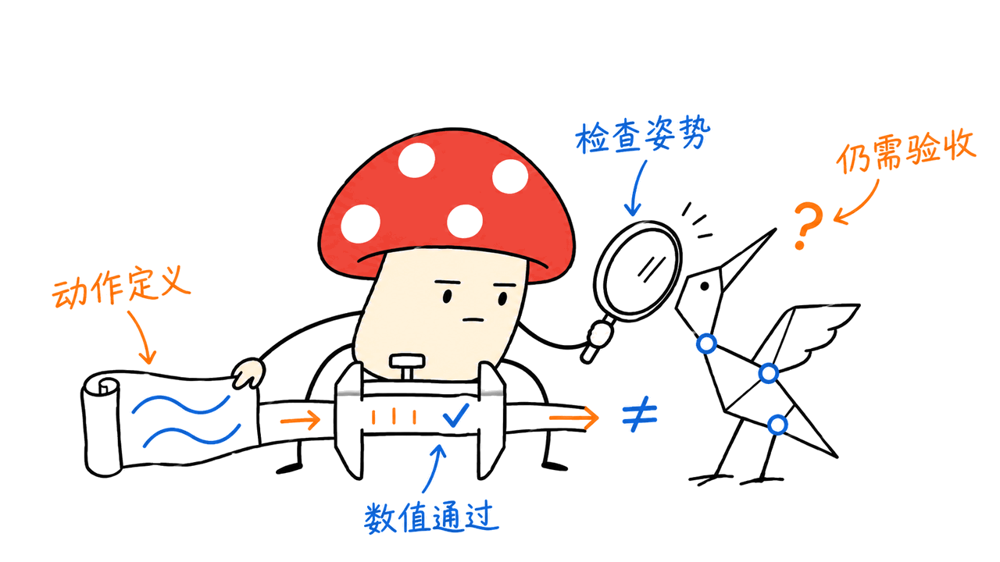
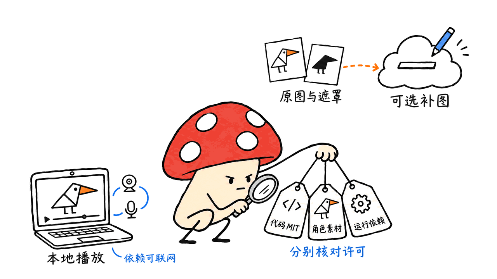

Mesh Avatar Studio 和 live2d-add-motion-sample-web-ui 都能让二维角色动起来，但起点不同：前者从一张插画制作网格头像，后者给已经绑定好的 Live2D 模型增加动作。选型先看手里有什么素材，再看需要哪种表情和控制方式。

两个仓库都由 shinshin86 维护，原创代码采用 MIT。本文核对了 README、运行格式和制作流程，并在本机执行部分构建、测试与浏览器检查；没有从一张新图完成角色制作，也没有给真实 Live2D 模型验收新动作。

Mesh Avatar Studio：https://github.com/shinshin86/mesh-avatar-studio
Live2D 动作工具：https://github.com/shinshin86/live2d-add-motion-sample-web-ui
在线 Player：https://shinshin86.github.io/mesh-avatar-studio/play/

## 手里只有一张图，还是已有 Live2D 模型？

| 判断维度 | Mesh Avatar Studio | Live2D 动作 WebUI |
| --- | --- | --- |
| 起点 | 一张插画，正面、透明背景、头肩像更合适 | 已有参数和绑定的 Live2D 模型 |
| 主要工作 | 标定坐标、划分图层、定义变形区域，再微调 | 分析已有参数、写动作定义、生成并校验曲线 |
| 主要产物 | rig、图层及 .mavatar 包 | .motion3.json、可选表情文件和模型注册项 |
| 播放接入 | WebGL runtime、Web Component、React 包 | 依赖 Cubism Core 的浏览器播放界面 |
| 能力边界 | 遮挡、侧脸、缺少的眼嘴形状需要处理 | 只能使用原模型已有的可用参数 |

两者不是格式互换器。不能把一张 PNG 交给第二个项目，就期待它补出完整的 Live2D 绑定；第一个项目产出的 .mavatar，也不能直接当成 Cubism 模型使用。



## Mesh Avatar Studio 怎样把插画变成头像？

它把制作过程交给编码智能体与本地编辑器协作。智能体先读带网格的图像，定位眼、嘴、头发和身体的控制区域，生成 rig 与图层；使用者在编辑器里拖动控制点，查看眨眼、转头、呼吸、头发摆动等效果。

真正费功夫的是坐标和遮挡。眼睛轮廓稍偏，眨眼就可能拉到睫毛；头发与脸没有分开，转头时就会露出不自然的边缘。因此官方流程要求先校准视觉坐标，再看放大网格、叠加图和固定姿势。JSON 有效只是第一道门，画面自然还需要实际检查。

闭眼图和不同口形可以作为额外绘制的变体加入。没有这些变体时，运行时仍能用网格变形让眼嘴动起来，但并不等于能自动画出原图里不存在的内容。

本次使用的仓库要求 Node.js 22.17+。编辑器和 Live 页面只需 Node；重新构建图层还需要 uv 与 Python，制作流程的姿势检查需要 Playwright Chromium。克隆后可按下面的顺序检查环境：

```bash
npm ci --ignore-scripts
npm run doctor
npm run dev
```

本次采用冻结锁文件、跳过安装脚本的方式安装。doctor 最初提示缺少对应的 Playwright Chromium；安装后才运行浏览器检查。仅打开编辑器不需要把所有制作依赖都装齐，但要从新图制作头像，就应处理相关警告。

导出 .mavatar 时，原图默认包含在内，以便继续编辑。关闭原图导出不代表隐藏角色素材：用于播放的图层仍在包里。导入后没有原图的头像可以播放，却不能按原流程编辑和重建。

## 已有 Live2D 模型，怎样安全增加动作？

第二个项目主要管理参数的时间曲线。以点头为例，生成器让头部俯仰参数在几秒内变化，再回到模型的基础姿势。它不重新建网格，也不能给缺少抬手绑定的模型凭空增加自然的挥手动作。

手工流程是先准备自己的模型，再生成、校验和预览：

```bash
python3 tools/setup_model.py /path/to/model.zip
python3 tools/analyze_model.py
# 根据当前模型编写 motion-defs/<model-name>.py
python3 tools/gen_motions.py
python3 tools/validate_motions.py
python3 tools/serve.py
```

模型分析会参考已有动作的取值和初始姿势。动作定义是源文件，生成后的 .motion3.json 和模型注册项是产物。要修改动作，应改定义再生成，避免下次构建把手工修改覆盖掉。

独立校验器会检查曲线范围、时间、元数据计数和回到基础姿势等条件。循环动作还要考虑首尾数值与斜率衔接。已有物理系统控制的输出参数不应直接拿来驱动动作，否则容易被覆盖或互相争抢。

共享动作使用归一化值，再映射到各模型的可用范围。但“都叫眼睛开合”不保证视觉效果相同：笑眼可能要同时控制多个参数，嘴形的默认值也未必是零。缺少参数时跳过或换表达，比强行套模板更合理。



## 本次实际验证了什么？

在临时源码副本、Node 22.23.3 环境中，Mesh Avatar Studio 的 lint、355 项测试通过；Studio、runtime、Web Component、React 包构建通过。两组 Python 工具测试各 7 项通过。

另外运行了引擎、编辑器和头像归档相关的 8 项 Playwright 浏览器检查，全部通过，覆盖样例渲染、控制点与属性同步、错误文件拒绝、重建提示及归档与文件夹播放一致等场景。这是所选测试，不是整个端到端测试集，也不是帧率、摄像头准确度或 OBS 兼容性报告。

Live2D 项目运行了其身体追踪数学和 Cubism 颜色模块的检查。另用自建参数 JSON 夹具运行真实生成与校验 CLI：合法点头曲线通过，第二次生成字节不变；未知参数被生成器拒绝，越界曲线被独立校验器拒绝。

这个夹具没有 .moc3，也没有加载 Cubism 角色，不能证明点头看起来好看。我们没有下载 Hiyori 模型、使用真实摄像头或麦克风、录制动作或接入 OBS；两条制作路线的最终视觉质量仍需用自己的素材验收。

## 本地运行，哪些内容可能出设备？

需要分别看制作和播放。Mesh Avatar Studio 的摄像头、麦克风追踪在本机处理，直播视图接收数值控制量；但它的可选绘图流程会把原图和遮罩发送给 OpenAI 生成闭眼、嘴形等变体。官方创建命令会先确认，--no-variants 可以跳过这条补图路线。本文没有运行补图或调用付费服务。

在线 Player 可在浏览器打开 .mavatar，不提供 Studio 的 OBS Browser Source URL。要用它直播，官方给的是弹出头像窗口，再由 OBS 窗口捕获并抠绿幕；本地 Studio Live 页面才提供另一条透明浏览器源路线。不要把网页预览与完整直播控制当成同一功能。

Live2D WebUI 的本地服务器负责直播中继、录制保存和外部动作控制，普通静态文件服务器无法替代这些功能。摄像头和麦克风数据不随动作中继发送，但播放还会加载 CDN 上的 Cubism Core、PixiJS 等依赖，因此“本地处理”也不代表首次打开完全不联网。



## MIT 是否覆盖示例角色与全部运行依赖？

不覆盖。Mesh Avatar Studio 的 Miko 示例角色适用独立的角色使用规则，不能把角色素材当作 MIT 资产包再分发；MediaPipe 使用 Apache 2.0。Live2D 项目的 Hiyori 模型不随仓库提供，Cubism Core 也采用独立的专有许可。发布基于 SDK 的商业产品时，应按 Live2D 当前规则核对适用条件。

角色使用规则：https://miko.aituberonair.com/#terms
Live2D SDK 许可：https://www.live2d.com/en/sdk/license/

工程上值得借鉴的是三层分工：让智能体编写可检查的数据，让确定性工具生成和校验，让人或浏览器验证可见结果。Mycelium Protocol 的建议是先验收几种固定姿势与嘴形，再接实时输入；不要把“工具退出零”作为角色已可交付的唯一依据。

## 常见问题

### 它们自带能聊天的 AI 吗？

这两个项目主要解决角色制作、动画和控制。嘴动起来不等于具备语音识别、对话模型或语音合成。构建会聊天的角色，还要连接这些服务，并协调音频播放与动作状态。

### 只有一张立绘，应该先试哪个？

先试 Mesh Avatar Studio 的样例与制作流程。有可用 Live2D 模型且只想加动作，则先试另一个项目；动作质量仍受原绑定能力限制。

### 能完全离线吗？

应按具体路径验证。图层制作、播放器依赖、追踪模型和可选图像生成各有条件，不能从“本地编辑器”推导出所有功能都离线。本文没有完成完整离线验收。

核查日期：2026-11-18。源码版本、测试日志和合成夹具已保存；封面与正文配图是原理示意。README 的九张官方截图已下载供知识库参考，角色与图片权利仍归各自权利人。

格式参考：https://github.com/shinshin86/mesh-avatar-studio/blob/main/docs/format.md
相关项目分析：https://blog.mushroom.cv/blog/promptsoul-live2d-ai-motion-npc/

---

> © 2026 Author: Mycelium Protocol. 本文采用 [CC BY 4.0](https://creativecommons.org/licenses/by/4.0/deed.zh) 授权——欢迎转载和引用，须注明作者姓名及原文链接，不得去除署名后以原创发布。

<!--EN-->

Mesh Avatar Studio and live2d-add-motion-sample-web-ui both animate 2D characters, but they start with different assets. Mesh Avatar Studio builds a mesh avatar from an illustration. The Live2D tool adds motion curves to an already rigged model. Choose by the asset you have and the control you need.

Both repositories are maintained by shinshin86 and license their original code under MIT. We reviewed their documentation, formats and workflows, and ran selected local checks. We did not build a new character from an original illustration or visually approve new motions on a real Live2D model.

Mesh Avatar Studio: https://github.com/shinshin86/mesh-avatar-studio
Live2D motion tool: https://github.com/shinshin86/live2d-add-motion-sample-web-ui
Online Player: https://shinshin86.github.io/mesh-avatar-studio/play/

## Which asset do you already have?

| Decision | Mesh Avatar Studio | Live2D motion WebUI |
| --- | --- | --- |
| Starting point | Illustration, preferably a front-facing transparent bust | Existing rigged Live2D model |
| Main work | Coordinate calibration, layers, rig and visual adjustment | Parameter analysis, motion definitions and curve validation |
| Output | Rig, textures and .mavatar package | .motion3.json, optional expressions and registrations |
| Integration | WebGL runtime, custom element and React wrapper | Browser playback using Cubism Core |
| Boundary | Occlusion and missing eye/mouth artwork need attention | Limited to parameters the model can already express |

These are not interchangeable formats. The second tool does not turn a PNG into a Cubism rig, and .mavatar is not a Cubism model.


## How does Mesh Avatar Studio prepare an illustration?

A coding agent reads coordinate grids, positions deformation regions and prepares layers. The local editor lets the user drag handles and preview blinking, head rotation, breathing and hair movement. Calibration, enlarged grids, overlays and fixed-pose reviews matter because valid JSON alone cannot establish natural animation.

Drawn eye and mouth variants are optional. Without them, mesh deformation still animates the avatar, but cannot reliably invent artwork absent from the source image.

The reviewed repository requires Node.js 22.17+. The editor and Live page need Node; layer building also needs uv/Python, and the agent workflow uses Playwright Chromium for pose reviews.

```bash
npm ci --ignore-scripts
npm run doctor
npm run dev
```

We installed from the lockfile with lifecycle scripts disabled. The initial doctor check reported missing Playwright Chromium; we installed it before browser checks. Missing creation tools are different from the requirements for opening the editor.

An exported .mavatar includes the original illustration by default so it remains editable. Excluding that source does not hide the built textures. A source-free archive can play, but cannot be edited or rebuilt through the same workflow.

## How does the Live2D tool add motion?

It generates curves for existing parameters rather than editing meshes or binding a new model. A rig without a useful arm parameter cannot gain a natural wave merely by asking an agent for one.

```bash
python3 tools/setup_model.py /path/to/model.zip
python3 tools/analyze_model.py
# Author motion-defs/<model-name>.py for this model.
python3 tools/gen_motions.py
python3 tools/validate_motions.py
python3 tools/serve.py
```

Definitions are the source; generated motion files and model registrations are outputs. Edit definitions and regenerate. Analysis uses existing motions to estimate usable ranges and base poses. The independently implemented validator checks ranges, timing, metadata counts and return to base. Loops also need matching seam values and slopes. Physics outputs should not be driven directly.

Shared templates map normalized values into each model’s available ranges. Matching parameter names do not establish matching visual meaning. A smile may require several controls, and a resting mouth value need not be zero. Skip unsupported actions or use another expression instead of forcing a template.


## What did we actually verify?

Using an isolated checkout and Node 22.23.3, Mesh Avatar Studio passed lint and 355 tests. Studio, runtime, custom-element and React builds passed. Two Python tool suites passed seven tests each.

Eight selected Playwright checks covering the engine, editor and avatar archive passed. They cover sample rendering, handle/inspector synchronization, malformed-input rejection, rebuild guidance and archive/folder playback consistency. This was not the entire end-to-end suite or a frame-rate, real-camera or OBS evaluation.

For the Live2D repository, we ran its body-tracking math and Cubism-color checks. We also exercised the real generator and validator with a synthetic parameter-JSON fixture: valid curves passed, a repeat generation preserved bytes, unknown parameters were rejected and an out-of-range curve failed independent validation.

The fixture contained no .moc3 and rendered no Cubism character. It proves those pipeline behaviors, not natural-looking motion. No Hiyori model, real camera/microphone session, motion recording or OBS integration was tested.

## Which operations stay local?

Separate creation from playback. Mesh Avatar Studio processes camera and microphone tracking locally and relays numeric motion values. Its optional image-generation workflow sends source images and masks to OpenAI for drawn variants. The official creation command asks first; --no-variants skips that route. We did not invoke image generation on a character or use a paid service.

The browser Player opens .mavatar files without a Studio installation. It does not provide Studio’s OBS Browser Source URL: the documented route uses an avatar window, window capture and green-screen removal. Local Studio Live provides the transparent browser-source route.

The Live2D local server supplies streaming relay, recording storage and external motion control. A plain static server does not replace those endpoints. Camera/audio are not relayed as media, but Cubism Core and other playback dependencies load from CDNs. Local processing is not the same as no network dependency.


## Does MIT cover the characters and every dependency?

No. Mesh Avatar Studio’s Miko sample uses separate character terms, and MediaPipe uses Apache 2.0. The Live2D repository does not include Hiyori model data. Cubism Core has a proprietary license; commercial SDK publication conditions must be checked separately.

Character terms: https://miko.aituberonair.com/#terms
Live2D SDK licensing: https://www.live2d.com/en/sdk/license/

Mycelium Protocol’s engineering takeaway is to separate agent-authored data, deterministic generation/validation, and visible acceptance. Review fixed poses and mouth shapes before adding live input. A successful CLI exit is useful evidence, but insufficient evidence that a character is ready to ship.

## FAQ

### Do these projects include a conversational AI?

Their main scope is avatar preparation, animation and control. Mouth movement does not provide speech recognition, a dialogue model or speech synthesis. A conversational character needs those systems and coordinated audio/motion state.

### Which should I try with one illustration?

Start with Mesh Avatar Studio’s sample and creation workflow. Use the Live2D tool when you already have a rigged model and need new motions within its capabilities.

### Is every workflow offline?

No blanket claim is justified. Creation tools, tracking models, browser dependencies and optional image generation have different requirements. We did not complete a full offline acceptance test.

Reviewed November 18, 2026. Source revisions, logs and the synthetic fixture are retained. Cover and body illustrations explain concepts. Nine official README screenshots were downloaded for KB reference; character and image rights remain with their owners.

Format reference: https://github.com/shinshin86/mesh-avatar-studio/blob/main/docs/format.md
Related analysis: https://blog.mushroom.cv/blog/promptsoul-live2d-ai-motion-npc/

---

> © 2026 Author: Mycelium Protocol. Licensed under [CC BY 4.0](https://creativecommons.org/licenses/by/4.0/) — free to share and adapt with attribution. You must credit the author and link to the original; removing attribution and republishing as original is not permitted.
