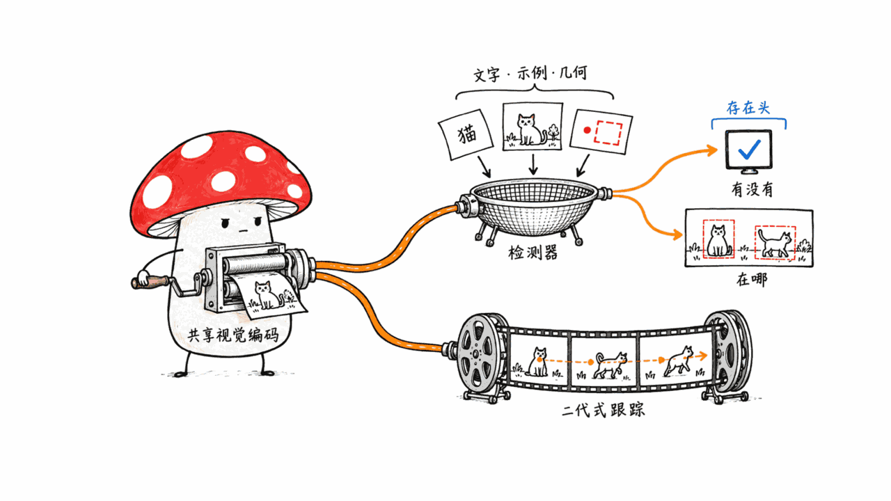
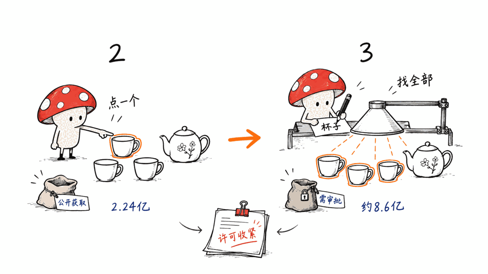
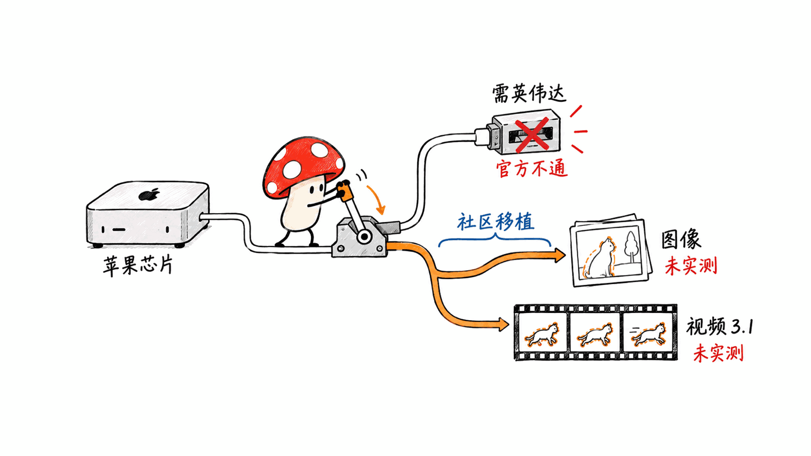
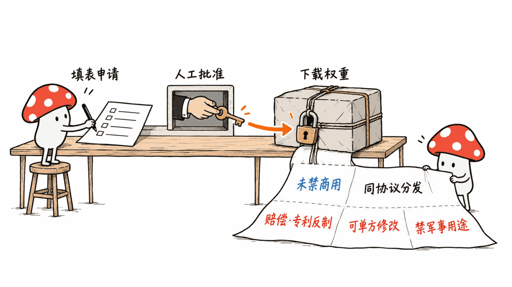

**BLUF**：SAM 3（Segment Anything with Concepts）和 SAM 2 最大的不同，是它不再只能「你点哪里我分割哪里」，而是你写一个短名词（比如 "yellow school bus"）或给一张示例图，它就把图里或视频里**所有**匹配的实例都找出来、分割出来、还能跟踪。Meta 官方称模型 **848M 参数**，在自家新基准 SA-Co/Gold 上实例分割 cgF1 为 **54.1**，人类为 **72.8**，也就是约七成五的人类水平。落地前有三道关：**权重是 manual gated**（要在 HuggingFace 提交姓名、生日、国家、单位并等人工批准）；**许可证不是 Apache-2.0 也不是 MIT**，而是 Meta 的 SAM License；**官方代码要求 CUDA 12.6+**，Mac 上没有官方路径，只能走社区的 MLX 或 CoreML 移植，我们没有实测。

> 📌 一手资料
> 官方仓库：https://github.com/facebookresearch/sam3
> 模型（gated）：https://huggingface.co/facebook/sam3
> 论文：https://arxiv.org/abs/2511.16719
> 许可证全文：https://github.com/facebookresearch/sam3/blob/main/LICENSE

---

## 为什么 Mycelium Protocol 要看这个模型？

本站的配图流水线里有一条硬规则：banner 必须是干净的写实图，不能带文字、不能有人脸特写。现在这个检查靠的是本机的视觉语言模型加一些规则。「把图里所有人脸找出来」「把画面里所有文字区域圈出来」这类需求，恰好就是概念分割的活。所以我们关心的是：SAM 3 能不能当这类工具用？我的机器能不能跑？许可证允不允许？

说明：**我们没有实测 SAM 3。** HuggingFace 上 facebook/sam3 的模型卡是 gated 页面，未登录拿不到正文（API 返回「Access to model facebook/sam3 is restricted」），所以本文的模型描述和指标来自官方 GitHub README、SAM 3.1 发布说明、LICENSE 全文、HF 公开元数据和论文摘要。本机是 16GB 内存的 Mac mini，也没有拿到权重。文中没有任何速度或出图质量的实测数字。

## SAM 3 到底是什么？

官方 README 的核心描述：

- **任务**：Promptable Concept Segmentation（PCS，可提示概念分割）。输入是短名词短语、示例图，或两者结合；输出是所有匹配实例的掩码和唯一 ID。同时保留了 SAM 1/2 的点、框、掩码提示
- **结构**：一个检测器加一个跟踪器，共用同一个视觉编码器。检测器基于 DETR，可以接文字、几何和示例图条件；跟踪器沿用 SAM 2 的 transformer 编码器-解码器结构，负责视频和交互式修正
- **presence token**：新增的「存在性」头，把「这个概念在图里有没有」和「它在哪」分开判断，官方说用它来区分相近的提示，比如 "a player in white" 和 "a player in red"
- **数据**：官方称数据引擎自动标注了超过 400 万个独立概念，论文摘要说是 4M 个概念标签（含难负例），跨图像和视频
- **基准**：新发布的 SA-Co 基准含 27 万个独立概念，官方称是现有基准的 50 倍以上
- **发布时间**：论文 arXiv 2511.16719 于 2025 年 11 月 20 日提交，2026 年 3 月 28 日更新到 v2；HF 仓库 facebook/sam3 最后更新于 2025 年 11 月 20 日

## 参数量到底是多少？

官方 README 写「It has 848M parameters」。HuggingFace 的 safetensors 元数据统计是 **859,922,360** 个参数（全部 F32），约 8.6 亿，差了约 1200 万。我们没法确认差异来自哪里（可能是统计口径，比如是否含某些辅助模块），所以引用时请带上来源：README 说 848M，HF 元数据说 860M。

作为对照，SAM 2.1 Hiera-Large 在 HF 上的元数据是 **224,447,154** 个参数（约 2.2 亿）。也就是 SAM 3 大约是 SAM 2.1 大号版的 3.8 倍。F32 存储下，860M 参数对应约 3.4GB 一份；HF 仓库里同时放了 model.safetensors 和 sam3.pt，仓库已用存储约 10.3GB（HF API 的 usedStorage，含历史版本，不等于一次下载量）。

## 它和 SAM 2 有什么区别？

| 维度 | SAM 2 / 2.1 | SAM 3 |
|---|---|---|
| 提示方式 | 点、框、掩码 | 以上全部，外加文字短语和示例图 |
| 一次输出 | 你指定的那一个对象 | 所有匹配概念的实例 |
| 概念范围 | 不识别概念，只做几何分割 | 开放词汇，SA-Co 含 27 万个概念 |
| 参数量（HF 元数据） | 约 2.24 亿（2.1 Hiera-Large） | 约 8.6 亿 |
| 许可证 | Apache-2.0（HF 上 sam2.1-hiera-large 标注） | SAM License（Meta 自定义） |
| 权重获取 | 公开下载 | manual gated |

注意最后两行：从 SAM 2.1 升级到 SAM 3，**许可证和获取门槛都变严了**。SAM 2.1 的 HF 仓库标注 apache-2.0 且不 gated；SAM 3 是 `license: other` 加 manual gated。

## 自报指标：数字能信多少？

以下全部是官方 README 的自报数字，来自 Meta 自己的新基准 SA-Co，评测设计和数据都由同一团队完成。独立复现的结果我们没有找到。

**图像（SA-Co/Gold 等）**

| 模型 | LVIS 实例分割 cgF1 | SA-Co/Gold 实例分割 cgF1 | SA-Co/Gold 框检测 cgF1 |
|---|---|---|---|
| 人类 | - | 72.8 | 74.0 |
| OWLv2 | 29.3 | 24.6 | 24.5 |
| DINO-X | - | 21.3 | 22.5 |
| Gemini 2.5 | 13.4 | 13.0 | 14.4 |
| SAM 3 | 37.2 | 54.1 | 55.7 |

SAM 3 在 SA-Co/Gold 上约是 OWLv2 的 2.2 倍，这就是论文说的「doubles the accuracy」。但要注意两点。第一，SA-Co 是为概念分割量身定做的基准，对手 OWLv2、DINO-X 并不是为这个指标设计的。第二，在 LVIS 这种已有基准上，差距明显小：37.2 对 29.3。

**视频（SA-Co/VEval，SAM 3 对人类）**

| 子集 | SAM 3 cgF1 | 人类 cgF1 |
|---|---|---|
| SA-V test | 30.3 | 53.1 |
| YT-Temporal-1B test | 50.8 | 71.2 |
| SmartGlasses test | 36.4 | 58.5 |

视频上的差距比图像更大：SA-V 上只有人类的约 57%。「75-80% 人类水平」这个说法主要对应图像基准。

## SAM 3.1 是什么？该用哪个？

2026 年 3 月 27 日，Meta 发布了 SAM 3.1（Object Multiplex）。官方发布说明的要点：

- 多目标跟踪不再逐个对象独立处理，而是把对象分到固定容量的桶里联合处理，共享记忆
- 官方称在单张 H100 上跟踪 128 个对象时，相比 2025 年 11 月的 SAM 3 约 **7 倍**加速
- 精度：SA-Co/VEval 上结果有升有降（SA-V cgF1 30.3 到 30.5，SmartGlasses 36.4 到 36.3，BURST HOTA 44.5 到 43.3）；YT-Temporal-1B cgF1 从 50.8 到 52.9；视频目标分割 MOSEv2 从 60.3 到 62.3
- SAM 3.1 在 HF 上是单独的仓库 facebook/sam3.1，同样 manual gated、license: other，权重文件是 sam3.1_multiplex.pt

结论：如果你主要做**视频里多目标跟踪**，选 3.1；如果只做**单张图**的概念分割，3.1 的主要改进（多目标联合跟踪）基本用不上，现成的 SAM 3 生态（transformers 的 Sam3Model、各种 Mac 移植）也更成熟。

## 许可证：SAM License 能不能商用？

LICENSE 全文（最后更新 2025 年 11 月 19 日）的要点，不是法律意见：

- **授权范围**：非独占、全球、免费、不可转让的有限许可，可以使用、复制、分发、修改，也可以做衍生作品
- **没有收入门槛，也没有明确禁止商用**。这点和 Krea 2 那类「年收入 100 万美元以下」的条款不同
- **再分发**：必须以同一份协议分发，并附上协议副本
- **论文致谢**：发表基于 SAM Materials 的研究结果，必须在论文里说明用了它
- **禁止反向工程**：不得反向工程、反编译或探查模型的内部组成，也不得鼓励别人这样做
- **贸易管制**：不得用于 ITAR 范围活动，或军事、战争、核工业、间谍活动、枪支或非法武器相关用途
- **专利反制**：如果你对 Meta 就 SAM Materials、输出或结果提起知识产权诉讼，授权立即终止；你还需要就第三方因你的使用或分发提出的索赔对 Meta 作赔偿
- **修改条款**：Meta 可以单方面修改协议，继续使用即视为同意
- **终止**：Meta 在你违约时可终止，终止后须删除并停止使用

GitHub 的许可证探测显示 NOASSERTION（识别不了），HF 标注 `license: other`。结论：**个人和公司商用在条文上没有被禁止，但它不是 OSI 意义的开源协议**，有赔偿条款、有单方修改条款、有军事用途限制。如果你要把 SAM 3 嵌进产品分发，务必让法务看全文。

另一个坑：社区 MLX 移植 mlx-community/sam3-image 的卡片写着 `license_name: apache-2.0`，但同时 `license: other` 并把 license_link 指回 Meta 的 SAM License。**不要被 apache-2.0 这个名字误导**，权重衍生物仍受 SAM License 约束。

## gated 是什么流程？

HF 页面元数据显示 `gated: manual`，表单字段包括姓名、生日、国家、单位、职位（学生/研究生/AI 研究员/AI 开发者/记者/其他），并通过 IP 记录地理位置，还要勾选同意 Meta 隐私政策。manual 表示需要人工批准，我们没提交申请，所以**批准要多久不清楚**。官方 README 的要求是：先申请权限，通过后用 `hf auth login` 认证才能下载。

## Mac 能跑吗？

**官方路径：基本不行。** README 的前置条件写的是 Python 3.12+、PyTorch 2.7+、**CUDA 12.6+ 的 GPU**，可选加速还用到 flash-attn-3。官方仓库里有两个相关的未关闭 issue：#179「No module named 'triton' on Mac」（2025-11-21）和 #164「backend-agnostic inference (CPU/MPS/TPU)」（2025-11-20），#597 在 2026-06-26 又有人遇到同样的 triton 报错。也就是说一直没有官方的 Mac 支持。

**社区路径（我们没实测，以下是项目自述）：**

- mlx-community/sam3-image：Deekshith-Dade/mlx_sam3 的 MLX 移植，自称覆盖 M1 到 M4，支持文字提示和框提示，只做图像。该 GitHub 仓库 45 星，许可证探测为 NOASSERTION，最后推送于 2026-07-30。HF 页面下载数为 0
- sdkv2/sam3.1-coreml：SAM 3.1 的 CoreML 导出，自述在 16GB 的 M 系列笔记本上图像编码器约 2 秒/帧，跟踪器预热后约 0.7 秒/帧。这是项目自己的数字，我们没有复现
- mlboydaisuke/sam3-CoreAI-official：基于 Apple 官方导出方案的 Core AI 包，源检查点依然 gated
- HuggingFace transformers 有 Sam3Model 和 Sam3Processor，官方文档给的示例用 device_map="auto"。我们没验证它在 MPS 上能否完整运行

对 16GB 的 Mac：FP32 权重约 3.4GB，从体积看不是问题，真正的风险是**算子支持和速度**。如果你想在 Mac 上做图像概念分割，先试 MLX 移植；视频跟踪则先看 CoreML 版，并自己测一遍再决定。

## 有哪些局限？

- **文字提示的否定词不可靠**：官方 issue #393 里有人报告，提示 "person without safety helmet" 时，即使所有人都戴了头盔，也返回高置信度结果。概念分割擅长「找 X」，不擅长「找不是 X 的」
- **视频仍离人类很远**：SA-V 上 30.3 对人类 53.1
- **自报基准**：SA-Co 由同一团队设计，评测对手不是为该任务设计的
- **参数量口径不一致**：848M 对 860M
- **需要审批的权重**：自动化流水线里不能直接 `wget`，CI 上要处理 HF token

## 常见问题（FAQ）

**SAM 3 是开源的吗？** 代码和权重在 SAM License 下可获取，但它不是 OSI 认可的开源许可证，权重需要在 HF 上 manual gated 申请。

**SAM 3 能商用吗？** 条文上没有禁止商用，也没有收入门槛，但有赔偿、专利反制、单方修改和军事用途限制。产品化前请让法务看 LICENSE 全文。

**SAM 3 和 SAM 2 的核心区别？** SAM 3 能用文字短语或示例图，一次性分割所有匹配的实例；SAM 2 需要你用点、框或掩码逐个指定对象。

**SAM 3.1 比 SAM 3 好在哪？** 多目标视频跟踪更快，官方称 128 个对象时在 H100 上约 7 倍；精度有升有降，主要改进在视频，不在单图。

**Mac 上怎么跑？** 官方代码要求 CUDA，没有 Mac 路径。社区有 MLX（图像）和 CoreML（SAM 3.1 视频）移植，我们没有实测。

**需要多少显存或内存？** 官方 README 没有给出明确数字。FP32 权重约 3.4GB，实际占用要看分辨率和视频长度，我们没测。

## 我们的判断

如果你有 NVIDIA GPU，需要「按文字找出所有同类物体」，比如给素材库打标签、做自动抠图、视频里数人数，SAM 3 是目前开放权重里最直接的方案，值得走一遍 gated 流程。如果你只有 Mac，先别指望官方代码，先用 MLX 移植做小规模试验，把视频需求留给 CoreML 版，并且一定自己验证。如果你的场景是「找不是 X 的东西」或者对许可证条款敏感，要多留一手。

本文仅供学习研究参考，不构成法律或商业建议。使用任何模型前请自行阅读其许可证。

## 一手源

官方仓库：https://github.com/facebookresearch/sam3
SAM 3.1 发布说明：https://github.com/facebookresearch/sam3/blob/main/RELEASE_SAM3p1.md
模型（gated）：https://huggingface.co/facebook/sam3
SAM 3.1 模型（gated）：https://huggingface.co/facebook/sam3.1
论文：https://arxiv.org/abs/2511.16719
许可证：https://github.com/facebookresearch/sam3/blob/main/LICENSE
transformers 文档：https://huggingface.co/docs/transformers/model_doc/sam3
MLX 移植：https://huggingface.co/mlx-community/sam3-image
CoreML（SAM 3.1）：https://huggingface.co/sdkv2/sam3.1-coreml
Mac 相关 issue：https://github.com/facebookresearch/sam3/issues/179

---

> © 2026 Author: Mycelium Protocol. 本文采用 [CC BY 4.0](https://creativecommons.org/licenses/by/4.0/deed.zh) 授权——欢迎转载和引用，须注明作者姓名及原文链接，不得去除署名后以原创发布。

<!--EN-->

**BLUF**: The big change from SAM 2 to SAM 3 (Segment Anything with Concepts) is that you no longer click where to segment. You write a short noun phrase such as "yellow school bus", or give an example image, and it finds, segments and tracks **every** matching instance in an image or video. Meta states **848M parameters**, and on its own SA-Co/Gold benchmark the model scores **54.1** instance-segmentation cgF1 against **72.8** for humans, roughly 75% of human performance. Three hurdles before you adopt it: **the weights are manually gated** on HuggingFace (name, birthday, country, affiliation, then human approval); **the license is neither Apache-2.0 nor MIT** but Meta's custom SAM License; and **the official code requires CUDA 12.6+**, so on a Mac you depend on community MLX or CoreML ports, which we did not test.

> 📌 Primary sources
> Official repo: https://github.com/facebookresearch/sam3
> Model (gated): https://huggingface.co/facebook/sam3
> Paper: https://arxiv.org/abs/2511.16719
> License text: https://github.com/facebookresearch/sam3/blob/main/LICENSE

---

## Why does Mycelium Protocol care about this model?

Our banner pipeline has a hard rule: banners must be clean photorealistic images with no text and no face close-ups. Today that check relies on a local vision-language model plus rules. "Find every face" or "outline every text region" is exactly a concept-segmentation job, so the questions are: can SAM 3 serve as that tool, can my machine run it, and does the license allow it?

Disclosure: **we did not test SAM 3.** The model card for facebook/sam3 on HuggingFace is gated and returns nothing without login (the API says "Access to model facebook/sam3 is restricted"), so this article uses the official GitHub README, the SAM 3.1 release notes, the full LICENSE, public HF metadata and the paper abstract. Our machine is a 16GB Mac mini and we did not obtain the weights. There are no speed or quality measurements here.

## What exactly is SAM 3?

From the official README:

- **Task**: Promptable Concept Segmentation (PCS). Input is a short noun phrase, image exemplars, or both; output is masks and unique IDs for all matching instances. The SAM 1/2 prompts (points, boxes, masks) are retained
- **Architecture**: a detector and a tracker sharing one vision encoder. The detector is DETR-based and conditioned on text, geometry and exemplars; the tracker inherits SAM 2's transformer encoder-decoder for video and interactive refinement
- **Presence token**: a presence head separates "is the concept in the image" from "where is it", which Meta says helps distinguish close prompts such as "a player in white" versus "a player in red"
- **Data**: the README says the data engine auto-annotated over 4 million unique concepts; the paper abstract says 4M concept labels including hard negatives, across images and video
- **Benchmark**: the new SA-Co benchmark has 270K unique concepts, which Meta says is over 50 times more than existing benchmarks
- **Dates**: arXiv 2511.16719 was submitted on 20 November 2025 and revised to v2 on 28 March 2026; the HF repo facebook/sam3 was last modified on 20 November 2025

## How many parameters does it really have?

The README says "It has 848M parameters". HuggingFace's safetensors metadata counts **859,922,360** parameters (all F32), about 860M, roughly 12M more. We cannot tell where the gap comes from (possibly counting scope), so cite both with sources: README 848M, HF metadata 860M.

For comparison, HF metadata for SAM 2.1 Hiera-Large is **224,447,154** parameters. SAM 3 is about 3.8 times that. At F32, 860M parameters is about 3.4GB per copy; the HF repo ships both model.safetensors and sam3.pt, with 10.3GB of used storage reported by the HF API (this includes history and is not a single download size).

## How is it different from SAM 2?

| Dimension | SAM 2 / 2.1 | SAM 3 |
|---|---|---|
| Prompts | Points, boxes, masks | All of those plus text phrases and exemplars |
| Output per prompt | The one object you specify | Every instance of the concept |
| Concept coverage | None, geometric only | Open vocabulary, SA-Co has 270K concepts |
| Parameters (HF metadata) | about 224M (2.1 Hiera-Large) | about 860M |
| License | Apache-2.0 (as tagged on HF sam2.1-hiera-large) | SAM License (Meta custom) |
| Weight access | Public download | Manually gated |

Look at the last two rows: moving from SAM 2.1 to SAM 3, **both the license and the access barrier got stricter**. The SAM 2.1 HF repo is tagged apache-2.0 and not gated; SAM 3 is `license: other` and manually gated.

## Self-reported benchmarks: how far to trust them?

Everything below is self-reported in the official README on Meta's own SA-Co benchmark, designed by the same team. We found no independent reproduction.

**Images**

| Model | LVIS mask cgF1 | SA-Co/Gold mask cgF1 | SA-Co/Gold box cgF1 |
|---|---|---|---|
| Human | - | 72.8 | 74.0 |
| OWLv2 | 29.3 | 24.6 | 24.5 |
| DINO-X | - | 21.3 | 22.5 |
| Gemini 2.5 | 13.4 | 13.0 | 14.4 |
| SAM 3 | 37.2 | 54.1 | 55.7 |

SAM 3 is about 2.2 times OWLv2 on SA-Co/Gold, which is the "doubles the accuracy" claim. Two caveats. First, SA-Co is tailored to concept segmentation, and OWLv2 and DINO-X were not built for this metric. Second, on the pre-existing LVIS benchmark the gap is much smaller: 37.2 versus 29.3.

**Video (SA-Co/VEval, SAM 3 versus humans)**

| Subset | SAM 3 cgF1 | Human cgF1 |
|---|---|---|
| SA-V test | 30.3 | 53.1 |
| YT-Temporal-1B test | 50.8 | 71.2 |
| SmartGlasses test | 36.4 | 58.5 |

The video gap is larger: on SA-V SAM 3 reaches only about 57% of humans. The "75-80% of human performance" line mostly describes the image benchmarks.

## What is SAM 3.1 and which should you use?

On 27 March 2026 Meta released SAM 3.1 (Object Multiplex). Key points from the release notes:

- Multi-object tracking no longer processes each object independently; objects are grouped into fixed-capacity buckets and processed jointly with shared memory
- Meta states about a **7x speedup** at 128 objects on a single H100 versus the November 2025 SAM 3
- Accuracy is mixed on SA-Co/VEval (SA-V cgF1 30.3 to 30.5, SmartGlasses 36.4 to 36.3, BURST HOTA 44.5 to 43.3); YT-Temporal-1B cgF1 rises from 50.8 to 52.9; video object segmentation MOSEv2 goes from 60.3 to 62.3
- SAM 3.1 is a separate HF repo, facebook/sam3.1, also manually gated and `license: other`, with the checkpoint sam3.1_multiplex.pt

Takeaway: for **multi-object video tracking** choose 3.1. For **single-image** concept segmentation 3.1's main change does not apply, and the SAM 3 ecosystem (transformers Sam3Model, Mac ports) is more mature.

## License: can you use the SAM License commercially?

Key points from the full LICENSE (last updated 19 November 2025). This is not legal advice:

- **Grant**: non-exclusive, worldwide, non-transferable, royalty-free limited license to use, reproduce, distribute, copy, modify and create derivative works
- **No revenue threshold and no explicit commercial-use ban**, unlike the "under $1M annual revenue" clauses in some other recent model licenses
- **Redistribution**: only under the same agreement, with a copy of it
- **Research acknowledgment**: if you publish research results obtained using SAM Materials, you must acknowledge it
- **No reverse engineering**: you may not reverse engineer, decompile or discover the underlying components, or encourage others to
- **Trade controls**: no ITAR activities, and no military or warfare, nuclear, espionage, guns or illegal weapons uses
- **Patent retaliation and indemnity**: if you sue Meta over IP concerning the SAM Materials, outputs or results, your licenses terminate; you also indemnify Meta against third-party claims arising from your use or distribution
- **Amendments**: Meta may modify the agreement unilaterally, and continued use counts as acceptance
- **Termination**: Meta may terminate on breach, after which you must delete and stop using the materials

GitHub's detector reports NOASSERTION and HF labels it `license: other`. Bottom line: **commercial use is not prohibited on the text, but this is not an OSI-style open-source license**, and it carries indemnity, unilateral-change and military-use clauses. Have counsel read the full text before shipping it inside a product.

One more trap: the community MLX port mlx-community/sam3-image has `license_name: apache-2.0` in its card, yet also `license: other` with the license link pointing to Meta's SAM License. **Do not be misled by the apache-2.0 name**; derived weights remain under the SAM License.

## What does gated mean here?

The HF metadata shows `gated: manual`. The form asks for first and last name, date of birth, country, affiliation and job title (student, research graduate, AI researcher, AI developer/engineer, reporter, other), records IP geolocation, and requires accepting Meta's privacy policy. Manual means a person approves it. We did not submit a request, so **we do not know the approval time**. The README says to request access first, then authenticate with `hf auth login` to download.

## Can it run on a Mac?

**Official route: effectively no.** The README prerequisites are Python 3.12+, PyTorch 2.7+, and a **CUDA 12.6+ GPU**, with flash-attn-3 as an optional accelerator. Two open issues in the official repo: #179 "No module named 'triton' on Mac" (2025-11-21) and #164 "backend-agnostic inference (CPU/MPS/TPU)" (2025-11-20); #597 reported the same triton error again on 2026-06-26. There is no official Mac support.

**Community routes (untested by us; these are project self-descriptions):**

- mlx-community/sam3-image: an MLX port by Deekshith-Dade/mlx_sam3 that claims M1 to M4 coverage with text and box prompts, image only. The GitHub repo has 45 stars, license detected as NOASSERTION, last pushed 2026-07-30. The HF page shows 0 downloads
- sdkv2/sam3.1-coreml: a CoreML export of SAM 3.1 that reports about 2 seconds per frame for the image encoder and about 0.7 seconds per frame for the tracker after warm-up on a 16GB M-series laptop. These are the project's own numbers and we did not reproduce them
- mlboydaisuke/sam3-CoreAI-official: a Core AI bundle built from Apple's official export recipe; the source checkpoint is still gated
- HuggingFace transformers ships Sam3Model and Sam3Processor, and the docs example uses device_map="auto". We did not verify that it runs fully on MPS

On a 16GB Mac, the roughly 3.4GB of F32 weights is not the problem; the risks are **operator support and speed**. For image concept segmentation start with the MLX port; for video look at the CoreML build, and measure it yourself before relying on it.

## What are the limits?

- **Negation in text prompts is unreliable**: official issue #393 reports high-confidence results for "person without safety helmet" even when everyone wears a helmet. Concept segmentation is good at "find X", not "find things that are not X"
- **Video is still far from human level**: 30.3 versus 53.1 on SA-V
- **Self-reported benchmark**: SA-Co is designed by the same team, and the baselines were not built for this task
- **Inconsistent parameter count**: 848M versus 860M
- **Approval-gated weights**: you cannot just `wget` in an automated pipeline, and CI needs an HF token

## FAQ

**Is SAM 3 open source?** Code and weights are available under the SAM License, but it is not an OSI-approved open-source license, and the weights need a manual-gated request on HF.

**Can I use SAM 3 commercially?** The text does not prohibit it and sets no revenue threshold, but it has indemnity, patent-retaliation, unilateral-amendment and military-use clauses. Have legal review the full LICENSE before productizing.

**What is the core difference between SAM 3 and SAM 2?** SAM 3 takes a text phrase or exemplar and segments all matching instances at once; SAM 2 needs points, boxes or masks to specify objects one at a time.

**What does SAM 3.1 improve?** Faster multi-object video tracking, about 7x at 128 objects on an H100 per Meta; accuracy is mixed, and the gains are in video rather than single images.

**How do I run it on a Mac?** The official code requires CUDA and has no Mac path. Community MLX (image) and CoreML (SAM 3.1, video) ports exist; we did not test them.

**How much memory does it need?** The README gives no figure. F32 weights are about 3.4GB; real usage depends on resolution and video length, and we did not measure it.

## Our take

If you have an NVIDIA GPU and need "find every object of this kind from a phrase", such as tagging a media library, automatic cutouts or counting people in video, SAM 3 is the most direct open-weight option right now and worth the gated process. If you only have a Mac, do not expect the official code to work; try the MLX port on small jobs, leave video to the CoreML build, and verify everything yourself. If your use case is "find things that are not X", or you are sensitive to license terms, keep a fallback.

This article is for learning and research reference only and is not legal or business advice. Read any model's license before use.

## Primary sources

Official repo: https://github.com/facebookresearch/sam3
SAM 3.1 release notes: https://github.com/facebookresearch/sam3/blob/main/RELEASE_SAM3p1.md
Model (gated): https://huggingface.co/facebook/sam3
SAM 3.1 model (gated): https://huggingface.co/facebook/sam3.1
Paper: https://arxiv.org/abs/2511.16719
License: https://github.com/facebookresearch/sam3/blob/main/LICENSE
transformers docs: https://huggingface.co/docs/transformers/model_doc/sam3
MLX port: https://huggingface.co/mlx-community/sam3-image
CoreML (SAM 3.1): https://huggingface.co/sdkv2/sam3.1-coreml
Mac-related issue: https://github.com/facebookresearch/sam3/issues/179

---

> © 2026 Author: Mycelium Protocol. Licensed under [CC BY 4.0](https://creativecommons.org/licenses/by/4.0/) — free to share and adapt with attribution. You must credit the author and link to the original; removing attribution and republishing as original is not permitted.
