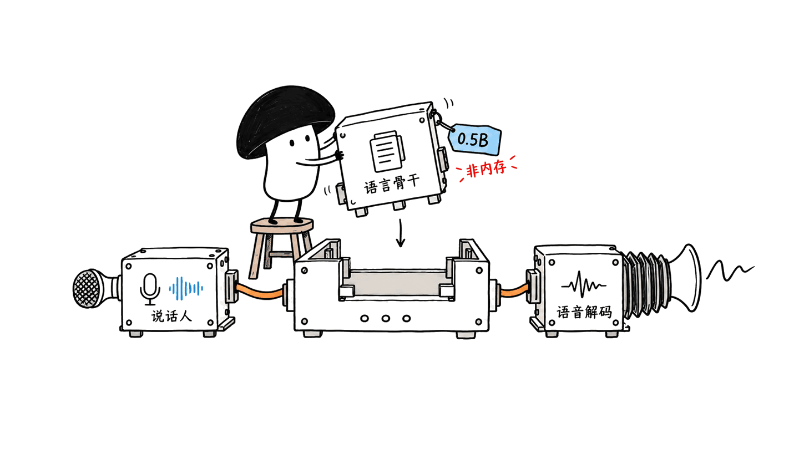

Ming-3.0-TTS 是蚂蚁 inclusionAI 开源的语音合成模型。0.5B 稠密版本确实在独立英文听感榜上表现突出，但“顶级音质”不是所有任务第一，也不等于任意笔记本都能直接运行。

本文核对于2026年10月24日：代码与权重可下载，MIT许可属实。我们检查了任务输入协议与推理代码，没有生成音频、组织听测或测量速度。下文区分独立榜单、团队评测与本机检查。

## 原始仓库和模型权重在哪里？

代码、推理入口及任务说明：
https://github.com/inclusionAI/Ming-3.0-tts

0.5B模型权重与模型卡：
https://huggingface.co/inclusionAI/Ming-3.0-tts-0.5B

官方演示与能力说明：
https://nomorecoding.github.io/Ming-3.0-tts/

不要把同一家族的`tiny`当作更小版本：0.5B是基于Qwen2.5-0.5B的稠密路线，tiny则是7.9B总参数、1.3B激活参数的MoE。后者有独立依赖环境和API，多说话人对话也只在tiny路线提供。

0.5B模型包不只有语言骨干，还包含DiT头、音频tokenizer、说话人编码器和文本tokenizer。此次HF文件元数据显示，`model.safetensors`约2.96GB，`campplus.onnx`约28.3MB，尚未计入其他文件。**0.5B是模型规格标签，不是500MB下载量或内存承诺。**



## “顶级”是哪张榜、什么口径？

Artificial Analysis提供了两类听感偏好榜。Controlled Voice让模型克隆同样的八个英美音色，更侧重可比条件下的表现；Provider Voice使用各模型自己的原生音色，反映模型与音色库的组合。

| 2026-10-24读取的榜单 | Ming结果 | 该数字说明什么 |
|---|---|---|
| Controlled Voice | Elo 1071±16，总榜第14，名次区间10—20 | 英文盲听偏好，不能写成所有模型第一 |
| Provider Voice | Elo 1191±14，总榜第19，名次区间18—22 | 原生音色盲听；榜单FAQ把它列为开放权重第三 |
| 发音鲁棒性 | README报告93.2%，称总榜第一 | 英文特定片段是否念对，属于另一种指标 |

README保存的是Controlled 1069、第13和Provider 1188、第17的早期快照。实时榜已经变化，本文采用直接读取的榜单值。README称Controlled开放权重第一；这里不把开放子集名次扩展为全体排名。

93.2%的定义也很关键：它不是MOS自然度、声音相似度，更不是中文整体正确率。AA的方法是由人工判断英文指定片段的读音，涵盖缩写展开、编号和路径、专名及上下文消歧。此次可读取的方法页没有列出Ming的具体分数，因此93.2%保留为项目方引用AA的结果，未独立复算。

Elo来自比较偏好，区间有重叠时，个位数分差不值得放大。尤其不能横向相减两张榜的Elo，声称“原生音色比克隆高120分”：两张榜的比较集合与标尺不同。

榜单与方法：
https://artificialanalysis.ai/text-to-speech/leaderboard/controlled-voice
https://artificialanalysis.ai/text-to-speech/leaderboard/provider-voice
https://artificialanalysis.ai/methodology/text-to-speech/pronunciation-robustness-overview


## 官方客观评测有没有短板？

模型卡的Seed-TTS测试表提供了另一个视角。以下是团队公布的结果，本文没有复测；SIM衡量说话人相似性，WER越低越好，二者都不能完整替代听感评价。

| 模型 | 中文WER | 中文SIM | 英文WER | 英文SIM |
|---|---:|---:|---:|---:|
| Ming-3.0-tts-0.5B | 0.800% | 0.758 | 1.584% | 0.691 |
| CosyVoice3-0.5B | 1.160% | 0.780 | 2.020% | 0.718 |
| Qwen3-TTS-12Hz-0.6B-Base | 0.920% | 未列 | 1.320% | 未列 |

这张表支持一个更具体的判断：Ming在列出的中文识别误差上有竞争力，但它的英文WER并非表内最低，SIM也不是全面领先。不要把别的模型未填写的SIM当成零分。

官方还承认法语声音相似性、纯靠语气传达的情感，以及一句里堆多个非语言标签等场景存在短板。更大的tiny也不是逐项更好：韩语CER为6.000%，0.5B为1.728%。选模型应看自己的语言和任务，不能只按参数量排序。

## 小模型能控制哪些声音？

公开能力包含七种语言：中、英、德、西、法、韩、日，另有四川话和粤语；输出采样率为44.1kHz。使用方式包括参考音频克隆、文字描述音色、内置音色，以及语速、音高、音量、情绪和笑声等标签。

这些不是随意组合的“万能提示词”。`FREEFORM`使用独立的自然语言指令；情绪、方言和基本属性等走结构化任务。`MULTILINGUAL`对新增五种语言要求明确的`language_id`。官方cookbook比一段包揽全部控制项的示例更可靠。

我们在本机直接调用上游任务构建函数，验证了八种输入：普通TTS、自由描述、日语多语言请求能通过；缺语言、自由描述混用情绪字段、冲突说话人模式、缺失参考音频和空文本会被拒绝。**这只证明接口约束执行正常，没有加载权重或证明合成质量。**

任务说明：https://github.com/inclusionAI/Ming-3.0-tts/blob/main/cookbooks/instructions.md

## Mac能直接安装吗？先看代码走哪条设备路径

官方0.5B参考环境在NVIDIA H800-80GB、H20-96G上测试，Docker采用PyTorch 2.6与CUDA 12.4。大卡测试不等于最低显存要求；官方没有给出可据以承诺的Mac最低内存配置。

源码中`infer.py`默认`--device cuda:0`，封装默认BF16，生成逻辑还有显式CUDA autocast。虽然CLI暴露设备参数，**把它改成`mps`不构成完整适配验证**；CUDA容器也不能直接变成Apple GPU容器。`flash-attn`可选、可回退SDPA，只解决注意力依赖，不证明整个推理链已支持MPS。

| 使用环境 | 本文可以确认的范围 |
|---|---|
| 官方CUDA参考路线 | 有代码和依赖说明，H800/H20测试环境明确；本文未做GPU推理 |
| Apple Silicon Mac | 可以阅读源码和运行纯Python任务协议检查；合成、兼容性和速度未验证 |
| CPU或第三方移植 | 应核对具体仓库、版本及完整音频输出，不能直接继承官方成绩 |

因此，不建议仅凭“0.5B”购买或升级Mac。实际运行还涉及解码模块、参考音频、缓存、依赖和数值精度；权重文件大小也不是峰值内存。

在符合官方环境的机器上，先建独立环境、按仓库安装依赖并下载权重，然后使用本地路径做预检：

```bash
hf download inclusionAI/Ming-3.0-tts-0.5B --local-dir Ming-3.0-tts-0.5b
python tools/preflight.py --model_path ./Ming-3.0-tts-0.5b
python infer.py --model_path ./Ming-3.0-tts-0.5b \
  --task TTS --language_id Chinese --text "今天的测试已经完成。" \
  --prompt_wav_path data/wavs/10002287-00000094.wav \
  --prompt_text "在此奉劝大家别乱打美白针。" \
  --use_spk_emb --output output/tts.wav
```

这段来自官方用法，本文未执行音频生成。文本归一化可选依赖`pynini`；跳过归一化可能改变数字、日期和符号的读法，不能把这个开关当作毫无影响的安装捷径。


## 它值得用在哪里？

值得优先考虑的是可分段验收的配音、原型助手和多语言创作。先用真实稿件检查读音，再核对克隆音色，最后测总耗时与首音频延迟。离线批量合成成功，也不自动代表满足实时对话的延迟要求。

对于角色对话，要先确认是否需要tiny的多说话人能力；对于客服，要测试产品名、金额和日期；对于国际化，要单独听目标语言，别用英文榜单为粤语表现担保。我们的判断是“小体量下有竞争力的开放选择”，而非已经验证的全场景替代品。

MIT允许按许可证条件使用和再分发代码与权重，须保留声明；它不自动授予参考音频、人物声音或第三方素材的使用权。语音生成与语音识别也不同，可对照本站Bark分析理解两类任务：https://blog.mushroom.cv/blog/underdog-bark-3-local-asr/

## 常见问题

### 0.5B就是整套系统只占1GB吗？

不是。本次发布的主权重文件约2.96GB，还有说话人编码器等文件；运行内存需要单独测量。

### “顶级音质”是否意味着所有榜单第一？

不是。听感、发音鲁棒性和音色相似性是不同评估；开放权重子集名次也不同于含闭源系统的总榜。

### 我们已经在Mac上合成音频了吗？

没有。本文只做源码核查与八项任务输入检查，未给出Mac合成速度或音质实测结论。

---

本文原文：https://blog.mushroom.cv/blog/ming-3-tts-small-model-evaluation/

> © 2026 Author: Mycelium Protocol. 本文采用 [CC BY 4.0](https://creativecommons.org/licenses/by/4.0/deed.zh) 授权——欢迎转载和引用，须注明作者姓名及原文链接，不得去除署名后以原创发布。

<!--EN-->

Ming-3.0-TTS is inclusionAI's open speech-synthesis family. Its dense 0.5B release is competitive on independent English listening evaluations, but that does not establish universal leadership or an effortless Mac installation.

Checked October 24, 2026. Code and weights are available under MIT. We inspected source and exercised task validation; we did not synthesize audio, run a listening study or benchmark inference.

## Where are the original releases?

Code: https://github.com/inclusionAI/Ming-3.0-tts
Weights: https://huggingface.co/inclusionAI/Ming-3.0-tts-0.5B
Demos: https://nomorecoding.github.io/Ming-3.0-tts/

The dense release uses a Qwen2.5-0.5B backbone. The separately named tiny is a 7.9B-total/1.3B-active MoE with a different environment and API; multi-speaker dialogue belongs to that route.

A complete package also includes a DiT head, audio tokenizer, speaker encoder and text tokenizer. The checked HF metadata reports 2,959,055,504bytes for `model.safetensors` and 28,303,423bytes for `campplus.onnx`, before other files. A0.5B label is not a 500MB download or a runtime-memory specification.


## What do the independent rankings measure?

Artificial Analysis separates cloning the same eight US/UK voices from comparing each provider's own voices. These answer different listening questions.

| Board read on October 24 | Ming result | Interpretation |
|---|---|---|
| Controlled Voice |1071±16 Elo,14th overall; rank range10–20|English preference with shared cloned voices|
| Provider Voice |1191±14 Elo,19th overall; rank range18–22|Native-voice preference; the FAQ lists it third among open weights|
| Pronunciation robustness |93.2% reported by the project, described as first overall|Correct pronunciation of selected English spans|

The README's earlier snapshot has 1069/13th and 1188/17th for the two preference boards. We use the directly read live values instead. Its claim of first among open weights on Controlled Voice is not a claim of first overall.

Pronunciation robustness concerns English spans containing names, ambiguous words, exact sequences and shorthand. It is not a naturalness MOS, speaker-similarity score or Chinese accuracy measure. The accessible methodology page did not expose Ming's individual result, so 93.2% remains a project-reported citation of AA, not our independent recalculation.

Overlapping intervals limit the significance of small Elo differences. Elo scales on separate boards should not be subtracted from one another.

Sources:
https://artificialanalysis.ai/text-to-speech/leaderboard/controlled-voice
https://artificialanalysis.ai/text-to-speech/leaderboard/provider-voice
https://artificialanalysis.ai/methodology/text-to-speech/pronunciation-robustness-overview


## Does the objective evaluation show tradeoffs?

The developer's Seed-TTS table reports 0.800% Chinese WER and 1.584% English WER for Ming0.5B, with speaker similarity 0.758/0.691. CosyVoice3-0.5B has 1.160%/2.020% WER and 0.780/0.718 SIM; Qwen3-TTS-12Hz-0.6B-Base has 0.920%/1.320% WER, with SIM omitted.

Ming is therefore competitive on the listed Chinese error measure, but neither English WER nor similarity is uniformly best. Missing comparison values are not zeros. These are developer-published results, not our reproduction.

The project also identifies weaknesses in French speaker similarity, emotion conveyed by delivery alone and multiple vocal-event tags in one sentence. Bigger does not win every task: tiny's Korean CER is 6.000%, versus 1.728% for the dense release.

## Which controls can an application use?

The family covers Chinese, English, German, Spanish, French, Korean and Japanese, plus Sichuanese and Cantonese, with 44.1kHz output. Reference-voice cloning, described voices, presets and delivery controls use distinct task modes.

`FREEFORM` takes its own instruction. Structured emotion, dialect and basic attributes follow their task contracts; newly added multilingual targets require an explicit language ID. Consult the cookbook rather than assuming all controls combine.

Our eight direct calls to the upstream task builder accepted plain TTS, freeform and Japanese requests, and rejected missing language, freeform mixed with emotion fields, conflicting speaker modes, a missing required reference and empty text. This validates input handling only: no weights were loaded and no audio was generated.

Cookbook: https://github.com/inclusionAI/Ming-3.0-tts/blob/main/cookbooks/instructions.md

## Is the reference implementation ready for a Mac?

The published 0.5B environment was tested on NVIDIA H800-80GB and H20-96G; its Docker route uses PyTorch 2.6 and CUDA 12.4. Those tested cards are not a published minimum-memory requirement. We found no official Mac minimum that supports a reliable compatibility promise.

`infer.py` defaults to`cuda:0`, the wrapper loads BF16, and generation contains explicit CUDA autocast. A device argument alone does not prove MPS compatibility. Optional flash-attention with an SDPA fallback does not establish portability of the rest of the stack, and a CUDA container does not give a Mac an NVIDIA device.

| Environment | Verified scope here |
|---|---|
| Official CUDA reference |Documented dependencies and tested hardware; no GPU inference performed|
| Apple Silicon |Source inspection and pure-Python task checks; synthesis and speed unverified|
| CPU or third-party port |Requires its own version-specific validation and audio output|

Do not purchase a Mac based solely on the 0.5B headline. Decoder modules, precision, references, buffers and dependencies affect deployment, while weight size does not measure peak memory.

On a matching reference environment, clone the code, install its dependencies in isolation, download weights and run preflight before synthesis:

```bash
hf download inclusionAI/Ming-3.0-tts-0.5B --local-dir Ming-3.0-tts-0.5b
python tools/preflight.py --model_path ./Ming-3.0-tts-0.5b
python infer.py --model_path ./Ming-3.0-tts-0.5b \
  --task TTS --language_id Chinese --text "今天的测试已经完成。" \
  --prompt_wav_path data/wavs/10002287-00000094.wav \
  --prompt_text "在此奉劝大家别乱打美白针。" \
  --use_spk_emb --output output/tts.wav
```

This is a documented recipe, not an executed synthesis test. Optional text normalization uses`pynini`; disabling it may change how numbers, dates and symbols are spoken.


## Where does the model fit?

Segmented narration, prototype assistants and multilingual creative work provide bounded starting points. Check pronunciation on actual scripts, then voice similarity, total processing time and time to first audio. Offline batch synthesis does not establish real-time conversational latency.

Customer-support teams should test product names, amounts and dates. Dialogue applications should check whether they need tiny's multi-speaker path. Evaluate the target language directly instead of applying an English leaderboard result to Cantonese.

MIT grants rights subject to its conditions and retained notices; it does not grant rights to another person's voice or unrelated source recordings. Speech synthesis also differs from recognition; compare our local-ASR analysis: https://blog.mushroom.cv/blog/underdog-bark-3-local-asr/

## FAQ

### Does 0.5B mean the whole deployment needs about 1GB?

No. The released main weight file is about 2.96GB, with additional speaker and tokenizer files. Peak runtime memory needs measurement.

### Does top-tier mean first on every leaderboard?

No. Preference, pronunciation and speaker similarity differ, as do open-weight subsets and overall rankings.

### Did we synthesize speech on this Mac?

No. We inspected code and ran eight task-input checks. This article makes no measured Mac speech-quality or speed claim.

---

Original article: https://blog.mushroom.cv/blog/ming-3-tts-small-model-evaluation/

> © 2026 Author: Mycelium Protocol. Licensed under [CC BY 4.0](https://creativecommons.org/licenses/by/4.0/) — free to share and adapt with attribution. You must credit the author and link to the original; removing attribution and republishing as original is not permitted.
