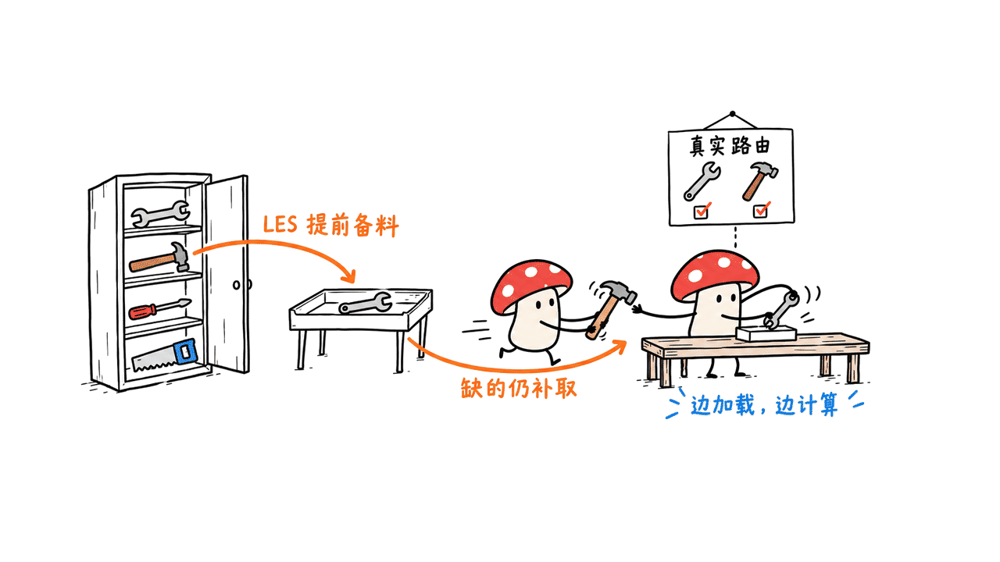
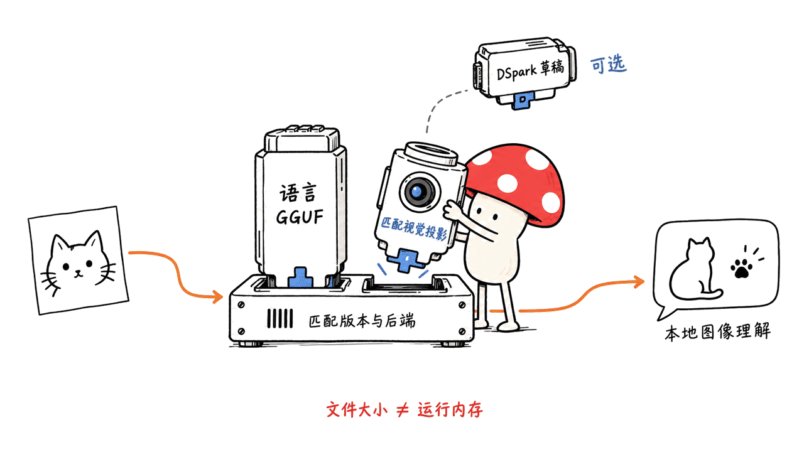

MiniCPM-V 4.7 的35B-A3B版本，把单图、多图和视频理解与端侧MoE推理结合起来。官方强调的关键进展是提前加载可能用到的专家、让加载与计算重叠，再结合量化和DSpark推测解码，提高受限设备上的生成速度。这套工程路线需要把总参数、活跃计算、文件大小和运行内存分开理解。

本篇于2026-10-18核对官方模型卡、模型配置、部署文档和热榜。公开性能与评测数字均为官方报告；本文只做元数据与文件头核查，没有运行完整模型或复现手机演示。

模型：https://huggingface.co/openbmb/MiniCPM-V-4.7-35B-A3B

## “Trending前三”该怎样记录？

收到的素材称模型登上Hugging Face Trending前三。本次抓取采用无任务、语言等筛选的全模型榜：**2026-10-18 05:11 UTC快照中，它排第4**，API与网页显示顺序一致。

| 快照位置 | 模型仓库 |
|---:|---|
| 1 | deepseek-ai/DeepSeek-V4.1-Flash-1017 |
| 2 | google/embeddinggemma-2 |
| 3 | jialinyyzz/humanizer |
| 4 | openbmb/MiniCPM-V-4.7-35B-A3B |

热榜会变化，筛选条件也会影响观察范围。本文没有找到可核验的历史前三快照，因此不否定它此前可能登过前三，也不把原消息改写成今天仍稳居前三。Trending应当作为关注热度的信号，与同一套能力评测上的分数分开看。

榜单：https://huggingface.co/models?sort=trending

## 35B、A3B、3GB，分别是什么？

35B描述总参数规模，A3B描述每个token激活的参数量级。配置中的文本骨干为 `qwen3_5_moe_text`，40层，256个路由专家，每个token选择8个；还有共享专家等部分，因此不能把8/256直接当作整个模型的计算或内存比例。

专家虽然不是每次都参与计算，其权重仍需保存在某处。我们检查的标准权重索引列出16个分片，总张量字节约70.43GB。这个数字不等于实际运行峰值，却足以说明“只激活约3B”不代表只需存储3B参数。

官方所说约3GB运行内存，来自特定端侧调度与量化方案，并不表示完整模型文件只有3GB。专家权重仍可位于设备存储中，运行时按需加载；磁盘容量、加载带宽与运行缓冲都要另算。


## LES如何减少等待，又为什么不是剪掉专家？

官方的Lookahead Expert Scheduling使用跨层路由预测，提前把下一层可能需要的专家加载进来。实际路由完成后，优先计算已准备好的必要专家，同时加载其他仍需使用的专家；预测没命中的真实专家也会补载和执行。

这个区别很关键：预测用于预取与调度，目标是保留原本的token级路由，不是把所有后续token固定限制在一个预选专家池里。权重的连续存储布局和更少的读取调用，也有助于减轻闪存读写开销。

另一层是细粒度混合量化，减少存储与传输；DSpark再通过推测采样辅助解码。调度不裁剪实际路由，不等于所有量化配置都与BF16逐位一致。官方“无损”或“不牺牲性能”的表述需要连同其具体权重、评测与执行方案阅读，不能直接替代自己的精度复核。



## 官方端侧速度数据，哪些能放在一起比？

模型卡报告：iPhone 17 Pro Max上，配合相关优化，以约3GB内存达到13+ tokens/s。这是官方展示，不是本文实测，也不是对其他手机的最低配置承诺。

另一个独立口径来自LES技术说明：设备是iPad Pro 11英寸M4、16GB内存。下表属于这套iPad实验，不能与前述iPhone数字拼成一条曲线。

| iPad实验阶段 | 官方解码速度 |
|---|---:|
| 基线：从存储加载专家，未加后续优化 | 2.97 tokens/s |
| LES预加载、调度与权重访问优化 | 9.81 tokens/s |
| 再加精细逐层混合量化 | 14.92 tokens/s |
| 完整LES加DSpark推测采样 | 17.39 tokens/s |

其速度定义为生成token数除以解码时间，并不包含对所有首token延迟、视觉预填充、视频加载和长时间发热场景的保证。该说明还列出了测试任务与一个内部文本对话评价集；本文没有独立复现这些结果。比较自己的设备时，要记录输入图像数量、上下文、量化、缓存、温度状态和生成长度。

LES说明：https://github.com/OpenBMB/llama.cpp-omni/blob/0b74404c9b3dfe2c6b11aebe0dd58fc23f133ee2/docs/les/lookahead-expert-scheduling.md

## 4×与16×视觉压缩，该怎么选？

模型延续切片式高分辨率视觉编码，并引入视觉编码器内部的早期压缩。4×与16×控制视觉token压缩程度，16×通常保留更少的视觉token，但不能直接推导端到端速度必然快四倍。实际还受切片数、图像尺寸、视觉编码、文本长度和硬件影响。

以下摘录自官方35B-A3B Instruct评测图，均为官方报告；图注说明来源包括公开报告和团队使用官方检查点进行的本地评测，并非本文统一重跑。

| 基准 | 4× | 16× |
|---|---:|---:|
| MMBench | 91.72 | 90.87 |
| OCRBench | 91.20 | 90.40 |
| CharXiv Reasoning | 75.60 | 69.20 |
| LongVideoBench | 68.90 | 67.60 |
| ScreenSpot | 86.99 | 85.01 |

16×在某些总体指标上的损失较小，图表推理的CharXiv却下降6.40分，说明“差不多”不能套给每种任务。同一官方图中，4×版本也不是每行第一：例如ScreenSpot低于Qwen3.8-27B的93.31。选型应按细小文字、图表结构、定位与视频等任务分别验证。

官方示例默认 `downsample_mode="16x"`，也提示可选4×保留细节。思考模式、采样参数与压缩模式同样属于实验配置，热榜位置无法替代这些条件。

## 下载文件之前，先把部署路径分清

官方提供35B-A3B和另一个1B命名版本，另有对应DSpark草稿头。不同规模、不同量化和不同推理引擎的结果应分别记录，不能把较小版本的表现算给35B。

| 路径 | 主要用途与注意点 |
|---|---|
| Transformers | 标准图像／视频推理示例；官方要求较新的版本与视觉、视频依赖 |
| GGUF／llama.cpp | 本地推理；语言权重与匹配视觉投影文件分开，特殊端侧优化须按对应实现配置 |
| llama.cpp-omni及端侧Apps | 官方链接的LES与端侧方案入口；不等同随便启动通用llama.cpp就复现手机演示 |
| FP8、int4、AWQ、GPTQ | 官方列出的其他量化产物；具体后端、内核与精度条件分别核对 |

从官方GGUF仓库树读取的文件大小如下，GB均按十进制计算，不是内存估算：

| 文件或产物 | 大小 |
|---|---:|
| 标准权重索引总张量 | 70.43GB |
| Q4_K_M语言权重 | 21.17GB |
| mix_q3gud_im语言权重 | 15.50GB |
| 默认F16视觉投影文件 | 1.12GB |
| 4×视觉投影文件 | 0.91GB |
| 仓库中的F16 DSpark头 | 0.79GB |

不能把这些文件全加起来当作一种必选配置，也不能只看语言GGUF而漏掉视觉模块。上下文缓存、视觉输入、草稿头、运行时缓冲和后端的权重加载策略，会继续影响实际占用。

下面仅为按固定revision下载一组候选文件的示例，本文未下载这些完整权重，也未执行推理：

```bash
hf download openbmb/MiniCPM-V-4.7-35B-A3B-gguf \
  MiniCPM-V-4_7-35B-A3B-mix_q3gud_im.gguf mmproj-model-f16.gguf \
  --revision 77ec40de8445999bf3076aeff9ff45d40a2713cc \
  --local-dir models/minicpm-v47
```

若选4×路径，需检查对应视觉文件及引擎配置，不能只改文件名。Transformers示例还会把 `downsample_mode` 同时传给处理器和生成调用；遇到torchcodec/CUDA不匹配，模型卡列有PyAV等替代路径，但应按实际环境固定依赖，不能照抄一个安装命令就宣称兼容。



## 本文实际核查了什么？

标准模型revision为 `0bbda78419a0b505a58234574ff40b1c344a86fc`，GGUF仓库revision为 `77ec40de8445999bf3076aeff9ff45d40a2713cc`。我们保存热榜API与网页顺序、模型配置、权重索引和文件列表，并通过HTTP Range实际获取混合量化GGUF的前65,536字节。

头部确认为GGUF v3，记录733个tensor；已解析部分元数据中的40层、256专家、每token选8专家，与标准配置一致。由于只读取头部片段，没有核对整个权重文件完整性，更没有加载tensor进行推理。

另一个值得注意的细节是，该GGUF头部的采样默认值包括temperature 1.0、top-k 20，而官方Instruct示例推荐temperature 0.7、top-k 100。文件默认值不自动等于作者评测设置，复现时应显式核对有效参数。

本文没有进行模型推理、手机安装、延迟、速度、功耗或量化精度测试。Mycelium Protocol 建议先用一张固定图片确认后端、视觉文件和输出配置，再逐步增加图像、分辨率与视频长度，分别测首token延迟、解码速度、峰值内存及错误类型。

## 常见问题

### Trending靠前，意味着视觉能力排名靠前吗？

热榜与能力评测不是同一口径。本文快照是无筛选全模型榜第4，视觉任务表现需回到具体基准与实际样本。

### 35B-A3B只需要3GB存储吗？

不是。A3B是激活计算量级，完整专家权重仍需存储；约3GB是官方特定端侧运行方案的内存描述。

### 官方写“无损”，是不是量化和所有部署设置都等价？

LES保留实际路由的机制，与量化、视觉压缩和后端数值行为是不同问题。需要按具体设置检查精度，不能将宣传语扩大成逐位一致的保证。

## 一手资料

热榜：https://huggingface.co/models?sort=trending

标准模型：https://huggingface.co/openbmb/MiniCPM-V-4.7-35B-A3B

GGUF：https://huggingface.co/openbmb/MiniCPM-V-4.7-35B-A3B-gguf

官方介绍：https://openbmb.cn/en/model/minicpm-v-4-7

部署文档：https://github.com/OpenBMB/MiniCPM-V/blob/dfe5db0cabf054c4615c796306a51f9b0ee399ca/docs/minicpm_v4dot7_en.md

LES：https://github.com/OpenBMB/llama.cpp-omni/blob/0b74404c9b3dfe2c6b11aebe0dd58fc23f133ee2/docs/les/lookahead-expert-scheduling.md

端侧Apps：https://github.com/OpenBMB/MiniCPM-V-Apps

相关本地视觉模型：https://blog.mushroom.cv/blog/nemotron-35-super-vl-bolt-local-models/

标准模型与GGUF模型卡均标注Apache-2.0，具体依赖和第三方代码保留其许可证。封面为本地生成的视觉理解概念场景；正文小M图不是性能测试图。

---

> © 2026 Author: Mycelium Protocol. 本文采用 [CC BY 4.0](https://creativecommons.org/licenses/by/4.0/deed.zh) 授权——欢迎转载和引用，须注明作者姓名及原文链接，不得去除署名后以原创发布。

<!--EN-->

MiniCPM-V 4.7 35B-A3B combines image, multi-image and video understanding with on-device MoE inference. Its main engineering story is overlapping expert loading and computation through lookahead scheduling, alongside quantization and DSpark speculative decoding. Total parameters, active computation, file size and runtime memory must be read separately.

This October 18, 2026 review checks official documentation and artifacts. Performance and benchmark figures below are author-reported. We inspected metadata and a file prefix without running the full model or reproducing a phone demonstration.

## What happened to the Trending claim?

The supplied note says the model reached the top three. Our unfiltered global-model snapshot at **2026-10-18 05:11 UTC** places it fourth, with the API and rendered page agreeing.

| Snapshot position | Model repository |
|---:|---|
| 1 | deepseek-ai/DeepSeek-V4.1-Flash-1017 |
| 2 | google/embeddinggemma-2 |
| 3 | jialinyyzz/humanizer |
| 4 | openbmb/MiniCPM-V-4.7-35B-A3B |

Rankings change and filters matter. We found no verifiable historical top-three snapshot, so we neither reject a possible earlier ranking nor present it as the current position. Trending is an attention signal, not a shared capability exam.

## How do 35B, A3B and 3GB differ?

35B denotes total parameter scale; A3B denotes approximately active parameters per token. The text configuration identifies a `qwen3_5_moe_text` backbone with 40 layers, 256 routed experts and eight selected per token. Shared experts and other components prevent treating 8/256 as the entire model's compute or memory fraction.

Inactive experts still need storage. The standard checkpoint index lists 16 shards and about 70.43GB of tensor data. This is not runtime peak memory, but it establishes that a small active subset does not eliminate the remaining weights.

The reported approximately 3GB memory figure belongs to a specific on-device loading and quantization scheme. It does not describe the complete model file. Storage capacity, bandwidth and runtime buffers remain relevant.


## How does LES reduce loading stalls?

Lookahead Expert Scheduling predicts likely next-layer experts and preloads them. Once the actual router selects its experts, already available required experts run first while other required weights continue loading. Prediction misses are loaded and evaluated rather than discarded.

Prediction therefore controls prefetching and scheduling, not a permanently restricted expert pool. Contiguous storage and fewer reads also improve weight access. Mixed precision reduces transfer requirements, and DSpark adds speculative sampling.

Preserving actual routing does not establish bitwise BF16 equivalence for every quantized configuration. Interpret official lossless/performance-preservation language within its concrete runtime and evaluation setting.


## Which speed results are comparable?

The model card reports 13+ tokens/s with about 3GB memory on iPhone 17 Pro Max. We did not measure this, and it is not a minimum-hardware guarantee for other phones.

The separate LES guide reports the following stages on an 11-inch iPad Pro M4 with 16GB memory. Do not combine this table and the iPhone observation into one experiment.

| iPad experiment stage | Reported decode speed |
|---|---:|
| Storage-loaded experts, no subsequent optimizations | 2.97 tokens/s |
| LES scheduling and weight-access optimizations | 9.81 tokens/s |
| Plus precise layer-wise mixed quantization | 14.92 tokens/s |
| Full LES plus DSpark | 17.39 tokens/s |

The guide defines speed as generated tokens divided by decode time. This is not a complete guarantee covering first-token latency, image prefill, video loading or sustained thermal conditions. Its evaluation includes listed tasks and an internal text-dialogue Arena set. Record input count, context, quantization, cache state, thermal conditions and output length in your own comparisons.

## How should 4× and 16× visual compression be chosen?

The architecture uses sliced high-resolution encoding and early compression within the vision encoder. Stronger compression reduces visual tokens, but does not establish a fourfold end-to-end speedup: image dimensions, slice count, encoding, output length and hardware also matter.

Selected figures from the official 35B-A3B Instruct chart follow. The chart combines public reports and the team's local evaluation using official checkpoints; these are not our reruns.

| Benchmark | 4× | 16× |
|---|---:|---:|
| MMBench | 91.72 | 90.87 |
| OCRBench | 91.20 | 90.40 |
| CharXiv Reasoning | 75.60 | 69.20 |
| LongVideoBench | 68.90 | 67.60 |
| ScreenSpot | 86.99 | 85.01 |

Small differences on some benchmarks do not generalize to all tasks: CharXiv drops 6.40 points. The same chart also has stronger competitors on individual metrics, including Qwen3.8-27B at 93.31 on ScreenSpot. Validate fine text, charts, grounding and video separately.

The example defaults to `downsample_mode="16x"` and offers 4× for finer detail. Compression, thinking mode and sampling settings are part of the configuration, not details that a Trending position can replace.

## What needs to be downloaded?

The family also includes a separately named 1B version and corresponding DSpark heads. Do not transfer smaller-model results to the 35B configuration.

Transformers provides standard examples; GGUF/llama.cpp provides a local route with separate language and vision files. Official LES and edge-app paths require their corresponding implementation. A generic llama.cpp launch does not establish reproduction of the phone demo. FP8, int4, AWQ and GPTQ variants have their own backend requirements.

Sizes below come from official artifact metadata and use decimal GB, not RAM estimates:

| Artifact | Size |
|---|---:|
| Standard checkpoint tensor data | 70.43GB |
| Q4_K_M language GGUF | 21.17GB |
| mix_q3gud_im language GGUF | 15.50GB |
| Default F16 vision projection | 1.12GB |
| 4× vision projection | 0.91GB |
| Repository F16 DSpark head | 0.79GB |

These are alternatives and optional components, not one mandatory bundle. Conversely, language weights alone omit vision components, caches, buffers and the backend's loading strategy.

This pinned download example was not executed for full weights:

```bash
hf download openbmb/MiniCPM-V-4.7-35B-A3B-gguf \
  MiniCPM-V-4_7-35B-A3B-mix_q3gud_im.gguf mmproj-model-f16.gguf \
  --revision 77ec40de8445999bf3076aeff9ff45d40a2713cc \
  --local-dir models/minicpm-v47
```

A 4× route needs matching vision files and engine settings. The Transformers example passes compression mode to both processor and generation. Its video dependencies also need environment-specific CUDA/decoder compatibility rather than an untested universal install recipe.


## What did we verify?

The standard model revision is `0bbda78419a0b505a58234574ff40b1c344a86fc`; the GGUF revision is `77ec40de8445999bf3076aeff9ff45d40a2713cc`. We saved the Trending API/page order, configuration, weight index and file tree, then fetched exactly 65,536 bytes of the mixed-quantization GGUF using HTTP Range.

The prefix identifies GGUF v3 with 733 tensors. Parsed metadata agrees with the standard configuration on 40 layers, 256 experts and eight selected per token. This partial-header inspection does not verify complete-file integrity or execute any tensor.

The inspected GGUF also records sampling defaults including temperature 1.0 and top-k 20, whereas the official Instruct example recommends 0.7 and 100. Artifact defaults are not automatically the published evaluation settings; check effective parameters explicitly.

We performed no model inference, phone installation, latency, throughput, power or quantization-quality test. Mycelium Protocol recommends starting with one fixed image and validated vision/backend settings, then increasing input complexity while measuring first-token latency, decode speed, peak memory and error types separately.

## FAQ

### Does Trending rank measure visual capability?

No. Our unfiltered snapshot places the model fourth. Capability requires task-specific benchmarks and acceptance examples.

### Does A3B imply 3GB of storage?

No. Active parameters describe computation; remaining expert weights still need storage. The official memory observation belongs to a specific runtime scheme.

### Does lossless mean every quantization and backend is identical?

LES routing preservation, quantization, visual compression and backend numerics are separate questions. Check the actual configuration rather than assuming bitwise equivalence.

## Primary sources

Trending: https://huggingface.co/models?sort=trending

Standard model: https://huggingface.co/openbmb/MiniCPM-V-4.7-35B-A3B

GGUF: https://huggingface.co/openbmb/MiniCPM-V-4.7-35B-A3B-gguf

Official overview: https://openbmb.cn/en/model/minicpm-v-4-7

Deployment: https://github.com/OpenBMB/MiniCPM-V/blob/dfe5db0cabf054c4615c796306a51f9b0ee399ca/docs/minicpm_v4dot7_en.md

LES: https://github.com/OpenBMB/llama.cpp-omni/blob/0b74404c9b3dfe2c6b11aebe0dd58fc23f133ee2/docs/les/lookahead-expert-scheduling.md

Edge apps: https://github.com/OpenBMB/MiniCPM-V-Apps

Related local vision models: https://blog.mushroom.cv/blog/nemotron-35-super-vl-bolt-local-models/

The checked standard/GGUF cards state Apache-2.0; dependencies retain their own licenses. The cover and XiaoM figures are conceptual, not performance captures.

---

> © 2026 Author: Mycelium Protocol. Licensed under [CC BY 4.0](https://creativecommons.org/licenses/by/4.0/) — free to share and adapt with attribution. You must credit the author and link to the original; removing attribution and republishing as original is not permitted.
