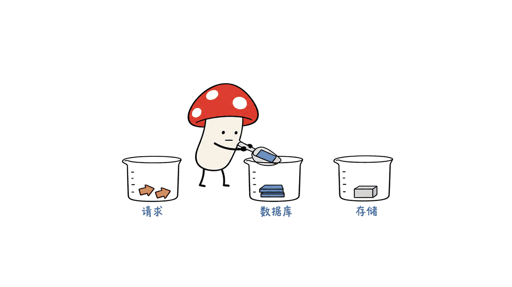
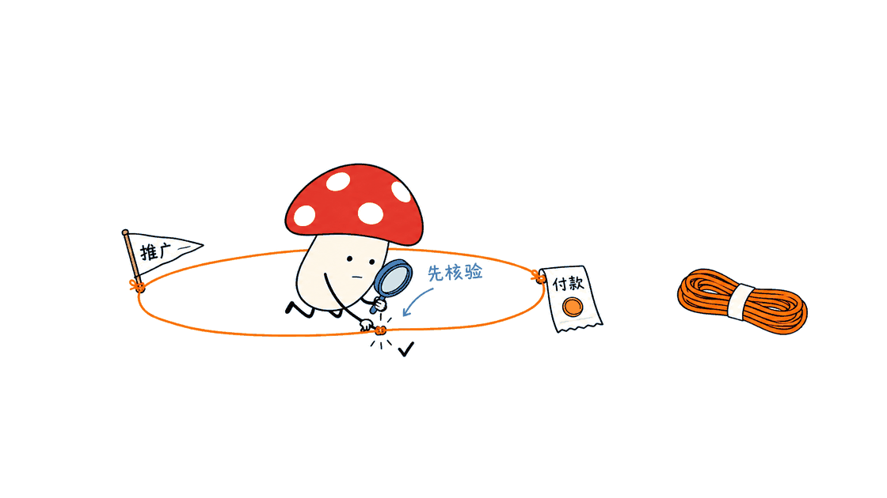

Minilytics 把网站访问、营销来源与付款记录接在一起，帮助小团队回答：哪次推广带来了收入？它适合愿意维护轻量分析系统的开发者，但“免费自托管”有额度边界，“收入归因”也不等于证明营销带来的增量收益。

仓库是 `surendrapandar/minilytics`，采用 MIT 许可证，部署在用户自己的 Cloudflare Workers 与 D1 账户。本文以 2026 年 10 月 29 日核验的提交 `4058dc39e0d9aeaf26ed49c0eef07b559523398f` 为依据。GitHub API 当时显示 766 星；OpenFree 页面保留的是 332 星的较早快照。星数变化不能独立证明“两天增长到 300”的时间线，更不能证明评论区关于付费产品市场的判断。

项目地址：https://github.com/surendrapandar/minilytics

## Minilytics 比普通流量看板多做了什么？

普通网站统计首先回答“来了多少人”。Minilytics 进一步展示来源、页面路径、目标事件、漏斗和客户 Journey，把访客与付款金额、首次付费前的时间连起来。它支持多个网站，通过同一个后台查看；这与默认单用户密码登录并不矛盾。

技术结构并不重：浏览器脚本上报事件，Hono Worker 接收请求，D1 保存记录，React 仪表盘展示统计。静态资源和 API 同处一个 Worker 项目。源码里的 `/api/*` 路径先运行 Worker，其余资源走静态资源服务。

营销链接仍要认真打标签。例如，X 的来源经常只剩 `t.co`，无法自动识别具体哪条推文。可以用 `utm_campaign=launch-october` 或 `?ref=launch-october` 区分。Google 搜索引荐与入口页能提示哪篇文章吸引了访问，但不会凭空恢复 Google 隐藏的搜索词。


## 收入究竟归给哪个渠道？

项目采用 **最后一次非直接访问归因**。例如，读者先从活动推文进入，过几天直接打开网址付款，收入仍可能记在此前那次有来源的访问上。这个规则清晰、容易用于日常复盘，但不是多触点因果模型。

接入 Stripe 或 Dodo 时，需要配置服务端 Webhook 签名密钥，并尽量把 `ml_visitor_id`、`ml_session_id` 带进结账元数据。支付返回页也能帮助关联付款与访客。只粘贴统计脚本，通常不足以完成稳定的收入归因。

元数据缺失时，系统还会尝试返回页声明、同一客户的历史付款、已识别邮箱及结账时间等线索。源码中的时间匹配属于启发式推断，会筛选结账点击与付款后的回访；候选过多时可以保持未匹配。分析时应保留 `matched_by` 的区别，不能把时间推测和明确 ID 关联当成同一强度的证据。

订阅续费和退款也纳入处理。财务复核应另外检查币种、结算金额、退款时间和重复事件。仪表盘上的渠道收入适合指导下一轮营销实验，正式账目仍应与支付平台核对。

## Cloudflare 自托管真的可以一直零成本吗？

在免费配额内可以没有平台订阅账单。Cloudflare 官方当前列出的 Workers Free 请求额度为每天 100,000 次；D1 Free 为每天 500 万行读取、10 万行写入，以及总计 5 GB 存储。Worker 请求、数据库行操作和页面浏览不是同一个计量单位。

| 成本维度 | 应怎样理解 |
| --- | --- |
| Worker 请求 | 事件、后台和其他 API 共享额度；静态资源有单独规则 |
| D1 写入 | 一次浏览可能更新多个表和索引，不能按一 PV 一行估算 |
| D1 读取 | 扫描范围、索引和看板查询频率都会影响用量 |
| 超出免费计划 | Workers Paid 当前起价每月 5 美元，用量还需单独核算 |
| 维护与支付 | 自托管不免除升级、备份、支付渠道和人工支持成本 |

README 把每日约一万次浏览作为写入额度的量级估计，不是本文测得的容量保证。更可靠的做法是先运行一周，查看真实 D1 行读写和 Worker 请求，再决定是否升级。这里的“自己部署”，主要指云账户归自己，并不是数据离线留在个人电脑。

Cloudflare 官方计费依据：https://developers.cloudflare.com/workers/platform/pricing/

D1 计费与行操作解释：https://developers.cloudflare.com/d1/platform/pricing/



## 实际跑了哪些检查？

Mycelium Protocol 在隔离的临时目录安装锁定依赖，运行了上游类型检查、23 项单元测试和 Vite 生产构建，均通过。随后用本机 Wrangler 的本地 Worker 和本地 D1 执行上游 `scripts/smoke.mjs`，51 条断言通过。

这个本地流程覆盖了后台登录、域名限制、访客事件、带签名的模拟 Dodo 付款、重复 Webhook、续费与退款、渠道及活动归因、客户轨迹、漏斗、筛选和站点删除。其中一条断言确认：两次模拟付款减去一次退款后，净收入为 49 美元，并计入 X 来源。

这些检查提高了对实现连通性的信心，但没有连接真实 Stripe/Dodo 商户，没有向生产 Cloudflare 部署这个分析服务，也没有测生产吞吐、浏览器 Cookie 丢失率或财务归因准确率。统计脚本被广告拦截、用户换设备或浏览器清理标识后的表现，不能从这些测试推导出来。

可复核命令，进入已克隆的仓库后运行：

```bash
npm ci
npm run typecheck
npm test
npm run build
cp .dev.vars.example .dev.vars
npx wrangler d1 migrations apply minilytics --local
npx wrangler dev --local --ip 127.0.0.1 --port 18787
# 在另一个终端执行
BASE=http://127.0.0.1:18787 node scripts/smoke.mjs
```

上述数据均来自合成测试，不包含真实客户交易。文章封面采用项目官方演示看板，画面上的收入也不能当作项目或本文测试的真实营收。

## 小团队应该怎样开始用？

先用一个站点、一项转化目标和一条明确标记的营销链接完成闭环。生产部署需要 Node.js 20+、Git 和自己的 Cloudflare 账户：创建 D1，把数据库 ID 填入 `wrangler.jsonc`，设置 `ADMIN_PASSWORD` 与 `SESSION_SECRET`，再运行项目部署命令。

之后添加站点、安装脚本、配置支付 Webhook 与结账 ID。测试一次付款、一次退款和一次重放通知，确认金额没有重复计入，再进行真实活动。第一周重点看“能否解释每笔关联”，而不是急着比较漂亮的渠道排名。

隐私方面，默认脚本使用第一方 Cookie；`identify` 可接收用户 ID、邮箱和姓名。自有 Cloudflare 账户让数据控制权更明确，但不自动使访客匿名，也不自动解决告知、授权、保留期限和后台访问管理问题。团队可以先不传个人字段，只有确有必要时再启用识别。



关于“开源毁掉付费市场”的争论，更实用的判断是：代码获取成本降低了，可靠运营、口径解释和持续服务仍然需要投入。会部署的独立开发者可能很喜欢它；需要多人权限、服务承诺与成熟工作流的团队，仍要逐项评估，而不是仅比较软件标价。

## 常见问题

### Minilytics 是无 Cookie 分析工具吗？

不是。核验版本通过第一方 Cookie 识别访客和会话，还可关联用户邮箱等字段。部署方应按自己的数据需求选择配置。

### 免费额度意味着每天十万次页面浏览吗？

不意味着。请求、页面事件与 D1 行写入分别计量，多表更新可能先耗尽数据库额度；应查看真实用量。

### 本文验证了真实收入归因准确率吗？

没有。验证的是本地模拟付款、退款与分析流程能按预期连通，没有进行真实商户或跨浏览器准确率评测。

相关分析：Plausible 的定位与部署服务讨论：https://blog.mushroom.cv/blog/plausible-analytics-consulting-white-label/

资料：OpenFree 收录 https://openfree.tools/zh/minilytics ；固定版本源码 https://github.com/surendrapandar/minilytics/tree/4058dc39e0d9aeaf26ed49c0eef07b559523398f

---

> © 2026 Author: Mycelium Protocol. 本文采用 [CC BY 4.0](https://creativecommons.org/licenses/by/4.0/deed.zh) 授权——欢迎转载和引用，须注明作者姓名及原文链接，不得去除署名后以原创发布。

<!--EN-->

Minilytics connects visits, marketing sources and payments so small teams can investigate which campaigns brought paying customers. It is a useful self-hosted option for developers willing to operate their analytics, with limits: a free tier has quotas, and attribution does not establish incremental marketing impact.

The MIT project lives at https://github.com/surendrapandar/minilytics and runs in the owner's Cloudflare Workers and D1 account. This review examines commit `4058dc39e0d9aeaf26ed49c0eef07b559523398f`. On October 29, 2026, GitHub's API reported 766 stars; OpenFree showed an older snapshot of 332. Neither snapshot independently establishes the claimed two-day growth trajectory or a conclusion about the paid analytics market.

## What does Minilytics add to traffic analytics?

The product tracks sources, page paths, goals and funnels, then connects visitors with payment amounts and time to conversion in its Journey view. One dashboard can manage several sites, even though the default deployment uses a single shared admin password.

A browser script sends events to a Hono Worker backed by D1. A React dashboard serves the results. In the inspected configuration, `/api/*` invokes the Worker first; dashboard assets use the static asset service.

Campaign tagging remains necessary. A referral from X may identify only `t.co`, so distinguishing individual posts requires a campaign or `ref` parameter. Google referrals and landing pages can identify useful content, but cannot recover search terms Google does not disclose.


## How is revenue attributed?

Minilytics uses last non-direct touch. Someone who arrives from a tagged post and later returns directly to pay can still be credited to that earlier source. This is an understandable operational rule, rather than a causal or multi-touch attribution model.

Stripe and Dodo integrations require signed server-side Webhooks. Passing `ml_visitor_id` and `ml_session_id` into checkout metadata provides a stronger connection than relying on the browser tracker alone. A payment return page provides another linking mechanism.

When identifiers are absent, the code can consider return-page claims, previous customer payments, identified email addresses and checkout timing. Timing is a heuristic: the implementation considers checkout clicks and subsequent returns, and can leave ambiguous cases unmatched. Preserve the `matched_by` evidence when reviewing results; an inferred match is weaker than an explicit identifier.

Renewals and refunds are handled too. Reconcile currencies, settlement amounts, refund dates and duplicate events against the payment platform before treating the dashboard as a financial record. Channel attribution is most useful for choosing the next marketing experiment.

## Is Cloudflare hosting permanently free?

It can incur no hosting subscription within the Free plan's quotas. Current official documentation lists 100,000 daily Workers requests, five million daily D1 rows read, 100,000 daily D1 rows written and five GB of total D1 storage. These are different units; one pageview can cause several database operations.

The README's approximate ten-thousand-pageviews-per-day estimate is not a capacity result from this review. Observe actual requests and row metrics over a representative week. Workers Paid currently starts at five dollars monthly, with usage to consider separately. Maintenance, payment fees and support also remain costs. Self-hosting here means ownership of a cloud deployment, rather than offline storage on a personal computer.

Official pricing: https://developers.cloudflare.com/workers/platform/pricing/

D1 row accounting: https://developers.cloudflare.com/d1/platform/pricing/


## What was actually tested?

In an isolated temporary checkout, Mycelium Protocol ran the upstream type check, all 23 unit tests and the production Vite build successfully. A local Wrangler Worker with local D1 then passed all 51 assertions in the upstream end-to-end smoke script.

Those assertions exercised login, domain restrictions, visitor events, signed synthetic Dodo payments, duplicate notifications, renewals, refunds, channel and campaign attribution, customer journeys, funnels, filters and site deletion. One check confirmed that two synthetic payments minus one refund produced 49 dollars of net revenue attributed to X.

No real Stripe or Dodo merchant account was connected, and this analytics service was not deployed to production Cloudflare. Production throughput, cross-browser identity loss and real-world attribution accuracy were not measured. Ad blockers, device changes and cookie deletion remain practical limits.

The commands in the Chinese section reproduce the upstream local workflow. The cover is an official demonstration dashboard; its displayed revenue is neither verified project revenue nor a result of these tests.

## How should a small team adopt it?

Start with one site, one conversion goal and one tagged marketing link. Deployment needs Node.js 20 or later, Git and a Cloudflare account. Create D1, place its ID in `wrangler.jsonc`, configure `ADMIN_PASSWORD` and `SESSION_SECRET`, then deploy. Install the tracker, connect a payment Webhook and pass checkout identifiers.

Before running a campaign, check one payment, one refund and one replayed notification. Focus on explaining each payment link rather than optimizing a channel ranking immediately.

The default tracker uses first-party cookies, and `identify` can collect user IDs, email addresses and names. Cloud account ownership does not make visitors anonymous. Decide which fields are necessary, who can access them and how long to retain them. Starting without personal fields reduces the initial data footprint.


Open source lowers access costs without eliminating the work of reliable operations and interpretation. Developers comfortable maintaining a small system may find Minilytics appealing. Teams requiring established permission structures, service commitments and broader workflows should assess those requirements directly.

## FAQ

### Is it cookieless?

No. The inspected tracker uses first-party visitor and session cookies, with optional personal identifiers.

### Does the free request quota allow 100,000 daily pageviews?

Not necessarily. Requests and database row operations consume different quotas; database writes may become the first constraint.

### Did this review measure attribution accuracy on real revenue?

No. It verified synthetic local payment and analytics behavior, rather than a live merchant deployment or browser accuracy benchmark.

Directory entry: https://openfree.tools/zh/minilytics

Pinned source: https://github.com/surendrapandar/minilytics/tree/4058dc39e0d9aeaf26ed49c0eef07b559523398f

---

> © 2026 Author: Mycelium Protocol. Licensed under [CC BY 4.0](https://creativecommons.org/licenses/by/4.0/) — free to share and adapt with attribution. You must credit the author and link to the original; removing attribution and republishing as original is not permitted.
