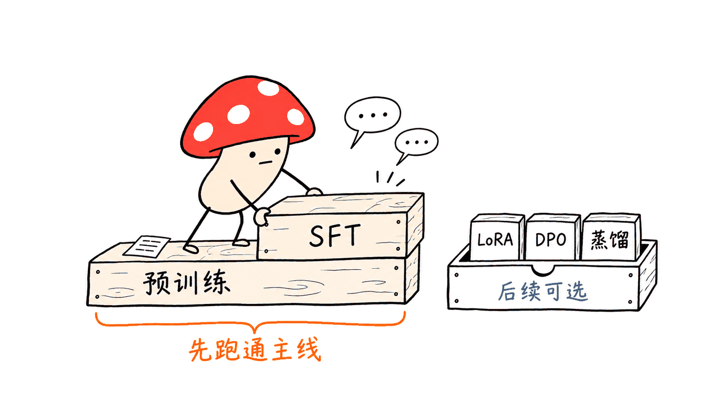
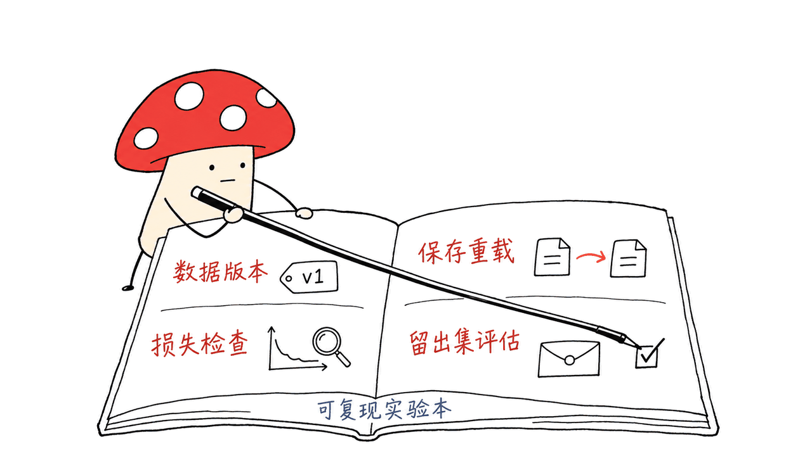

MiniMind 是让你亲手搭建、训练和检查一个小语言模型的教学项目。它的价值在于把训练过程缩小到个人能理解和实验的范围，而不是用极少参数替代通用大模型。

仓库 jingyaogong/minimind 采用 Apache 2.0 许可，当前主线 Dense 模型约 64M 参数，另有 MoE 等实验路线。本文核对了代码，并在本机 CPU 跑通默认结构的随机权重小测试；没有训练出可用聊天模型，也没有复现官方 GPU 时间和成本。

开源仓库：https://github.com/jingyaogong/minimind

## “GPT-3 的 1/2700”到底在比什么？

GPT-3 论文中最大的模型是 175B 参数，按 MiniMind 的名义 64M 计算，175000 ÷ 64 ≈ 2734。因此“约 1/2700”可以理解为参数量的近似比例。

它不表示智能水平缩小了同样倍数，也不是严格的安装包或磁盘占用比例。权重精度、分词器、运行时和缓存都会改变实际体积；训练还需要梯度、优化器状态与中间激活，不能拿推理权重大小估计训练显存。

举个仅用于理解的算术例子：64M 参数按每参数两字节存储，权重约 128MB；四字节则约 256MB。这里使用十进制 MB，只算权重，不是本机测得的峰值内存，更不是显卡配置建议。


## 64M 模型里能看见哪些真实工程结构？

本次固定到提交 `cc9629e5f464ef46ef9411bfac916364e0a6dff1`。默认配置是 8 层、隐藏维度 768、词表 6400，8 个查询头和 4 个 KV 头，输入嵌入与输出头共享权重。我们按不重复的参数对象统计，得到 63,912,192 个参数，与“约 64M”一致。

代码可直接读到 RMSNorm、RoPE、分组查询注意力和门控前馈层。重点不是背术语：顺着一批 token 看张量形状怎样变化，追踪当前位置怎样进入注意力，再观察下一个 token 的概率如何得到，才能把这些模块联系起来。

KV cache 的作用也能在这个规模上亲手检查：缓存前缀后，只计算新 token，与整段重算的输出应该在数值误差内一致。它减少重复计算，但会占内存，不能当作免费加速。

MoE 要单独理解。README 将另一个配置标为 `198M-A64M`：总参数与每个 token 激活的参数不是同一回事。不能因为激活量相近，就认定它与 Dense 64M 的存储和训练开销相同。

## 从零训练、SFT、LoRA 分别改了什么？

读项目时，建议先只走预训练和全参数 SFT 两步。预训练让模型学习文本的续写分布；SFT 再通过对话样本，让它学习如何根据指令给出回答。当前 SFT 脚本的 `from_weight` 默认是 `pretrain`，因此直接启动 SFT 并不等于从随机权重开始。

数据代码也很值得看：预训练会把 padding 对应的标签设为 `-100`；SFT 则构建仅对回答目标计分的标签，模型前向中再移位计算交叉熵。这里的学习问题是：哪些位置在被监督，哪些位置只是上下文？它往往比再换一种优化算法更影响实验解释。

LoRA、DPO、PPO、GRPO、蒸馏和工具调用等路径可以作为后续实验，但仓库提供脚本，不代表你必须把它们全部串起来。先建立可复现的基线，再改一个因素，才知道结果由什么造成。



## “两小时、三块钱”能覆盖整个项目吗？

不能脱离数据、阶段与硬件讨论。当前 README 存在两种表达，需要分开记录：开头注释将“两小时”限定为 RTX 3090 上 SFT 一轮的耗时，将“三块钱”限定为对应租卡成本；训练明细又给出另一组经验估算：

| README 中的 Dense 64M 小数据路线 | 估算时间 | 估算租卡费 |
| --- | --- | --- |
| 预训练 `pretrain_t2t_mini` | 1.21 小时 | 1.57 元 |
| SFT `sft_t2t_mini` | 1.10 小时 | 1.43 元 |
| 两阶段合计 | 2.31 小时 | 约 3 元 |

明细按单张 3090、约 1.3 元/小时估计，作者也明确称它们是估算值。它们不是我们实测，不能把开头的阶段限定与后面的两阶段估算混为一个严格保证。

更重要的是，这笔账没有证明所有数据准备、调参、失败重跑、评测，以及各种强化学习路线都包含在内。学习项目的低门槛是真正的吸引力；对外承诺时间和预算，仍应记录自己采用的数据版本、长度、批次、精度和训练阶段。

## 我们在本机实际跑了什么？

环境是 ARM64 macOS、CPU、PyTorch 2.14.0、Transformers 5.16.1。我们直接加载上述提交的模型代码，创建默认 Dense 结构，用随机整数 token 和随机初始化权重做小型检查，8 项均通过：

- 输入嵌入与输出头共享同一权重对象。
- 批量 2、长度 16 的前向输出形状正确，logits 全部有限。
- 前缀缓存再算最后一个 token，与整段重算相符。
- 贪心生成追加 3 个 token 后长度正确。
- 交叉熵有限，反向传播产生有限梯度。
- 一步 SGD 确实改变被检查的权重。

其中“前向形状”和“数值有限”、“损失有限”和“梯度有限”分别计数，共 8 项。缓存比较的最大绝对误差约为 `4.05e-6`，符合本次设置的容差；这不是吞吐或准确率成绩。

没有下载预训练权重，没有测中文聊天质量，没有训练完整数据集，也没有评估真实工具调用或强化学习效果。随机 token 上链路跑通，证明本机这段代码能执行，不证明模型会说有意义的话。

## 工程师怎样把它变成一次有效学习？

先固定提交和依赖，再按 README 准备相应数据及 tokenizer。官方两步入口分别是在仓库根目录执行以下命令；每一行从根目录开始，完整训练本文未执行：

```bash
cd trainer && python train_pretrain.py
```

```bash
cd trainer && python train_full_sft.py
```

第一轮不要急着比较排行榜。先确认标签没有全部被屏蔽、损失与梯度有效、权重真的更新，再确认保存后加载能恢复同一输出。需要断点续训时，还应验证优化器、训练步数和随机状态，而不只是文件存在。

第二轮再设置一个小而固定的验证集，按任务记录输出，保留不参与训练的样本，检查是否只是记住了训练文本。做 tokenizer、模型深宽、训练数据或损失 mask 的对比时，每次只改一个因素，并保留版本、配置与日志。

Mycelium Protocol 更建议把第一份成果做成“可重复的训练实验报告”：别人能按你的材料重跑，并得到可解释的变化。这种能力能够迁移到更大模型；一张漂亮的聊天截图不能替代它。



## FAQ

### 它与 MiniMind-O 是同一个模型吗？
不是。这里是 `jingyaogong/minimind` 的文本训练主线；MiniMind-O 是另一个多模态仓库。本博客已有 MiniMind-O 文章，不应把那篇的参数量与能力套到这里。

### 能把64M模型直接用作生产客服吗？
本次没有提供这方面的质量证据。应先用真实但经过授权的业务样本验证正确性、拒答与失败路径；训练代码易读并不等于满足生产需求。

### 本机检查通过，是否证明两小时能训完？
不能。随机权重短序列检查与指定 GPU 上的数据集训练是不同工作量，本文没有测完整训练时间或成本。

相关旧文：https://blog.mushroom.cv/blog/minimind-o-multimodal-agent-eyes-ears-voice/

来源：项目及训练说明 https://github.com/jingyaogong/minimind ；固定代码 https://github.com/jingyaogong/minimind/tree/cc9629e5f464ef46ef9411bfac916364e0a6dff1 ；GPT-3 论文 https://arxiv.org/abs/2005.14165 。

---

> © 2026 Author: Mycelium Protocol. 本文采用 [CC BY 4.0](https://creativecommons.org/licenses/by/4.0/deed.zh) 授权——欢迎转载和引用，须注明作者姓名及原文链接，不得去除署名后以原创发布。

<!--EN-->

MiniMind is an educational project for building, training and inspecting a small language model yourself. Its value is making the training process accessible to individual learners, rather than replacing general-purpose large models with very few parameters.

The Apache 2.0 repository `jingyaogong/minimind` currently offers an approximately 64M Dense model and additional experimental routes. We audited its code and ran a short CPU test with randomly initialized default weights. We did not train a useful chatbot or reproduce GPU training costs.

Repository: https://github.com/jingyaogong/minimind

## What does “1/2700 of GPT-3” compare?

The largest GPT-3 model in its paper has 175B parameters. Dividing 175000M by a nominal 64M gives approximately 2734. The slogan is therefore a reasonable rounded parameter-count comparison.

It is neither a capability ratio nor a precise download-size ratio. Weight precision, tokenizers, runtime code and cache storage affect actual footprint. Training additionally requires gradients, optimizer state and activations.

For illustration only, 64M parameters at two bytes each require approximately 128MB, or 256MB at four bytes, using decimal MB. These are weight-only calculations, not measured peak memory or a GPU recommendation.


## Which real engineering structures can you inspect?

We pinned revision `cc9629e5f464ef46ef9411bfac916364e0a6dff1`. The default configuration has eight layers, hidden width 768, vocabulary size 6400, eight query heads and four KV heads, with tied input and output weights. Counting unique parameter objects produced 63,912,192 parameters, consistent with “approximately 64M.”

The implementation exposes RMSNorm, RoPE, grouped-query attention and a gated feed-forward network. Trace tensor shapes and position information through one batch rather than only memorizing the component names.

KV caching is small enough to examine directly: processing a prefix once and then a new token should agree with recomputing the entire sequence within numerical tolerance. It reduces repeated work while consuming memory.

The separately documented `198M-A64M` MoE configuration distinguishes total parameters from parameters activated per token. Similar active counts do not imply equal storage or training costs to a Dense 64M model.

## What changes between pretraining, SFT and later experiments?

Start with pretraining and full SFT. Pretraining learns text continuation; supervised fine-tuning uses conversational examples to shape instruction responses. The current SFT script defaults `from_weight` to `pretrain`, so launching SFT is not synonymous with starting from random weights.

The dataset code reveals which positions receive supervision. Pretraining masks padding labels with `-100`; SFT constructs answer-target labels, and the model shifts targets for cross-entropy. Understanding which tokens contribute to loss often matters more than changing optimization algorithms prematurely.

LoRA, DPO, PPO, GRPO, distillation and tool-use scripts are subsequent experiments. Their presence does not require combining every stage. Establish a reproducible baseline and change one factor at a time.


## Does “two hours and three yuan” cover everything?

The current README uses two scopes that should be recorded separately. Its opening note ties two hours to one SFT epoch on an RTX 3090 and three yuan to the corresponding rental. A later detailed table provides these separate estimates:

| Dense 64M small-data route | Estimated time | Estimated rental |
| --- | --- | --- |
| `pretrain_t2t_mini` | 1.21 hours | CNY 1.57 |
| `sft_t2t_mini` | 1.10 hours | CNY 1.43 |
| Combined | 2.31 hours | Approximately CNY 3 |

The table assumes one 3090 at roughly CNY 1.3 per hour and explicitly calls its figures estimates. We did not measure them. The opening phase-specific statement and the later two-stage estimate should not be collapsed into a strict guarantee.

Neither establishes that every data-preparation step, failed run, tuning experiment, evaluation and reinforcement-learning route is included. Record the actual data version, sequence length, batch size, precision and training stages when reporting your own budget.

## What did we actually run locally?

On ARM64 macOS CPU with PyTorch 2.14.0 and Transformers 5.16.1, we instantiated the pinned default Dense architecture with random weights and synthetic integer tokens. Eight checks passed:

- Input embeddings and output head share the same weight object.
- Forward output shape is correct for batch 2 and sequence length 16, and all logits are finite.
- Prefix-cache processing agrees with full recomputation for the last token.
- Greedy generation appends the requested three tokens.
- Cross-entropy is finite and backward gradients are finite.
- One SGD step changes the inspected weight.

Output shape and finite logits count separately, as do finite loss and finite gradients, giving eight checks. The maximum cache-comparison absolute difference was approximately `4.05e-6`, within our specified tolerance. This is neither throughput nor language accuracy.

We downloaded no pretrained weights, evaluated no Chinese chat quality, trained no complete dataset and tested no real tool-use or reinforcement-learning outcome. A functioning random-token path does not establish useful generated language.

## How can engineers turn it into useful learning?

Pin the commit and dependencies, then prepare the documented tokenizer and datasets. The official two-stage entry points below each start from the repository root; we did not execute these full training jobs.

```bash
cd trainer && python train_pretrain.py
```

```bash
cd trainer && python train_full_sft.py
```

First verify that labels are not entirely masked, loss and gradients are valid, and parameters change. Then test that saving and reloading reproduce the same output. For training resumption, verify optimizer state, training position and randomness rather than merely checking that a file exists.

Next introduce a fixed held-out evaluation set and inspect outputs by task. Check whether apparent progress is just memorization. Change only one of tokenizer, architecture, data or loss masking per comparison, retaining versions, configuration and logs.

Mycelium Protocol recommends making the first deliverable a reproducible experiment report that another engineer can rerun and interpret. That skill transfers to larger models; an attractive chat screenshot cannot replace it.


## FAQ

### Is this the same model as MiniMind-O?
No. This article covers the text-training mainline in `jingyaogong/minimind`. MiniMind-O has a separate multimodal repository and an existing article here; its parameter counts and claims should not be transferred to this project.

### Can it serve as production customer support immediately?
Our checks provide no evidence for that. Validate correctness, refusals and failure paths on authorized business examples. Readable training code does not establish production fitness.

### Do successful local checks prove a two-hour training run?
No. A short random-weight sequence and a dataset training job on a specified GPU perform different amounts of work. We measured neither full training time nor cost.

Related article: https://blog.mushroom.cv/blog/minimind-o-multimodal-agent-eyes-ears-voice/

Sources: repository https://github.com/jingyaogong/minimind ; pinned source https://github.com/jingyaogong/minimind/tree/cc9629e5f464ef46ef9411bfac916364e0a6dff1 ; GPT-3 paper https://arxiv.org/abs/2005.14165 .

---

> © 2026 Author: Mycelium Protocol. Licensed under [CC BY 4.0](https://creativecommons.org/licenses/by/4.0/) — free to share and adapt with attribution. You must credit the author and link to the original; removing attribution and republishing as original is not permitted.
