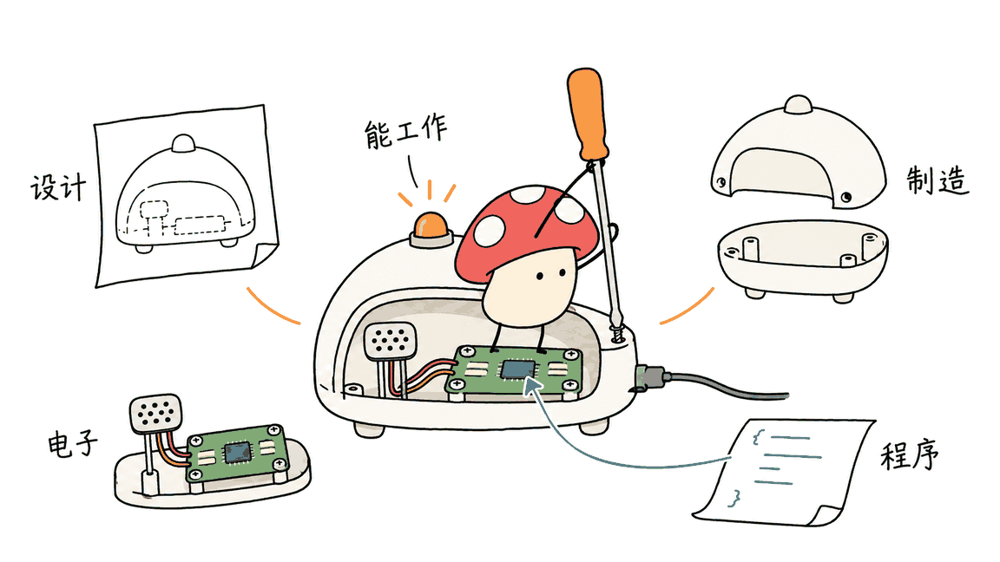
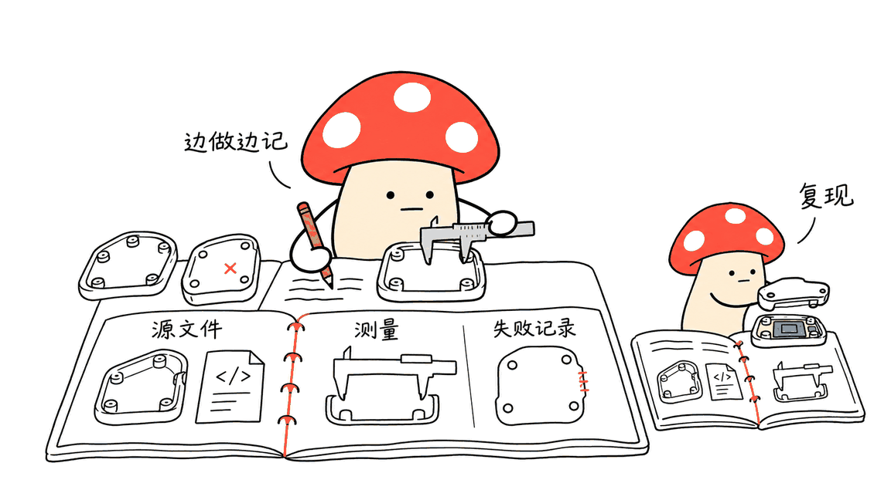

MIT的MAS.863值得看，不只是因为它教人制造东西，而是它把设计、制造、编程、集成和记录放进同一个项目。对自学者来说，最值得借走的是这条完整链路。

课程名为《How To Make (almost) Anything》，也常简称HTMAA；2026站点列出MAS.863、4.140、6.9020三个编号，People页注明授课教师为Neil Gershenfeld。以下是课程资料导读与我们的学习方法分析，不是修课经历或制造实测。

你提供的旧入口：https://fab.cba.mit.edu/classes/MAS.863/

当前2026课程站：https://pub.cba.mit.edu/863.26/site/

旧入口返回的是带HTML meta refresh的跳转页，不是失效的课程正文。部分抓取工具不会执行这种跳转，需要手动进入新地址。

## 这门课怎样把不同技术串起来？

课程表从设计工具进入数字制造，再接到电子电路、嵌入式程序、输入输出与系统集成。它还列出AI agents和Edge AI专题讨论。AI是工具链的一部分，并没有替代制造和测量。

| 能力组 | 可以带着什么问题阅读 |
|---|---|
| CAD、切割、扫描与3D打印 | 屏幕上的形状如何成为可制造的零件？ |
| 电路设计、制作与嵌入式编程 | 结构怎样接上可工作的电子系统？ |
| 输入输出与通信 | 实物如何感知、响应并交换数据？ |
| 项目开发和系统集成 | 各部分怎样装在一起，并让别人操作？ |

这张表是我们的阅读归纳，不是官方课程单元重新分组。看资料时，不必把每一种工具都学到同样深；先判断它在目标系统里承担什么角色，再决定要补哪块能力。

截至2026年11月22日，课程仍在进行。课程表后续的通信、系统集成与最终展示是学期安排，不能把排上日程等同于所有2026学生作品已经完成。

## 为什么文档不是做完以后补一篇感想？

2026申请说明标示每周约18小时投入，评价中周作业占80%、最终项目占20%；周作业的记录要足以帮助复现。页面还要求说明所用来源，包括AI。

这里值得注意的不是分数比例，而是“我成功过一次”和“别人能检查我怎么成功”之间的差别。记录失败的材料版本、接线变化和测量条件，往往比只放一张漂亮成品照更有价值。

项目展示要求把设计、材料、制作、评价与结果讲清楚；这提醒我们，交付一个物件也要交付判断依据。一个演示视频能证明某次表现，不能自动证明长期可靠，也不能替代原始设计文件。

项目开发资料还把开发中记录、螺旋式推进、任务取舍和集成列在一起。我们的理解是：文档本身应成为调试工具。每轮写清改了什么、为什么改、如何判断，就能减少下一轮从记忆里重建现场的成本。

申请与课程要求：https://pub.cba.mit.edu/863.26/site/file/app.html

项目开发资料：https://academy.cba.mit.edu/classes/project_development/index.html

## 最容易被低估的环节，为什么是集成？

零件单独能动、电路单独能亮、程序单独通过测试，放到一起仍可能失败。课程链接的系统集成材料会讨论装配、走线、电源、失效模式和维修；它把“做成系统”作为独立工作，而不是最后拧上几个螺丝。

一个很普通的例子是传感器提示装置。桌面上读数正常，装进外壳后，安装位置、连接器和使用方式都可能改变结果。这里不能只问代码有没有报错，还要问人在真实使用条件下看到了什么。

这也是我们认为课程对软件开发者有价值的地方：现实中的接口不只有函数签名，还有尺寸、供电、材料、操作动作和维护方式。提前做最小集成，可以尽早发现这些接口之间的误解。

系统集成资料：https://fabacademy.org/2026/classes/system_integration/index.html

最终展示要求：https://academy.cba.mit.edu/classes/project_presentation/index.html

## 自学者怎样借鉴，而不是照搬一学期？

下面是一条我们建议的缩小版练习路线，不是MIT官方替代课程，也没有经过教学效果实验。以一个简单的环境提示装置为例，先定义一种输入、一种输出和一个可重复观察的结果，暂时不做云端平台与复杂外观。

1. 先画系统草图，写出输入输出、所需零件和验收条件。用纸板模型检查摆放和操作空间。
2. 用已有的开发板与模块验证最短链路，保存读数与程序版本。没有测量条件的地方，明确记为未验证。
3. 再为已经跑通的部分设计外壳和连接方式；每次只改变一个主要因素，观察结果是否变化。
4. 让另一人按记录重新操作。对方必须靠你当场补充才能完成的步骤，就是文档或设计还没有解决的问题。

如果暂时没有合适的实验空间，可以先做CAD、阅读项目记录、整理物料表或检查程序。物理加工与设备使用则需要相应场地、培训和许可；公开课程网页并不提供这些资格。

真正可迁移的能力，是把“我想做一个东西”缩小成下一次能够验证的改变。最终项目越复杂，这种分解越重要。

## AI能把哪部分变快，哪部分必须留证据？

AI可以协助解释资料、比较方案、整理接口、编写小段程序和起草记录。但生成的零件尺寸、器件参数与接线建议仍需要对照原始资料和实际对象。生成一张合理的设计图，不代表物件已经制造或装配成功。

对学习尤其有用的做法，是要求AI列出假设与待测项，再逐项补证据。把模拟结果、资料推断和实体观察分别标注，读者才能知道哪些结论可以复现，哪些仍是计划。

## 我们这次实际核验到了哪里？

Mycelium Protocol读取并核验了9个官方HTML页面，涵盖旧入口、2026首页、申请说明、人员、原则、项目开发、项目展示、集成资料与AI讨论入口。保存了地址、内容哈希和检查结果，确认旧址的meta跳转及关键课程字段。

这不是完整站点审计，没有逐一验证全部外链、视频播放、学生作业或历史年度，更没有操作设备、完成课程或做出上述示例装置。封面是对应数字制造主题生成的示意场景，不是MIT实验室实拍；正文配图也是概念示意。

公开阅读也不自动附带课程资料、学生作品或设计文件的统一再分发许可。本篇提供独立分析与原始入口，不把公开可访问误称为全部开源。

## 常见问题

### 这是可以免费拿MIT学分的在线课程吗？

公开页面不等于正式注册。课程说明明确存在场地和选课限制；学分、资格和实验室使用应以校方安排为准。

### 必须先买齐所有制造设备吗？

不需要把采购当作学习起点。先确定一个小项目与可用资源，完成纸面设计或软件验证，再判断需要什么加工能力。

### 看完所有材料就能制造任何东西吗？

不能。题目里的“almost”保留了能力和条件的边界。更现实的收获是学会拆解、试验、记录和集成，而非获得无条件的制造能力。

原则与实践：https://academy.cba.mit.edu/classes/principles_practices/index.html

相关工具阅读：https://blog.mushroom.cv/blog/simulab-claude-interactive-lab-model-validation-guide/

---

> © 2026 Author: Mycelium Protocol. 本文采用 [CC BY 4.0](https://creativecommons.org/licenses/by/4.0/deed.zh) 授权——欢迎转载和引用，须注明作者姓名及原文链接，不得去除署名后以原创发布。

<!--EN-->

MIT MAS.863 connects design, fabrication, programming, integration, and documentation within complete projects. For independent learners, its most useful lesson is how those activities support one another.

The 2026 HTMAA site lists MAS.863, 4.140, and 6.9020; its people page names Neil Gershenfeld as instructor. This is a resource guide and our analysis, not an account of attending the class or completing fabrication experiments.

Original entry: https://fab.cba.mit.edu/classes/MAS.863/

Current 2026 site: https://pub.cba.mit.edu/863.26/site/

The original URL returns an HTML meta-refresh page. A reader that does not execute that refresh may display an empty page even though the destination works.

## How does the course connect different technologies?

The schedule moves from design and fabrication into electronics, embedded programming, input/output, and integration. AI-agent and edge-AI recitations appear within that broader toolchain.

| Capability group | A useful reading question |
|---|---|
| CAD, cutting, scanning, printing | How does a digital shape become a manufacturable part? |
| Electronics and embedded code | How does a structure acquire working behavior? |
| Input/output and communication | How does the object sense, respond, and exchange information? |
| Project development and integration | How do the pieces become an operable system? |

These groups are our reading aid, not an official syllabus reorganization. Learn a tool to the depth required by its role in a project rather than assuming every tool needs equal mastery.

As of November 22, 2026, the term is ongoing. Later communication, integration, and presentation dates are scheduled activities, not evidence that every 2026 project has finished.

## Why document during development?

The 2026 application page describes roughly 18 hours of weekly effort and an 80/20 split between weekly work and final integration. Weekly documentation should support reproduction, and sources—including AI—must be acknowledged.

The deeper distinction is between having succeeded once and giving another person enough evidence to inspect that success. Failed material choices, wiring revisions, and measurement conditions can teach more than a polished final photograph.

Presentation requirements connect design decisions, materials, fabrication, evaluation, and outcomes. A demonstration video supports a particular observed behavior; it does not establish long-term reliability or replace editable design files.

Project-development notes put documentation alongside spiral development, prioritization, and integration. Our interpretation is that records should help debugging: each iteration states what changed, why, and what observation would count as progress.

Course requirements: https://pub.cba.mit.edu/863.26/site/file/app.html

Project development: https://academy.cba.mit.edu/classes/project_development/index.html

## Why is integration a separate task?

A working component, circuit, and program can still fail as an assembled system. The linked integration material considers assembly, wiring, power, failure modes, and repair rather than treating packaging as a final cosmetic step.

Consider a simple sensor indicator. Readings on a workbench may change when the sensor moves into an enclosure or users interact with it differently. An error-free program does not settle whether the assembled object behaves as intended.

For software developers, this widens the meaning of an interface. Dimensions, power, materials, operation, and maintenance matter alongside function signatures. A small integrated prototype can expose misunderstandings before each subsystem becomes expensive to change.

Integration: https://fabacademy.org/2026/classes/system_integration/index.html

Presentation requirements: https://academy.cba.mit.edu/classes/project_presentation/index.html

## How can an independent learner adapt the method?

The following is our proposed exercise, not an official replacement curriculum or an experimentally validated teaching program. Choose one environmental input, one output, and one repeatable observation. Leave cloud infrastructure and elaborate appearance outside the first version.

1. Sketch the system and define its parts and acceptance condition. A cardboard mock-up can expose space and operation problems.
2. Use available boards and modules to validate the shortest behavior chain. Save readings and code versions; mark unmeasured assumptions explicitly.
3. Design an enclosure and connections around the working chain. Change one major factor at a time and compare observations.
4. Ask someone else to operate it from the records. Steps that require your live explanation reveal gaps in documentation or design.

Without suitable facilities, begin with CAD, project records, a bill of materials, or software checks. Public resources do not grant machine access, training, or workshop permission.

The transferable skill is reducing an ambition to the next checkable change. That discipline becomes more valuable as a project grows.

## Where can AI help without replacing evidence?

AI can explain references, compare approaches, organize interfaces, draft code, and structure documentation. Proposed dimensions, component specifications, and wiring still need checking against primary information and actual hardware. A plausible drawing is not an assembled device.

Ask AI to expose assumptions and outstanding measurements. Label simulation, inference from references, and physical observation separately so another reader can tell which claims were tested.

## What did we verify?

Mycelium Protocol checked nine official HTML pages: the legacy entry, current homepage, application, people, principles, development, presentation, integration, and AI-recitation entry. We recorded URLs, hashes, and results, confirming the meta refresh and key course fields.

We did not audit every link, play every video, validate student submissions, complete the course, operate machinery, or build the proposed exercise. The cover is a generated fabrication-themed scene, not a photograph of an MIT laboratory; body images are conceptual illustrations.

Public access also does not imply a blanket redistribution license for course materials, student projects, or design files. This guide provides independent analysis and source links.

## FAQ

### Does public access provide MIT credit?

No. Reading the site is separate from registration, eligibility, and workshop access, which remain subject to institutional arrangements.

### Should I buy every fabrication tool first?

Start with a small objective and available resources. Use paper design and software checks to establish what fabrication capacity the project actually needs.

### Does reading everything let me make anything?

No. The practical goal is learning to decompose, test, document, and integrate within real constraints, not acquiring unlimited manufacturing capability.

Principles: https://academy.cba.mit.edu/classes/principles_practices/index.html

Related reading: https://blog.mushroom.cv/blog/simulab-claude-interactive-lab-model-validation-guide/

---

> © 2026 Author: Mycelium Protocol. Licensed under [CC BY 4.0](https://creativecommons.org/licenses/by/4.0/) — free to share and adapt with attribution. You must credit the author and link to the original; removing attribution and republishing as original is not permitted.
