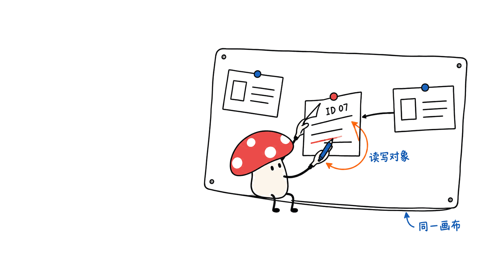
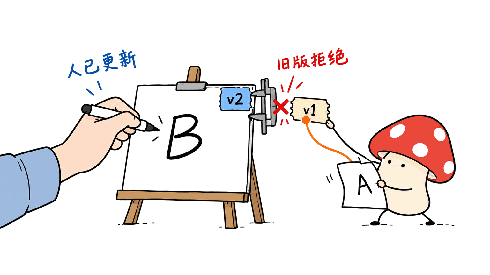
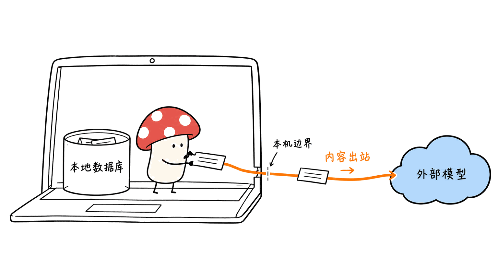

MOKI 白板让人和 Agent 操作同一张本地画布：Agent通过MCP读写元素，而不是只在旁边聊天。接入时最重要的是读回真实ID、传入版本号，再核验修改结果。

> 核对日期：2026-10-23。本文运行了源码中的白板核心与SQLite存储，未启动Electron界面，也未跑完整MCP协议测试。
> 官方仓库：https://github.com/JKZeng-cell/moki-whiteboard

## 它是什么，解决什么问题？

这是从MOKI工作台演化出的独立无限白板，README和package.json当前版本为0.1.7，MIT开源。前端使用React，桌面外壳是Electron，数据库为本地SQLite。

人可以放便签、画图、整理思维导图、添加文件和链接；Agent可以通过工具读取、创建、更新、对齐及导出画布对象。它没有内置模型账号，智能能力来自你连接的MCP客户端与模型。

更适合它的任务是把资料归类成卡片、把讨论整理成结构、根据已有元素做布局。它不是一个新的大模型，也不是让图片生成模型画一张“看起来像白板”的截图。

## MCP 如何接入现有画布？

项目提供stdio与Streamable HTTP两种MCP方式，README列出16个工具。代表性入口如下：

| 工具 | 用来做什么 |
|---|---|
| `whiteboard_list` | 找到已有白板 |
| `whiteboard_inspect` | 读取页面、元素、文本与准确ID |
| `whiteboard_add_elements` | 创建便签、文本、图形等 |
| `whiteboard_update_elements` | 更新内容与属性 |
| `whiteboard_align_elements` | 对齐及分布 |
| `whiteboard_export` | 导出 `.moki` |

推荐顺序是list → inspect → 指定ID和版本修改 → 再inspect。这里的第二次inspect是验收，不应被“工具没有报错”代替。



## 版本冲突保护是自动强制的吗？

不是无条件强制。我们检查了MCP schema与存储源码：`expectedVersion` 是可选字段，只有传入后才进行版本比较。版本过期时会返回 `VERSION_CONFLICT`，而省略它的更新可以被接受。

因此，假设人刚把卡片改成B，Agent还拿着旧的A。正确做法是使用旧版本提交并收到冲突，再重新读取；不是省略版本号重试，把B静默覆盖掉。

我们的实际验证使用修订 `9273947dee37de7c9cf88d4d84454ba47e62eef4` 的源码和独立临时数据库：

- SQLite工作在WAL模式；创建白板并添加便签成功。
- 携带旧版本的更新被拒绝，便签原文保留。
- 使用新版本修改成功；关闭并重新打开数据库后，文本与版本仍一致。
- 被拒绝的修改没有留下成功写入记录；该白板有创建、添加和更新3条审计。
- 另一个测试白板省略版本参数时，修改确实被允许。

这验证的是存储与画布核心，不等于完整UI、MCP客户端或多人协同已通过测试。



## 怎样运行并接到 Agent？

README要求Node.js 22.5或更高版本。完整开发启动可按上游说明执行，以下命令经源码核对，本文未安装全部依赖或启动界面：

```bash
git clone https://github.com/JKZeng-cell/moki-whiteboard.git
cd moki-whiteboard
npm ci
npm run dev
```

默认网页地址是 `http://127.0.0.1:4320`，API为 `http://127.0.0.1:4321`，开发数据库为 `data/moki-whiteboard.db`。桌面模式使用 `npm run desktop`。

stdio方式先 `npm run build`，再把客户端的MCP配置指向自己的绝对路径。例如：

```json
{
  "mcpServers": {
    "moki-whiteboard": {
      "command": "node",
      "args": ["/absolute/path/moki-whiteboard/dist/mcp/server.js"],
      "env": {
        "MOKI_WHITEBOARD_DATA": "/absolute/path/moki-whiteboard/data/moki-whiteboard.db"
      }
    }
  }
}
```

`mcpServers` 是常见客户端配置形状，不是MCP规范强制统一的文件格式；以自己客户端的要求为准。更换数据路径也可能让Agent和人看到不同的白板，因此先用list/inspect确认连接的是同一个数据库。

上游还提供 `npm run check` 和 `npm run test:mcp:stdio`；本文没有声称执行这两条完整检查。

## “本地优先”是否意味着内容绝不出电脑？

数据库和素材默认在本机，但如果外部Agent把inspect读到的文本发给云端模型，内容仍会离开设备。MOKI本地存储与模型请求的去向要分别检查。

HTTP MCP面向本机使用，不要直接开放到公网；需要本机认证时可设置 `MOKI_WHITEBOARD_MCP_TOKEN`。浏览器与Electron也有能力差异，本机文件打开等操作依赖桌面桥接。

`.moki` 是包含页面与素材的迁移文件，不只是一个干净的布局模板。分享前检查其中的文件、链接和内容。官方Windows打包流程不等于本文已验证macOS安装包；当前未签名Windows发布物的提示也应按项目说明处理。

安全说明：
https://github.com/JKZeng-cell/moki-whiteboard/blob/main/SECURITY.md



## 我们会怎样把它用于一个真实项目？

可以先让Agent只在“资料整理”页面新增卡片，统一标注来源，不覆盖人的原始记录。确认数据和布局符合预期后，再允许它对齐元素或生成讨论提纲。

工作流的验收不是“生成了多少卡片”，而是每条结论是否能回到来源、人的内容是否保留、导出后能否恢复。把可修改范围与核验步骤写进Agent指令，比“自动帮我整理所有白板”更容易得到可靠结果。这是我们的建议流程，不是已经完成的产品案例。

## 常见问题

### 它自带 AI 模型吗？

不内置模型账号。需要连接支持MCP的客户端及模型，费用与数据路径由相应配置决定。

### 只传元素 ID 就能避免覆盖吗？

不能。想拒绝过期更新，还要传入inspect得到的 `expectedVersion`。

### 本文测试证明了什么？

证明所检查源码的核心存储行为通过小范围验证。没有验证完整桌面UI、HTTP/stdio协议链路或公开安装包。

---

本文原文：https://blog.mushroom.cv/blog/moki-whiteboard-local-mcp/

> © 2026 Author: Mycelium Protocol. 本文采用 [CC BY 4.0](https://creativecommons.org/licenses/by/4.0/deed.zh) 授权——欢迎转载和引用，须注明作者姓名及原文链接，不得去除署名后以原创发布。

<!--EN-->

MOKI lets people and agents edit the same local canvas through MCP. Reliable use depends on reading actual object IDs, supplying the observed version and inspecting the result after each mutation.

Checked October 23, 2026. We ran the real canvas core and SQLite store, not the Electron UI or a complete MCP protocol test.

Repository: https://github.com/JKZeng-cell/moki-whiteboard

## What is it?

The MIT-licensed project is an independent whiteboard derived from MOKI Workbench. The checked README and package identify version 0.1.7. It combines React, Electron and SQLite, with notes, shapes, mind maps, files and links.

Its distinction is an editable object interface: agents can inspect, add, update, align and export content. It is neither another language model nor an image generator producing a whiteboard-looking picture. Model access comes from an external MCP client, not a bundled model account.

## How should an agent edit safely?

The project documents 16 tools over stdio or Streamable HTTP. Start with `whiteboard_list` and `whiteboard_inspect`; then edit explicit IDs with the returned version and inspect again. Useful mutations include `whiteboard_add_elements`, `whiteboard_update_elements` and `whiteboard_align_elements`; `whiteboard_export` creates a portable board.

Crucially, `expectedVersion` is optional in the schema and store. Passing a stale value rejects the write; omitting it allows an unguarded update. Do not handle a conflict by dropping that field and retrying.


## What did the source test establish?

At commit `9273947dee37de7c9cf88d4d84454ba47e62eef4`, our isolated SQLite smoke test confirmed WAL mode, note creation, rejection of a stale update without losing content, acceptance of a fresh update, and persistence after reopening. The tested board had three successful audit entries: create, add and update. A separate board confirmed that omitting the version permits a write.

This is a storage/core result, not a full application, multi-user collaboration or MCP transport certification.


## How do you run it?

The documented minimum is Node.js 22.5. These upstream commands were inspected, not executed as a full installation here:

```bash
git clone https://github.com/JKZeng-cell/moki-whiteboard.git
cd moki-whiteboard
npm ci
npm run dev
```

The browser defaults to `http://127.0.0.1:4320`, the API to port 4321, and development storage to `data/moki-whiteboard.db`. Use `npm run desktop` for the Electron path.

For stdio MCP, build first and point the client at the absolute path to `dist/mcp/server.js`; set `MOKI_WHITEBOARD_DATA` to the database the application uses. Client configuration shapes differ: `mcpServers` is common, not a universal MCP configuration-file standard. Verify the board list before allowing edits.

Upstream provides `npm run check` and `npm run test:mcp:stdio`; we did not run those complete checks.

## Does local-first guarantee no data leaves the computer?

No. Storage can be local while an agent sends inspected content to a cloud model. Review both paths. HTTP MCP is intended for local use; the project documents `MOKI_WHITEBOARD_MCP_TOKEN` for authentication, not a public hosting recipe.

Portable `.moki` files may include content and assets. Inspect them before sharing. Browser and Electron capabilities differ, and the Windows packaging instructions do not establish tested macOS installers.

Security guidance: https://github.com/JKZeng-cell/moki-whiteboard/blob/main/SECURITY.md


## Where would we start?

Our proposed pilot limits the agent to adding sourced notes on one research page. Keep human originals intact, validate the content, then allow layout changes. Acceptance should cover traceability, preserved edits and recoverable exports, rather than counting generated cards. This is an implementation suggestion, not a completed case study.

## FAQ

### Is a model included?

No model account is bundled. Connect an MCP client and choose its model/provider separately.

### Is an object ID sufficient to prevent overwrites?

No. Supply `expectedVersion` from inspection to reject stale writes.

### Was the full application tested?

No. The scope was the real storage and canvas core, not the UI, transports or packaged installers.

---

Original article: https://blog.mushroom.cv/blog/moki-whiteboard-local-mcp/

> © 2026 Author: Mycelium Protocol. Licensed under [CC BY 4.0](https://creativecommons.org/licenses/by/4.0/) — free to share and adapt with attribution. You must credit the author and link to the original; removing attribution and republishing as original is not permitted.
