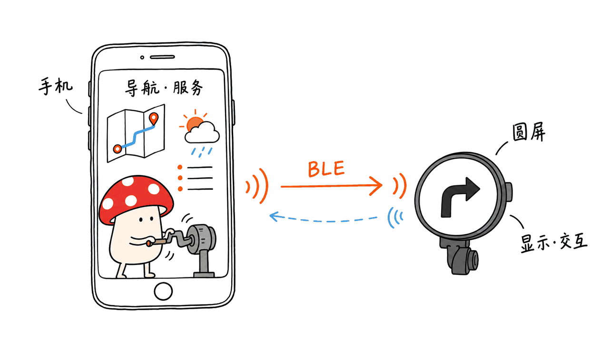
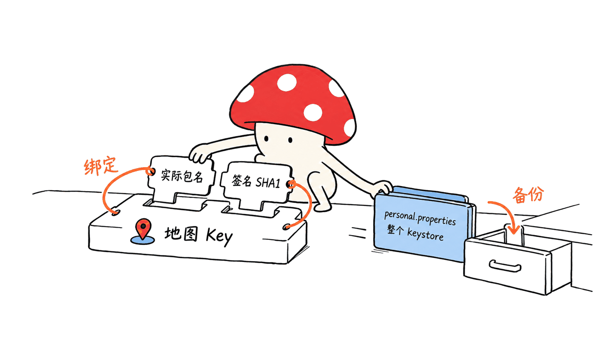

MotoNav 把 Android 手机上的导航信息送到一块小圆屏，让手机负责定位、路线和数据处理，屏幕负责显示导航、天气与音乐控制。它适合想研究或自制摩托车导航副屏的爱好者，需要手机、指定开发板和自己的服务凭据一起配合。

项目由 `zyn950929/MotoNav` 公开源码，但采用自定义非商业使用条款，不能理解为 MIT、Apache 那样的许可。本文核对日期为 2026-10-17，固定源码 `3b93facfd244b0477950189b6e26aa913b2ded78`。README 标注 App 8.3.19、圆屏固件 7.8.11。

封面与手绘是本文的概念配图，不是 MotoNav 实机或路测证据。原仓库的素材也有不同性质，后文会分开说明。

## 小圆屏自己导航，还是手机的副屏？

**主要导航能力在手机一侧。** README 明确，地图、搜索、算路和导航仍依赖高德；固件和 Android 源码中可看到 BLE 连接、配对及数据收发逻辑。圆屏承担可视化与部分交互，不宜把它写成自带定位、能完全脱离手机的导航仪。

| 部分 | 负责什么 | 复现时要准备 |
| --- | --- | --- |
| Android App | 定位、地图、路线、数据处理与设备连接 | 支持的手机、权限与地图配置 |
| ESP32-S3 固件 | 圆屏显示、触摸交互及蓝牙通信 | 对应板型与匹配固件 |
| 高德 | 地图、搜索、算路和导航服务 | Android 平台 Key，绑定实际包名与签名 SHA1 |
| 天地图 | 可选底图或卫星风格 | 对应 HTTP 服务 Key |
| 和风天气 | 天气、短时降水、空气质量、预警 | 自己账号的 API Host 与 API Key |

因此，“自己编译的软件”不等于“不需要外部服务”。是否能离线、某个分享链接能否还原原路线，都应分别验证；项目没有给出所有场景的离线保证。README 也说明，高德网页无法还原原路线时需按提示处理，不保证全部分享链接可还原。

项目写明使用 AI 辅助开发，含义是开发过程有 AI 参与，并不表示圆屏里运行大模型或有智能体自主驾驶能力。



## 支持什么硬件，有哪些可见功能？

当前公开说明明确支持 Waveshare ESP32-S3-Touch-AMOLED-1.75，分辨率 466×466；其他板型不列入本次支持范围，M5Stack StopWatch 也不在仓库内。即使某段构建脚本保留其他板型参数，也不能据此把兼容名单扩大。

功能包括地图、路线、转向提醒、车速、行程环、巡航、音乐控制及开机动画，保留摩托车、驾车、自行车路线分享的处理。地图共享与外部服务的车型/路线权限仍需按实际服务规则核对。

天气部分已经改为和风天气，圆屏可在主页、降水/空气和预警摘要之间切换；手机提供详情与来源。请求按查看天气触发并使用缓存，不是在导航后台持续轮询。作者这样设计有利于减少无谓请求，但具体新鲜度和额度消耗仍取决于配置、使用行为及服务端数据。

天气照片里的数值是拍摄时的内容，预警也可能延迟。不能把一张“暂无预警”的画面解释为当前所在地没有风险。

## 为什么打包之前，先理解包名和签名？

高德 Key 绑定的不是仓库里的一个文字名字，而是实际安装应用的包名与签名证书 SHA1。源码 namespace `com.example.motonav` 可以与实际 applicationId 不同。个人打包第一次会生成专属应用标识和签名，再用这些信息配置服务。

Windows 官方路径是完整解压仓库后运行根目录批处理。它会下载 JDK、Android SDK、Gradle 和依赖，成功后生成 `output/MotoNav-personal.apk`，并在 `Application-info.txt` 中提供绑定信息。这里的一键入口仍需要网络、构建依赖以及对 SDK 许可的确认，不是仓库自带一个通用 APK。

更新前需要保留 `android/personal.properties` 和整个 `android/keystore` 目录；换新版源码后先放回，再打包，才能沿用个人包名、证书和服务绑定。别把个人签名与带凭据的工程重新公开上传。

Android 构建配置声明 compile/target SDK 35、minSdk 26 和 arm64-v8a，但这是构建目标信息，不代表我们验证了所有 Android 8 及以上机型。Mac 用户也不能直接双击 Windows 批处理；应自行准备相应工具链并参照源码构建配置。



## 固件与服务配置有哪些具体门槛？

1.75 英寸工程位于 `firmware/boards/175/MotoNav`，第三方库放在 `firmware/libraries`。README 要求 Arduino CLI 与 ESP32 Arduino Core 3.3.10，Windows 构建命令为：

```powershell
.irmwareuild.ps1 -Board 175
```

输出区分首次安装的 `full_0x0` 完整镜像，以及已有相同板型和分区的 `app_0x10000` 升级镜像。先核对设备、分区和备份，再按官方指引刷写，不能把两类文件随意互换。

地图和天气凭据均不内置。和风实现会校验所配置的 API Host，使用 HTTPS 和请求头传 Key；这些是源码可见的实现细节，不构成我们对整个应用安全性的认证。各服务权限、使用范围、额度、署名和收费要看服务商当期规则，重新签名不会自动获得服务授权。

## 公开源码到底允许怎样使用？

仓库自有代码、固件、脚本与原创材料受 `LICENSE.md` 的非商业条款约束：允许个人非商业学习、编译、修改和自用；免费分享也要求保留条款、版权与来源，并标明修改。未经书面许可的收费下载、付费入群、代编译、代刷机、硬件预装或套件转售等都在禁止范围内。

**不能把可下载源码当成可销售方案。** 改名字、换包名、重新签名不会解除这些限制。第三方库、字体、商标、地图和天气数据又各有自己的条件，不因项目主条款而统一改许可。

本文原创文字与手绘按文末声明分享，不授予读者对 MotoNav 代码、照片、固件或第三方数据的额外权利。

## 实机照片和测试结果，能说明什么？

原仓库 `docs/MEDIA.md` 做了清楚的区分：停车安装照是真实安装记录；导航、音乐、降水等照片及静音视频是设备展示，其中导航视频为桌面演示；天气主页和启动页的部分照片经 AI 隐私处理，细节可能改变；三张模拟效果图则不是实机截图或功能测试结果。

素材没有被声明为第三方可任意转载，本文没有把它们直接当作不限权的封面素材。按你的知识库归档要求，已将 14 张静态图/GIF 保存到本地，并保留来源与类别说明；不拿生成画面证明设备效果。

本次本地验证在 M4 上使用临时解压、校验哈希的 JDK 17，运行了上游三组纯 Java 检查：巡航计时组包含 12 个情境；地图样式组覆盖 12 种样式及捕获策略/非法 ID；地区格式组包含 17 个案例，均通过。没有修改源代码，也没有把 JDK 安装到系统。天气 Kotlin/JSON 解析测试没有运行。

我们没有编译完整 Android App 或固件，没有连接 ESP32、调用真实地图天气接口、测试蓝牙链路或做道路验证。三组逻辑检查只能说明相应代码在模拟输入下的行为，不能证明导航定位、连接稳定性、续航、防水或户外可读性。


我的判断：MotoNav 更像一个可研究的手机—圆屏协作工程，适合愿意处理硬件、构建和服务凭据的个人爱好者。先在停车或桌面状态验收连接、重连、转向显示和数据过期提示，再考虑具体安装场景；需要现成即用、跨硬件兼容或商业销售授权的人，应先核对这些条件是否满足。另一个端侧项目的硬件、服务与公开源码边界，可参见：https://blog.mushroom.cv/blog/pocketorca-35b-moe-phone-server/

## 常见问题

### 手机不用联网也能完整导航吗？

不能从公开源码直接得出这个结论。当前说明仍依赖高德和自配天气服务，离线行为需要独立验收。

### 可以把编译好的系统装进硬件出售吗？

当前条款明确限制未经许可的商业使用与硬件捆绑销售，需要另行取得书面许可。

### README 的漂亮封面是实机效果吗？

作者明确标为 AI 模拟效果，非实机截图；真实素材也需按桌面演示、隐私处理等标签阅读。

## 一手资料

- 项目：https://github.com/zyn950929/MotoNav
- 固定源码：https://github.com/zyn950929/MotoNav/tree/3b93facfd244b0477950189b6e26aa913b2ded78
- 非商业条款：https://github.com/zyn950929/MotoNav/blob/3b93facfd244b0477950189b6e26aa913b2ded78/LICENSE.md
- 素材性质：https://github.com/zyn950929/MotoNav/blob/3b93facfd244b0477950189b6e26aa913b2ded78/docs/MEDIA.md
- 检查入口：https://github.com/zyn950929/MotoNav/blob/3b93facfd244b0477950189b6e26aa913b2ded78/android/tests/run.ps1

---

> © 2026 Author: Mycelium Protocol. 本文采用 [CC BY 4.0](https://creativecommons.org/licenses/by/4.0/deed.zh) 授权——欢迎转载和引用，须注明作者姓名及原文链接，不得去除署名后以原创发布。

<!--EN-->

MotoNav sends navigation information from an Android phone to a small round display. The phone handles location, routes and data; the ESP32-S3 device displays navigation, weather and music controls. It is a DIY project requiring the specified hardware and the user’s own service credentials.

The source is public at zyn950929/MotoNav under custom noncommercial terms, rather than MIT or Apache. This October 17, 2026 review pins `3b93facfd244b0477950189b6e26aa913b2ded78`; the README identifies app 8.3.19 and firmware 7.8.11. Our cover and drawings are conceptual illustrations, not device or road-test evidence.

## Is the round screen a standalone navigator?

The primary navigation work remains on the phone. The README says maps, search, routing and navigation depend on Amap. Source contains BLE connection, pairing and data-transfer logic. The display provides presentation and interaction; it should not be described as independently supplying GPS and complete phone-free navigation.

| Component | Responsibility | User preparation |
| --- | --- | --- |
| Android app | Location, maps, routing, data and device connection | Compatible phone, permissions and configuration |
| ESP32-S3 firmware | Display, touch interaction and BLE | Matching board and firmware |
| Amap | Maps, search, routing and navigation | Android key bound to actual application ID and signing SHA1 |
| Tianditu | Optional map or satellite styles | Corresponding service key |
| QWeather | Weather, precipitation, air quality and warnings | Account-specific API host and key |

Self-building does not remove external service dependencies. Offline operation and restoration of shared routes require separate checks; the README does not guarantee every route link can be reconstructed. AI-assisted development describes how the project was made, not an LLM running inside the display.


## What hardware and features are documented?

The stated supported board is Waveshare ESP32-S3-Touch-AMOLED-1.75 at 466×466. Other boards are outside the current documented support scope; M5Stack StopWatch is not included. Residual build-script parameters are not evidence of additional supported hardware.

Features include maps, routes, turn reminders, speed, trip rings, cruise behavior, music controls and boot animations. Motorcycle, car and bicycle route-sharing handling remains, subject to actual provider capabilities and permissions.

QWeather supplies current conditions, five-hour forecasts, short-term precipitation, air quality and warnings. The display cycles through views, while the phone shows details and attribution. Requests occur when viewing weather and use caching rather than continuous navigation-background polling. Freshness and quota use still depend on configuration, behavior and upstream data.

## Why do package identity and signing matter?

Amap keys bind to the installed app’s application ID and signing-certificate SHA1. The source namespace can differ from the installed application ID. Personal packaging generates an identity and signature that must match the service configuration.

The documented Windows path downloads build tools and dependencies, produces output/MotoNav-personal.apk and writes binding information to Application-info.txt. It is not a universal ready-made APK shipped in the repository.

Preserve android/personal.properties and the entire android/keystore directory across updates. Restore them before rebuilding to retain identity, signature and service bindings. Keep personal signing material and credential-bearing projects out of public uploads.

The Android configuration declares compile/target SDK 35, minSdk 26 and arm64-v8a. These are build declarations, not our compatibility tests across every Android 8+ phone. Mac users also cannot directly use a Windows batch file without preparing an appropriate build environment.


## What does firmware setup require?

The 1.75-inch project lives in firmware/boards/175/MotoNav, with bundled third-party library source in firmware/libraries. The README calls for Arduino CLI and ESP32 Arduino Core 3.3.10:

```powershell
.irmwareuild.ps1 -Board 175
```

The full_0x0 image is for initial installation; app_0x10000 is for an existing matching board and partition layout. Check the target and backups before following the flashing guide.

Map and weather credentials are not bundled. The QWeather implementation validates the configured host and uses HTTPS with a key header. Those source details are not a security certification. Provider permissions, attribution, quotas and billing remain separate, and re-signing does not automatically grant service authorization.

## What do the noncommercial terms allow?

The project’s own terms permit personal noncommercial study, compilation, modification and use. Free sharing requires retention of terms, copyright and source, with changes identified. Unauthorized paid downloads, paid groups, compilation/flashing services and hardware-bundle sales are prohibited examples.

Renaming, changing the package ID or re-signing does not remove those restrictions. Third-party libraries, fonts, trademarks, maps and weather data retain separate conditions. This article’s original text and drawings do not grant additional rights in MotoNav code, firmware, photographs or third-party data.

## What do the imagery and our checks establish?

The upstream media guide distinguishes a parked installation photograph, device and desktop demonstrations, AI-edited privacy photographs, and three AI-generated mockups. Desktop navigation demonstrations are not independent road testing. Weather values belong to the recording time and may be delayed.

The media are not declared arbitrarily reusable by third parties. We therefore made an original conceptual cover, while saving 14 source images/GIFs locally with origin and category records for the requested knowledge archive.

On M4, we used a temporary extracted JDK 17 with a verified archive checksum to run three upstream pure-Java suites. The cruise timer suite covers 12 scenarios; map-style checks cover 12 styles plus capture policy and invalid IDs; area-format checks cover 17 cases. All passed without modifying source or installing Java system-wide. We did not run the Kotlin/JSON weather parser tests.

We built neither the complete Android app nor firmware, connected no ESP32, called no live map/weather API and performed no BLE or road testing. Logic checks do not establish positioning accuracy, reconnection reliability, battery life, waterproofing or outdoor readability.


Our assessment: MotoNav is a useful phone/display integration project for hobbyists willing to manage hardware, builds and provider credentials. Validate connection, reconnection, turn presentation and stale-data behavior on a desk or parked vehicle before considering the installation scenario. Ready-to-use, broad-hardware and commercial requirements need separate verification. Related device/source-boundary discussion: https://blog.mushroom.cv/blog/pocketorca-35b-moe-phone-server/

## FAQ

### Does it provide complete offline navigation?

The public source does not establish that. The documented setup still uses Amap and user-configured weather services; offline behavior needs separate acceptance testing.

### Can I sell hardware with it installed?

The current terms restrict unauthorized commercial use and bundled hardware sales. Separate written permission is required under those terms.

### Is the attractive README hero a real device screenshot?

The author explicitly labels it as AI-generated simulation. Read the labels on real, desktop-demo and privacy-edited media separately.

## Primary sources

- Project: https://github.com/zyn950929/MotoNav
- Pinned source: https://github.com/zyn950929/MotoNav/tree/3b93facfd244b0477950189b6e26aa913b2ded78
- Terms: https://github.com/zyn950929/MotoNav/blob/3b93facfd244b0477950189b6e26aa913b2ded78/LICENSE.md
- Media guide: https://github.com/zyn950929/MotoNav/blob/3b93facfd244b0477950189b6e26aa913b2ded78/docs/MEDIA.md
- Logic checks: https://github.com/zyn950929/MotoNav/blob/3b93facfd244b0477950189b6e26aa913b2ded78/android/tests/run.ps1

---

> © 2026 Author: Mycelium Protocol. Licensed under [CC BY 4.0](https://creativecommons.org/licenses/by/4.0/) — free to share and adapt with attribution. You must credit the author and link to the original; removing attribution and republishing as original is not permitted.
