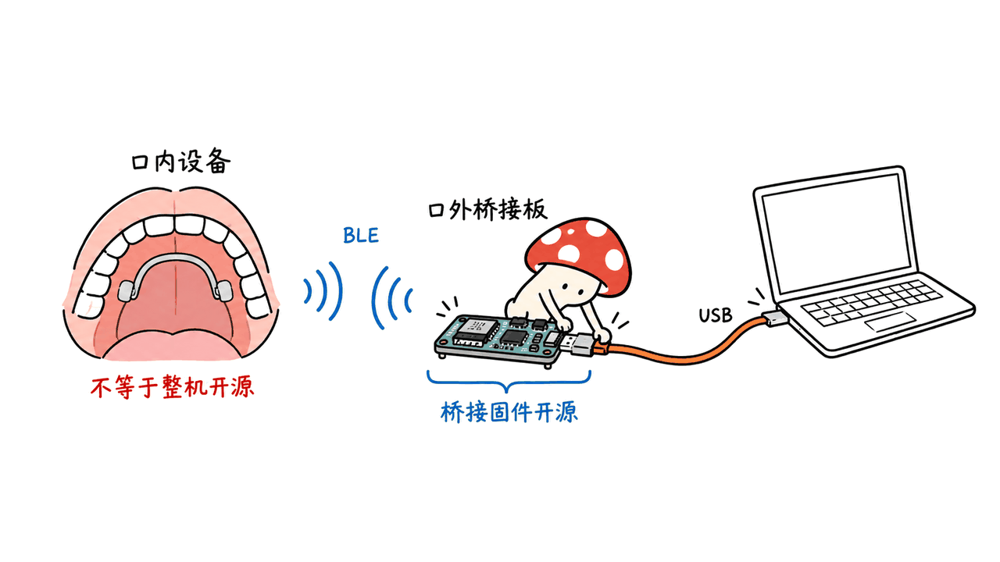
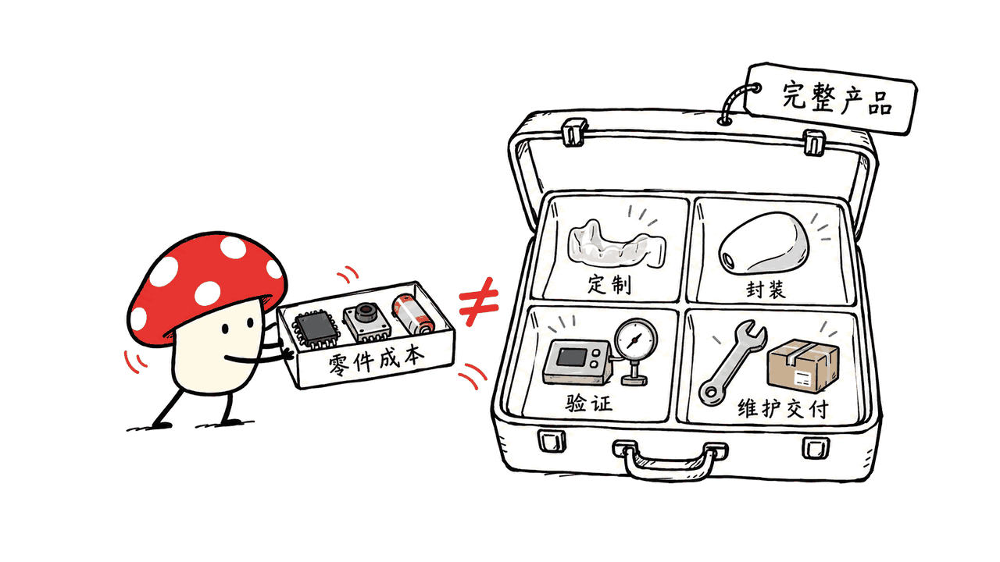

舌控牙套是一种让舌头动作变成鼠标输入的辅助设备，真实产品已经存在；但截至2026年10月20日，我们没有找到足以证实“26岁青年拒绝苹果6亿收购、牙套售价47美元”的一手材料。能确认的是Augmental的MouthPad，以及相关公开桥接代码，不能把它们直接认作网传主角。

## “苹果6亿收购”的故事能追到哪里？

我们找到一条内容高度相近的英文传播帖，由Venkatesh Krishnamurthy发布在LinkedIn。它讲的是一名未具名的26岁开发者，用180美元打印机制作舌控设备，拒绝苹果840万美元收购；47美元被写作单件硬件成本。帖子还声称代码和STL已经公开，但没有提供仓库地址。

传播帖地址：https://www.linkedin.com/posts/venkateshtheinnovator_apple-sandiego-bluetoothle-activity-7493291823403139072-mVAt

这只是找到的相近传播版本，不能认定是最早原帖或已证实新闻。我们按金额、打印机、设备名称以及Apple网站等方向检索，没有定位到可交叉验证的发明者声明、收购公告和对应制造仓库。“没查到”不证明交易绝不可能发生，但不足以把它写成事实。

| 核查项 | 当前能确认什么 | 不能据此推出什么 |
|---|---|---|
| 26岁、180美元打印机 | 相近英文帖存在这些说法 | 发明者身份、打印机和成本已经核验 |
| 苹果收购 | 英文帖声称840万美元 | 中文“6亿”有可靠出处，或交易真实 |
| 47美元 | 原帖称硬件成本 | 终端售价、合格成品总成本 |
| 公开代码和STL | 传播帖声称已开源 | 已找到该匿名发明的完整仓库 |
| 舌控电脑 | 有具名厂商与研究项目 | 它们就是上述匿名人物的项目 |

## 真实开发商在哪里，MouthPad怎么工作？

Augmental官网明确写明生产主体是位于旧金山的Augmental Technologies Inc.，并列出共同创始人兼CEO Tomás Vega。2026年7月22日的官方公告宣布MouthPad在美国公开销售。

官网：https://www.augmental.tech/

官方发布：https://www.augmental.tech/news/mouthpad-and-vox-launch

联系地址：https://www.augmental.tech/contact-us

MouthPad根据牙齿扫描定制，舌头在上腭触控区域操作，再以蓝牙鼠标方式连接设备。官网单件标价1,400美元，牙齿扫描通常另收50—150美元，并写明制作交付约六个月。这些是官网报价和承诺，不是我们的到货实测；也不能用来反推匿名设备的成本。

封面采用Augmental官网公开的MouthPad产品图，图像版权归原权利人。设备照片不代表我们拿到了实物。

## 找到了开源仓库，但开放的是哪一层？

确实有可访问的相关代码：

Augmental组织的分支：https://github.com/augmentaltech/mouthpad-relay

上游作者仓库：https://github.com/RobertDaleSmith/mouthpad-usb

本次读取时，两者main均指向：

e18eae46ac0249bf7c80d788a4e86273e88e2c8e

README和LICENSE表明它是MIT许可的外置桥接固件：接收现有MouthPad的蓝牙输入，在电脑一端提供USB HID与CDC接口。目录分别包含nRF52840和ESP32-S3实现。也就是说，开发板在口外做连接适配，口内设备仍需另有来源。

我们的工程判断是：这个仓库适合研究连接、适配和诊断，**不能据此声称整套MouthPad硬件、口内固件和定制牙套文件均已开源**。仓库属于相关生态，也不能证明匿名26岁发明者和苹果收购故事。

对读代码的人，先看README所界定的BLE到USB边界，再沿ncs/与esp/目录查看平台实现，最后核对板型和构建说明。没有实物时，把阅读结论限定为软件结构；不要把README的支持列表写成自己验证过的兼容性。

## 想研究可定制口腔接口，MouthIO值得看什么？

另一个具名项目是MouthIO，来自MIT CSAIL与奥胡斯大学研究者。MIT在2024年10月28日发布介绍；对应论文发表于UIST 2024。它提供可定制口腔接口的研究方法，把牙齿扫描、Blender设计、传感与反馈组件整合起来。

MIT原始介绍：https://news.mit.edu/2024/interactive-mouthpiece-mouthio-1028

研究者项目页：https://www.yijingjiang.com/work/mouthio

论文：https://interactivematterlab.org/data/mouthio.pdf

这是独立研究项目，不是MouthPad的开源版，也不是已证实的“47美元牙套”。研究方法公开、论文可读，与可直接采购或完整复刻的产品是不同层次。我们没有找到能确认属于网传匿名人物的仓库，因此不拿名称相近的项目补上这个空缺。

## 为什么47美元成本不能直接变成47美元产品？

材料清单只能回答“零件多少钱”。口内设备还涉及个体适配、接触材料、密封、供电、耐用性、校准、维护和交付。MouthIO论文专门讨论结构与佩戴评估，这些本身就说明：打印外形只是工程的一部分。

不能仅凭成品贵于零件就断言暴利，也不能用一个未经证实的低价宣称普及难题已经解决。对开发者，更有用的比较是：哪些设计和代码能复核，哪些验证有记录，谁负责定制与售后，以及用户能否持续稳定使用。

这与我们研究本地工具时的原则相通：可下载、可运行和可持续使用，需要分别核对。相关工程阅读：https://blog.mushroom.cv/blog/thinkterm-multi-agent-terminal/

## 常见问题

### 找到那位26岁发明者了吗？

没有。找到的是高度相近的传播帖，未找到可以把姓名、原始演示、苹果提议和制造文件连成证据链的材料。

### 现在有可购买产品和可读代码吗？

有。MouthPad官网提供产品信息和订购入口；mouthpad-usb与mouthpad-relay提供相关桥接代码。两者范围必须分清。

### 这篇做了哪些实测？

只做来源追踪、官网报价核对，以及固定提交的README和许可证审阅。没有制作或佩戴牙套，没有编译刷写桥接板，也没有测量延迟、准确率或临床效果。本文是来源与工程边界核查，不是产品性能评测。

---

> © 2026 Author: Mycelium Protocol. 本文采用 [CC BY 4.0](https://creativecommons.org/licenses/by/4.0/deed.zh) 授权——欢迎转载和引用，须注明作者姓名及原文链接，不得去除署名后以原创发布。

<!--EN-->

A tongue-controlled retainer converts mouth movements into computer input. Real products exist, but our October 20, 2026 investigation did not substantiate the viral story about a 26-year-old rejecting an Apple acquisition and selling a device for $47.

## What can we trace about the Apple story?

A closely matching LinkedIn post by Venkatesh Krishnamurthy describes an unnamed developer, a $180 printer, an alleged $8.4 million Apple offer, and $47 in hardware costs. It claims firmware and STL files were published but supplies no repository.

Post: https://www.linkedin.com/posts/venkateshtheinnovator_apple-sandiego-bluetoothle-activity-7493291823403139072-mVAt

This is a located circulation version, not an authenticated original. Searches using the distinctive amounts, printer and device descriptions, including Apple sources, did not establish the inventor, acquisition, or manufacturing repository. Absence of public evidence does not prove an offer impossible; it prevents us reporting it as established fact. Hardware cost is also different from retail price, and the amount differs from the Chinese account.

## Who makes the real MouthPad?

Augmental identifies itself as the manufacturer in San Francisco. Its July 22, 2026 announcement names CEO and co-founder Tomás Vega. A custom dental scan produces the fit; tongue input reaches the host through a Bluetooth mouse interface. The website lists $1,400 per device, separate scans typically at $50–$150, and approximately six months for delivery. These are vendor statements, not our purchase experience.

Product: https://www.augmental.tech/

Announcement: https://www.augmental.tech/news/mouthpad-and-vox-launch

Developer contact: https://www.augmental.tech/contact-us

The cover is an official Augmental product image; rights remain with its owner. We have not obtained the device. There is no basis for identifying Augmental as the anonymous developer in the viral post.

## What is actually open source?

The relevant public repositories are:

https://github.com/augmentaltech/mouthpad-relay

https://github.com/RobertDaleSmith/mouthpad-usb

Both main branches resolved to e18eae46ac0249bf7c80d788a4e86273e88e2c8e during our review. Their MIT-licensed bridge firmware receives BLE input from an existing MouthPad and presents USB HID/CDC interfaces to a host. The repository contains nRF52840 and ESP32-S3 implementations.

This is useful connection infrastructure. It does not establish publication of the entire wearable's electronics, internal firmware, and custom retainer files. To study it, start with the README's interface boundary, inspect ncs/ and esp/, and then check the chosen board's build documentation. A documented hardware target is not compatibility we personally tested. Nor does either repository substantiate the alleged Apple deal.

## Where does MouthIO fit?

MIT CSAIL and Aarhus University researchers developed a separate customizable oral-interface research project, MouthIO. MIT published its introduction on October 28, 2024, and the paper appeared at UIST 2024. It connects dental scans and Blender-based customization with integrated sensing and feedback.

MIT: https://news.mit.edu/2024/interactive-mouthpiece-mouthio-1028

Researcher: https://www.yijingjiang.com/work/mouthio

Paper: https://interactivematterlab.org/data/mouthio.pdf

MouthIO is neither an open-source edition of MouthPad nor a verified match for the unnamed $47 device. Published methods and papers do not by themselves establish a complete manufacturing repository or a ready-to-order product.

## Why does the cost distinction matter?

Parts cost answers only one question. A usable oral device also requires fit, appropriate materials, encapsulation, power management, durability, calibration, maintenance and delivery. The MouthIO paper addresses structural and wearability evaluation, illustrating why a printable shape is only part of the work.

Our independent conclusion is to compare evidence: what files are inspectable, what validation is documented, and who handles customization and support. A gap between parts and retail prices does not by itself demonstrate excessive margins. An unsupported low-cost claim does not establish that access barriers have disappeared.

Related engineering reading: https://blog.mushroom.cv/blog/thinkterm-multi-agent-terminal/

## FAQ

### Did you identify the anonymous inventor?

No. We found a similar circulating post, but no evidence chain linking a named inventor, original demonstration, Apple offer and manufacturing files.

### Are there real products and public code?

Yes: MouthPad is a named commercial product, and the linked repositories contain bridge firmware. Those are separate scopes.

### What did you test?

We traced sources, checked vendor pricing, and reviewed pinned README and license files. We did not manufacture or wear a retainer, flash hardware, or measure latency, recognition accuracy or clinical outcomes. This is a source and engineering-scope review, not a performance review.

---

> © 2026 Author: Mycelium Protocol. Licensed under [CC BY 4.0](https://creativecommons.org/licenses/by/4.0/) — free to share and adapt with attribution. You must credit the author and link to the original; removing attribution and republishing as original is not permitted.
