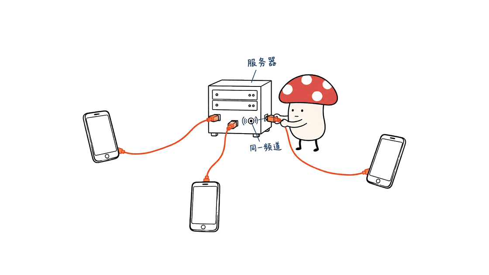
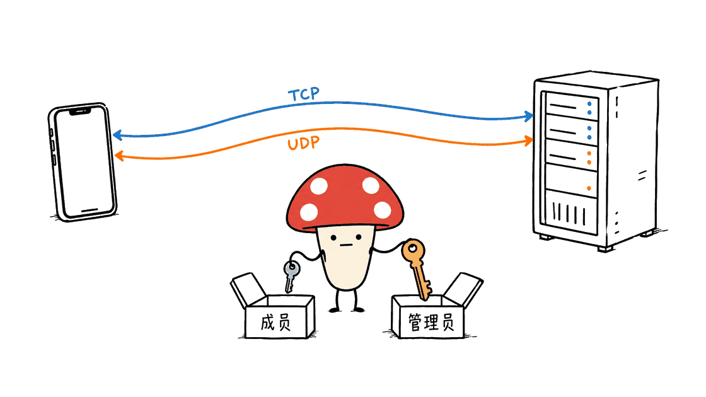

Mumble可以让多部手机接入同一个语音频道，用按住说话的方式实现网络对讲。搭建确实不复杂，但它需要手机能够访问服务器；它不会把手机变成没有网络也能远距离通信的无线电对讲机。

这里有四个容易混淆的名字：Mumble是核心项目，Android常用客户端叫Mumla，iOS有独立应用Mumblers，还有开源的跨平台客户端MumbleWay。它们并非同一个团队维护，开源状态、系统要求和后台体验也不同。

本文截至2026年11月1日核对了官方代码、商店页面和容器配置，给出一套小团队起步方案。Mycelium Protocol完成了源码与配置静态核查，没有在手机上实测双向通话、锁屏保活或蓝牙按键，也没有在本机启动服务端。

## Mumble如何把手机接成对讲频道？

最小结构只有三部分：一台Mumble服务器、每人一款兼容客户端，以及所有人加入的同一个频道。手机把语音发给服务器，再由服务器按频道与权限转发给其他成员。电脑也能加入，并不局限于手机之间。

```text
Android客户端 ─┐
iPhone客户端  ─┼─ 网络 ─ Mumble服务器 ─ 同一频道内的其他成员
桌面客户端    ─┘
```

Mumble本来就是低延迟语音软件。它支持多人频道，按住说话只是客户端的一种发言方式，不意味着服务器变成严格的单人抢麦系统。声控发言也可选，但嘈杂环境更容易把风声、音乐或回声误判成讲话。

“客户端填IP、端口、密码就能连”大体描述了初次连接，但通常还要填写显示用户名、核对服务器证书，并选择频道。后续如果要固定身份、分配管理权限，还会涉及用户注册和客户端证书。

它适合活动执行、小型制作团队、办公室语音房，以及有网络覆盖的同行小组。若在没有互联网的场地使用，只要本地Wi-Fi与服务器仍互通，局域网内也可以对讲；跨越不同移动网络，则需要可达的服务器或适当的VPN连接。



## 相关应用，哪些确实有开源仓库？

| 项目 | 负责什么 | 已核实的源码与状态 |
|---|---|---|
| Mumble / mumble-server | 桌面客户端与服务端，服务端旧称Murmur | 官方C++/Qt项目，主体采用BSD风格三条款许可 |
| Mumble Docker | 官方服务端容器打包与启动脚本 | 官方仓库，BSD-3-Clause |
| Mumla | Android客户端，延续Plumble | GitLab主仓库，GitHub镜像，GPLv3 |
| Mumblers | iPhone、iPad上的独立兼容客户端 | 已确认商店与开发者网站，尚未核实对应公开源码仓库与许可证 |
| MumbleWay | Rust核心与Flutter界面的跨平台客户端 | 独立开源仓库，核心声明GPL-3.0-or-later |
| Mumble for iOS旧项目 | 早期官方iOS客户端 | 有公开源码，但仓库明确标记停止维护 |

Mumble核心：https://github.com/mumble-voip/mumble
官方容器：https://github.com/mumble-voip/mumble-docker
Mumla主仓库：https://gitlab.com/quite/mumla
Mumla GitHub镜像：https://github.com/quite/mumla
MumbleWay：https://github.com/zavitax/mumbleway
旧版iOS源码：https://github.com/mumble-voip/mumble-iphoneos

上表区分了三个问题：能不能安装、是不是兼容Mumble、有没有可核实的开源代码。一个应用使用开放协议，并不能自动证明它本身开源。

### Android：搜索Mumla，核对包名

Mumla在F-Droid和Google Play均有可核实入口，包名是`se.lublin.mumla`。这比在商店里只搜“mumble”更容易找到对应应用。当前页面说明最低要求为Android 5.0；实际安装还应以设备和所在地区的商店结果为准。

F-Droid：https://f-droid.org/packages/se.lublin.mumla/
Google Play：https://play.google.com/store/apps/details?id=se.lublin.mumla
项目网站：https://mumla-app.gitlab.io/

它提供声控、按键发言、证书管理、自动重连等功能。不过，维护者在README中明确表示时间有限，主要维持稳定与安全，并寻找新的维护者。因此“目前有下载入口”不能延伸成“未来商店可用性与功能更新都有保证”。

### iOS：Mumblers能找到，但源码不能张冠李戴

Mumblers由开发者george khoury发布，已核实的美国区App Store页面标为免费，要求iOS 17或更新版本。商店介绍包含按住说话、声控、Keychain保存凭证与Live Activity控制等功能，这些是开发者说明，不是本文实测。

商店：https://apps.apple.com/us/app/mumblers/id6806896342
开发者网站：https://mumblers-ios.spires-viler5o.chatgpt.site/

在其开发者网站与公开搜索中，尚未建立它和某个源码仓库的可信对应关系。GitHub存在同名Rust项目，也不能仅凭名字认定是这款iOS应用。App Store页面嵌入的推荐应用资料中还出现了MumbleWay链接，它属于另一款应用，不能当成Mumblers源码。

旧的`mumble-iphoneos`仓库也不等于Mumblers。Mumble官方下载页明确说明旧iOS应用未维护，不能把它当作现代iPhone安装的默认推荐。

### 想让手机客户端也可审计：补充看MumbleWay

MumbleWay是另一位开发者维护的独立客户端，公开了Rust语音核心与Flutter应用代码，覆盖Android、iOS和桌面平台。它尤其关注头盔内的风噪、回声、自动重连与音频链路诊断，也提供按住说话。

项目网站：https://zavitax.github.io/mumbleway/
源码：https://github.com/zavitax/mumbleway

这使它成为希望检查移动端实现的用户的候选项。它的噪声处理效果、耗电和实际延迟仍应在自己的手机、耳机与网络上验证；本文没有复现作者的路测指标。iOS源码可编译也不等于任意下载的未签名包都能直接安装，应从项目网站指向的商店或签名发行入口获取。

## 服务端怎样搭，才不只是一条演示命令？

新手可以先用一台装好Docker和Compose的Linux主机。云服务器需要考虑所在地区、到成员的网络质量和流量费用；家中的小主机或NAS也可以，但要处理休眠、断电和外网可达性。

核心仓库的`master`包含开发中代码，部署时应选择稳定发行版。截至核查时，官方稳定版为1.5.939。下面固定镜像版本，避免`latest`在后续拉取时悄悄改变。官方镜像索引已核实包含Linux amd64、arm64等架构，但镜像存在并不等于已在读者的具体设备上验证成功。

先在新目录中创建`.env`，放入两段不同的随机密码。以下是内容示意，运行前必须换成自己的值：

```dotenv
MUMBLE_JOIN_PASSWORD=replace-with-a-long-random-join-password
MUMBLE_ADMIN_PASSWORD=replace-with-a-different-random-admin-password
```

普通成员只拿第一段。第二段用于`SuperUser`管理身份，不应作为团队共用的入场密码。服务器的`.env`和数据库备份也不应提交到公开仓库。

再创建`compose.yaml`：

```yaml
services:
  mumble:
    image: ghcr.io/mumble-voip/mumble-server:v1.5.939
    restart: unless-stopped
    ports:
      - "64738:64738/tcp"
      - "64738:64738/udp"
    environment:
      MUMBLE_CONFIG_SERVER_PASSWORD: "${MUMBLE_JOIN_PASSWORD:?Set MUMBLE_JOIN_PASSWORD in .env}"
      MUMBLE_SUPERUSER_PASSWORD: "${MUMBLE_ADMIN_PASSWORD:?Set MUMBLE_ADMIN_PASSWORD in .env}"
      MUMBLE_CONFIG_USERS: "20"
    volumes:
      - mumble-data:/data
volumes:
  mumble-data:
```

然后执行：

```bash
chmod 600 .env
docker compose config --quiet
docker compose up -d
docker compose ps
docker compose logs --tail=50 mumble
```

这里的20人是示例人数上限，不是经过容量测试得到的并发保证。命名卷保存数据库等持久状态；普通重建容器会复用它，而`docker compose down -v`会删除卷，不要把该命令当作日常重启方式。备份可在停服后复制数据卷，并同时保留配置和镜像版本。

配置不发布6502管理接口，也不启用公共服务器目录注册。正式运行后，可用桌面Mumble以管理身份建立频道、设置ACL，再让普通成员进入各自频道。不要把共享入场密码当成细粒度成员授权。

本机没有可用的Docker或Podman运行环境，因此这里完成的是YAML解析、参数与官方启动脚本的对照，未执行容器启动。它是一份可复核的部署起点，不是“所有手机已经通话成功”的证明。



## 填好地址仍连不上，先查哪里？

服务器默认使用64738端口。TCP承担控制与可靠传输，UDP优先承载低延迟语音，二者都应在主机防火墙、云安全组和必要的路由器映射中正确放行。UDP不可用时，兼容客户端可能退回TCP隧道，但这不应作为忽略UDP配置的理由。

如果服务端在家里，手机连的是同一个Wi-Fi，可以先填服务器局域网IP。切到移动数据后，这个私网地址通常就不可达了；需要公网入口、正确端口映射，或者让成员经VPN接入同一可达网络。

运营商级NAT（CGNAT）下，仅在家用路由器里添加端口映射可能仍然无效。改密码不会改变这个问题。域名能让地址更容易记住，但不会自动打通防火墙、NAT或休眠的服务器。

| 现象 | 优先排查 |
|---|---|
| 完全连不上 | 地址和端口、服务端是否运行、TCP与网络路由 |
| 已连上但没有声音 | 是否同一频道、静音/拒听、麦克风权限、发言方式、UDP与回退状态 |
| 切到移动网络就掉线 | 私网地址、外网入口、网络切换与重连 |
| 锁屏后收不到或发不出 | 客户端后台音频能力、系统省电策略、通知及音频权限 |
| 耳机按钮没反应 | 应用是否支持该按键、系统音频路由、蓝牙协议和耳机兼容性 |

第一次连接自签名证书时，应通过可信渠道核对服务器指纹；之后证书突然变化也应查明原因。需要更顺畅的证书体验时，可以配置受信任证书，但这属于额外的域名与证书管理工作。

## 手机体验的难点：后台、噪声和耳机

真正决定好不好用的，往往不是服务端是否启动，而是锁屏后是否持续收听、Wi-Fi与移动网络切换能否恢复，以及耳机麦克风有没有被正确选中。

第一次测试建议两部手机戴耳机，加入同一频道，先开启按住说话；确认双向通话后，再测试锁屏、来电中断、重新连接和蓝牙音频路由。各步骤都应由另一端实际确认收到声音，不能只看本机麦克风动画。

普通耳机的接听键并不天然等于PTT键，某些蓝牙音频模式也会影响同时播放的音乐质量。声控可以减少操作，但应在噪声环境下调整阈值，检查首字被切掉、持续误触发和回声问题。

保持实时语音连接会使用网络、音频与电池。费用不是“按Token计费”，却仍可能包含服务器租金、移动流量和供电。人数、同时发言者和编解码设置都会影响流量，本文不提供未经测量的固定每小时耗电或流量承诺。

## 自托管是否意味着服务器听不到内容？

**不是。Mumble的客户端与服务器之间有传输加密，但这不等于服务器无法解密的端到端加密。** 官方协议说明了客户端到服务端的加密通道；服务端源码也包含对客户端语音包解密、再向接收者加密转发的处理。

自托管的价值是让团队选择服务器运营者、权限与数据保留方式，而不是消除对运营者的信任。服务器管理员、频道成员以及客户端上的录音能力都需要考虑；应用商店的“不收集数据”声明，也不能替第三方服务器作保证。

协议说明：https://github.com/mumble-voip/mumble/blob/master/docs/dev/network-protocol/overview.md
服务器处理代码：https://github.com/mumble-voip/mumble/blob/master/src/murmur/Server.cpp


## 一套适合小团队的落地顺序

先在局域网把两个人接通，再决定要不要上公网。Android先核对Mumla包名；iPhone可评估Mumblers，同时希望移动端源码可审计的团队可以试MumbleWay。若需要管理频道，保留一台桌面客户端会更方便。

随后建立三个明确约定：成员用哪个频道，谁负责服务器，连接中断时用什么备用联系方式。再逐项验收锁屏、网络切换、耳机和噪声。通过之后扩大人数，按实际资源用量调整配置。

这套方案的优势是服务器与频道由自己控制，成员不必依赖一个厂商运营的公共语音房。它的代价也清楚：团队接手了连通性、移动端兼容和运维责任。“搭起来简单”可以成立，“任何环境都可靠”则需要测试证明。

官方软件下载与状态：https://www.mumble.info/downloads/
服务端配置说明：https://www.mumble.info/documentation/administration/config-file/

相关阅读：同样涉及本地设备与远程服务边界，可以对照本站的自托管工具调研：
https://blog.mushroom.cv/blog/corespeed-tie-mac-studio-guide/

## 常见问题

### 没有手机信号，Mumble还能对讲吗？

如果设备仍能通过本地Wi-Fi访问同一台服务器，局域网内可以工作。若没有可用的数据路径，也没有可达服务器，它不能像独立无线电对讲机一样通信。

### 只需要IP、端口和密码吗？

基础连接还通常需要显示用户名、证书信任与频道选择。跨网使用先解决服务器可达性；固定身份和权限管理则另需注册、客户端证书或ACL。

### Mumblers就是官方开源iOS客户端吗？

不是。它的开发者明确称其为独立兼容客户端。本文找到商店和网站，但未核实对应公开源码；旧官方iOS仓库是另一个停止维护的项目。

---

> © 2026 Author: Mycelium Protocol. 本文采用 [CC BY 4.0](https://creativecommons.org/licenses/by/4.0/deed.zh) 授权——欢迎转载和引用，须注明作者姓名及原文链接，不得去除署名后以原创发布。

<!--EN-->

Mumble lets phones join a shared voice channel and use push-to-talk for network-based communication. It needs a reachable server. It does not turn a phone into a long-range radio that works without a network.

Four names matter: Mumble is the core project; Mumla is a common Android client; Mumblers is an independent iOS application; MumbleWay is another open-source cross-platform client. Their maintainers, licensing and mobile behavior differ.

This guide checks primary repositories, store listings and container configuration as of November 1, 2026. Mycelium Protocol performed source and configuration checks. It did not start a server locally or test phone-to-phone audio, lock-screen behavior or Bluetooth controls.

## How do the phones communicate?

Each client connects to a Mumble server, which forwards voice according to channel membership and permissions. Desktop users can join the same conversation. Push-to-talk controls transmission on a client; it does not automatically impose a strict single-speaker floor on the server.

```text
Android ─┐
iPhone  ─┼─ reachable network ─ Mumble server ─ other channel members
Desktop ─┘
```

A local Wi-Fi network can work without upstream internet if every device can still reach the server. Users on different mobile networks need a reachable public endpoint or a suitable VPN. Voice activation is another option, but noise and acoustic feedback make it less predictable than an explicit button.


## Which projects have verified source repositories?

| Project | Role | Source status |
|---|---|---|
| Mumble / mumble-server | Desktop client and server, formerly Murmur | Official repository; BSD-style three-clause license |
| Mumble Docker | Official server image packaging | BSD-3-Clause |
| Mumla | Android client descended from Plumble | GitLab upstream, GitHub mirror; GPLv3 |
| Mumblers | Independent iPhone/iPad client | Store and developer site verified; matching public source and license not verified |
| MumbleWay | Rust core and Flutter client | Public repository; core declares GPL-3.0-or-later |
| Legacy Mumble for iOS | Earlier official application | Public source; explicitly unmaintained |

Core: https://github.com/mumble-voip/mumble
Official image: https://github.com/mumble-voip/mumble-docker
Mumla upstream: https://gitlab.com/quite/mumla
Mumla mirror: https://github.com/quite/mumla
MumbleWay: https://github.com/zavitax/mumbleway
Legacy iOS: https://github.com/mumble-voip/mumble-iphoneos

Installation availability, protocol compatibility and open-source status are separate questions. A compatible application does not become open source merely by speaking an open protocol.

### Android: identify Mumla by its package name

The verified package is `se.lublin.mumla`, with listings on F-Droid and Google Play. Current documentation specifies Android 5.0 or later; actual installation depends on device and regional availability.

F-Droid: https://f-droid.org/packages/se.lublin.mumla/
Google Play: https://play.google.com/store/apps/details?id=se.lublin.mumla
Site: https://mumla-app.gitlab.io/

Mumla offers voice activation, push-to-talk, certificate handling and reconnection. Its maintainer also explicitly reports limited time and asks for a replacement maintainer. Present availability is not a promise of future store support or feature development.

### iOS: Mumblers is a distinct application

The verified US App Store listing names george khoury as developer, lists the app as free and requires iOS 17 or later. Push-to-talk, voice activation, Keychain credential storage and Live Activity controls are developer-described features, not measurements from this review.

Store: https://apps.apple.com/us/app/mumblers/id6806896342
Developer: https://mumblers-ios.spires-viler5o.chatgpt.site/

No credible link from this application to a public source repository was established. Same-name Rust repositories are insufficient evidence. A MumbleWay source link embedded in the store page belonged to related-app information, not Mumblers itself.

The old official `mumble-iphoneos` repository is a separate project. Both it and the official download page describe the legacy app as unmaintained, so it should not be presented as the default modern iPhone solution.

### An additional open-source candidate: MumbleWay

MumbleWay publishes its Rust engine and Flutter application for mobile and desktop targets. It focuses on noisy helmet environments, audio diagnostics, reconnection and push-to-talk.

Site: https://zavitax.github.io/mumbleway/
Source: https://github.com/zavitax/mumbleway

It is a candidate for teams that want auditable mobile code. Its latency, noise processing and battery behavior still need testing with the actual phones, headsets and networks. An unsigned iOS build is not an immediately installable App Store package; follow the project's signed distribution links.

## How should a small team deploy the server?

Start with a Linux host that already has Docker and Compose. A cloud host avoids some home-network routing problems, while a home server or NAS requires attention to reachability, sleep and power loss.

The core repository’s `master` contains development code. The inspected stable version is 1.5.939. The official image index includes Linux amd64 and arm64 variants, among others. Pinning its tag improves reproducibility; it does not prove compatibility with every target machine.

Create a private `.env` file with two different random values:

```dotenv
MUMBLE_JOIN_PASSWORD=replace-with-a-long-random-join-password
MUMBLE_ADMIN_PASSWORD=replace-with-a-different-random-admin-password
```

Share only the join password with ordinary members. Keep the SuperUser administrator credential separate. Do not commit either the secrets file or database backups to a public repository.

Create `compose.yaml`:

```yaml
services:
  mumble:
    image: ghcr.io/mumble-voip/mumble-server:v1.5.939
    restart: unless-stopped
    ports:
      - "64738:64738/tcp"
      - "64738:64738/udp"
    environment:
      MUMBLE_CONFIG_SERVER_PASSWORD: "${MUMBLE_JOIN_PASSWORD:?Set MUMBLE_JOIN_PASSWORD in .env}"
      MUMBLE_SUPERUSER_PASSWORD: "${MUMBLE_ADMIN_PASSWORD:?Set MUMBLE_ADMIN_PASSWORD in .env}"
      MUMBLE_CONFIG_USERS: "20"
    volumes:
      - mumble-data:/data
volumes:
  mumble-data:
```

Then run:

```bash
chmod 600 .env
docker compose config --quiet
docker compose up -d
docker compose ps
docker compose logs --tail=50 mumble
```

Twenty users is an example admission limit, not a measured capacity guarantee. The named volume retains state across ordinary container recreation. `docker compose down -v` deletes it and should not be used as a routine restart. Stop the service for a simple consistent data-volume backup and preserve configuration and version information too.

The example does not publish the ICE administration port or enable public-directory registration. A desktop client is useful for creating channels and assigning ACLs. A shared join password is not a substitute for individual authorization.

No Docker, Podman or server executable was available locally. The YAML and upstream settings were checked statically; this is a deployment starting point, not evidence of a successful live call.


## Why might a client still fail to connect?

The default port is 64738 for TCP control traffic and UDP voice. Configure both protocols in the host firewall, cloud security group and router mapping where applicable. Compatible clients may tunnel voice through TCP when UDP fails, but that fallback is not a reason to leave UDP misconfigured.

A private LAN address can work on home Wi-Fi and fail immediately after switching to mobile data. Home routers behind carrier-grade NAT may not accept inbound traffic even with a local port-forward rule. A domain name improves addressing; it does not fix NAT, a firewall or a sleeping server.

| Symptom | First checks |
|---|---|
| No connection | Address, port, running server, TCP and routing |
| Connected but silent | Channel, mute/deafen, microphone permission, transmit mode and UDP/fallback |
| Failure on mobile data | Private address, public endpoint and reconnection |
| Failure after locking | Background audio, power management and permissions |
| Headset button does nothing | App support, button mapping and audio route |

For a self-signed server certificate, compare the fingerprint through a trusted channel. Investigate unexpected changes. A publicly trusted certificate can improve onboarding but requires additional certificate management.

## Mobile usability needs its own acceptance test

Test two phones with headsets and explicit push-to-talk first. Confirm sound at the far end, then test locking, interruptions, network changes and Bluetooth routing. A moving microphone meter alone does not demonstrate that anyone received the voice.

A headset answer button is not automatically a PTT button. Bluetooth microphone modes can also affect simultaneous music quality. Voice activation needs checks for clipped openings, false triggers and echo.

Real-time audio uses power and data. This system has no token bill, but it can have server rent, traffic and operating costs. User count, concurrent speakers and codec settings affect traffic; no fixed battery-life or megabytes-per-hour claim is made here.

## Can the server operator hear encrypted conversations?

Mumble encrypts client-server transport. That is different from end-to-end encryption that prevents the server from decrypting content. The upstream protocol describes the transport channels, and server code decrypts incoming voice packets and encrypts them for recipients.

Self-hosting lets a team choose the operator, permissions and retention policy. It does not eliminate trust in that operator or in other channel members. A store's developer privacy declaration cannot guarantee the behavior of an independently operated server.

Protocol: https://github.com/mumble-voip/mumble/blob/master/docs/dev/network-protocol/overview.md
Server code: https://github.com/mumble-voip/mumble/blob/master/src/murmur/Server.cpp


## A practical rollout sequence

Connect two people on a LAN first. Choose Mumla on Android by checking its package ID; evaluate Mumblers on iPhone, or MumbleWay when public client source matters. Keep a desktop client for channel administration.

Agree on the channel, server owner and fallback communication method. Validate lock-screen behavior, network handoff, headsets and noise before adding more users. Expand according to measured behavior and resource use.

The benefit is control over a shared voice space. The cost is responsibility for the server, network path and mobile compatibility. Easy setup can be true while dependable operation still requires testing.

Official downloads: https://www.mumble.info/downloads/
Server configuration: https://www.mumble.info/documentation/administration/config-file/
Related self-hosting review:
https://blog.mushroom.cv/blog/corespeed-tie-mac-studio-guide/

## FAQ

### Does it work without cellular reception?

It can work over local Wi-Fi if every device reaches the same server. Without any usable network path, it is not a replacement for an independent radio link.

### Are IP address, port and password all that matter?

Basic setup also typically includes a display name, certificate trust and channel selection. Cross-network operation requires reachability, while persistent identity and permissions need additional configuration.

### Is Mumblers the official open-source iOS app?

No. It identifies itself as an independent compatible client. A matching public source repository was not verified; the old official iOS repository is a different, unmaintained project.

---

> © 2026 Author: Mycelium Protocol. Licensed under [CC BY 4.0](https://creativecommons.org/licenses/by/4.0/) — free to share and adapt with attribution. You must credit the author and link to the original; removing attribution and republishing as original is not permitted.
