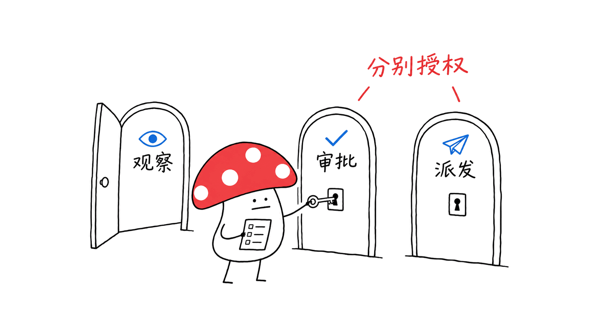

My Office 把多个 Claude Code 会话放进一个可视化工作空间，帮助开发者看清谁在工作、谁在等待，以及哪些操作需要自己处理。

官方仓库是 https://github.com/khanh020905/my-office ，采用 MIT 许可。本次固定快照的 package.json 为 0.5.0。这是社区项目，仓库明确说明它与 Anthropic 没有官方隶属或背书关系。

## 一间虚拟办公室解决什么问题？

同时开几个 Agent 终端时，最容易丢失的是工作状态：某个会话正在读文件，另一个在执行命令，还有一个其实已经停在审批提示上。切换窗口只能看到局部，很难快速掌握全局。

My Office 用角色和场景表达这些事件：读文件对应去书架，编辑对应在桌边工作，执行命令对应服务器区。任务完成、提交和推送等事件也有对应反馈。它改善的是状态呈现，不代表模型推理更强，也不是一套新训练出来的 Agent。

如果不需要动画，项目还提供二维会话列表，按等待处理、工作中和休息等状态组织。这个入口尤其适合手机、低功耗设备，或只想处理任务而不想观看场景的用户。


## hooks 怎样变成画面？

项目的架构可以分成四层：

| 层 | 组成 | 作用 |
|---|---|---|
| 事件来源 | Claude Code hooks、状态行和可选的用量遥测 | 报告工具活动、审批和用量 |
| 本地服务 | Node.js 服务 | 汇总会话、保存状态、处理控制请求 |
| 事件传输 | Server-Sent Events 等接口 | 把增量变化交给页面 |
| 可视化 | Next.js、React、Three.js | 展示二维面板与三维办公室 |

工程上值得借鉴的是把事件和画面分开。同一份会话状态可以支持角色动画、二维列表、回放和通知。增加一种视图，不应该要求改变 Agent 的工具实现。

场景再生动，也只反映捕获到的事件。某个角色在“工作”并不能证明任务正确；判断完成仍要回到会话结果、实际文件和检查输出。用量展示中的 API 等价费用也不应直接当成订阅账单。

## 如何试用，安装会改变什么？

可以先打开官方静态演示：https://khanh020905.github.io/my-office/ 。其中是虚构项目，不需要连接真实 Claude Code 会话，也不能拿演示里的任务当成真实执行结果。

需要接入自己的会话时，README 给出的入口是：

```bash
npm install -g claude-my-office
my-office install --service
my-office doctor
```

项目要求 Node.js 20.9 或更高。`install --service` 不只是打开网页：它会为 Claude Code 配置添加自己的 hooks，并安装登录时启动的后台服务；默认还会处理用量遥测配置。README 提供 `--no-approve`、`--no-status` 和 `--no-otel` 等选项。

仓库说明安装会备份配置，卸载会移除项目添加的内容并保留其他设置。本文没有对真实的 Claude 配置执行安装或卸载。接入前应按自己需要选择事件展示、审批和用量功能，再通过 doctor 核对，而不是把所有选项都视为必需。

## 审批与远程访问有哪些边界？

在本地看见一个状态，与替 Agent 批准操作，是两种权限。项目支持把权限请求、问题和计划放进看板，但依赖已安装的 hooks、页面活动状态、等待时间及相关设置。不能把它理解成任何环境下都可接管全部提示。

手机查看、手机审批和从手机派发工作也分别有开关。项目提供局域网访问、PIN 和 Cloudflare 隧道等路径；一旦开启远程入口，访问范围、会话内容和可执行动作就要一起考虑。



“本地优先”不等于整个系统没有网络请求。仓库列出了套餐用量、GitHub CI、可选翻译和推送等网络路径，其中部分接口依赖第三方或未公开约定，未来可能变化。需要稳定内网环境时，应先决定哪些功能可以关闭。

项目还提供最后一轮文件撤销，但有范围限制：它记录的是工具编辑等受覆盖路径，不保证撤回 shell、git 或构建命令造成的全部变化。把撤销当成全盘快照，会产生错误预期。

## 我们实际验证了什么？

Mycelium Protocol 固定仓库 commit，在临时目录安装依赖后运行上游 Node 测试：168 项通过。测试覆盖项目定义的若干状态与工具模块，包括角色资源释放等行为；具体环境和结果保存在发布证据中。

最初未安装依赖时，Three.js 模块缺失导致其中一个测试文件无法加载。安装依赖后重新运行通过。这个过程说明完整依赖环境是复核前提，不应把缺依赖的运行报告成产品功能失败。

本文没有给真实 Claude Code 会话安装 hooks，没有验证手机审批、隧道、系统清理或实用量读取，也没有测量三维帧率、CPU 和内存。因此，不据此宣称它能提升任务成功率或降低资源消耗。

## 工程师可以借鉴什么？

首先建立稳定的事件模型：会话标识、时间、工具活动、等待原因和完成结果应可追踪。再把状态转换集中起来，让动画、列表和通知读取同一个事实来源。

随后把“观察”和“行动”分开。展示一个命令很容易，允许另一台设备批准、停止或重新派发它，需要重新验证权限、目标会话和当前状态。回放也应是历史视图，不能让旧事件直接触发新的执行。

最后为渲染和后台采集设置预算。三维场景可以增加亲切感，二维列表则保留高效处理入口；采集、持久化与网络轮询也应能独立关闭和诊断。


## 常见问题

### 它会取代 Claude Code 吗？

不会。它围绕现有会话做展示和部分控制，执行仍依赖 Claude Code 与对应配置。

### 手机打开页面是否就能批准所有命令？

不是。手机查看、审批和派发工作有不同设置，还受 hooks、会话状态及项目规则约束。

### 本文有没有实测降低内存或提升开发效率？

没有。本文运行了168项上游测试；资源表现和真实工作效率需要另建任务及设备评估。

官方仓库：https://github.com/khanh020905/my-office
架构说明：https://github.com/khanh020905/my-office/blob/main/docs/ARCHITECTURE.md
官方演示：https://khanh020905.github.io/my-office/

---

> © 2026 Author: Mycelium Protocol. 本文采用 [CC BY 4.0](https://creativecommons.org/licenses/by/4.0/deed.zh) 授权——欢迎转载和引用，须注明作者姓名及原文链接，不得去除署名后以原创发布。

<!--EN-->

My Office turns multiple Claude Code sessions into a visible workspace so developers can identify active work, waiting sessions, and requests that need attention.

The MIT repository is https://github.com/khanh020905/my-office . Its package version at our pinned snapshot is 0.5.0. The maintainers explicitly describe it as a community project without Anthropic affiliation or endorsement.

## What does the office add?

Several terminal windows expose only fragments of a larger workload. One session may be reading, another running a command, and another waiting for approval. My Office maps these events to characters and places: shelves, desks, and a server area.

This improves status presentation; it does not train a stronger model or prove that a task is correct. A 2D session list is also available when the animation is unnecessary or the device has limited rendering capacity.


## How do events reach the page?

Claude Code hooks, a status line, and optional usage telemetry feed a local Node.js service. It aggregates sessions and persists state, then sends updates to the Next.js/React interface. Three.js provides the office scene.

The useful design is separating event state from presentation. A list, replay, notification, and animated character can share one event model. Neither an animation nor a captured completion event substitutes for inspecting actual output and checks. API-equivalent cost estimates should also be distinguished from subscription billing.

## What changes during installation?

The static demo at https://khanh020905.github.io/my-office/ uses fictional projects and does not need a real Claude Code connection.

The documented live-session setup requires Node.js 20.9 or newer:

```bash
npm install -g claude-my-office
my-office install --service
my-office doctor
```

Installation modifies Claude Code configuration and adds a login service. Approval hooks, the status line, and usage telemetry have separate options, including `--no-approve`, `--no-status`, and `--no-otel`. The README describes configuration backup and scoped uninstall behavior; we did not apply either to a real Claude installation.

Choose the features needed, then inspect doctor results. A dashboard should not require enabling every control surface just to observe sessions.

## Which controls need separate attention?

Viewing activity, approving a command, and assigning work are distinct permissions. The project supports approval cards and questions through installed hooks, subject to visibility, timeouts, settings, and session behavior. It does not universally replace all native prompts.

Phone viewing, approval, and work assignment have different switches. LAN access, a PIN, and an optional Cloudflare tunnel expand where the interface is reachable. They also change which session data and actions are exposed.


Local-first does not mean network-free. The README lists usage checks, GitHub CI, optional translation, and push pathways; third-party or undocumented interfaces can change. Its last-turn undo is also scoped: shell, git, or build effects are not automatically a complete reversible snapshot.

## What did we test?

Mycelium Protocol installed dependencies in a temporary checkout and ran the upstream Node suite: 168 tests passed. The earlier dependency-free run could not load one Three.js-dependent test file; it passed after dependencies were installed.

We installed no hooks into a real Claude Code configuration and did not test phone approvals, tunnels, cleanup, live usage access, frame rate, CPU, or memory. These tests do not establish productivity or task-success improvements.

## What should engineers reuse?

Define traceable sessions, timestamps, tool activity, waiting reasons, and results. Keep transitions in one state model, then let the scene and list consume it. Separate observation from action and revalidate the target and permission before any control request.

Historical replay must remain a view rather than a way to execute old actions again. Give rendering, persistence, sampling, and network polling independent budgets and diagnostic controls.


## FAQ

### Does it replace Claude Code?

No. It presents and controls selected aspects of existing sessions; execution still depends on Claude Code and its configuration.

### Can any phone approve everything?

No. Viewing, approval, and assignment are separately controlled and depend on installed hooks and current session behavior.

### Did we measure resource or productivity gains?

No. We ran 168 upstream tests; real workflows and device performance require separate evaluation.

Repository: https://github.com/khanh020905/my-office
Architecture: https://github.com/khanh020905/my-office/blob/main/docs/ARCHITECTURE.md
Demo: https://khanh020905.github.io/my-office/

---

> © 2026 Author: Mycelium Protocol. Licensed under [CC BY 4.0](https://creativecommons.org/licenses/by/4.0/) — free to share and adapt with attribution. You must credit the author and link to the original; removing attribution and republishing as original is not permitted.
