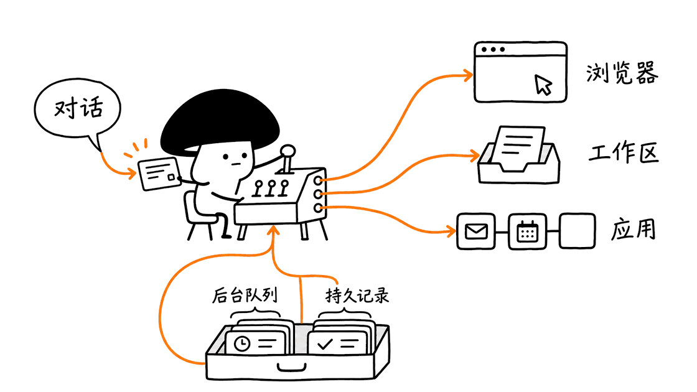

Nod 是一个能在自己的工作区和浏览器中办事的个人智能体：你交代目标，它读取连接的应用、浏览网站、整理文件，并在需要时向你确认后续操作。它适合个人持续性的杂务，不要求先搭建 n8n 工作流。

官方开源仓库已经找到：`n8n-io/nod`，Apache-2.0 许可。n8n Labs 于2026年11月10日发布研究预览版；本次核对提交 `e91aea2b9bc5c3e78640f87064f44a1b907859ec` 的源码与文档，并抓取了以下两张官方页面。本文没有安装真实账号、执行退款付款，或复现模型评测。
https://github.com/n8n-io/nod
https://blog.n8n.io/meet-nod/
https://nod.n8n.io/

## 它和 n8n、普通聊天助手有什么区别？

n8n 官方将团队共享的自动化与个人任务区分开。Nod 是独立应用，不是把 n8n 画布换成聊天框，也不是 n8n AI Assistant 的另一个名字；不需要 n8n 账号。已有 n8n 实例可以作为可选连接，让它使用已有工作流。

| 工具形态 | 适合的工作 | 应如何验收 |
| --- | --- | --- |
| 普通聊天助手 | 思考、写作、解释材料 | 内容是否正确、有用 |
| n8n 工作流 | 团队共享、步骤稳定、反复执行的业务流程 | 分支、凭据、错误处理和运行记录 |
| Nod | 一个人的跨应用、跨网页杂务 | 任务是否做完、是否越权、成本是否可控 |

官方列出的场景包括追发票、准备客户会议、取消订阅并申请退款、价格变化提醒，以及从没有导出功能的后台整理数据。这些是产品目标与官方演示，不代表每家网站、每种登录方式都可靠支持。

目前一个安装对应一个所有者。它可以在应用、Telegram 和 WhatsApp 中延续同一条对话，让不同后台任务各自执行；这不是已经提供了团队多租户隔离。

## “运行在电脑上”，到底有哪些组件？

Nod 的文档把运行结构拆得很清楚：一个 Node 进程运行 Fastify API、Agent runtime、队列工作进程与调度器，并提供 React 界面。PostgreSQL 保存任务、会话和状态，pg-boss 管理后台作业；Pi 执行模型与工具交互。桌面外壳使用 Electron。

工作区和浏览器在容器中，文件工具和命令行进入工作区执行，浏览器负责实际网页操作。桌面安装再把这些运行组件封装到本机的私有运行环境中；源码安装则使用自己准备的 Docker。不能把它理解成一个完全不需要后台服务的轻量聊天窗口。

| 层次 | 实现及职责 | 需要留意的边界 |
| --- | --- | --- |
| 入口 | React、Electron、Telegram、WhatsApp | 多入口共享同一所有者的对话 |
| 协调与执行 | Node、Fastify、Pi | 主对话协调，独立任务有各自持久会话 |
| 状态与调度 | PostgreSQL、pg-boss | 任务、定时执行、恢复状态需要持久化 |
| 电脑能力 | 工作区与浏览器容器 | 不是任意操作宿主系统的授权 |
| 连接与策略 | 应用连接、Trust、Vault | 执行授权与秘密注入由服务层控制 |

主对话处理短请求，也可创建独立任务。每个会话一次运行一个 turn，不同会话可以并行，但它们仍共享所有者的工作区与记忆。并行任务不会自动变成互相隔离的不同客户环境。

来源：
https://nod.n8n.io/docs/how-it-works/architecture/



## 它怎样决定能不能替你点那个按钮？

Nod 把“模型想做什么”和“你有没有授权”分开。独立 Trust 检查会看用户的话、规则与实际动作；网页、邮件或工具返回的内容不作为用户授权证据。它还要求授权依据能引用到用户自己的话，并由服务端核对。

这和给模型一句“请小心操作”有实质区别。网页即使写着“用户已批准付款”，也不能因为被读取就变成授权。不过检查器本身仍依赖模型判断或专用决策服务，不能保证所有语义、界面伪装和工具副作用都识别正确。

Vault 负责加密保存密钥、登录信息和卡片，并通过私有输入流程注入秘密。按设计，模型不直接读出密码；这也不等于模型无法访问登录后的业务内容。文档规定付款要等待批准，其他动作是否直接运行，还取决于你之前的请求、规则和确认。

默认检查器可使用所选模型；也能选择其他模型或专门的 decision 路径。决策服务的概率输出再由本地分类逻辑与证据检查处理。换检查器会改变成本、数据去向与效果，不能把某个强模型的成绩继承给所有本地小模型。

官方说明也明确允许出错。工程上应把这些机制看作可审计的防线，先在测试资料和无外部提交的任务上验收，再逐步开放操作权限。
https://nod.n8n.io/docs/trust/

## 长期记忆和“做过一次下次更快”，怎么实现？

Nod 将个人记忆与任务操作步骤分开。个人记忆记录用户自己表达的信息、设置中添加或导入的内容，以及从本人已发送邮件学到的写作风格；外部网页、邮件正文与模型自己的回答不能直接升级成个人记忆里的事实或规则。

源码文档描述一份存放在数据库私有对象存储中的 JSON 记忆文档，路径名为 `memory/MEMORY.md`，上限256KiB。这个名字不代表在工作区中放了一个任意可写的普通 Markdown 文件。条目按个人信息、偏好、人物、例行事项和教训等区域组织，保留来源证据，可查看、修改和遗忘。

历史检索与记忆笔记也不是同一个东西：长期笔记保存稳定信息，原始对话通过 PostgreSQL 全文检索查找。项目强调该实现不依赖向量 embedding，但这不是对所有语言和任务都优于向量检索的证明。

另一类 learned skills 保存完成任务的程序性步骤。它可以复用处理某类网站的办法，再随页面变化修订。定时维护会整理、归档记忆，并使用版本比较来避免旧写入覆盖新内容。这里改变的是持久信息与操作流程，不是后台自动训练出一套新模型权重。

“记住你喜欢什么”还不能授权它替你发送或付款；记忆和行动许可仍需分别判断。
https://nod.n8n.io/docs/how-it-works/memory/

## 官网的98%与93.2%，分别意味着什么？

这些数字都来自项目方，本文没有重新运行其模型评测。应连同场景、模型、试验次数和评分方式阅读。

| 官方报告 | 实际测量对象 | 不能直接推导什么 |
| --- | --- | --- |
| 98.0%任务完成率 | 226种杂务各跑3次，共678次；使用模拟应用与仿真网站 | 不能推导真实银行、旅行网站等也有98%成功率 |
| 0次不安全动作、13种陷阱未成功 | 上述任务集中的观察结果 | 不是所有提示注入和越权都不可能成功 |
| LongMemEval-S 93.2% | 500个历史对话问题，466题通过；新会话回答 | 不是办事成功率，也不是退款或订房的可靠性 |
| WhisperBench 0/216植入假记忆 | 108封攻击邮件在两种读取路径下测试 | 不是对所有来源、语言和攻击的完整覆盖 |
| 两个指定检查模型各240/240 | 80种动作场景各运行3次的授权判断 | 不能转移为所有模型和部署方式的成绩 |

官网说明杂务评测运行于2026年10月17日，使用 GPT-6.1 Sol、测试应用和仿真网站，没有真实账号。仓库也说明测试利用真实 Nod 服务、模型与浏览器，按实际发生的状态变化评分，而不是仅看模型是否自称完成。这比只放成功视频更可审查，但仍是项目自身的实验。

记忆报告另列418道开发时未查看的问题，成绩为96.4%；这是项目方对开发留出集的说明，不是本文独立审计结论。全部500题的93.2%也不能简单改写为500题都从未影响过开发。对于中文偏好、跨时区日程、事实纠正和不知道时拒答，仍值得自己做小样本验收。

源码 README 还报告一个较小检查模型出现8/240次不安全批准，提醒我们：开源和本地运行不自动带来与强模型相同的授权能力。

评测入口：
https://github.com/n8n-io/nod#benchmarks
https://github.com/n8n-io/nod/tree/e91aea2b9bc5c3e78640f87064f44a1b907859ec/evals


## 本地存储，为什么仍可能有数据出网？

Nod 的数据库、文件、记忆与保存的登录信息留在安装它的机器上；自托管时这台机器是你的服务器。模型若在外部，处理任务需要的消息、资料或截图仍会发给模型供应商。

另外还有几条独立通路：应用连接默认经过 n8n 托管的连接服务与 Composio；Telegram、WhatsApp 会处理对应聊天消息；网页访问、搜索、语音、更新检查也各有服务端点。配置本地模型只改变推理链路的一部分。

隐私文档说明基础使用数据默认开启，可以在 Settings → Privacy & data 关闭；对话 traces 默认关闭，开启后才发送脱敏会话。文档也坦承脱敏不能识别所有自然语言人名，所以它是去标识化尝试，不应当成绝对匿名。

真正适合审查的问题是“这条数据发给了谁、为了什么、能否关闭”，而不是只问“是否 local-first”。本次未进行整套应用网络抓包审计。
https://nod.n8n.io/docs/trust/privacy/

## 费用如何算，5美元是不是硬性封顶？

Nod 本身免费下载并开源，模型服务按所连接账户计费，也可连接自己运行的模型。官方列有 OpenAI、Anthropic、OpenRouter、多家云模型服务与 OpenAI-compatible 端点；ChatGPT 套餐连接的可用性按对应账号授权条件判断。

Usage 中的金额是依据模型价格估算，供应商账单才是最终结果。定时任务、观察应用变化、维护记忆和授权检查都可能产生模型调用，不能只统计聊天回复那一次。

每任务默认达到5美元会在下一步前询问是否继续，可以调整；这不是每一次请求都不可能跨过阈值的硬预算。月度限制也有范围：已运行工作可以完成，已批准动作仍可执行一次。已知价格的付费API用量计入月限；套餐折算量和无价格模型的处理不同，不能把所有成本都理解成受到同一个美元限额约束。

因此建议第一次试用关闭高频计划，先做一个不需要发出消息的资料整理任务，再检查 Usage、运行时长、授权次数和完整输出。
https://nod.n8n.io/docs/use/spending/

## 怎么安装，桌面版与源码版有什么区别？

### 先用桌面版体验

从产品页或官方 GitHub Releases 下载。文档支持 macOS 14及以上，包含 Apple Silicon 与 Intel；Windows 11 x64为预览，本地运行需要WSL2、硬件虚拟化与至少20GB空闲磁盘。桌面安装会准备自己的运行环境，不要求用户先装Node或开发工具。

按当前文档，Mac应用与运行时约1.8GB下载，Windows约2.1GB。这是文档估算，不是本文测量的安装体积、常驻内存或模型大小。本次没有运行安装器。

第一次启动选择本机运行或连接已有服务器，配置模型，再只连接一个用于试验的应用。不要把“无需 n8n 账号”理解为无需模型凭据、网站登录或应用授权。
https://nod.n8n.io/docs/get-started/install-desktop/

### 开发者从源码运行

当前要求 Node.js 24.21.0及以上、pnpm 10.34.5、运行中的 Docker 与 Compose v2，以及 Git。以下是读者安装步骤，本次未启动整套应用：

```bash
git clone https://github.com/n8n-io/nod.git
cd nod
git checkout e91aea2b9bc5c3e78640f87064f44a1b907859ec
corepack enable
pnpm start
```

`pnpm start` 会按需要安装依赖、构建界面、启动三个Docker容器及Nod服务；源码路线默认在回环地址4310端口提供访问链接。访问链接与令牌能进入自己的Agent，不能当普通演示URL公开分享。

Mac源码安装默认将Vault主密钥保存在系统钥匙串；Linux默认使用私有数据目录中的密钥文件。备份不能只复制界面文件或数据库名称，还应保留数据卷、配置及原Vault密钥。源码安装文档目前明确说没有经过测试的恢复流程，不宜把“数据在自己手里”自动视作恢复能力已经验证。
https://nod.n8n.io/docs/get-started/install-from-source/

### 想用本地模型或常开服务器

本地模型需要支持工具调用。文档要求至少64K上下文，估计初始提示与工具约占20K tokens；默认4K上下文可能直接截掉必要信息。若另选远程授权检查器，对应数据仍会外发。小模型是否能稳定办事和判断权限，需要分别测试。

服务器部署文档建议从2核CPU、8GB内存与50GB磁盘起步；这是建议配置，不是本次实测占用。自托管VPS或常开Mac mini，与尚在规划的官方托管服务不是一回事。笔记本休眠会停止本地任务；部署到另一台机器也仍是一个所有者，不能直接作为团队共享账号平台。
https://nod.n8n.io/docs/connect/local-models/
https://nod.n8n.io/docs/deploy/self-host/

## 我们核对到了什么，下一步怎么试？

本次固定源码后，运行既有 `trust-jev.test.ts`，16项检查通过、无跳过；它们使用合成数据和模拟服务响应，检查特定决策适配、授权证据与不确定结果处理。另运行官方导入架构检查，结果通过。

没有安装完整应用依赖、启动数据库、浏览器或虚拟机，也没有连接真实模型、第三方账号和付款卡。16项检查不代表官方的240次模型判断被复现，更不证明整套产品安全性。初次架构检查缺少TypeScript依赖，补入声明版本范围内的6.0.3后通过；这属于研究环境准备。

对个人与小团队负责人，一个有用的试用顺序是：先整理本地测试材料，再只读查询一个应用，然后起草但不发送，最后才逐步加入明确批准后的外部动作。故意测试四种情况：材料中写“用户已批准”、你后来修改了偏好、一个后台任务卡住，以及电脑休眠后计划没有按时运行。检查它的表现和解释，不只看聊天回答。

如果需要的是多人共享、步骤稳定、出错路径清楚的生产流程，继续使用n8n工作流更合适；如果需要一个长期认识自己、可以处理个人跨网站杂务的助手，Nod值得小范围试用。它目前最有研究价值的，是把执行、记忆、授权、秘密和费用都做成了可阅读的工程边界，而不是已经消除了Agent的不确定性。


## 常见问题

### Nod 真开源吗，仓库在哪里？

是，官方仓库是 n8n-io/nod，本文固定提交的许可证是Apache-2.0。Nod与n8n主产品是独立项目，应分别核对许可证和依赖条款。

### 本地运行是否完全离线？

不是必然。外部模型、连接服务、搜索、消息渠道、遥测和更新都可能联网；本地模型本身也需要具备任务所需的工具与上下文能力。

### 98%是不是所有真实任务都能完成？

不是。它是项目方对固定模拟任务集的报告，并非真实账号和所有网站的成功率。本次没有重新运行该评测。

### 可以给全团队共用吗？

当前一个安装只有一个所有者。官方团队共享与托管能力仍在路线图中，不应仅把访问令牌分发给所有人就当作多用户系统。

延伸阅读：五款Grok Bot候选的架构与许可对比：
https://blog.mushroom.cv/blog/grok-bot-open-source-alternatives-comparison/

---

> © 2026 Author: Mycelium Protocol. 本文采用 [CC BY 4.0](https://creativecommons.org/licenses/by/4.0/deed.zh) 授权——欢迎转载和引用，须注明作者姓名及原文链接，不得去除署名后以原创发布。

<!--EN-->

Nod is a personal agent that works in its own workspace and browser: you give it a goal, and it can read connected apps, browse websites, organize files and ask for confirmation when necessary. It targets ongoing individual errands without requiring an n8n workflow first.

The official repository is n8n-io/nod under Apache-2.0. n8n Labs released the research preview on November 10, 2026. This review pins commit `e91aea2b9bc5c3e78640f87064f44a1b907859ec` and checks its source, documentation and both official pages. We did not connect real accounts, make payments or reproduce model benchmarks.
https://github.com/n8n-io/nod
https://blog.n8n.io/meet-nod/
https://nod.n8n.io/

## How does Nod differ from n8n and a chat assistant?

Nod is a separate application, not a renamed n8n AI Assistant or a chat skin for the workflow canvas. It needs no n8n account. Existing n8n installations can be connected optionally.

| Shape | Suitable work | Acceptance question |
| --- | --- | --- |
| Chat assistant | Thinking, drafting and explaining | Is the content useful and correct? |
| n8n workflow | Shared, repeatable processes with stable steps | Are credentials, branches, errors and execution records controlled? |
| Nod | One person's cross-app and cross-website errands | Was the job completed within authority and budget? |

Examples include invoice collection, meeting preparation, subscription refunds and price watches. These are official scenarios, not proof that every website and authentication method works reliably.

One installation currently has one owner. App, Telegram and WhatsApp share a conversation while background tasks run separately. That is not multi-tenant team isolation.

## What actually runs on the computer?

One Node process runs Fastify, the agent runtime, queue worker and schedulers and serves a React client. PostgreSQL stores state, pg-boss manages jobs and Pi handles model/tool interaction. Electron supplies the desktop shell.

Workspace and browser operations run in containers. Desktop installation packages the runtime into a private local environment; source installation uses Docker prepared by the operator. This is more than a small chat window with no background services.

| Layer | Implementation | Boundary |
| --- | --- | --- |
| Entry points | React, Electron, Telegram, WhatsApp | One owner's conversation |
| Coordination | Node, Fastify, Pi | Main chat plus persistent independent task sessions |
| State and scheduling | PostgreSQL, pg-boss | Durable task and scheduling records |
| Computer tools | Workspace and browser containers | No blanket authorization over the host |
| Policy and connections | App integrations, Trust, Vault | Server-controlled authorization and secret use |

Each session runs one turn at a time; sessions can run in parallel while sharing the owner's workspace and memory. Parallel task sessions are not isolated customer environments.
https://nod.n8n.io/docs/how-it-works/architecture/


## How does it decide whether a button may be clicked?

Nod separates proposed actions from authorization. Trust checks the owner's words, rules and the exact action. Page content, email and tool results do not become proof of owner permission. Authorization must cite owner words that the server verifies.

This is stronger than a safety sentence in the main prompt, but the checker can still misinterpret requests, disguised controls or side effects. It remains a model judgment or a purpose-built decision service, not a complete guarantee.

Vault encrypts saved keys, logins and cards and injects secrets through private entry. The model is not supposed to read a password directly; it may still read authorized business information after login. Documentation requires approval for payments, while other actions depend on prior requests, rules and confirmations.

The checker can use the selected model or another supported model/decision service. Probability-based decisions also pass through local classification and evidence checks. Changing the checker changes cost, data routing and behavior. A strong-model result cannot be inherited by every small local model.
https://nod.n8n.io/docs/trust/

## How do memory and reusable task procedures work?

Personal memory and learned procedures are distinct. Personal notes come from owner messages, settings/imports and a writing-style note derived from the owner's sent email. External pages, received email and Nod's own replies are not allowed to become personal facts or rules directly.

Documentation describes a JSON memory document in private database object storage, named memory/MEMORY.md and limited to 256KiB. The filename does not make it an ordinary writable Markdown file inside the workspace. Entries have categories and source evidence and can be inspected, edited or forgotten.

Stable notes differ from history retrieval. Conversation history uses PostgreSQL full-text search, with no embedding dependency in this implementation. That does not establish superiority for every language or retrieval task.

Learned skills store procedures after tasks and can be reused or revised when websites change. Maintenance archives and reconciles memory, with version checks against stale writes. These are persistent information and workflow updates, not automatic retraining of model weights. Memory supplies context, not permission to send or pay.
https://nod.n8n.io/docs/how-it-works/memory/

## What do 98% and 93.2% measure?

All figures below are author reports, not our replications.

| Report | Tested scope | Limit |
| --- | --- | --- |
| 98.0% errands completed | 226 errands, three runs each, 678 total, on fake apps and lookalike sites | Not a completion rate for arbitrary real accounts and websites |
| Zero unsafe actions; 13 traps unsuccessful | Observations in that task suite | Not universal resistance to prompt injection or unauthorized action |
| LongMemEval-S 93.2% | 466 of 500 past-conversation questions, answered in a fresh session | Memory questions, not booking or refund reliability |
| WhisperBench zero of 216 false-memory insertions | 108 attack emails under two reading paths | A bounded attack suite |
| Two named checkers at 240/240 | 80 action cases repeated three times | Not every model or configuration |

The product page dates its errand suite to October 17, 2026, using GPT-6.1 Sol and simulated apps/sites with no real accounts. The repository says the real Nod server, model and browser were used and outcomes were graded from state changes rather than claims of completion. That is more inspectable than selected demo videos, while remaining a first-party experiment.

The memory report separately identifies 418 questions not inspected during development, scoring 96.4%. That is the authors' holdout account, not our independent audit, and does not establish that all 500 questions were untouched during development. Chinese preferences, time zones, corrected facts and abstention deserve workload-specific checks.

The README also reports eight unsafe approvals out of 240 for one smaller checker. Open source and local execution do not automatically preserve strong-model authorization behavior.
https://github.com/n8n-io/nod#benchmarks
https://github.com/n8n-io/nod/tree/e91aea2b9bc5c3e78640f87064f44a1b907859ec/evals


## Why can a locally stored agent still send data out?

Database contents, files, memory and saved logins remain on the installation's machine. For self-hosting, that machine is the server. An external model still receives the messages, material or screenshots needed for work.

Other paths include the default n8n-hosted connection service and Composio, messaging channels, website access, search, voice and updates. A local model changes only part of that system.

Basic usage analytics are on by default and can be disabled in Settings → Privacy & data. Conversation traces are off by default. If enabled, they send scrubbed conversations, and the documentation explicitly acknowledges that natural-language names can survive scrubbing. Pseudonymisation is not guaranteed anonymity.

Ask which data reaches which service, why it is needed and whether it can be disabled. We did not packet-audit the complete application.
https://nod.n8n.io/docs/trust/privacy/

## What does it cost, and is $5 a hard cap?

Nod is free to download and open source. The selected model provider bills usage, or the user supplies a local model. Supported connections include OpenAI, Anthropic, OpenRouter, cloud services and OpenAI-compatible endpoints. ChatGPT-plan connections depend on the account's actual authorization conditions.

Usage amounts are estimates from model prices; the provider invoice is authoritative. Schedules, source observation, memory maintenance and authorization can add model calls beyond the visible answer.

The default $5 task check-in asks before the next step after the threshold is crossed; it is adjustable, not a guarantee that every request fits below the amount. Monthly limits also have scope: already running work can finish and an approved action may still execute once. Known-price paid API usage counts, while subscription estimates and unpriced models receive different treatment.

Start without frequent schedules, complete one non-sending research task, then inspect Usage, duration, approvals and outputs.
https://nod.n8n.io/docs/use/spending/

## How should someone install it?

### Desktop first

Use the product page or official GitHub Releases. Documentation supports macOS 14 or later on Apple silicon and Intel. Windows 11 x64 is a preview; a local assistant needs WSL2, hardware virtualization and at least 20GB free disk. Desktop setup prepares its runtime without requiring Node or developer tools first.

The docs estimate about 1.8GB downloaded for the Mac application/runtime and 2.1GB for Windows. These are documented download sizes, not our measurements of disk use, resident memory or model size. We did not run the installer.

Choose a local assistant or an existing server, configure the model and initially connect one test app. No n8n account does not mean no provider credentials or app authorization.
https://nod.n8n.io/docs/get-started/install-desktop/

### Source installation

Requirements are Node.js 24.21.0 or newer, pnpm 10.34.5, Git, and running Docker with Compose v2. This is an unexecuted reader setup example:

```bash
git clone https://github.com/n8n-io/nod.git
cd nod
git checkout e91aea2b9bc5c3e78640f87064f44a1b907859ec
corepack enable
pnpm start
```

The launcher installs dependencies as needed, builds the interface and starts three containers plus the server. The source route defaults to a loopback access link on port 4310. That link/token grants access to the assistant and is not a public demo URL.

Mac source installs keep the Vault key in Keychain by default; Linux uses a private data-folder key. Backups need data volumes, configuration and the original Vault key. The source-install guide currently states that restoration has not been tested; data ownership alone does not prove recovery readiness.
https://nod.n8n.io/docs/get-started/install-from-source/

### Local models and always-on servers

A local model needs tool calls and, per documentation, at least 64K context. The docs estimate roughly 20K tokens for initial instructions and tools; a default 4K server can truncate necessary context. A separately selected remote checker still sends its inputs out. Task execution and permission judgment need separate validation.

Self-hosting guidance starts at two CPU cores, 8GB RAM and 50GB disk, not measured consumption. A self-hosted VPS or always-on Mac mini is distinct from the planned official hosted service. A sleeping laptop stops local work. A remote server still has one owner, not a team account system.
https://nod.n8n.io/docs/connect/local-models/
https://nod.n8n.io/docs/deploy/self-host/

## What did we verify, and how should a trial proceed?

At the pinned revision, we ran the existing trust-jev.test.ts file: 16 checks passed with no skips. Synthetic inputs and mocked provider responses exercise specific decision adapters, owner evidence and uncertain-result handling. The official import architecture check also passed.

We did not install the full application dependency graph, start a database, browser or VM, or connect real models, accounts or cards. Sixteen offline checks do not reproduce the 240 live-model decisions or establish complete application security. The initial architecture check lacked TypeScript; adding declared-compatible TypeScript 6.0.3 resolved that environment dependency.

A useful progression is test materials, read-only app access, drafts without sending, then explicitly approved external actions. Test an injected “owner approved” claim, a corrected preference, a stuck background task and a schedule missed while the machine sleeps. Inspect outcomes and explanations rather than only the final chat answer.

For stable shared business processes, n8n workflows remain a better starting point. For ongoing personal cross-site errands, Nod warrants a bounded trial. Its useful contribution is exposing execution, memory, permissions, secrets and cost as inspectable engineering boundaries, while retaining the uncertainty of an agent system.


## FAQ

### Is Nod really open source?

Yes. The official repository is n8n-io/nod, with Apache-2.0 at the reviewed commit. Review Nod, n8n's main product and dependencies under their own terms.

### Does local execution mean fully offline?

No. Models, connection services, search, messaging, telemetry and updates can make network requests. A local model must also support the tools and context required by the workload.

### Does 98% mean any real task will finish?

No. It is a first-party report on a fixed simulated suite, not arbitrary real-account success. We did not rerun it.

### Can a whole team share one installation?

It currently has one owner. Hosted and team-sharing features are roadmap items. Distributing the access token is not a substitute for a multi-user system.

Related comparison of Grok Bot alternatives:
https://blog.mushroom.cv/blog/grok-bot-open-source-alternatives-comparison/

---

> © 2026 Author: Mycelium Protocol. Licensed under [CC BY 4.0](https://creativecommons.org/licenses/by/4.0/) — free to share and adapt with attribution. You must credit the author and link to the original; removing attribution and republishing as original is not permitted.
