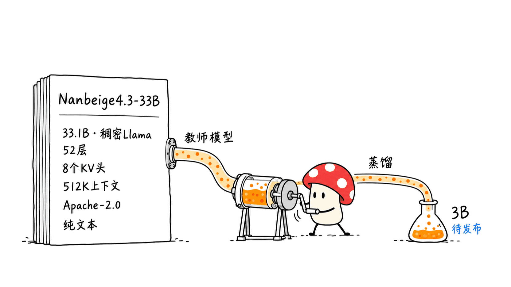
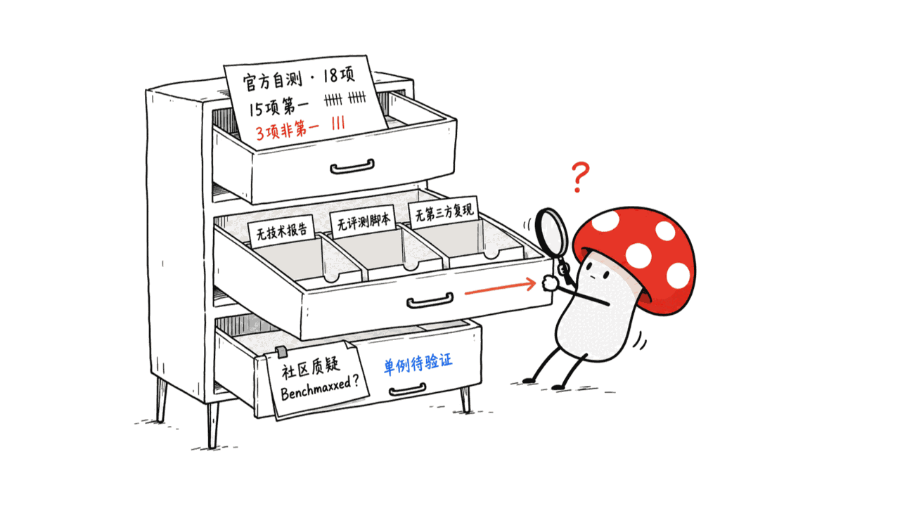
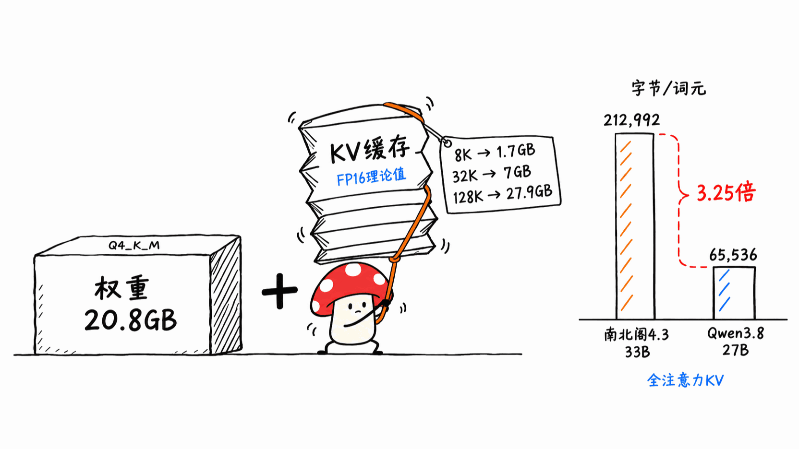
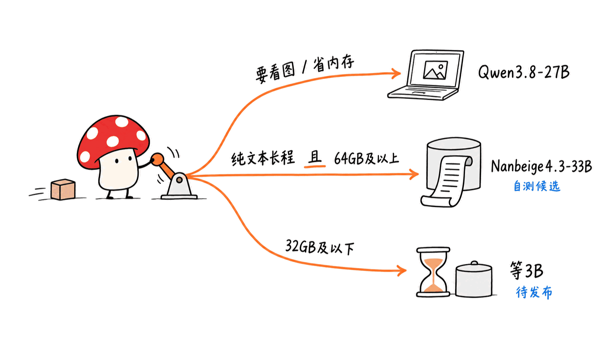

**BLUF**：Nanbeige4.3-33B 是一个 **33.1B 参数的稠密（dense）模型**，Llama 架构、**Apache-2.0**、上下文 **512K**，HuggingFace 创建于 2026-10-24。官方定位是「教师模型」：先做一个能力强的大 Agent，再把能力蒸馏进后续的小模型（如 Nanbeige4.3-3B）。README 的对比表里，它在 18 项基准中有 15 项排第一，例如 **Terminal-Bench 2.1 为 80.9**（Qwen3.8-27B 为 73.0）、**DeepSWE 65.5**（对 42.5）。但这些全部是**官方自测**：没有技术报告（团队说要等 3B 学生模型一起发）、没有第三方复现，社区已经有人开了「Benchmaxxed」讨论帖质疑真实任务表现。对 Mac 用户，更要紧的是：权重不是瓶颈（社区 Q4_K_M GGUF 约 20.8GB），**KV 缓存才是**——每 token 212,992 字节，32K 上下文就要约 7GB，是 Qwen3.8-27B 同口径的 3.25 倍。结论：值得拿来做「长任务 Agent 的候选」跑自己的任务验证，不值得凭那张表就换掉现有模型。

> 📌 一手资料
> 模型卡：https://huggingface.co/Nanbeige/Nanbeige4.3-33B
> 基座：https://huggingface.co/Nanbeige/Nanbeige4.3-33B-Base
> 社区讨论区：https://huggingface.co/Nanbeige/Nanbeige4.3-33B/discussions
> 对比对象：https://huggingface.co/Qwen/Qwen3.8-27B

---

## 它到底是什么？先把规格核实一遍

以下全部来自 HuggingFace API 与 config.json，不是营销稿：

- **参数量**：safetensors 元数据显示 33,118,977,024，即 33.1B，**BF16**，14 个分片。纯权重 BF16 约 66.2GB。
- **架构**：`LlamaForCausalLM`，52 层，hidden 7168，56 个注意力头，**8 个 KV 头**，head_dim 128，词表 166,912。没有 MoE，没有线性注意力，没有 MTP 头。团队在讨论区明确回答：**它不是 Looped Transformer**，循环结构留给后续的 3B 小模型。
- **上下文**：config 的 `max_position_embeddings` 是 524,288（512K），rope_theta 为 1.2 亿。
- **许可证**：模型卡 YAML 为 **apache-2.0**，仓库不 gated，基座模型 Nanbeige4.3-33B-Base 同样是 Apache-2.0。这一点比很多「开放权重」友好得多。
- **语言与模态**：中英文，**纯文本**。chat template 里遇到图片、音频会直接插入一段「你没有多模态能力」的提示，讨论区也有人抱怨它做不了需要看图的前端开发。
- **热度**：写稿时约 602 个赞、2,787 次下载，社区已出现 GGUF、MLX、EXL3、NVFP4、FP8 等十几种量化版本——开源 3 天，这个量化速度说明关注度确实高。
- **出品方**：模型卡联系邮箱域名是 kanzhun.com（看准），据此推断南北阁团队隶属看准科技（Kanzhun）。老一代 Nanbeige4.1-3B 在 2026-02 发布，目前有 1,188 个赞。

## 「教师模型」是什么意思？为什么这个定位重要？

README 的第一段说得很直白：先做一个高容量的教师 Agent，**再**用它去蒸馏更小的模型。也就是说，33B 本身不是终点，而是 3B/小模型的原料。这解释了几个现象：

1. 它被设计成「在 Agent 任务上尽量强」，而不是「在 16GB 笔记本上好用」。官方没有给 MoE，也没有做 KV 缓存优化（团队在讨论区回应「更高效的注意力机制在路线图上」）。
2. 技术报告被推迟：团队回复「Nanbeige4.3 系列技术报告将与学生模型 Nanbeige4.3-3B 一起发布」。所以目前**训练配方、数据、后训练细节全部不可知**。
3. 它的价值很可能要等 3B 出来才完整体现。如果你的目标是在 Mac 上日常跑，等小模型更合理。

## 那张 18 项基准表，能信几分？

README 与 Qwen3.8-27B、Muse-Glimmer-30B、Gemma4-31B 比较，声明「所有模型在最高思考强度下、使用相同推理超参和 harness」。几个核心数字（均为 README 自报）：

| 基准 | Nanbeige4.3-33B | Qwen3.8-27B | Muse-Glimmer-30B | Gemma4-31B |
|---|---:|---:|---:|---:|
| Terminal-Bench 2.1 | 80.9 | 73.0 | 61.8 | 47.2 |
| Terminal-Bench 4.0 | 23.8 | 6.3 | 1.6 | 0.0 |
| DeepSWE | 65.5 | 42.5 | 4.4 | 2.7 |
| SWE-Bench Pro | 60.3 | **61.7** | 36.9 | 51.2 |
| GDPval | 84.8 | **86.4** | 75.8 | 71.4 |
| GPQA Diamond | 89.5 | 89.2 | 83.5 | **91.3** |
| AIME 2026 | 95.2 | 94.5 | 94.7 | 89.2 |

值得指出的细节：

- **并非全胜**：SWE-Bench Pro、GDPval、GPQA Diamond 三项它不是第一，其中 SWE-Bench Pro（最接近真实代码修复）还是略输 Qwen3.8-27B。这是这张表里最可信的部分——连官方都没把它写成全胜。
- **差距最大的恰恰是最难复核的**：DeepSWE 65.5 对 Muse-Glimmer 的 4.4、对 Gemma4 的 2.7，这类悬殊差距更像是「harness 适配度」造成的，而不是能力差十几倍。Terminal-Bench 4.0 里 Gemma4 是 0.0，同理。
- **对手成绩是官方自己跑的**：脚注写明各基准用了不同 harness（Terminus 2、mini-swe-agent v2.4.6、Claude Code、各基准官方仓库）。对比的 Qwen3.8-27B 数字，与 Qwen 自家模型卡采用的评测设定（Claude Code harness、修正过的 SWE-bench Pro、256K 上下文）并不一致，所以两家数字**不能直接拼在一起看**。
- **自己定制的评测条件**：Nanbeige 用了 `preserve_thinking=true`；Toolathlon-Verified 不限制单次请求 max_tokens；YC-bench 只保留最近 10 轮对话；Claw-Eval 只用 General 子集的 157 个任务；GDPval 用的是「修订后的评分规则」；SWE-Atlas-QnA 用 GPT-6 Sol 当裁判。每一条都是合理的工程选择，但每一条都让结果更难与别处对齐。
- **没有可复现材料**：仓库里只有三张图（基准图、logo、职业分布图），没有评测脚本、轨迹或配置。
- **社区反馈**：开源后第三天出现标题为「Benchmaxxed」的帖子，发帖人称模型在真实任务上不行，举的例子是它不认识 ESP32 常用的 INMP441 麦克风，并认为模型「为通过测试而微调」。这只是**单个用户的单个提示词**，不能当证据，但它指向一个值得自己测的方向：Agent 基准强、通用世界知识弱，是「教师/Agent 特化」模型的常见形态。

一句话：这张表可以当作「值得测试」的信号，不能当作「已经验证」的结论。

## 在 Mac 上到底能不能跑？权重不是问题，KV 缓存才是

先看权重。社区 bartowski 的 GGUF 实际文件大小（HF API 核实）：

| 量化 | 大小 |
|---|---:|
| IQ2_M | 12.2GB |
| IQ3_M | 17.8GB |
| IQ4_XS | 18.6GB |
| Q4_K_M | 20.8GB |
| Q5_K_M | 25.1GB |
| Q6_K | 29.0GB |
| Q8_0 | 35.2GB |
| BF16 | 约 66.3GB |

另外有 MLX 4-bit 版本（pratikgx 的版本权重合计约 18.6GB）以及 NVFP4、FP8、EXL3 等版本。注意这些都是**第三方量化**，质量未经官方背书，而且量化对 Agent 长链条任务的影响没人系统测过。

再看 KV 缓存。这一项我们按 config.json 自己算了一遍：

- Nanbeige：52 层 × 2（K 和 V）× 8 个 KV 头 × 128 head_dim × 2 字节（FP16）= **212,992 字节/token**。
- 32K 上下文约 **6.98GB**；64K 约 14.0GB；128K 约 27.9GB；512K（满上限）约 111.7GB。
- Qwen3.8-27B：64 层里只有 16 层是全注意力（其余是线性注意力），4 个 KV 头、head_dim 256，所以全注意力 KV 为 65,536 字节/token，32K 约 2.15GB。**比值正好是 3.25 倍。**（这里只比较全注意力 KV，没算线性注意力的固定状态。）

讨论区里有个说法「128K 要额外约 13GB、32K 约 3.25GB」，按上面的算式是对不上的（那更像 64K 的量，且 3.25 是比值不是 GB 数）；请以自己的计算为准。另外，config 里 `use_cache: false`，所以上面是「开缓存时的理论值」，不是默认分配的实测值。

换成 Mac 的语言：

- **32GB 统一内存**：Q4_K_M（20.8GB）+ 8K 上下文的 KV（约 1.7GB）勉强能跑，系统和其他应用要紧缩；想上 32K（再加 7GB）基本不现实，除非把 KV 量化到 8-bit（理论上减半，但对质量的影响需要自测）。
- **64GB**：Q4_K_M + 32K–64K 上下文比较从容，这是更像样的配置。
- **128GB**：可以跑 Q8_0（35.2GB）加 128K 左右上下文。
- **16GB（含本站使用的 Mac mini）**：不要想了，IQ2 档（约 10–12GB）也只剩一点点空间，质量和上下文都会崩。

我们没有在本机下载权重实测速度（最小的可用档也超过 10GB，超出这次调研的约束），所以**没有 tokens/s 数据**，上面是基于文件大小与 config 的推算。稠密 33B 在统一内存上的解码速度受内存带宽限制，通常明显慢于同尺寸 MoE，这也是讨论区有人直接说「It's good, but too slow」的原因（该用户的措辞是原话，非测量值）。官方也说会开源 DFlash2 推测解码模块，但目前还没发布。

## 与同类比：该选 Nanbeige4.3-33B 还是 Qwen3.8-27B？

| 维度 | Nanbeige4.3-33B | Qwen3.8-27B |
|---|---|---|
| 参数 | 33.1B 稠密 | 约 27.8B（safetensors 元数据） |
| 许可证 | Apache-2.0 | Apache-2.0 |
| 模态 | 纯文本 | 图文（image-text-to-text） |
| 上下文 | 512K | 原生 262K，可扩展到 1M |
| KV 缓存（全注意力部分） | 212,992 B/token | 65,536 B/token |
| 技术报告 | 无（推迟） | 有官方模型卡与评测说明 |
| 热度 | 约 602 赞 | 约 18,465 赞 |
| 自报 Agent 能力 | 15/18 项第一 | 对比中多数落后，SWE-Bench Pro、GDPval 领先 |

简单判断：

- 需要**看图**（前端截图调试、文档截图）、需要**省内存**、需要成熟生态和周边工具，选 Qwen3.8-27B。
- 想要**纯文本长程 Agent**、有 64GB 以上内存、愿意自己拿任务做 A/B，Nanbeige4.3-33B 值得放进候选。
- 内存 ≤32GB，或要在笔记本上日常用，**等 Nanbeige4.3-3B**，团队说它会用 Looped Transformer 结构。

## 常见问题（FAQ）

**Nanbeige4.3-33B 可以商用吗？**
模型卡与基座的许可证字段都是 Apache-2.0，不 gated，允许商用。但生成数据与训练数据来源没有披露，如果你的场景对数据合规敏感，要自己评估。

**它比 Qwen3.8-27B 强吗？**
官方表格上多数 Agent 基准领先，但 SWE-Bench Pro、GDPval、GPQA Diamond 没赢，且所有数字都是官方自测。我们没有独立复现，所以不能说「更强」，只能说「官方声称在 Agent 类任务上占优」。

**为什么 KV 缓存这么大？**
因为它是 52 层全注意力的稠密 Llama 架构，没有线性注意力或 MLA 这类压缩手段；8 个 KV 头已经用了 GQA，但 52 层叠加起来仍是每 token 约 213KB。团队表示后续会推出更高效的注意力机制。

**能在 Mac 上跑吗？怎么跑？**
能，但建议 64GB 以上。路径有 llama.cpp 加社区 GGUF（Q4_K_M 约 20.8GB），或 MLX 4-bit 版本。官方 README 给的是 Transformers、SGLang、vLLM（示例用 4 卡张量并行），没有 Mac 专用说明。推荐设置：Agent 任务 temperature 1.0、top_p 0.95、最大生成 65,536；推理与对话 temperature 0.6、最大生成 262,144。

**`preserve_thinking` 是什么？**
chat template 的开关，控制多轮对话里是否保留历史回合的推理内容。官方建议多轮工具调用、办公和代码 Agent 场景开启，普通问答关闭。注意 README 的 Agent 基准成绩都是在开启它的前提下测的，所以开启后上下文增长更快，KV 压力更大。

**需要 trust_remote_code 吗？**
模型卡示例里写了 `trust_remote_code=True` 且 `use_fast=False`，但 config 是标准 Llama 架构。出于安全习惯，我们建议先检查仓库里是否有自定义代码（文件列表里没有 .py 文件），一般情况下不需要打开它。

## 我们的判断

1. **开源姿态是真的**：Apache-2.0、不 gated、有基座、三天内社区就出齐了量化，这点值得肯定。
2. **能力声明是待验证的**：没有技术报告、没有评测脚本、对手成绩由自己跑，还出现了「Benchmaxxed」质疑。建议用你自己的 5 到 10 个真实任务做对照再下结论。
3. **本地成本被低估了**：README 说「cost-effective」，但对个人 Mac 来说，稠密 33B 加上 213KB/token 的 KV，意味着 64GB 才是舒适线。
4. **更大的看点在后面**：真正决定它价值的，是 3B 学生模型和技术报告，这两者目前都只是承诺。

> **开源声明**：本文仅供学习和研究参考。模型权重、数字与结论均以官方发布及原始仓库为准；文中的 KV 缓存数字为我们按 config.json 推算，并非实测。

> 📌 一手源
> https://huggingface.co/Nanbeige/Nanbeige4.3-33B
> https://huggingface.co/Nanbeige/Nanbeige4.3-33B-Base
> https://huggingface.co/Nanbeige/Nanbeige4.3-33B/discussions
> https://huggingface.co/Qwen/Qwen3.8-27B
> https://huggingface.co/bartowski/Nanbeige_Nanbeige4.3-33B-GGUF
> https://huggingface.co/pratikgx/Nanbeige4.3-33B-MLX-4bit

---

> © 2026 Author: Mycelium Protocol. 本文采用 [CC BY 4.0](https://creativecommons.org/licenses/by/4.0/deed.zh) 授权——欢迎转载和引用，须注明作者姓名及原文链接，不得去除署名后以原创发布。

<!--EN-->

**BLUF**: Nanbeige4.3-33B is a **33.1B-parameter dense model** with a Llama architecture, **Apache-2.0**, **512K** context, created on HuggingFace on 2026-10-24. The official positioning is "teacher model": build a high-capacity agent first, then distill its abilities into smaller models such as Nanbeige4.3-3B. In the README's comparison table it ranks first on 15 of 18 benchmarks, for example **80.9 on Terminal-Bench 2.1** (Qwen3.8-27B: 73.0) and **65.5 on DeepSWE** (vs 42.5). But every number is **self-reported**: there is no technical report (the team says it will ship with the 3B student model), no third-party reproduction, and the community has already opened a "Benchmaxxed" thread questioning real-world performance. For Mac users the more important point is that weights are not the bottleneck (a community Q4_K_M GGUF is about 20.8GB); **the KV cache is**: 212,992 bytes per token, about 7GB at 32K context, 3.25x Qwen3.8-27B's full-attention KV. Verdict: a good candidate to A/B on your own long-horizon agent tasks, not a reason to swap out your current model based on a table.

> 📌 Primary sources
> Model card: https://huggingface.co/Nanbeige/Nanbeige4.3-33B
> Base model: https://huggingface.co/Nanbeige/Nanbeige4.3-33B-Base
> Community discussions: https://huggingface.co/Nanbeige/Nanbeige4.3-33B/discussions
> Comparison target: https://huggingface.co/Qwen/Qwen3.8-27B

---

## What exactly is it? Verifying the specs

Everything below comes from the HuggingFace API and config.json, not marketing copy:

- **Parameters**: safetensors metadata shows 33,118,977,024, i.e. 33.1B, **BF16**, 14 shards. Raw BF16 weights are about 66.2GB.
- **Architecture**: `LlamaForCausalLM`, 52 layers, hidden size 7168, 56 attention heads, **8 KV heads**, head_dim 128, vocab 166,912. No MoE, no linear attention, no MTP head. The team stated in the discussions that it is **not a Looped Transformer**; that structure is reserved for the upcoming 3B models.
- **Context**: `max_position_embeddings` is 524,288 (512K), rope_theta 120 million.
- **License**: the model card YAML says **apache-2.0**, the repo is not gated, and the Base model is also Apache-2.0. That is far friendlier than many "open-weight" releases.
- **Language and modality**: Chinese and English, **text only**. The chat template inserts a "you cannot process this image/audio" reminder when it meets media, and a discussion thread complains that it cannot be used for vision-dependent web dev.
- **Traction**: about 602 likes and 2,787 downloads at time of writing, and more than a dozen community quantizations (GGUF, MLX, EXL3, NVFP4, FP8) three days after release.
- **Publisher**: the contact address on the card is on kanzhun.com, so the Nanbeige team sits inside Kanzhun. The earlier Nanbeige4.1-3B (2026-02) has 1,188 likes.

## What does "teacher model" mean, and why does it matter?

The first paragraph of the README is blunt: build a high-capacity teacher agent first, then use it to distill smaller models. The 33B is therefore raw material, not the destination. That explains a few things:

1. It is built to be as strong as possible on agent tasks, not to be pleasant on a 16GB laptop. There is no MoE and no KV-cache optimization (the team replied that more efficient attention is on the roadmap).
2. The technical report is delayed: "the technical report for the Nanbeige4.3 series will be released together with Nanbeige4.3-3B". So the **training recipe, data and post-training details are all unknown** for now.
3. Its full value may only show once the 3B arrives. If your goal is daily use on a Mac, waiting for the small model makes more sense.

## How far can the 18-benchmark table be trusted?

The README compares against Qwen3.8-27B, Muse-Glimmer-30B and Gemma4-31B, claiming "all models at highest thinking effort, same inference hyperparameters and harness". Key numbers (all README self-reports):

| Benchmark | Nanbeige4.3-33B | Qwen3.8-27B | Muse-Glimmer-30B | Gemma4-31B |
|---|---:|---:|---:|---:|
| Terminal-Bench 2.1 | 80.9 | 73.0 | 61.8 | 47.2 |
| Terminal-Bench 4.0 | 23.8 | 6.3 | 1.6 | 0.0 |
| DeepSWE | 65.5 | 42.5 | 4.4 | 2.7 |
| SWE-Bench Pro | 60.3 | **61.7** | 36.9 | 51.2 |
| GDPval | 84.8 | **86.4** | 75.8 | 71.4 |
| GPQA Diamond | 89.5 | 89.2 | 83.5 | **91.3** |
| AIME 2026 | 95.2 | 94.5 | 94.7 | 89.2 |

Things worth noting:

- **Not a clean sweep**: it is not first on SWE-Bench Pro, GDPval or GPQA Diamond, and on SWE-Bench Pro (closest to real bug fixing) it trails Qwen3.8-27B slightly. This is the most credible part of the table.
- **The biggest gaps are the hardest to audit**: 65.5 on DeepSWE vs 4.4 and 2.7 looks more like harness fit than a ten-fold capability gap; Gemma4 scoring 0.0 on Terminal-Bench 4.0 is the same story.
- **Competitor numbers were run by the authors**: footnotes show different harnesses per benchmark (Terminus 2, mini-swe-agent v2.4.6, Claude Code, each benchmark's official repo). Qwen's own card uses different settings (Claude Code harness, a corrected SWE-bench Pro, 256K context), so the two sets of numbers **cannot be stitched together**.
- **Custom conditions**: `preserve_thinking=true`; no max_tokens cap on Toolathlon-Verified; YC-bench keeps only the last 10 turns; Claw-Eval uses only the 157-task General subset; GDPval uses "revised rubrics"; SWE-Atlas-QnA is judged by GPT-6 Sol. Each is a reasonable engineering choice, and each makes alignment with other results harder.
- **No reproducibility material**: the repo has three images (benchmark chart, logo, occupation chart), with no eval scripts, trajectories or configs.
- **Community pushback**: a thread titled "Benchmaxxed" appeared on day three; the poster says the model fails at real tasks, e.g. it did not know the INMP441 MEMS microphone commonly used with ESP32, and suspects it was fine-tuned to pass tests. That is **one user and one prompt**, not evidence, but it points at something worth testing yourself: strong agent benchmarks with thin general world knowledge is a common shape for agent-specialized teacher models.

In short: treat the table as a "worth testing" signal, not a "verified" conclusion.

## Can it run on a Mac? Weights are fine, the KV cache is the problem

Weights first. Actual file sizes of bartowski's community GGUFs (verified via the HF API):

| Quant | Size |
|---|---:|
| IQ2_M | 12.2GB |
| IQ3_M | 17.8GB |
| IQ4_XS | 18.6GB |
| Q4_K_M | 20.8GB |
| Q5_K_M | 25.1GB |
| Q6_K | 29.0GB |
| Q8_0 | 35.2GB |
| BF16 | about 66.3GB |

There are also MLX 4-bit builds (the pratikgx build totals about 18.6GB of weights) plus NVFP4, FP8 and EXL3. All are **third-party quantizations** with no official endorsement, and nobody has systematically tested how quantization affects long agent chains.

Now the KV cache, which we computed ourselves from config.json:

- Nanbeige: 52 layers x 2 (K and V) x 8 KV heads x 128 head_dim x 2 bytes (FP16) = **212,992 bytes/token**.
- 32K context is about **6.98GB**; 64K about 14.0GB; 128K about 27.9GB; the full 512K about 111.7GB.
- Qwen3.8-27B: only 16 of 64 layers are full attention (the rest are linear attention), with 4 KV heads and head_dim 256, so full-attention KV is 65,536 bytes/token, about 2.15GB at 32K. **The ratio is exactly 3.25x.** (We compare full-attention KV only and ignore the fixed state of linear-attention layers.)

A discussion comment claims "about 13GB at 128K and 3.25GB at 32K"; that does not match the formula above (13GB is closer to 64K, and 3.25 is a ratio, not gigabytes), so rely on the arithmetic. Also, the config sets `use_cache: false`, so the figures are theoretical sizes with caching on, not measured default allocations.

In Mac terms:

- **32GB unified memory**: Q4_K_M (20.8GB) with 8K context (about 1.7GB KV) just fits with little headroom; 32K (another 7GB) is unrealistic unless you quantize KV to 8-bit (halves it in theory; quality impact needs your own testing).
- **64GB**: Q4_K_M with 32K–64K context is comfortable. This is the realistic floor.
- **128GB**: Q8_0 (35.2GB) with roughly 128K context.
- **16GB (including the Mac mini used for this site)**: forget it. Even the IQ2 tier (10–12GB) leaves almost nothing, and quality and context both collapse.

We did not download weights to benchmark speed (even the smallest usable quant exceeds 10GB, beyond the limits of this investigation), so there are **no tokens/s numbers**; the above is inferred from file sizes and config. Decoding speed of a dense 33B on unified memory is bandwidth-bound and usually clearly slower than a similarly sized MoE, which is why one commenter wrote "It's good, but too slow" (their words, not a measurement). The team also promises a DFlash2 speculative-decoding module, not yet released.

## How does it compare: Nanbeige4.3-33B or Qwen3.8-27B?

| Dimension | Nanbeige4.3-33B | Qwen3.8-27B |
|---|---|---|
| Parameters | 33.1B dense | about 27.8B (safetensors metadata) |
| License | Apache-2.0 | Apache-2.0 |
| Modality | Text only | Image-text |
| Context | 512K | 262K native, extensible to 1M |
| KV cache (full attention) | 212,992 B/token | 65,536 B/token |
| Technical report | None (delayed) | Official card with eval notes |
| Traction | about 602 likes | about 18,465 likes |
| Self-reported agent strength | first on 15/18 | leads on SWE-Bench Pro, GDPval |

Rule of thumb:

- Need **vision** (screenshot-driven frontend debugging), need **less memory**, or want a mature ecosystem: pick Qwen3.8-27B.
- Want a **text-only long-horizon agent**, have 64GB or more, and are willing to A/B on your own tasks: put Nanbeige4.3-33B on the shortlist.
- 32GB or less, or laptop daily driver: **wait for Nanbeige4.3-3B**, which the team says will use a Looped Transformer design.

## FAQ

**Can Nanbeige4.3-33B be used commercially?**
The license field on both the model and the Base is Apache-2.0 and the repo is not gated, so yes. Training and generation data sources are not disclosed, so assess compliance yourself if your use case is sensitive.

**Is it better than Qwen3.8-27B?**
On the official table it leads most agent benchmarks, but not SWE-Bench Pro, GDPval or GPQA Diamond, and every number is self-run. We have not reproduced anything, so we can only say "claimed to be ahead on agent tasks".

**Why is the KV cache so large?**
It is a 52-layer, full-attention dense Llama with no linear attention or MLA-style compression. GQA with 8 KV heads helps, yet 52 layers still add up to about 213KB per token. The team says more efficient attention is coming.

**Can I run it on a Mac, and how?**
Yes, but 64GB or more is advisable. Use llama.cpp with a community GGUF (Q4_K_M about 20.8GB) or an MLX 4-bit build. The official README covers Transformers, SGLang and vLLM (examples use 4-way tensor parallel) and has nothing Mac-specific. Recommended settings: agent tasks temperature 1.0, top_p 0.95, max new tokens 65,536; reasoning and chat temperature 0.6, max new tokens 262,144.

**What is `preserve_thinking`?**
A chat-template switch controlling whether reasoning from earlier assistant turns is kept in multi-turn conversations. The team recommends it on for multi-turn tool use, office and code-agent work, and off for plain Q&A. Note that the README's agent benchmarks were run with it on, which makes context grow faster and KV pressure worse.

**Do I need trust_remote_code?**
The model card sample sets `trust_remote_code=True` and `use_fast=False`, but the config is a standard Llama architecture and the file list contains no .py files. As a habit, inspect before enabling it; normally you should not need it.

## Our take

1. **The openness is real**: Apache-2.0, not gated, a Base model, and a full set of quantizations within three days.
2. **The capability claims are unverified**: no technical report, no eval scripts, competitor scores run in-house, and a "Benchmaxxed" challenge. Test 5 to 10 of your own real tasks before deciding.
3. **Local cost is understated**: the README says "cost-effective", but for a personal Mac a dense 33B plus 213KB/token of KV makes 64GB the comfortable line.
4. **The bigger story is still ahead**: the 3B student model and the technical report decide its real value, and both are only promises today.

> **Open-source disclaimer**: This article is for learning and research reference only. Weights, numbers and conclusions are subject to the official release and original repositories; KV-cache figures are our own calculations from config.json, not measurements.

> 📌 Primary sources
> https://huggingface.co/Nanbeige/Nanbeige4.3-33B
> https://huggingface.co/Nanbeige/Nanbeige4.3-33B-Base
> https://huggingface.co/Nanbeige/Nanbeige4.3-33B/discussions
> https://huggingface.co/Qwen/Qwen3.8-27B
> https://huggingface.co/bartowski/Nanbeige_Nanbeige4.3-33B-GGUF
> https://huggingface.co/pratikgx/Nanbeige4.3-33B-MLX-4bit

---

> © 2026 Author: Mycelium Protocol. Licensed under [CC BY 4.0](https://creativecommons.org/licenses/by/4.0/) — free to share and adapt with attribution. You must credit the author and link to the original; removing attribution and republishing as original is not permitted.
