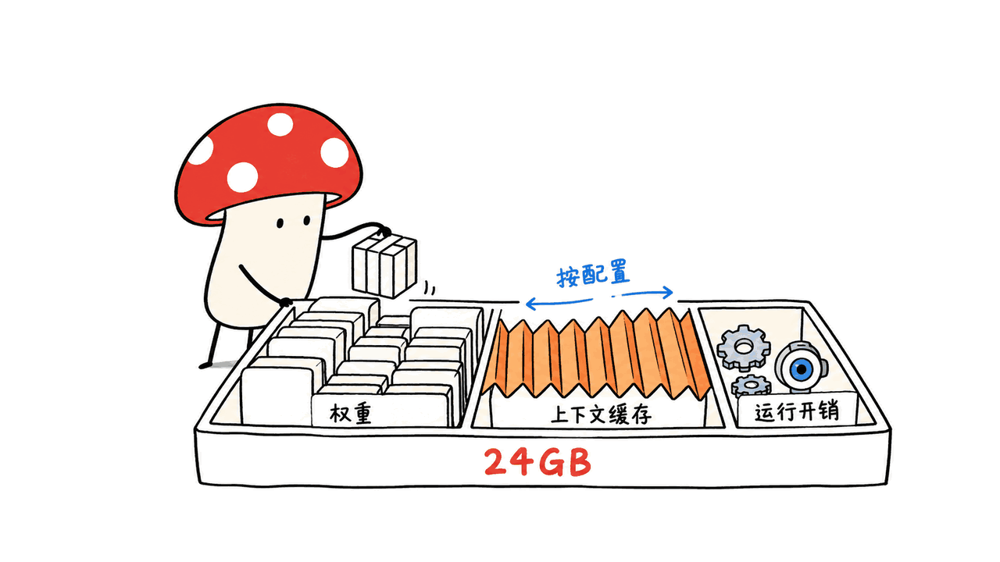
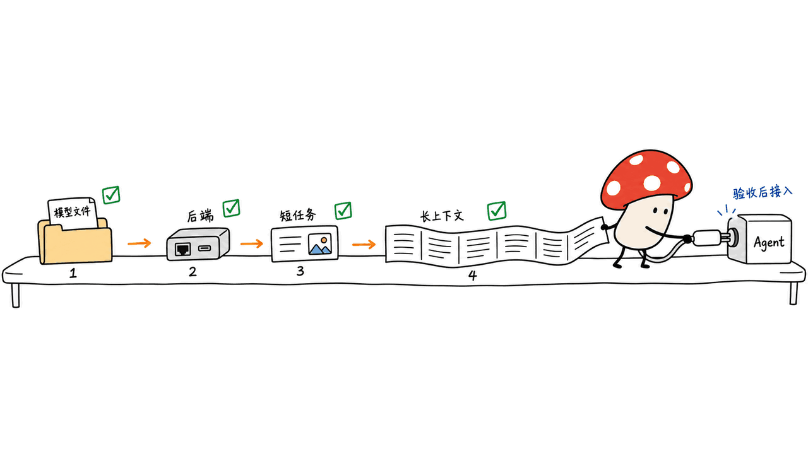

英伟达这次把视觉 Agent 模型分成了三档：面向服务器和 DGX Spark 的 Nemotron 3.5 Super VL、主打 24GB 部署的 Bolt 74B-A9B，以及计划供本地对话助手使用的 Bolt E4B。百万上下文属于 Super VL；不能把这个规格直接套到 Bolt 上。

NVIDIA 官方新闻发布于 2026 年 10 月 15 日。本文截至 10 月 17 日复核官方新闻、技术博客和 Hugging Face 模型卡：Super VL 与 Bolt 74B 已可获取，E4B 预告在 10 月 23 日提供。我们没有下载大模型权重，也没有在 16GB M4 上运行或测速。

## 三个名字，对应什么机器与任务？

| 型号 | 主要规格 | 输入与用途 | 当前状态 |
| --- | --- | --- | --- |
| Super VL 120B-A12B | 总参数 120B、激活 12B；最高 1M token 上下文 | 文字、图片、视频输入，文字输出；文档、代码与多模态 Agent | BF16、NVFP4 等版本已发布 |
| Bolt 74B-A9B 24GB | 总参数 74B、激活 9B；最高 256K；IQ2 量化感知训练 | 本地工具调用、浏览、终端及视觉任务 | 权重与 GGUF 入口已发布 |
| Bolt E4B 4GB | 官方定位为 4GB 档本地对话与嵌入式 Agent | 本地语音助手、交互角色等场景 | 计划 10 月 23 日上线，具体能力待正式模型卡核验 |

注意，“供语音助手使用”不等于已经证明支持音频输入输出或全双工。发布前不能凭产品定位补出 ASR、TTS 或打断能力，也不应把 E4B 名称自行展开成未经公布的总参数量。

## 百万上下文的 Super VL，强在哪里？

Super VL 将 Mamba-2、MoE 和 Attention 组合，并接入 C-RADIO 视觉编码器。MTP 支持原生投机解码，NVFP4 版本用量化感知蒸馏降低部署开销。它仍是文字输出的视觉语言模型：可以理解图片和视频，再写出判断、代码或工具调用；不是视频生成模型。

1M 是共享上下文上限，提示词、视觉输入、历史、工具结果和输出都占预算。模型卡也明确，实际部署配方可能使用更短窗口，以适配显存和并发。能加载模型、能处理一段短文本、能吃满百万上下文，是三次不同验收。

官方 NVFP4 卡列出 DGX Spark、H200、双 H100、GB200 等部署路线；页面开头的快速命令特别注明仅针对 DGX Spark，并固定并发为 1。不要把那条命令视为任何显卡的通用配方。不同平台的权重、激活精度和推理内核也有区别。

## Bolt 怎样把 74B 压到 24GB 档？

它不是把 Super VL 随手转成普通 Q2 文件。模型卡描述的流程包含 Star Elastic 架构搜索、蒸馏恢复和量化感知训练：从 120B-A12B 父模型压缩到 74B-A9B，再对专家权重使用 IQ2-XXS 等低比特表示。混合模型里仍有较高精度的部分，“2bit”不能理解成每一项运行状态都是两位。

**24GB 是带条件的部署目标。** 卡中架构搜索以 batch size 1、128K 上下文的内存预算为目标，并计入量化和运行状态；模型能力上限则标为 256K。默认示例还包含特定 vLLM nightly、`b12x` 内核、FP8 KV cache 与投机模型配置。这不构成“任意 24GB 机器、任意后端、满窗口和高并发都能运行”的保证。

实际选型时，把权重、KV/SSM 状态、视觉编码器、推理工作区、投机草稿模型、并发和其他应用占用分开核算。RTX 的显存和 Mac 的统一内存也不是相同的软件环境。官方提供 llama.cpp、Ollama、LM Studio 等入口，仍需核对对应版本、文件及视觉支持。

## 公开成绩该怎样读？

下面为 NVIDIA 模型卡公布值，不是我们的测评；两个型号各有量化和推理配置，不能把表格当作同硬件吞吐比赛。

| 项目 | Super VL NVFP4 | Bolt IQ2 |
| --- | ---: | ---: |
| GPQA Diamond | 89.90 | 86.43 |
| Terminal-Bench 2.1 | 62.78 | 50.98 |
| BrowseComp | 77.5 | 66.75 |

Super VL 卡还给出 OCRBench v2 中文 59.03、MMLongBench-Doc 62.82、OSWorld-Verified 52.3。Bolt 卡中，AA-Omniscience accuracy 为 16.90，低于同表 Gemma4 26B-A4B 的 22.17；不是每一项都领先。Agent 成绩还受 harness、工具与预算影响，不能用一张榜单推出所有真实工作都更好。

官方新闻的“最高 5 倍吞吐”属于其特定对比口径；本文不把它改写成你本地机器的提速倍数。复核入口包括官方技术博客、模型卡，以及 NeMo Gym 的评测配方，而不是只看社交媒体排名截图。

## 下载前先按什么顺序判断？

第一步选任务：长文档与复杂视觉推理偏向 Super VL；已有 24GB NVIDIA 本地环境、希望跑工具 Agent，可先研究 Bolt。第二步选模型文件与后端，不混用 safetensors、GGUF、投机草稿和视觉投影文件。第三步固定模型 revision、推理后端版本、量化与上下文配置，再测短文本、图片、工具回合，最后增加上下文和并发。

模型权重采用 OpenMDW-1.1，不能直接写成 Apache 2.0 或 MIT。推理与训练周边仓库另有各自许可证：vLLM、llama.cpp、NVIDIA Model Optimizer、NeMo Gym 都要分别核对。`trust-remote-code` 和模型卡允许访问整个本地媒体目录的示例参数，也应按实际部署缩小范围。

我的判断：这次最值得关注的是部署分层及专门优化的低比特模型，而不是“74B 激活只有 9B，就只需要 9B 的内存”。对于 E4B，等正式权重与模型卡，再讨论它能否组成完整本地语音链路。相关语音工程指标可参见：https://blog.mushroom.cv/blog/x2streaming-asr-append-only/

## 常见问题

### Bolt 也支持百万上下文吗？

本次 Bolt 74B 卡标注最高 256K；百万上下文是 Super VL 的规格。

### 24GB Mac 能直接照抄 vLLM 命令吗？

不能据此保证。官方 CUDA 内核和 NVIDIA 配方与 Mac 环境不同；GGUF 等其他路线也需单独验收。

### 小模型已经能下载了吗？

截至本文核对日，官方将 E4B 的上线时间定为 10 月 23 日。本文不声称已经下载或验证。

## 一手资料与开源入口

- 发布新闻：https://blogs.nvidia.com/blog/nemotron-3-5-super-vl/
- 技术介绍：https://developer.nvidia.com/blog/nvidia-nemotron-3-5-super-vl-powers-specialized-agents-with-multimodal-reasoning/
- Super VL NVFP4：https://huggingface.co/nvidia/NVIDIA-Nemotron-3.5-Super-VL-120B-A12B-NVFP4 ，核对 revision `59b8721646c38111a242da18218859fb2b454322`
- Bolt：https://huggingface.co/nvidia/NVIDIA-Nemotron-3.5-Bolt-74B-A9B-24GB ，核对 revision `c6cc2e8ffa353403213d6b9b18aaf8eb684d705a`
- Bolt GGUF：https://huggingface.co/nvidia/NVIDIA-Nemotron-3.5-Bolt-74B-A9B-24GB-GGUF
- 推理：https://github.com/vllm-project/vllm ，https://github.com/ggml-org/llama.cpp
- 量化与评测：https://github.com/NVIDIA/Model-Optimizer ，https://github.com/NVIDIA-NeMo/Gym
- 许可：https://openmdw.ai/license/1-1/

---

> © 2026 Author: Mycelium Protocol. 本文采用 [CC BY 4.0](https://creativecommons.org/licenses/by/4.0/deed.zh) 授权——欢迎转载和引用，须注明作者姓名及原文链接，不得去除署名后以原创发布。

<!--EN-->

NVIDIA’s October 15 release covers three deployment tiers: Nemotron 3.5 Super VL for large multimodal workloads, Bolt 74B-A9B for a 24GB deployment target, and an upcoming E4B model for local conversational agents. The million-token context belongs to Super VL, not to every Bolt model.

Checked on October 17, 2026: Super VL and Bolt 74B are available; NVIDIA schedules E4B for October 23. We downloaded no model weights and ran no inference or speed benchmark on our 16GB M4.

## Which model fits which workload?

| Model | Specification | Input and purpose | Status |
| --- | --- | --- | --- |
| Super VL | 120B total / 12B active; up to 1M tokens | Text, images and video in; text out; documents, coding and multimodal agents | BF16 and NVFP4 releases available |
| Bolt 74B-A9B 24GB | 74B total / 9B active; up to 256K; IQ2 quantization-aware training | Local tools, browsing, terminal and visual tasks | Weights and GGUF entry available |
| Bolt E4B 4GB | Announced 4GB deployment tier | Conversational and embedded agents | Scheduled for October 23 |

A voice-assistant positioning does not establish native audio input/output, speech synthesis or full-duplex interruption. Those capabilities require the final E4B model card. Its name should not be expanded into an unverified total parameter count.

## What makes Super VL different?

Super VL combines Mamba-2, MoE and attention with a C-RADIO vision encoder. MTP supports speculative decoding, while NVFP4 uses quantization-aware distillation. It understands visual inputs and emits text, code or tool requests; it does not generate video.

The 1M context limit is shared by prompts, visual inputs, history, tool results and output. Actual serving recipes may reduce it to fit memory and concurrency. Loading weights, completing a short request and sustaining the maximum context are separate acceptance checks.

The NVFP4 card lists DGX Spark, H200, dual H100 and GB200 deployment options. Its opening quick-start configuration is specifically for DGX Spark with one concurrent sequence. Kernel and precision choices vary across hardware; that recipe is not a universal GPU command.

## How does Bolt reach the 24GB tier?

The process includes Star Elastic architecture search, distillation recovery and quantization-aware training. It compresses the parent 120B-A12B into 74B-A9B, with IQ2-XXS expert weights and higher-precision components elsewhere. Two-bit weights do not make every runtime state two-bit.

The card’s architecture search targets batch size 1 and 128K context within its memory budget, accounting for quantization and runtime states. The model capability limit is 256K. Its vLLM example also specifies a nightly image, b12x kernels, FP8 KV cache and a speculative model. None of this guarantees every 24GB machine can sustain maximum context and high concurrency.

Budget weights, KV/SSM states, vision components, workspaces, draft models and other applications separately. NVIDIA VRAM and Mac unified memory have different serving environments. Official llama.cpp, Ollama and LM Studio entry points still need compatible files, versions and visual support.

## How should the published results be read?

These are NVIDIA model-card results, not our measurements or a same-hardware speed comparison.

| Benchmark | Super VL NVFP4 | Bolt IQ2 |
| --- | ---: | ---: |
| GPQA Diamond | 89.90 | 86.43 |
| Terminal-Bench 2.1 | 62.78 | 50.98 |
| BrowseComp | 77.5 | 66.75 |

Super VL additionally reports OCRBench v2 Chinese 59.03, MMLongBench-Doc 62.82 and OSWorld-Verified 52.3. Bolt does not lead every row: its AA-Omniscience accuracy is 16.90 versus Gemma4 26B-A4B’s 22.17 in the same table. Agent results depend on harnesses, tools and budgets.

The news headline’s up-to-5x throughput claim has a specific comparison setup. It is not a promised local speedup. Review the technical blog, cards and NeMo Gym evaluation recipes rather than only a ranking screenshot.

## What should a deployment check first?

Choose a workload, then a model format and runtime. Keep safetensors, GGUF, vision projectors and speculative drafts distinct. Pin the model revision and backend, start with short text, then test images and tool rounds before increasing context or concurrency.

Weights use OpenMDW-1.1, rather than Apache 2.0 or MIT. vLLM, llama.cpp, Model Optimizer and NeMo Gym have separate licenses. Review remote-code execution and local-media access settings before copying a serving example.

Our assessment: the substantive development is deployment specialization and a deliberately trained low-bit model. Nine billion active parameters do not imply nine billion parameters of storage. Wait for the final E4B release before evaluating an end-to-end local speech pipeline. Related speech engineering context: https://blog.mushroom.cv/blog/x2streaming-asr-append-only/

## FAQ

### Does Bolt have a million-token context?

The inspected 74B card specifies up to 256K. Super VL specifies up to 1M.

### Can a 24GB Mac copy the vLLM recipe?

The NVIDIA CUDA recipe does not establish Mac compatibility. Alternative GGUF routes need separate validation.

### Is E4B downloadable already?

The official announcement schedules it for October 23. We do not claim to have obtained or tested it.

## Primary sources and code

- Announcement: https://blogs.nvidia.com/blog/nemotron-3-5-super-vl/
- Technical blog: https://developer.nvidia.com/blog/nvidia-nemotron-3-5-super-vl-powers-specialized-agents-with-multimodal-reasoning/
- Super VL: https://huggingface.co/nvidia/NVIDIA-Nemotron-3.5-Super-VL-120B-A12B-NVFP4 ; inspected revision `59b8721646c38111a242da18218859fb2b454322`
- Bolt: https://huggingface.co/nvidia/NVIDIA-Nemotron-3.5-Bolt-74B-A9B-24GB ; inspected revision `c6cc2e8ffa353403213d6b9b18aaf8eb684d705a`
- GGUF: https://huggingface.co/nvidia/NVIDIA-Nemotron-3.5-Bolt-74B-A9B-24GB-GGUF
- Runtime: https://github.com/vllm-project/vllm ; https://github.com/ggml-org/llama.cpp
- Quantization and evaluation: https://github.com/NVIDIA/Model-Optimizer ; https://github.com/NVIDIA-NeMo/Gym
- Terms: https://openmdw.ai/license/1-1/

---

> © 2026 Author: Mycelium Protocol. Licensed under [CC BY 4.0](https://creativecommons.org/licenses/by/4.0/) — free to share and adapt with attribution. You must credit the author and link to the original; removing attribution and republishing as original is not permitted.
