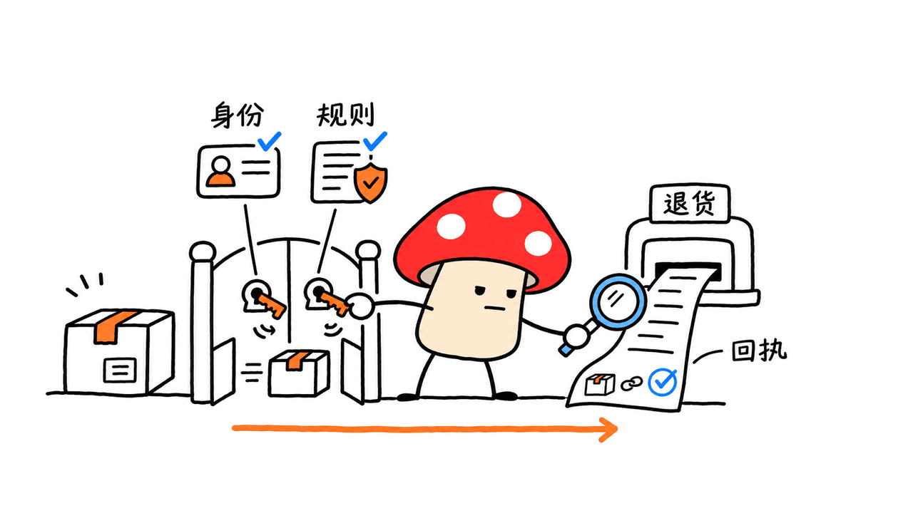
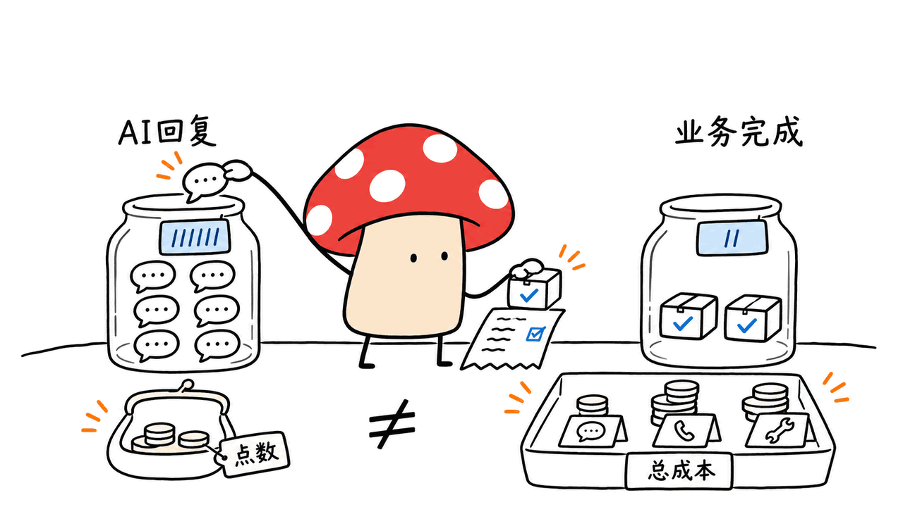

Neura HQ 是帮助消费品牌通过对话完成导购和售后的商业软件。它的价值取决于能否把商品、门店、订单和人工服务接成闭环；聊天是否自然，只是其中一层。

产品由 ZEPIC 提供。我们核对了 2026 年 11 月 15 日可访问的官网、定价页、企业页及 Product Hunt 上发布者的答复。以下明确区分官方展示、我们的工程分析和假设预算；没有注册商家账号、连接真实商店或执行退款，不能把本次调研称作产品实测。

官网：https://neurahq.ai/
价格：https://neurahq.ai/pricing/

## 它卖的是什么，为什么值得看？

普通 FAQ 机器人主要回答“退货政策是什么”。Neura 的产品主张向前走了一步：先理解想买什么，再查商品和库存；线上没货时，引导附近门店；买后继续处理订单问题，把需要人工介入的会话连同上下文转交。

这对多门店、SKU 较多、售前咨询密集的品牌有意义。线上库存不足不必直接结束一次销售，售后也不必重新询问顾客的全部背景。若接入可靠，减少的是真实业务中的跳转和重复劳动。

但“把官网变成 Agent”不代表把网页交给模型便能自动经营。库存接口、商品变体映射、门店可售量、订单权限和退款规则，都需要配置。产品页的聊天和订单确认画面是演示素材，不是我们验证过的订单流水。

官网更新列表已列出 Shopify、WooCommerce、BigCommerce 和 Magento 连接器；连接器存在也不等于它覆盖所有平台版本、插件和写操作。采购时应对照你的实际系统确认支持范围，而不只数 Logo。

## 哪些能力已宣称可用，哪些还要问？

一个值得注意的来源差异：官网明确写当前可用的是 Web chat 和 WhatsApp，其他渠道陆续推出。Product Hunt 上发布者另称支持 SMS，并说邮件可通过 MCP 连接邮件平台。短信是否随你的套餐交付，应实际确认；不能把页面列出的 Instagram、Voice、Gmail 等图标全当成已上线原生渠道。

企业页则承诺更广的多 Agent 编排、可选择模型及私有 VPC 部署。这是单独的企业销售范围，不能把它算进每月 99 美元的 Starter。

本次公开资料中，我们没有核实到其内部代码、模型清单、数据库、检索框架、工作流引擎或可复现的生产性能结果。下文的架构是从业务要求推导的参考设计，不是对 Neura 私有实现的逆向结论。

发布者讨论：https://www.producthunt.com/products/neura-4?launch=neura-hq
企业产品：https://neurahq.ai/enterprise/

## 技术上，最关键的是把“知识”和“事实”分开

发布者的解释有一个合理方向：价格、变体和库存以电商系统为优先来源，政策与流程以品牌文档和指令为依据，信息不足时转人工。这是厂商描述，具体更新延迟和冲突处理仍需验证。

工程上应把数据分成三类。

| 数据 | 合适的处理方式 | 不应混淆的边界 |
| --- | --- | --- |
| 材质、尺码说明、常见问题 | 文档检索、版本和来源记录 | 旧网页不能覆盖新政策 |
| 价格、库存、订单状态 | 调用系统接口，带更新时间和业务标识 | 不能靠向量检索猜实时库存 |
| 退货资格、退款额度、预约规则 | 可执行规则与流程状态 | 模型建议不能直接成为授权 |

自然语言可以帮助解释需求，但最后还要落到确定的 SKU、门店和订单。查到“有两件”也不等于已经为客户保留两件：如果并发售出，承诺就可能失效。预约或预留需要由库存系统确认，返回可追踪凭证。

官网还把配置包装成“像培训新人一样说话”，并展示从会话提出新指令、由商家批准的流程。这可以降低配置门槛，但不能据此推断模型会在线更新权重。工程上应将口述内容先转成待审配置，记录适用范围、审批人和版本，允许回滚，并处理新旧政策冲突。

## 一个可借鉴的参考架构

以下是我们的工程建议，而非已证实的 Neura 技术栈：

1. 渠道适配层接收网站、WhatsApp 消息，统一事件结构并去重，保留渠道消息 ID。
2. 身份服务将访客、已验证顾客与订单权限分开，跨渠道关联前确认身份。
3. 任务路由区分商品咨询、订单查询和售后写操作，选择对应知识与工具。
4. 业务流程层维护表单字段、资格检查、执行状态和人工接管点。
5. 工具网关限制可调用接口、参数、金额与租户范围，记录每次操作凭证。
6. 结果与审计层把消息、工具执行、业务回执、credit 消耗和人工处理关联起来。

可以采用检索增强和工具调用，但没有证据表明 Neura 一定使用某个向量库或 Agent 框架。MCP 能统一部分工具接入方式，却不自动解决订单归属、重试或权限问题。

例如一次退货可以设计为：收集订单和商品 → 验证顾客有权操作该订单 → 读取实际签收时间及政策版本 → 计算资格 → 顾客确认 → 执行退货申请 → 查询系统凭证 → 回复结果。模型负责对话，规则和后端负责授权及记账。

“退款请求已提交”“退款获批”“资金已退回”必须是不同状态。接口超时可能发生在服务端已执行之后，此时要先用请求标识查询，不能让模型再退一次。幂等键、超时恢复和人工升级，比多加一条“不要出错”的提示词更重要。

## 跨渠道记忆的价值与风险在哪里？

官网称用一次性验证码确认顾客身份，并读取过去订单和偏好。它可以降低重复询问，但“记得你喜欢黄色”与“允许修改你的配送地址”是两种权限。

建议把偏好记忆与身份凭证分开。未验证会话可以讨论公开商品信息，订单详情和地址修改则需要更强的身份及订单归属检查。共享手机号、家庭设备和手机号重新分配，都可能造成错误关联。

还要问清记忆保存多久、删除请求如何传播到摘要和检索索引。ZEPIC 的通用隐私说明谈到按业务需要保留数据，但这不是 Neura 顾客记忆的固定保留天数，也不能由此确认所有子处理商和部署区域。

人工接管应当同时转交已收集字段、工具结果、当前流程状态和未完成动作，并暂停机器人写操作。否则“上下文都交给人了”，后台 Agent 却仍在执行，可能制造重复处理。

隐私说明：https://zepic.com/privacy

## 99 美元到底能买多少服务？

下面按官网美元月付价格计算，不包含税费、WhatsApp、集成实施与人工费用；价格核对日期为 2026 年 11 月 15 日。

| 套餐 | 月费 | 每月 credits | 集成数 | 流程/表单各自上限 | 席位 |
| --- | --- | --- | --- | --- | --- |
| Starter | $99 | 2,000 | 1 | 各 3 | 3 |
| Growth | $249 | 6,000 | 3 | 各 15 | 10 |
| Scale | $499 | 15,000 | 10 | 各 50 | 25 |

普通 AI 回复为 1 credit；涉及顾客照片、语音或文件的 AI 回复为 3 credits，人工回复不耗 credits。加购包为 1,000/$59 或 5,000/$249。试用为申请开通的 14 天、无需银行卡，不等于已经给我们开放了测试账号。

所以 2,000 credits 不是 2,000 位顾客，更不是 2,000 个解决的问题。套餐额度用满时，单 credit 摊销约为 $0.0495、$0.0415、$0.0333，但未用满时真实平均成本更高。

我们运行了一份可复算的预算脚本，假设每次会话需要 6 条 AI 回复。如果全是普通回复，三个套餐分别约支持 333、1,000、2,500 次完整会话；若 20% 的 AI 回复按多模态计费，每次平均消耗 `6 × (0.8 × 1 + 0.2 × 3) = 8.4 credits`，约降到 238、714、1,785 次。这是均值预算，不是官方会话配额。

进一步假设每月 1,000 次这样的混合会话，需要 8,400 credits。按离散加购包枚举，Starter 需买 5,000 加两个 1,000 包，合计 $466；Growth 加三个 1,000 包为 $426；Scale 不加购为 $499。这个需求下仅看点数，Growth 更便宜；如果需要更多集成或流程，选型结果可能改变。

脚本没有假设额度结转。内部重试是否扣点、同一附件后续多轮如何计费、用完后暂停还是自动加购，都应在试用或合同中确认。

WhatsApp 不是每条回复都必然额外收费。Meta 价格取决于消息类别和接收市场，官网也列出免费情形。应将实际渠道账单独立建模，不能简单给所有 AI 回复乘一个固定 WhatsApp 单价。

Meta 官方定价：https://whatsappbusiness.com/products/platform-pricing/

## 护城河与商业模式：优势和张力是什么？

这类产品容易被低估为“聊天窗口加大模型”，也容易被高估为能替商家接管一切。真正难复制的是连接器的长期维护、品牌业务语义、错误恢复和完整运营流程，而不是单次模型回答。

Neura 在同一产品里覆盖导购与售后，理论上可以共享顾客上下文；对有线上线下库存的品牌，这比只回答常见问题更有价值。ZEPIC 已有品牌服务背景，可能有助于渠道和数据接入，但不能把母公司的经验或客户数量当成 Neura 自身转化效果的证据。

计费也存在张力：商家希望更少轮次解决问题，供应商却按回复量计费。不能据此推断它会故意拉长对话，但采购方应把“每个成功结果成本”放在回复量之前。简短回答若导致重开工单，也未必更省钱。

相比只读知识库助手，它更值得为事务闭环付费；相比自己搭建方案，购买 SaaS 可能省去一部分维护工作，但仍需适配系统与验收。评估应比较完整实施成本，而不是拿 99 美元与裸模型 Token 价格直接对比。

## 怎样做一个有判断力的试点？

先选一个品牌、一个渠道和一个边界明确的流程。例如从只读订单查询开始，再开放低风险的退货申请，最后才讨论实际退款。不要第一天就连接全部写权限。

构造覆盖关键失败路径的验收集：同名不同 SKU、线上有货但门店没货、政策文档冲突、无权访问的订单、过期验证码、重复 webhook、执行成功后超时、转人工后禁止自动继续。每个样本都应提前写好业务预期，不能只检查答案是否流畅。

用真实业务回执计算任务完成率和单结果总成本，另看错误库存承诺、重复写入、重开率、接管质量及端到端延迟分布。衡量销售增量时采用合理的对照分组，并考虑毛利、退货与后续支持成本；订单与聊天相关，不等于聊天造成订单增长。

当前公开证据足以说明产品方向和计费框架，但不足以给出独立的转化提升、退款成功率、SLA 或单位经济性结论。Product Hunt 的发布者答复能澄清产品主张，不能替代长期商家使用记录。企业页上的安全标识和“零泄漏”表述，也应向供应商索取适用范围及审计材料，而非当作我们已验证的安全保证。

## 常见问题

### Neura HQ 是开源项目吗？

本次核对的官方入口以商业服务、试用和企业销售为主，没有发现可据以自托管的官方源码与开源许可证。不能从“支持自选模型”推导出开源。

### Starter 能实现库存、物流、退款一条龙吗？

不能仅据演示判断。Starter 的集成数和流程数有限，是否覆盖完整链路取决于连接器能力、系统组合和权限，需要用自己的测试商店验收。

### 最重要的采购指标是什么？

是可核对业务结果对应的总成本与错误风险。把订阅、加购、渠道、实施和人工成本合并，再除以实际完成的结果；回复数量只能解释部分消耗。

来源与研究边界：
https://neurahq.ai/
https://neurahq.ai/pricing/
https://neurahq.ai/enterprise/
https://www.producthunt.com/products/neura-4?launch=neura-hq
https://zepic.com/privacy
https://zepic.com/terms
https://whatsappbusiness.com/products/platform-pricing/

---

> © 2026 Author: Mycelium Protocol. 本文采用 [CC BY 4.0](https://creativecommons.org/licenses/by/4.0/deed.zh) 授权——欢迎转载和引用，须注明作者姓名及原文链接，不得去除署名后以原创发布。

<!--EN-->

Neura HQ is commercial software for consumer brands that want to combine conversational selling and after-sales service. Its value depends on connecting products, stores, orders, and people into a completed workflow. Natural conversation is only one layer.

ZEPIC provides the product. We reviewed its public website, pricing, enterprise offer, and maker responses on Product Hunt on November 15, 2026. Vendor claims, our engineering recommendations, and hypothetical cost calculations are distinguished throughout. We did not register a merchant account, connect a live store, or execute refunds. This is research, not a hands-on production review.

Website: https://neurahq.ai/
Pricing: https://neurahq.ai/pricing/

## What is the product actually selling?

A conventional FAQ bot explains a returns policy. Neura proposes a broader journey: understand a shopper's needs, recommend an item, check availability, suggest a nearby store when online stock is unavailable, and continue into order support with contextual human handoff.

That combination is relevant to brands with many SKUs, multiple stores, and substantial purchase questions. A stockout need not end a sale, and a support conversation need not restart the customer's history. The potential value is fewer transfers and repeated steps.

However, converting a website into an agent does not eliminate integration work. SKU variants, available-to-sell inventory, order permissions, and refund policy still need explicit configuration. The homepage's order confirmations are demonstrations, not transaction records we verified.

The vendor's updates list Shopify, WooCommerce, BigCommerce, and Magento connectors. Their presence does not establish support for every platform version, plugin, or write operation. Verify your specific system and workflow rather than counting integration logos.

## Which capabilities need clarification?

The homepage explicitly identifies web chat and WhatsApp as available, with other channels coming later. A Product Hunt maker response also mentions SMS and email through an MCP-connected email platform. Confirm SMS delivery for your plan; do not treat every Instagram, Voice, or Gmail icon as a shipping native channel.

The enterprise offer describes multi-agent orchestration, model choice, and private VPC deployments. Those belong to a separate sales scope, not an assumed feature set of the $99 Starter subscription.

We did not verify an official self-hostable source release, internal model list, database, retrieval framework, workflow engine, or reproducible production performance. The architecture below is a reference design inferred from the business requirements, not a reconstruction of Neura's private implementation.

Maker discussion: https://www.producthunt.com/products/neura-4?launch=neura-hq
Enterprise: https://neurahq.ai/enterprise/

## Separate knowledge from current business facts

The maker describes source priority: commerce systems for prices, variants, and inventory; business documents and instructions for policies; human escalation when information is missing. This is a sensible vendor-stated direction, whose freshness and conflict handling still need acceptance tests.

| Information | Suggested handling | Boundary |
| --- | --- | --- |
| Materials, sizing, FAQs | Retrieval with document versions and sources | Old pages must not override newer policy |
| Prices, stock, order status | System calls with timestamps and identifiers | Vector retrieval cannot establish current stock |
| Return eligibility and refund limits | Executable rules and workflow state | A model suggestion is not authorization |

An interpreted request must ultimately map to exact SKUs, stores, and orders. Reporting two units in stock does not reserve them. Reservation requires confirmation from the inventory system and a traceable receipt, particularly under concurrent purchases.

The conversational setup interface can reduce configuration effort. The site also describes suggesting instructions from conversations for merchant approval. That is not evidence of online model-weight training. A robust implementation should compile such input into reviewable configuration with scope, approver, versioning, rollback, and policy-conflict handling.

## A reference architecture engineers can borrow

The following is our recommendation, not a verified Neura stack:

1. Channel adapters normalize website and WhatsApp events, deduplicate deliveries, and preserve channel message IDs.
2. An identity service separates visitors, verified customers, and order-level permissions before linking channels.
3. Task routing distinguishes product questions, order reads, and after-sales writes, selecting appropriate evidence and tools.
4. A workflow layer maintains collected fields, eligibility checks, execution states, and human takeover points.
5. A tool gateway restricts operations, arguments, amounts, and tenant scope while recording execution receipts.
6. An outcome layer connects messages, tool calls, business receipts, credits, and human work for audit and measurement.

Retrieval and tool calling are plausible building blocks, but the evidence does not identify a particular vector database or agent framework. MCP can standardize parts of tool access; it does not automatically provide ownership checks, retry safety, or authorization.

A return workflow could collect the order and item, verify customer authority, read delivery time and the applicable policy version, determine eligibility, obtain confirmation, submit a return request, query its receipt, and report the resulting state. The model handles conversation; rules and backend systems authorize and record the operation.

A submitted refund request, an approved refund, and funds actually returned are different states. A timeout can occur after the backend has committed a write. Query by request ID before retrying. Idempotency, recovery, and escalation matter more than another instruction asking the model to avoid mistakes.

## What does cross-channel memory require?

The homepage describes one-time-code verification and access to order history and preferences. Remembering a favorite color and authorizing an address change require different permissions.

Separate preference memory from authentication evidence. Unverified users can discuss public products; order details and address changes need stronger identity and ownership checks. Shared phones, household devices, and recycled numbers can create incorrect associations.

Ask how long memory persists and how deletion reaches summaries and retrieval indexes. ZEPIC's general privacy notice describes retention according to business need; that is not a fixed retention period for Neura shopper memory, nor a complete deployment-specific subprocessor or residency description.

Human takeover should transfer collected fields, tool results, workflow state, and pending actions while suspending automated writes. Sending an agent transcript to a person is insufficient if the automation continues executing in parallel.

Privacy: https://zepic.com/privacy

## What does $99 actually buy?

These are USD monthly prices checked November 15, 2026. They exclude tax, WhatsApp, implementation, and human labor.

| Plan | Monthly price | Credits | Integrations | Procedures / forms | Seats |
| --- | --- | --- | --- | --- | --- |
| Starter | $99 | 2,000 | 1 | 3 each | 3 |
| Growth | $249 | 6,000 | 3 | 15 each | 10 |
| Scale | $499 | 15,000 | 10 | 50 each | 25 |

A standard AI reply uses one credit; an AI reply involving a customer photo, voice note, or file uses three. Human replies consume none. Additional packs are $59/1,000 or $249/5,000. The no-card 14-day trial requires requesting access; we did not obtain a test account.

Two thousand credits do not mean two thousand customers or resolved problems. At full utilization, the subscription averages approximately $0.0495, $0.0415, and $0.0333 per included credit. Lower utilization increases the effective average.

We executed a reproducible budget calculation assuming six AI replies per conversation. All-standard replies allow roughly 333, 1,000, and 2,500 complete conversations respectively. If 20% of replies use media pricing, expected consumption becomes `6 × (0.8 × 1 + 0.2 × 3) = 8.4 credits`, reducing those estimates to 238, 714, and 1,785. These are budget averages, not vendor conversation allowances.

For 1,000 such mixed conversations, the budget requires 8,400 credits. Enumerating the published discrete packs gives $466 for Starter plus one 5,000 pack and two 1,000 packs; $426 for Growth plus three 1,000 packs; and $499 for Scale without add-ons. Growth is cheaper for this credit-only scenario. Integration and workflow requirements can change that choice.

We assume no rollover. Confirm whether retries consume credits, how follow-up turns involving an attachment are metered, and whether exhaustion pauses service or triggers a purchase.

WhatsApp does not necessarily charge for every AI reply. Meta's pricing depends on the recipient market and message category and includes free cases. Model the actual channel bill separately rather than applying a universal WhatsApp rate to every reply.

Meta pricing: https://whatsappbusiness.com/products/platform-pricing/

## Where are the defensibility and incentives?

It is easy to underestimate this category as a chat window around a model, or overestimate it as a replacement for an entire retail operation. Durable connector maintenance, business semantics, recovery behavior, and operating workflows are harder to reproduce than a single answer.

Combining selling and service can reuse customer context. For omnichannel brands, that may be more valuable than answering FAQs. ZEPIC's existing brand-service experience may help distribution and integration, but its parent-company history or customer count is not evidence of Neura-specific conversion gains.

Reply-based pricing also creates an incentive tension: merchants want fewer turns per completed task, while billing measures replies. That does not establish deliberate conversation inflation. It does mean buyers should track cost per successful outcome ahead of response counts. A short answer followed by a reopened ticket may cost more overall.

Compared with a read-only knowledge assistant, transactional closure is the feature worth paying for. Compared with building internally, SaaS can remove some maintenance work while still requiring adaptation and acceptance tests. Compare complete operating costs, not $99 against bare model token prices.

## How should a serious pilot work?

Choose one brand, one channel, and a bounded workflow. Begin with read-only order status, then a low-risk return request, and only later consider actual refunds. Avoid connecting every write permission on day one.

Create acceptance cases for similar names with different SKUs, store stockouts, conflicting policy documents, unauthorized orders, expired codes, duplicate webhooks, successful writes followed by timeouts, and automated writes after human takeover. Specify business outcomes before testing instead of judging fluency alone.

Use backend receipts to measure completion and total outcome cost. Track false stock promises, duplicate writes, reopen rates, takeover quality, and end-to-end latency distributions. Assess sales incrementality with a suitable control group and include margin, returns, and follow-up support. A purchase associated with a chat does not prove the chat caused it.

Public evidence establishes a product direction and pricing structure, but not an independent conversion lift, refund success rate, SLA, or unit-economics result. Launch comments clarify claims rather than provide longitudinal merchant evidence. Enterprise security badges and zero-leakage language require scope and audit evidence from the vendor, not an assumption that we verified them.

## FAQ

### Is Neura HQ open source?

The official entry points reviewed offer commercial service, trial access, and enterprise sales. We found no verified official source release and license sufficient for self-hosting. Model choice does not imply open source.

### Does Starter cover inventory, delivery, and refunds end to end?

A demonstration cannot establish that. Integration and procedure limits, connector operations, backend combinations, and permissions determine coverage. Test the actual workflow with your own nonproduction store.

### Which buying metric matters most?

Total cost and error exposure per verifiable business outcome. Combine subscription, credit packs, channel charges, integration work, and human labor, then divide by genuinely completed outcomes. Reply counts explain only part of consumption.

Sources:
https://neurahq.ai/
https://neurahq.ai/pricing/
https://neurahq.ai/enterprise/
https://www.producthunt.com/products/neura-4?launch=neura-hq
https://zepic.com/privacy
https://zepic.com/terms
https://whatsappbusiness.com/products/platform-pricing/

---

> © 2026 Author: Mycelium Protocol. Licensed under [CC BY 4.0](https://creativecommons.org/licenses/by/4.0/) — free to share and adapt with attribution. You must credit the author and link to the original; removing attribution and republishing as original is not permitted.
