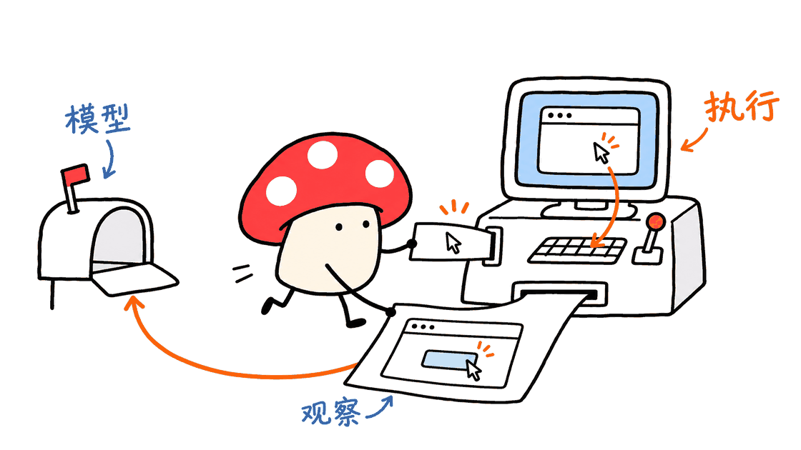
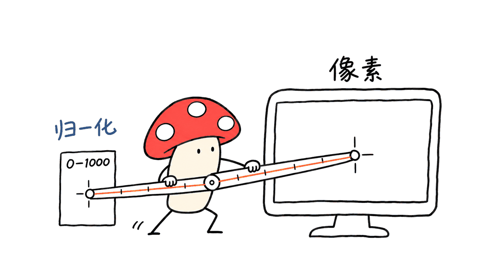

NorthCUA-Pro把用户指令、截图和交互历史转成推理、回复与工具调用。要让这些输出真正操作电脑，还需要运行框架处理截图、坐标、执行、记忆和结果验证；开放权重只是其中一层。

已核实的模型地址：

https://huggingface.co/beipo-ai/NorthCUA-Pro

模型卡指定的Harness仓库：

https://github.com/china-qijizhifeng/NorthCUA-Harness

发布方另一个公开Harness仓库，也是本文实际下载和分析的代码：

https://github.com/beipo-ai/NorthCUA

后者固定到 `fb5f9e2725c7cfe268fa0c2dc40f44cc132c12f4`。两个仓库地址均可访问，不能仅凭名称相近就把所有版本与验证记录混为一谈。模型元数据固定到 `b5d64ab98d811775cd5a297a5d14df0df35b39b9`；模型与所分析框架分别采用Apache-2.0。

## NorthCUA-Pro究竟是什么？

它是面向电脑操作的多模态模型，基于Qwen3.5进行独立后训练。输入可以包含界面截图、任务要求和操作历史，输出则需要由外部工具执行。它不直接拥有操作系统权限，也不会因为下载权重就自动形成一个可用的桌面助手。

同系列还提供Nano和Mini：

| 模型 | 总参数 / 激活参数 | 架构 |
|---|---|---|
| NorthCUA-Nano | 9B / 9B | Dense |
| NorthCUA-Mini | 35B / 3B | MoE |
| NorthCUA-Pro | 397B / 17B | MoE |

Nano与Mini也有各自的模型卡：

https://huggingface.co/beipo-ai/NorthCUA-Nano

https://huggingface.co/beipo-ai/NorthCUA-Mini

这些是官方给出的名义参数规模。MoE的激活参数描述单次计算涉及的部分，不能直接拿来估算全部权重的存储或显存需求。



## 它与传统RPA的区别在哪里？

传统自动化可以依赖稳定的接口、选择器或固定步骤。电脑智能体则尝试根据当前界面选择下一步，在页面变化、弹窗和跨应用任务中保持目标。

这不是说所有流程都该改成截图点击。若某项操作有可靠API或稳定DOM定位，直接调用通常更容易控制。NorthCUA的Web路径也包含DOM引用、表单与标签页工具，Desktop路径才更直接依赖屏幕观察和鼠标键盘。

对RPA团队，值得研究的是如何把视觉决策接到已有执行与验证体系，而不是简单把脚本换成一个自由点击的模型。任务权限、可用工具、超时与成功条件仍需要工程定义。

## 从“看见按钮”到“工作完成”，框架做了什么？

所分析的Harness基于公开NexAU，围绕完整任务而非单次点击组织运行：

1. 接收任务与当前环境，建立会话、预算和输出位置。
2. 获取观察信息，把截图、工具状态与相关历史交给模型。
3. 解析结构化工具调用，在对应Desktop或Web环境执行。
4. 读取新观察，保留有限的视觉窗口，对长历史进行压缩，并维护持久工作笔记。
5. 让独立评价步骤检查实际产物或原始工作区，将模型“说完成”和评价结果分开。
6. 保存轨迹、任务状态和产物；批任务可以在保留成功记录的基础上恢复。

“独立评价”并不意味着所有判断都绝对客观。评价规则、环境与证据仍要合适。但把动作完成声明与结果核验拆开，至少提供了定位问题的工程边界。

对于填写表单，应该检查提交回执或目标状态，而不只是看见模型调用了点击工具。对于生成文档，应该打开实际文件核对内容，而不是把一句“文件已保存”当证据。

封面采用项目公开的GeoGebra红色心形演示结果图。官方同时说明，30秒演示是加速剪辑，不是任务执行耗时，也不是当前发布checkpoint的性能复现。

## 一个容易踩坑的细节：坐标不一定是像素

NorthCUA模型卡规定GUI动作使用0–1000归一化坐标。例如 `(500, 500)` 表示对应截图的中心，不是屏幕上第500个像素。

所分析Harness的Desktop默认配置是 `image_pixels`。使用输出归一化坐标的模型时，需要在本次运行的配置中明确设置：

```yaml
desktop:
  coordinate_policy:
    input_space: normalized_1000
    clamp_to_bounds: true
```

边界转换只能发生在正确的执行位置。如果把归一化数值直接当屏幕像素，模型看对了目标，也可能点错地方。截图缩放、显示器偏移和边界值也都应由统一映射处理。

Web点操作使用CSS像素，DOM引用则是元素标识；这项Desktop设置不会自动把Web工具也改成归一化输入。模型适配时必须逐项确认工具契约，不能只替换模型名。



## 论文成绩很高，能等同于下载权重的能力吗？

模型卡列出的部分研究结果如下，均为官方报告口径，不是本文复测：

| 评测 | 阶段与指标 | Pro报告值 |
|---|---|---:|
| ScreenSpot-Pro | SFT，定位准确率 | 93.30% |
| OSWorld-G | SFT，定位准确率 | 90.96% |
| OSWorld-Verified | RL，任务成功率 | 88.64% |
| WebArena-Verified | RL，任务成功率 | 73.89% |

定位一次元素与完成一个长期任务是不同能力；SFT与后续RL也属于不同阶段。模型卡还说明，OSWorld-G采用三次完整运行中最好的一次，而非三次平均；OSWorld-Verified的任务设置排除了八个需要额外账号配置的Google Drive任务。

更关键的是，模型卡明确写道，这些研究成绩尚未与当前导出的checkpoint975建立精确绑定。因此，不能把表格包装成“下载这份文件即可稳定获得同样成绩”。

最新论文页面为arXiv v2，11月3日修订；模型卡和部分仓库文档仍引用v1及本地报告快照。复现时应记录具体论文版本、模型revision、框架提交、步骤预算、重试与评价规则，而不是只写模型名。

论文：https://arxiv.org/abs/2611.02102

另一个边界是Experience Flywheel。论文讨论轨迹生产、验证、技能演化与分阶段学习；本次分析的代码仓库主要发布Harness。运行一个任务不等于已经安装了完整训练流水线，也不意味着服务中的模型会自动更新权重。

## Pro能在Mac上本地跑吗？

本次实际读取了公开的模型配置和Safetensors索引。索引列出122个分片、1371个张量键，张量总字节数为 `793,604,721,632`，约793.6GB。Hugging Face API同时报告约3968亿个BF16参数，两者数量级一致。

这是权重张量的体积，不包含推理时的激活、缓存、视觉输入和运行框架开销。17B激活参数不代表只需装入34GB权重。配置中的262144上下文长度，也不代表在任何硬件上都能低成本跑满。

可以分三种情况判断：

| 使用方式 | Mac承担的工作 | 需要注意 |
|---|---|---|
| Mac运行Harness，连接远程模型 | 浏览器、截图、工具、轨迹与调度 | 无需在Mac加载Pro全部权重 |
| Mac本地运行较小模型，再接Harness | 同时承担模型推理 | 必须另核验模型格式、视觉与工具调用兼容性 |
| 原始BF16 Pro全部常驻Mac | 约794GB权重再加运行开销 | 不能把常见Mac或512GB统一内存配置当成已验证可行方案 |

从单纯位宽计算，4bit的397B权重也有约198.5GB的理论下限，还没加量化元数据、视觉组件和缓存。这只是容量估算，本文没有核实一个官方4bit Pro包、MLX移植或Mac推理配方，不能据此推荐具体机型或承诺速度。

最直接的Mac入门路径是把Mac作为控制端。官方文档的安装基线是Python 3.12与uv 0.13.6以上；Web需要Playwright/Chromium，原生Desktop还需要屏幕录制和辅助功能权限。先从隔离的测试页面开始，再决定是否接入真实工作桌面。

## 如何在不下载800GB权重的情况下先试框架？

所分析仓库提供无API Key教程：本地脚本模型端点配合真实浏览器，点击测试页按钮，再由评价器读取同一浏览器中的任务回执。

```bash
git clone https://github.com/beipo-ai/NorthCUA.git
cd NorthCUA
uv sync --locked --python 3.12 --extra local --extra device
uv run --no-sync playwright install chromium
uv run --no-sync northcua demo serve --directory logs/tutorial
```

服务显示 `"ready": true` 后，在第二个终端执行：

```bash
uv run --no-sync northcua config validate \
  --app-config logs/tutorial/app.example.yaml
uv run --no-sync northcua local web run \
  --app-config logs/tutorial/app.example.yaml \
  --url http://127.0.0.1:8787/task/first-web \
  --query 'Task ID: first-web. Activate the button and verify the receipt.' \
  --session-id first-web --max-steps 6 --evaluate
```

成功标准包括命令退出码、实际回执及 `evaluation_report.overall_verdict`，不能只看配置校验通过。重跑应选择新的输出目录，保留原始轨迹。

这套教程测试的是执行链路。即使通过，也不证明NorthCUA-Pro的自主规划能力，因为这里没有加载Pro权重，模型回复来自确定性的本地脚本服务。

## 本次核验与部署边界

本次直接读取了HF公开API、模型卡、配置与权重索引，未下载约794GB完整权重，未启动Pro推理，也未复现OSWorld。框架方面，按锁文件完成独立安装，坐标与工作记忆两个测试文件共13项通过；配置校验通过。无Key教程实际运行一个真实浏览器任务，命令退出0，记录到点击事件，评价器读到同一页面回执，最终 `overall_verdict: success`。这验证了脚本模型下的工具、DOM状态与回执链路；评价记录没有宣称视觉状态验证，本文也没有操作原生桌面、跑批或复现真实模型能力。

运行时和模型服务器应分开管理。模型导出记录Transformers 5.20.2，而所分析Harness锁定的NexAU依赖Transformers 4.x；两者的环境要求不能生搬硬合并。

框架维护者已公开披露这条依赖链的已知安全问题和临时例外策略。文章不把“Apache开源”或“CI通过”解读成没有漏洞；接入数据与模型配置时应看当前披露及修复状态。本文测试不加载不可信tokenizer或远程模型代码。

依赖披露：https://github.com/beipo-ai/NorthCUA/blob/main/docs/security/dependencies.md

对于真实自动化，建议从一个可重复的任务域开始：明确允许访问的环境、工具和停止条件，给最终文件或状态编写检查，保存失败轨迹，再引入批任务和恢复。模型输出的完成声明、执行器返回和业务结果应分别记录。


## 常见问题

### 下载NorthCUA-Pro后就能自动控制电脑吗？

还需要模型推理服务及匹配的Harness，处理截图、工具协议、执行权限与结果核验。权重本身不会点击鼠标。

### 17B激活参数是不是只需几十GB内存？

不是。激活参数描述计算量；当前BF16发布索引中的权重张量约793.6GB，另有运行开销。

### 无Key教程通过，是否代表Pro评测复现成功？

不是。教程使用本地脚本模型与真实浏览器，验证框架集成；Pro自主能力与论文成绩需要另做模型推理和基准复现。

相关工程阅读：https://blog.mushroom.cv/blog/nvidia-auto-ontology-agent-semantic-layer/

---

> © 2026 Author: Mycelium Protocol. 本文采用 [CC BY 4.0](https://creativecommons.org/licenses/by/4.0/deed.zh) 授权——欢迎转载和引用，须注明作者姓名及原文链接，不得去除署名后以原创发布。

<!--EN-->

NorthCUA-Pro turns instructions, screenshots and interaction history into reasoning, responses and tool calls. A computer-use runtime must connect those outputs to observation, coordinate mapping, execution, memory and outcome checks.

Model: https://huggingface.co/beipo-ai/NorthCUA-Pro

Harness linked by the model card: https://github.com/china-qijizhifeng/NorthCUA-Harness

Publisher's additional public Harness repository analyzed here: https://github.com/beipo-ai/NorthCUA

Both repository addresses are accessible. This article fixes its code analysis to the latter at `fb5f9e2725c7cfe268fa0c2dc40f44cc132c12f4`, and model metadata to `b5d64ab98d811775cd5a297a5d14df0df35b39b9`. It does not treat all repository revisions or verification records as interchangeable. Both the model and analyzed Harness specify Apache-2.0.

## What is being released?

Pro is an independently post-trained Qwen 3.5-based computer-use model, with approximately 397B total and 17 B active parameters. Nano is a 9 B dense model, while Mini has 35 B total and 3 B active parameters.

The model consumes visual/task context and proposes actions. It does not inherently possess operating-system privileges or provide a complete desktop application. The active MoE count describes per-token computation; it is not a weight-memory estimate.


## What does the Harness add?

The analyzed runtime is built on public NexAU. It manages Desktop and Web tools, bounded visual history, task-preserving context compaction, durable working notes, evaluation and recoverable batches.

A task proceeds through observation, structured tool invocation, execution and new observation. An evaluator can inspect actual artifacts or the original live workspace before cleanup. Actor completion and evaluation verdict are recorded separately.

This separation helps identify whether a problem came from planning, execution or incorrect success claims. Evaluation still depends on good evidence and criteria; a separate evaluator does not automatically make every judgment correct.

Web tools include DOM references, forms and tabs as well as screenshots. Stable APIs and selectors remain useful. Computer-use models should complement reliable execution mechanisms rather than replace every deterministic action with a visual guess.

The cover is an official GeoGebra heart-demo result. The project's 30-second clips are accelerated edits, not task runtimes or checkpoint benchmarks.

## Why does the coordinate contract matter?

The model card requires 0–1000 normalized GUI coordinates. `(500, 500)` denotes the center of the grounding screenshot, not pixel 500 on a physical screen.

The analyzed Harness defaults to `image_pixels` for Desktop. Set the relevant app configuration explicitly when using normalized output:

```yaml
desktop:
  coordinate_policy:
    input_space: normalized_1000
    clamp_to_bounds: true
```

Mapping belongs at the execution boundary. Screenshot scaling, display offsets and bounds need consistent handling; converting twice is also wrong. Web point tools use CSS pixels, while DOM references remain element identifiers. The Desktop policy does not silently change those Web contracts.


## Do the reported scores describe this exact download?

The model card reports 93.30% on ScreenSpot-Pro and 90.96% on OSWorld-G for SFT checkpoints, and 88.64% on OSWorld-Verified and 73.89% on WebArena-Verified after RL. These are publisher-reported research results, not measurements performed for this article.

Grounding and full task completion are different metrics. OSWorld-G uses the best of three complete runs, not their average. The stated OSWorld-Verified setup excludes eight Google Drive tasks requiring additional account configuration.

Most importantly, the card explicitly says the research results have not been tied to an exact checkpoint 975 export. A downloaded artifact therefore cannot be assigned those results without an appropriate reproduction.

The arXiv page currently lists v2, revised on November 3, while the card and some repository documents cite v1 or a bundled snapshot. Record report version, checkpoint, code revision, step limit, retries and outcome protocol when comparing results.

Report: https://arxiv.org/abs/2611.02102

The broader research includes an Experience Flywheel and staged learning. The analyzed repository primarily ships the Harness. Installing it does not reproduce the full training pipeline, and serving a request does not automatically update model weights.

## What hardware does Pro require, and where does a Mac fit?

The downloaded index lists 122 shards and 1,371 tensor keys totaling 793,604,721,632 bytes, approximately 793.6GB. The public API reports 396,802,360,816 BF 16 parameters, consistent with that scale. The index was inspected; the complete weights were not downloaded.

That tensor size excludes activations, caches and execution overhead. A 17 B active count does not make the full model a 34 GB load. The configured 262,144-token context is also a configuration limit rather than a low-cost hardware promise.

A Mac can operate the Harness while a remote inference service hosts the model. Running a smaller model locally is another path, but its image processing, tools, runtime and memory requirements need separate validation.

An ordinary Mac, including a 512 GB unified-memory configuration, cannot simply be assumed to hold the original approximately 794 GB weights in memory. At 4 bits per nominal parameter, the theoretical weight floor is approximately 198.5 GB before metadata and runtime overhead. This is a capacity calculation, not a verified quantized release or a tested MLX/Mac deployment recipe.

The framework's setup baseline is Python 3.12 and uv 0.13.6+. Web execution uses Playwright/Chromium. Native macOS operation additionally needs Screen Recording and Accessibility permissions. Model serving and the control machine are separate resource decisions.

## Start with a credential-free framework check

The repository includes a deterministic loopback model service and a real-browser tutorial. Installation uses:

```bash
git clone https://github.com/beipo-ai/NorthCUA.git
cd NorthCUA
uv sync --locked --python 3.12 --extra local --extra device
uv run --no-sync playwright install chromium
uv run --no-sync northcua demo serve --directory logs/tutorial
```

After `"ready": true`, use another terminal:

```bash
uv run --no-sync northcua config validate \
  --app-config logs/tutorial/app.example.yaml
uv run --no-sync northcua local web run \
  --app-config logs/tutorial/app.example.yaml \
  --url http://127.0.0.1:8787/task/first-web \
  --query 'Task ID: first-web. Activate the button and verify the receipt.' \
  --session-id first-web --max-steps 6 --evaluate
```

Check the exit status, actual task receipt and `evaluation_report.overall_verdict`. Preserve artifacts and choose a fresh directory for another run. A configuration validator alone cannot prove that a task completed.

This tutorial checks integration using scripted model responses. It does not load Pro or measure autonomous planning, even when a real browser successfully acts on the test page.

## Verification scope and engineering limits

This review inspected public HF metadata, configuration and the weight index. It did not run Pro inference, download the entire model or reproduce OSWorld. A locked installation completed, and 13 coordinate/working-memory tests passed. Configuration validation passed. One actual browser tutorial task exited 0, recorded a click, and produced a task-specific receipt inspected by the scripted evaluator with `overall_verdict: success`. This validates tool/DOM/receipt integration with scripted responses; the evaluation did not claim visual-state verification. Native Desktop, batch recovery and real-model capability were not tested.

Keep serving and Harness environments separate. The export records Transformers 5.20.2; the analyzed NexAU runtime locks a 4.x version. The maintainer discloses known dependency advisories and a temporary exception policy. Open licensing or green CI should not be interpreted as zero known vulnerabilities. No untrusted tokenizer configuration or remote model code was loaded here.

Disclosure: https://github.com/beipo-ai/NorthCUA/blob/main/docs/security/dependencies.md

For production automation, begin with one reproducible task domain. Define allowed tools, stopping conditions and artifact checks; retain failed traces before scaling to batches. Track model claims, tool execution and business outcomes separately.


## FAQ

### Do downloaded weights control a computer by themselves?

No. They need an inference service and a matching execution runtime for screenshots, tool calls, permissions and outcome checks.

### Does 17 B active mean only a few dozen gigabytes of memory?

No. The published BF 16 tensor index totals approximately 793.6GB, before runtime overhead. Active compute and stored weights are different quantities.

### Does passing the no-key tutorial reproduce Pro's benchmark results?

No. The tutorial uses scripted responses with a real browser to check framework integration. Model capability requires a separate inference and benchmark run.

---

> © 2026 Author: Mycelium Protocol. Licensed under [CC BY 4.0](https://creativecommons.org/licenses/by/4.0/) — free to share and adapt with attribution. You must credit the author and link to the original; removing attribution and republishing as original is not permitted.
