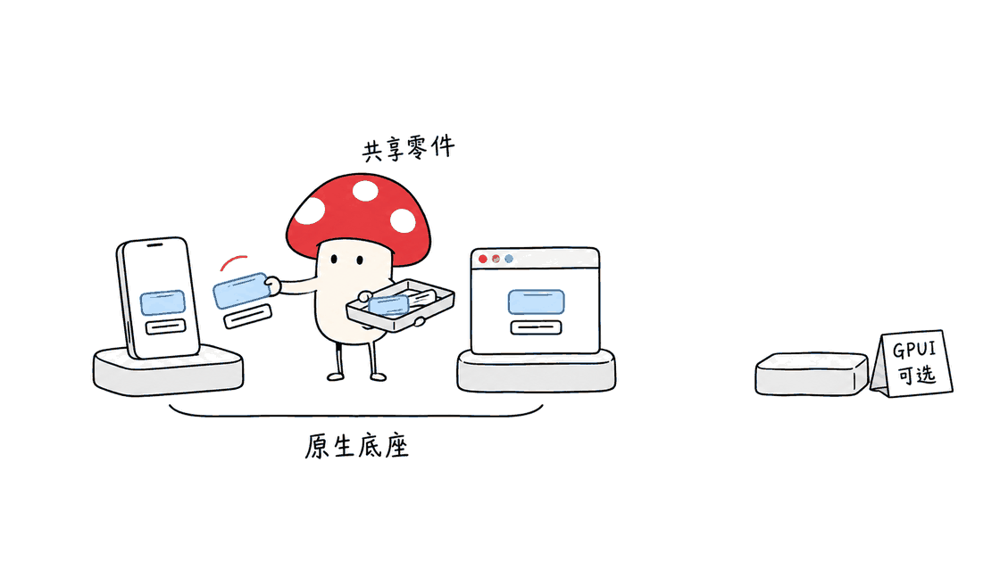

Native Shell（NSH）让同一套组件、状态和业务逻辑跑在多个平台，再由不同后端呈现界面。它值得原生应用团队做小范围试点：既能独立打包，也能给已有 App 嵌入功能，但不能把它当成可直接替换 React Native 的兼容层。

仓库找到了：`longbridge/nsh`，由长桥开源，仓库许可证文件为 Apache-2.0。本文核对的最新正式版是 2026 年 10 月 26 日发布的 v0.3.0；主分支另固定在 `ba9bf5c17b04a6ec020691fbc608ce944bf2f9b5`。下文明确区分源码与文档描述、发布包实际运行结果。核验时 GitHub API 显示 862 星，数字只代表当时的项目关注度。

源码：https://github.com/longbridge/nsh

官网与可运行示例：https://nsh.dev

## NSH 是把 GPUI 搬到手机上了吗？

不是。NSH 借鉴了 GPUI 的类型、几何与 API 思路，也借鉴 GPUI Kit 的组件分层；但 GPUI 只是 NSH 的一个后端。移动端并不是依靠 GPUI 统一画出所有控件。

| 平台 | 官方后端与运行要求 |
| --- | --- |
| iOS | UIKit、CoreText；iOS 15+ |
| Android | Android views、StaticLayout；Android 9 / API 28+ |
| macOS | AppKit、Core Animation、CoreText；macOS 14+ |
| Windows | Win32、Direct2D、DirectWrite；Windows 10 1809+ |
| Linux | GTK 4、Pango；GTK 4.14+ |
| GPUI 应用 | 通过独立 GPUI 后端嵌入；Linux 需要 Vulkan 等对应环境 |
| Web | 浏览器 HTML、CSS 后端 |

因此，“跨平台”指的是共享组件模型与逻辑，平台仍有自己的渲染、输入和交互实现。README 对平台能力的列举不是本文逐个平台验收的结果。输入法、无障碍、滚动、系统集成等细节，应在计划发布的平台单独检查。



## 看起来像 React Native，为什么又不一样？

TSX、`View`、`Text` 的写法容易让人想到 React Native。真正的区别在下面：NSH 使用 Solid 风格的细粒度响应式和 signals，而非 React 的组件更新模型；TSX 是描述格式，不代表依赖 React，也不承诺兼容 React Native API 或第三方组件。

主分支 README 支持三种路线：纯 Rust、TSX、Rust 与 TSX 混合。原生端 TSX 业务代码运行在 QuickJS 中，响应式图、布局、组件和动画等基础设施由 Rust 实现，布局使用 Taffy。Web 后端则使用浏览器自身的 JavaScript 引擎，不能把所有平台都概括成 QuickJS。

一个最小模块可以这样写：

```tsx
import { mount, signal, Text, View } from "nsh";

function App() {
  const count = signal(0);
  return (
    <View class="flex-1 items-center justify-center gap-4">
      <Text>{count()}</Text>
      <View onPress={() => count.update((n) => n + 1)}>
        <Text>Tap</Text>
      </View>
    </View>
  );
}

mount(App);
```

`nsh/base` 提供按钮、选择器、导航等行为和可访问结构，应用负责视觉设计。原生基础不意味着每个控件都长得和系统默认按钮一样；统一品牌样式与平台文本输入并不冲突。React Native 的兼容别名不是这个项目的目标，迁移时要按功能重做适配评估。

## 动态模块对已有 App 有什么用？

NSH 的一个重要入口是嵌入：iOS 放入 `NshAppView`，Android 使用 `NshView`，桌面或 GPUI 使用相应 `AppView`。宿主保留原有导航、业务服务和原生组件，再加载一块 TSX 界面。

这适合尝试内部审批页、运营表单、可替换工具面板等边界明确的功能。它也给 AI 生成 UI 提供了一个工程出口：模型写 TSX，开发流程检查 API 与行为，再构建和签名，宿主验证后执行。这里“AI 友好”意味着接口、声明和测试工具适合生成代码，不意味着框架会自动理解业务需求或保证生成结果正确。

签名与沙箱负责不同问题。签名包用来确认发布者、文件完整性及版本等信息；宿主能力配置决定模块能访问什么。签名不证明模块逻辑安全或业务正确，包的下载服务与更新时机也需要应用自己设计。


权限默认值尤其值得细读。核验源码中，嵌入式运行有宿主设定的堆、调用时长与节点等限制；独立应用的默认资源策略不同，不能把“256 MB 堆上限、2 秒调用预算”写成所有模式的统一保证。没有声明 capabilities 时，部分网络等能力保留宽松默认；进程、文件系统和宿主函数则需要显式声明。对外来模块应主动设置最小权限，并检查宿主暴露的函数，而不是只看到“沙箱”两个字就放心。

官方实现说明：https://github.com/longbridge/nsh/blob/ba9bf5c17b04a6ec020691fbc608ce944bf2f9b5/docs/dev/sandbox.md

## 在 Mac 上实际跑通了什么？

Mycelium Protocol 使用官方 v0.3.0 Apple Silicon 发布包，在 M4、16 GB 内存、macOS 26.6.2 上运行。压缩包 SHA-256 与 GitHub API 资产摘要及官方 `.sha256` 文件一致；没有执行全局安装，也没有修改现有工具链配置。

发布包打印 `nsh 0.3.0 (76fa8a7)`，对应 v0.3.0 解引用后的提交 `76fa8a7fed47ea51aea01fa85bb40960be15d984`。用它生成临时 TSX 项目，完成构建；生成的测试确认初值为 0，连续点击两次 `Tap` 后为 2。这个测试分别在无窗口引擎和 macOS AppKit 原生窗口中通过，各 1 项测试。

此外，Web 静态站点打包命令成功产出文件。它证明发布包能完成该构建路径，不代表已验收浏览器内交互，更不能推导 iOS、Android、GPUI 的性能与正确性。本文没有测跨平台帧率、内存对比、App Store 上架或动态模块安全边界。

在安装好 `nsh` 后，可以先走这条最小验证路线：

```bash
nsh --version
nsh init hello-nsh --template ts
nsh build hello-nsh
nsh test hello-nsh --trace
nsh test hello-nsh --target macos
nsh package hello-nsh --target web --out ./hello-web
```

正式安装与各平台工具要求：https://nsh.dev/docs/installation

Mac 上的预编译发布包面向 Apple Silicon；官方当前不提供 Intel Mac 的预编译包，Intel 用户需要另行评估源码构建。开发 macOS 应用需要 Xcode Command Line Tools，iOS 模拟器和设备开发需要 Xcode 与对应运行环境；Android 需要 Android SDK、JDK，以及模拟器或设备。TSX 路线的预构建工具链不要求用户另装 Node.js，写自有 Rust 组件则需要 Rust 工具链。类型检查工具首次获取还可能需要联网。

本次主机的 16 GB 内存只是实测环境，不是官方最低配置。不同目标的首次依赖准备、构建和模拟器开销差异很大，不能因为计数器通过，就承诺所有 Mac 都能流畅构建完整移动应用。


## 团队值得现在采用 NSH 吗？

适合先试的团队，是已经有原生宿主、愿意写 Rust，或需要动态交付少量界面的团队。建议挑一个可独立回退的功能，先验证中文输入、键盘与焦点、滚动、暗色模式、无障碍和现有业务 API，再扩大范围。

如果项目已依赖大量 React Native 组件，不应仅因为 TSX 相似就迁移。要核算原生集成、组件重写、测试覆盖与长期维护，而不是只比较一个 Hello World。NSH 的工程价值，在于把共享组件和各平台基础设施分工说清楚，并提供生成、测试、打包和签名工具；早期采用仍需要团队承担验证工作。

相关案例：同样基于 Rust / GPUI 生态的会话浏览器 Wake，展示了另一种应用边界：https://blog.mushroom.cv/blog/wake-gpui-coding-agent-session-browser-claude-codex-macos-native/

## 常见问题

### NSH 能直接使用 React Native 组件吗？

不能据此假设。它有自己的 signals、组件与 API 设计，官方明确不以 React Native 兼容层为目标。

### iOS 和 Android 是 GPUI 自绘的吗？

不是。官方移动后端使用 UIKit 和 Android views，GPUI 是另一个可选后端。

### 签名和沙箱意味着 AI 生成界面可直接上线吗？

不意味着。仍需检查代码、权限、宿主 API、业务行为、分发与平台要求。本文的计数器测试没有验证这些完整上线条件。

资料：固定主分支 https://github.com/longbridge/nsh/tree/ba9bf5c17b04a6ec020691fbc608ce944bf2f9b5 ；正式发布 https://github.com/longbridge/nsh/releases/tag/v0.3.0 ；设计边界 https://github.com/longbridge/nsh/blob/ba9bf5c17b04a6ec020691fbc608ce944bf2f9b5/CONTRIBUTING.md

---

> © 2026 Author: Mycelium Protocol. 本文采用 [CC BY 4.0](https://creativecommons.org/licenses/by/4.0/deed.zh) 授权——欢迎转载和引用，须注明作者姓名及原文链接，不得去除署名后以原创发布。

<!--EN-->

Native Shell, or NSH, shares components, state and logic across platforms while separate backends render each interface. It is worth a small pilot for teams building native applications, including embedded features, but it is not a drop-in React Native compatibility layer.

The project is Longbridge's `longbridge/nsh`, licensed under Apache-2.0 according to `LICENSE-APACHE`. This review examines the October 26, 2026 v0.3.0 release and separately pins current main at `ba9bf5c17b04a6ec020691fbc608ce944bf2f9b5`. GitHub reported 862 stars when checked, a snapshot of attention rather than evidence of production readiness.

Repository: https://github.com/longbridge/nsh

Documentation and demos: https://nsh.dev

## Does NSH bring GPUI to mobile?

Not in that sense. It draws ideas from GPUI's types, geometry and API vocabulary, and from GPUI Kit's component layering. GPUI is one backend, rather than the rendering foundation of every platform.

The documented mobile backends use UIKit and CoreText on iOS 15 or later, and Android views and StaticLayout on Android 9 / API 28 or later. Desktops use AppKit on macOS 14+, Win32 with Direct2D and DirectWrite on Windows 10 1809+, and GTK 4.14+ with Pango on Linux. A separate GPUI backend supports embedding in GPUI applications; the Web backend renders HTML and CSS.

Shared APIs do not eliminate platform validation. Text input, accessibility, scrolling and native service integration still need checking on every target the team intends to ship.


## Why does it resemble React Native without being React Native?

TSX and familiar names such as `View` and `Text` create a visual resemblance. NSH instead uses Solid-style fine-grained reactivity and signals, with its own component model. TSX is a code format, not a promise of React or React Native library compatibility.

Applications can use Rust, TSX or both. On native targets, TSX application code runs in QuickJS, while Rust implements core infrastructure including reactivity, layout, components and animation. Layout uses Taffy. The Web backend uses the browser's JavaScript engine, so QuickJS is not a universal description of all targets.

The `nsh/base` layer provides shared behavior and accessible structure; applications own their visual design. Native infrastructure does not imply every common control has a fixed system appearance. The project's contribution guide explicitly treats React Native as a reference for capabilities, not an API compatibility objective.

## What can embedded and dynamic modules add?

Existing iOS apps can embed `NshAppView`, Android apps `NshView`, and desktop or GPUI apps the appropriate `AppView`. The host retains its application services while a TSX module supplies one area of UI. Internal forms, approval screens and replaceable tool panels offer bounded pilot projects.

AI-generated UI can follow the same delivery path: generate TSX against declared APIs, check and test behavior, build and sign a package, then verify and execute it under host policy. Being AI-friendly does not mean the framework understands requirements or guarantees correct generated code.

Signatures and capabilities solve different problems. Package verification checks publisher trust, integrity and version-related conditions; host grants control access. A signed package can still contain faulty business logic, and the host must provide its own delivery and update system.


Defaults deserve attention. The inspected code gives embedded modules host-controlled resource limits, while standalone applications use a different default resource policy. Do not present a 256 MB heap limit and two-second call budget as universal guarantees. Without a capabilities declaration, several facilities including networking retain permissive defaults; process execution, filesystem access and host functions require explicit declarations. Configure minimal access for externally supplied modules and examine host APIs separately.

Implementation reference: https://github.com/longbridge/nsh/blob/ba9bf5c17b04a6ec020691fbc608ce944bf2f9b5/docs/dev/sandbox.md

## What actually ran on a Mac?

Mycelium Protocol downloaded the official v0.3.0 Apple Silicon archive and checked its SHA-256 against both the GitHub API asset digest and the published checksum file. It ran in a temporary directory on an M4 Mac with 16 GB memory and macOS 26.6.2, without global installation or existing toolchain changes.

The binary reported `nsh 0.3.0 (76fa8a7)`, matching the release tag's dereferenced source commit `76fa8a7fed47ea51aea01fa85bb40960be15d984`. It created a TSX counter and built it. The generated test checked an initial value of zero and a value of two after pressing Tap twice. That test passed once in the headless engine and once in a real macOS AppKit window.

Packaging the same project as a static Web site also succeeded. File generation is not a browser interaction test. No iOS, Android or GPUI device tests, cross-platform performance comparisons, store submission or complete dynamic-module security assessment were performed.

After installing NSH, the short command sequence in the Chinese section reproduces this counter workflow. A new package uses `--out`, rather than `--output`, to select its output directory.

Prebuilt Mac releases target Apple Silicon. Official documentation currently offers no prebuilt Intel Mac archive; Intel users need to evaluate source builds separately. macOS development needs Xcode Command Line Tools, while iOS needs Xcode and an appropriate simulator runtime or device. Android needs its SDK, a JDK and a target device or emulator. The prebuilt TSX toolchain does not require a separate Node.js installation; custom Rust components need Rust. Initial type-checker acquisition can require network access.

The test machine's 16 GB memory is an observed configuration, not an official minimum. A counter cannot establish memory requirements for full applications or mobile simulator workloads.

Installation requirements: https://nsh.dev/docs/installation


## Should a team adopt NSH now?

Teams with an existing native host, Rust expertise or a need for bounded dynamic UI delivery have useful pilot opportunities. Start with a feature that can be rolled back independently. Verify Chinese text input, keyboard focus, scrolling, dark appearance, accessibility and integration with existing services before expanding.

Teams deeply invested in React Native libraries should budget for adaptation and component work, rather than infer portability from TSX syntax. NSH's promising contribution is a clear division between shared UI behavior and platform infrastructure, supported by build, test, packaging and signing tools. Early adoption still requires application-specific verification.

Related GPUI application: https://blog.mushroom.cv/blog/wake-gpui-coding-agent-session-browser-claude-codex-macos-native/

## FAQ

### Can it directly use React Native components?

Do not assume that. NSH has its own signals, components and APIs and does not target a React Native compatibility layer.

### Are the mobile platforms rendered with GPUI?

No. Documented mobile backends use UIKit and Android views. GPUI is a separate option.

### Are signed AI-generated interfaces ready to ship automatically?

No. Code, permissions, host services, business behavior, distribution and platform requirements still require review. The counter test does not validate that complete delivery process.

Pinned main: https://github.com/longbridge/nsh/tree/ba9bf5c17b04a6ec020691fbc608ce944bf2f9b5

Tested release: https://github.com/longbridge/nsh/releases/tag/v0.3.0

Design boundaries: https://github.com/longbridge/nsh/blob/ba9bf5c17b04a6ec020691fbc608ce944bf2f9b5/CONTRIBUTING.md

---

> © 2026 Author: Mycelium Protocol. Licensed under [CC BY 4.0](https://creativecommons.org/licenses/by/4.0/) — free to share and adapt with attribution. You must credit the author and link to the original; removing attribution and republishing as original is not permitted.
