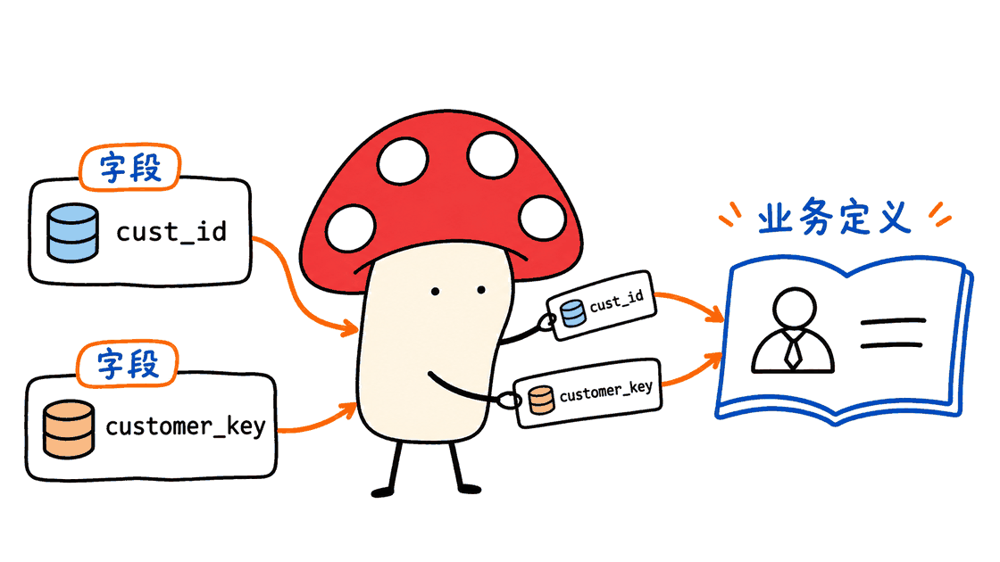
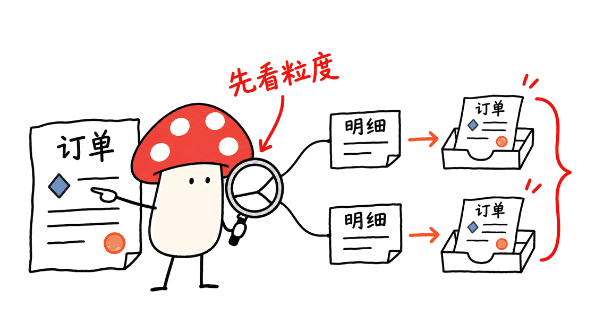

Auto Ontology 把企业里的业务概念、字段映射和计算表达式整理为 Agent 可以查询与复用的语义层。它的核心价值，是减少每个 Agent 对着原始表结构重新猜业务口径；但自动生成一套定义，并不等于这些定义已经得到业务确认。

已核实的官方开源仓库：

https://github.com/NVIDIA/auto-ontology

项目采用 Apache-2.0，当前源码版本为 1.1.0。它是软件框架，不是一个名为 Auto Ontology 的独立 Hugging Face 权重模型。本文固定分析提交 `cdaf61e1bd0cf3820d11d72b43bb460816aebbd3`，不把官方目标、已有实现与本次实际验证混为一谈。

## 一、为什么企业Agent需要的不只是更多数据库工具？

一个 Agent 能连接订单库，另一个能检索经营文档，第三个能生成 SQL，这仍不足以保证它们算出同一个“净收入”。有人按下单计算，有人按支付计算；有人扣退款，有人只排除取消订单。即使三条 SQL 都能运行，答案仍可能互相矛盾。

这类问题不是单纯提高模型参数量就能解决的。企业需要一个可复用的约定：概念是什么意思、映射到哪里、该按什么粒度计算、哪些关系允许连接，以及谁有权使用。

Auto Ontology 尝试把这些约定变成共享的上下文和可检查的结构，而不是只写在某个 Agent 的长提示词里。不同 Agent 可以围绕同一个定义查数据，也能追查某个数值来自哪段表达式和哪张表。



## 二、这里的“本体”具体是什么？

在这个项目最直接的产品路径里，本体表现为数据库之上的业务语义模型。可以从三类对象理解：

| 对象 | 回答的问题 | 示例 |
|---|---|---|
| Term，业务术语 | 大家讨论的概念是什么？ | 客户、订单、净收入 |
| ColumnAttribute，字段属性 | 业务属性对应哪些物理字段？ | 订单时间、客户标识 |
| SQLAttribute，SQL属性 | 某个业务量如何派生或计算？ | 有定义范围的金额、比率、滚动统计 |

关系、同义词、映射、权限与来源证据把这些对象连接起来。相同字段名不自动等于相同实体；客户关系也需要区分角色、方向与一对多关系。不能只凭“Ontology”这个名字，就推断它已经拥有完整的 OWL 推理机或自动掌握所有企业规则。

普通向量检索擅长找相关文字，数据目录擅长说明有哪些表列；语义层进一步试图约束“这些对象在业务上意味着什么”。它可以与已有语义模型配合，而不是要求企业先废弃全部数据治理资产。

官方建模说明：https://github.com/NVIDIA/auto-ontology/blob/main/skills/nvidia-ontology-management/references/modeling.md

## 三、自动发现到可信查询，中间有哪些步骤？

可以把工程流程理解成六段。这是结合代码与官方流程文档整理的工作模型，不是声称每段都能无需人工完成。

1. **连接与采集。** 从获准连接的数据源读取元数据，整理表、列、类型、关系及必要的分析信息。
2. **形成语义候选。** 利用现有元数据和模型辅助生成业务描述、映射和关系，建立术语与字段之间的联系。
3. **补齐业务定义。** 对真正要回答的问题，确认数据范围、粒度、单位、过滤条件、空值与时间规则，建立可复用SQL属性。
4. **编译与检索。** 把语义对象和相关上下文组织起来，为后续提问定位合适的定义；这不是对模型权重做训练。
5. **生成、验证与执行。** 将问题转成SQL，结合语义证据进行检查，再访问对应数据源。
6. **核验并维护。** 查看SQL、结果行与解释是否一致，再决定哪些修订值得复用；持久化写入和发布仍需要明确的权限与回执。

源码中，`semantic/deterministic.py` 的“确定性”首先涉及字段映射等规则；`retrieval/text_to_sql/agents/sql_parse_validation.py` 则同时包含静态解析与基于LLM的逻辑检查。不能把部分流程的确定性，扩大解释为整个自然语言问答必然正确。

例如，对日期字符串的格式进行验证，能减少“SQL合法但过滤不到数据”的错误；但识别日期格式本身，无法决定业务到底按支付日还是发货日确认某个指标。

## 四、一个能运行但会算错的SQL例子

本次用SQLite在内存中建立了一组完全合成的数据，不涉及任何企业数据库，也没有调用Auto Ontology或NIM模型。

假设有两张订单：两张原始金额都为100，第一张退款20，第二张没有退款。在这个演示定义里，按订单粒度计算的净额为：

```text
(100 - 20) + (100 - 0) = 180
```

第一张订单有两条商品明细，第二张有一条。如果先连接明细，再把订单金额相加，结果就变成：

```sql
SELECT SUM(o.gross - o.refund)
FROM orders o
JOIN items i ON i.order_id = o.id;
```

这条SQL会正常执行，却得到260：第一张订单的80被计算了两次。

也不能用 `SUM(DISTINCT gross)` 一概修复。两张不同订单的金额恰好都为100，去重后只剩100，而正确原始总额是200。需要保护的是订单身份和计算粒度，而不是让相同数值只出现一次。

这正是语义层应当帮助表达和检查的内容：指标的基础粒度、关系基数，以及哪些连接会造成重复计数。上面的180、260、200与100是本次实际运行的合成SQL结果，不是产品准确率，也不是推荐的真实会计政策。



## 五、Agent怎样使用？MCP能不能直接改业务规则？

官方MCP服务是Auto Ontology公开API的客户端，提供精选的语义读取与问数能力。例如先查术语、查看其字段或SQL属性，再提问；`ask_question` 可以返回答案、SQL和结果行。

关键边界是：**MCP在这里以只读方式暴露能力，修改语义定义走经过认证的API路径。** “能查询一个指标”和“能覆盖大家共用的指标”是不同权限。

它还保留了登录用户的身份语境，不是给所有Agent分发一把万能数据库钥匙。这适合把已有的编程Agent或业务Agent接到同一套语义定义上，而不是让每个工具自行拼接数据库访问方式。

官方文档：https://github.com/NVIDIA/auto-ontology/blob/main/docs/mcp.md

官方API说明：https://nvidia.github.io/auto-ontology/

文档个别位置仍保留“内部仓库”的历史说明；本次已经实际读取公开仓库，不能把旧文字当作当前访问状态。安装和工具列表也应以选定版本及实际服务握手为准。

## 六、“认证”和“发布”不能只看一个布尔字段

自动提议的关系可能很像正确答案，但业务身份和关联基数仍需证据。两个概念当前恰好对应同一批行，不代表以后一直等价；一条字段说明也不等于可执行的计算规则。

官方publication说明特别明确：当前认证字段并不是完整的原子审核、晋升和回滚系统。因此不能把“把某字段设为已认证”描述成已经具备企业级审批发布流水线。

面向真实业务，团队应保留定义版本、来源、责任人、适用时间、前后差异、测试案例和回滚目标。至少要用重复键、空键、一对多展开、零分母、时区和过期定义做反例，而不只是观察一个正常问题回答正确。

如果当前公开接口无法表达某类结构变更，应该记录能力缺口，不能让Agent虚构一个不存在的“自动发布”操作。官方文档本身也指出了部分术语创建与关系修改路径的限制。

发布边界：https://github.com/NVIDIA/auto-ontology/blob/main/skills/nvidia-ontology-management/references/publication.md


## 七、部署在哪里？Mac能跑吗？

当前应用包含Next.js前端、FastAPI后端与采集服务，以及Postgres和pgvector。模型推理通过配置的端点完成，默认提供聊天、embedding和rerank等不同角色；既可连接NVIDIA托管NIM，也可配置自托管服务。

这意味着它与“必须在本机运行CUDA模型”的工具不同：Mac可以运行Docker应用栈并连接远程推理端点，不要求Mac本身拥有NVIDIA显卡。但这不是“全部模型都在Mac离线运行”，也没有一个适用于所有数据库规模的固定内存或性能承诺。

初次试用可以按官方Compose路径，先使用无敏感内容的小型演示库：

```bash
git clone https://github.com/NVIDIA/auto-ontology.git
cd auto-ontology
cp .env.example .env
# 按官方说明填写认证、数据库与模型端点配置
docker compose up -d --build
```

`AUTH_SECRET` 与 `APP_URL` 是必要配置。聊天模型、embedding和rerank的端点及模型不能随意互换，采集与查询的embedding必须保持一致；更换模型后，需要评估既有向量是否仍可用。

这组命令是部署参考，本次没有启动完整容器栈、接入真实数据源或调用模型。Kubernetes、镜像与Helm部署说明见：

https://github.com/NVIDIA/auto-ontology/blob/main/DEPLOYMENT.md

### 自托管之后，哪些责任仍然在部署者？

源码文档明确提示，界面添加的数据源连接，在未启用Vault时会把完整连接对象以未加密形式存入Postgres。Vault需要完整配置才启用，部分配置会警告后回落到普通存储。因此不能因为应用部署在自己机器上，就自动宣称密钥已被安全托管。

前端网关负责认证，FastAPI后端则属于可信内部边界，不能把后端端口直接开放到公网。Compose中的端口映射也应按部署网络实际检查，而不是默认等同生产环境安全设计。

默认使用托管模型时，提交给推理端点的内容仍会离开本机。应核对元数据、样本值、问题和语义描述的实际流向，并让数据库账户本身具有最小读取权限。这些是源数据接入时的具体部署要求，不能由“开源”二字代替。

## 八、本次核验能够证明什么？

本次在独立Python 3.12环境中执行了仓库的日期格式测试，22项通过。测试覆盖多种日期与时间格式、歧义日期和混合情况，支持的是这个局部模块的行为。

另外实际运行了前述SQLite重复计数示例。两个检查都不依赖NIM，也没有使用真实企业数据。

没有执行完整端到端部署、认证集成测试、LLM语义发现或BIRD准确率评测。项目README给出的评测仓库旧地址已重定向为：

https://github.com/NVIDIA/auto-ontology-eval

它提供评测工具，不等于本文已经复现出一个成绩。接入自己的数据时，应同时记录执行结果、定义一致性、权限隔离、来源可追溯性、延迟和模型调用成本，而不是只统计SQL能否运行。

## 九、适合哪些团队，先从什么场景开始？

最适合优先尝试的，是已经拥有关系型数据、多个分析入口，却经常因指标口径和关系定义产生分歧的团队。比如订单、客户和库存分散在几个系统里，多名Agent需要复用同一套定义，而不应各自发明“活跃客户”或“可用库存”。

建议从一个数据域、少量代表性问题开始。先写清楚业务契约，再让自动发现帮助补充草案；人工核验后给Agent开放只读查询，并把反例与历史问题纳入回归。

如果数据源本身没有可靠主键、业务部门也未达成定义共识，那么部署一个自动本体框架不会凭空消除这些问题。它更像把过去分散、隐含的约定变成可以讨论、验证和复用的工程对象，而不是替组织作出所有业务判断。

## 常见问题

### Auto Ontology是否就是一个知识图谱模型？

不是独立模型。它是连接企业数据、业务语义、查询与Agent接口的软件框架，默认使用配置的推理模型。

### 自动生成的指标能直接当作企业标准吗？

不能。仍需确认来源、计算粒度、单位、过滤条件、关系基数和适用时间，并验证结果及发布状态。

### Mac上能完全离线使用吗？

Mac可运行应用栈并连接模型服务。是否离线取决于模型端点、数据源和其他依赖；默认托管NIM路径不能称作完全离线。

---

> © 2026 Author: Mycelium Protocol. 本文采用 [CC BY 4.0](https://creativecommons.org/licenses/by/4.0/deed.zh) 授权——欢迎转载和引用，须注明作者姓名及原文链接，不得去除署名后以原创发布。

<!--EN-->

Auto Ontology organizes business concepts, column mappings, and calculation expressions into a semantic layer that agents can inspect and reuse. Its value is reducing repeated guesses about enterprise meaning. Automatically producing definitions does not establish that the business has approved them.

Official repository: https://github.com/NVIDIA/auto-ontology

The Apache-2.0 project is a software framework, currently version 1.1.0, rather than a dedicated Auto Ontology model checkpoint. This review pins commit `cdaf61e1bd0cf3820d11d72b43bb460816aebbd3` and separates product goals, implementation, and independently executed checks.

## Why are database tools alone insufficient?

Several agents can access the same orders and still disagree about “net revenue”: order time versus payment time, refunds versus cancellations, or different populations. Valid SQL does not settle those choices.

A shared semantic layer records concepts, mappings, calculation grain, permitted relationships, and access boundaries. It can make an agent's interpretation inspectable rather than leaving the definition hidden in an individual prompt. The intended outcome is consistent, traceable use of approved meaning across agents.


## What does ontology mean in this implementation?

The most direct product path is a business semantic model over relational data:

| Object | Purpose | Example |
|---|---|---|
| Term | Name and explain a business concept | Customer, Order, Net Revenue |
| ColumnAttribute | Map business properties to physical columns | Order time, customer identifier |
| SQLAttribute | Represent reusable derivations or expressions | A scoped amount, ratio, or rolling measure |

Relationships, synonyms, mappings, permissions, and provenance connect these objects. Similar column names do not prove shared identity. The project name alone does not establish a full OWL reasoner or automatic knowledge of every organizational rule.

A document retriever finds related language; a catalog lists available data. A semantic layer additionally constrains what those objects mean. Auto Ontology can complement existing semantic assets rather than requiring their replacement.

Modeling guidance: https://github.com/NVIDIA/auto-ontology/blob/main/skills/nvidia-ontology-management/references/modeling.md

## How does the workflow reach a trustworthy answer?

A practical reading of the code and guidance has six stages:

1. Connect authorized sources and collect metadata.
2. Generate candidate descriptions, mappings, and relationships with rules and model assistance.
3. Confirm populations, grain, units, filters, null behavior, and time rules; define reusable SQL attributes.
4. Compile and retrieve semantic context. This is not training model weights.
5. Generate SQL, validate it against available evidence, and query the relevant source.
6. Inspect SQL, rows, and explanation before deciding which corrections should become durable shared definitions.

Some stages are deterministic; the entire answer is not therefore guaranteed correct. `semantic/deterministic.py` includes rule-based mapping, while `sql_parse_validation.py` combines static parsing with model-based logical checks. Validating a stored date format can avoid an empty-result error, but it cannot decide whether a business metric should use payment or shipping time.

## A valid query can still give the wrong number

An independently executed SQLite demonstration uses only synthetic data. Two orders each have gross 100; the first has refund 20 and the second 0. Under this illustrative definition, order-grain net amount is 180.

The first order has two detail rows and the second one. This runnable query returns 260 because the first order is counted twice:

```sql
SELECT SUM(o.gross - o.refund)
FROM orders o
JOIN items i ON i.order_id = o.id;
```

`SUM(DISTINCT gross)` is not a universal repair: it returns 100 when two distinct orders legitimately have the same 100 amount, although their gross total is 200. Preserve business identity and calculation grain rather than deduplicating equal values.

These are actual synthetic SQL results, not Auto Ontology accuracy measurements or accounting-policy recommendations. The example explains why relationship multiplicity belongs in a reusable metric contract.


## What can an agent do through MCP?

The MCP server is a client of the authenticated Auto Ontology API. Its curated surface lets agents discover terms, inspect mapped columns and SQL attributes, and ask questions. `ask_question` returns an answer with the SQL and rows.

MCP is read-oriented here. Semantic mutations use approved authenticated API paths rather than a universal MCP write tool. A caller also retains its user identity and permissions; querying a shared metric is not permission to redefine it.

MCP documentation: https://github.com/NVIDIA/auto-ontology/blob/main/docs/mcp.md

API reference: https://nvidia.github.io/auto-ontology/

Some documentation retains historical wording about an internal repository. The public repository was retrieved for this review; old wording should not be treated as current access status. Pin a revision and trust the deployed tool handshake for the actual available surface.

## Why is certification not the same as publication?

Metadata and sampled rows are evidence, not proof of concept identity or relationship cardinality. Two concepts that happen to select equal current rows need not remain equivalent. Descriptive prose is not automatically an executable business procedure.

The official publication guidance explicitly says current certification fields are not an atomic review, promotion, and rollback system. Setting a certification field should not be sold as a complete governed release lifecycle.

Keep versions, sources, owners, effective dates, before/after differences, regression cases, and rollback targets. Include duplicate and null keys, fanout, zero denominators, time zones, and superseded definitions. If the public API cannot express a structural mutation, record the capability gap rather than inventing an operation.

Publication limits: https://github.com/NVIDIA/auto-ontology/blob/main/skills/nvidia-ontology-management/references/publication.md


## Where does it run, including on a Mac?

The application combines Next.js, FastAPI services, Postgres, and pgvector. Inference is configured separately, with distinct chat, embedding, and reranking roles. Defaults use NVIDIA NIM endpoints; hosted and self-hosted inference are possible configurations.

A Mac can run the Docker application stack while connecting to an appropriate remote endpoint. This differs from requiring a local CUDA inference engine. It does not mean the models are running offline on the Mac, and no universal memory or performance minimum for every data scale was established here.

For an initial demonstration, follow the official Compose instructions with non-sensitive test data:

```bash
git clone https://github.com/NVIDIA/auto-ontology.git
cd auto-ontology
cp .env.example .env
# Configure authentication, database connections, and model endpoints.
docker compose up -d --build
```

`AUTH_SECRET` and `APP_URL` are required. Model roles are not interchangeable, and ingestion/query embeddings must stay compatible. Changing an embedding model requires evaluating the existing vector data.

These are deployment references, not commands used to launch a full stack for this review. Kubernetes, image, and Helm details: https://github.com/NVIDIA/auto-ontology/blob/main/DEPLOYMENT.md

### What does self-hosting leave to the operator?

Without configured Vault support, UI-added datasource connection objects, including credentials, are stored unencrypted in Postgres. A partial Vault configuration warns and falls back; “self-hosted” is not evidence of secure secret storage.

The authenticated frontend gateway and trusted internal FastAPI service have different boundaries. Do not expose the backend port as an independently authenticated public API. Review Compose port mappings against the intended network layout.

Hosted inference receives whatever content is submitted to its endpoints. Review the actual flow of metadata, samples, questions, and semantic descriptions, and use least-privilege datasource accounts. Open licensing does not replace those deployment decisions.

## What was actually verified?

The upstream date-format module's 22 tests passed in an isolated Python 3.12 environment, covering formats, ambiguity, and mixed cases. This verifies that module, not end-to-end enterprise answer quality.

The synthetic SQLite join-grain demonstration also ran. Neither check used a NIM endpoint or real enterprise data. Full deployment, authentication integration, model-driven ontology discovery, and BIRD evaluation were not run.

The README's older evaluation URL now redirects to https://github.com/NVIDIA/auto-ontology-eval . A published evaluation toolkit is not an independently reproduced score. Evaluate result correctness, definition consistency, access isolation, provenance, latency, and model cost alongside SQL execution success.

## Who should start with it?

Teams with relational data, several agent or analytics entry points, and recurring disagreements over definitions have a concrete use case. Orders, customer records, and inventory spread across systems are useful starting domains.

Begin with one domain and representative questions. Agree on a business contract, use discovery to propose a draft, validate it, and expose read-only access to agents. Preserve counterexamples and historical questions as regression cases.

An ontology framework cannot manufacture missing primary keys or organizational agreement. Its useful contribution is turning implicit conventions into objects people can inspect, test, govern, and reuse.

## FAQ

### Is Auto Ontology a knowledge-graph model checkpoint?

No. It is a framework connecting enterprise data, business semantics, queries, and agent interfaces, using configured inference models.

### Can generated metrics immediately become enterprise standards?

No. Sources, grain, units, filters, multiplicity, and effective time still require validation, as does durable publication state.

### Can a Mac use it fully offline?

A Mac can run application components and connect to model services. Offline operation depends on all configured endpoints and dependencies; the default hosted NIM path is not fully offline.

---

> © 2026 Author: Mycelium Protocol. Licensed under [CC BY 4.0](https://creativecommons.org/licenses/by/4.0/) — free to share and adapt with attribution. You must credit the author and link to the original; removing attribution and republishing as original is not permitted.
