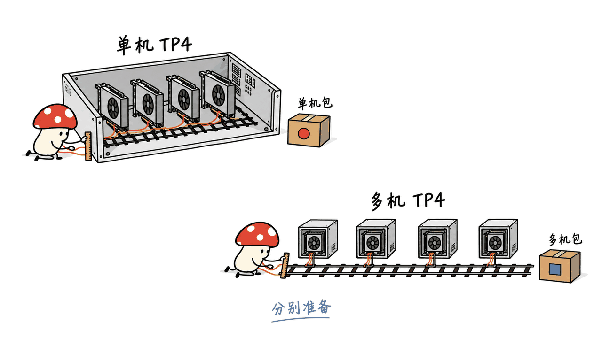

Flare 是把大模型提前准备成运行包，再由 Rust 提供本地推理服务的开源项目。它重点面向长对话、编程 Agent 和重复工具调用；采用前先确认硬件、模型配方与运行包容量是否匹配。

NVIDIA/flare-local-inference 采用 Apache-2.0。官方 README 明确标注“研究原型”，面向 SM120/SM121 等选定硬件工作流，尤其提到 DGX Spark。代码许可不自动替代模型权重的许可。本文核对日期为2026-10-23；检查官方文档、源码和真实命令行解析，未在 NVIDIA GPU 上运行推理，也不提供实测速度结论。

## “纯 Rust”究竟省掉了哪一段？

这里有两个阶段，依赖完全不同。

| 阶段 | 组件 | 实际工作 |
|---|---|---|
| 提前准备 | Python Ignition | 用PyTorch、Transformers、FlashInfer/b12x加载权重、调优内核、编译forward、规划内存并捕获CUDA Graph |
| 在线服务 | Rust Helios，由Flare CLI启动 | 加载运行包，完成请求处理、分词、调度、缓存管理、图重放与流式输出 |
| 跨机管理 | Flare agent与Orbit | 管理节点、分发包、放置rank并启动服务 |

因此，“零Python开销”的合理含义是在线服务不回调Python。GPU计算仍依赖CUDA和配套内核，并非用Rust重写全部模型算子。准备阶段依然要装Python环境和CUDA工具链，也可能花较长时间。

预捕获把一部分成本移到服务启动之前。代价是并发数、图形状和执行容量提前确定；超出准备范围的请求会被拒绝，不能指望服务临时重新编译来兜底。它减少的是在线不确定性，不能单凭架构推出“所有任务更快”。


## 为什么长对话和 Agent 值得单独优化？

Agent常常追加一段工具结果，再把已有对话送回来。对这种负载，重要的不仅是每秒生成多少token，还包括前缀复用、缓存恢复和分支状态是否正确。

Flare把KV、循环状态和其他模型历史作为完整状态管理。以混合架构为例，只保留KV而丢掉循环状态，即使表面上“命中了前缀”，继续生成也可能不正确。它的复用、分支和推测解码回滚都要覆盖这些状态。

官方准备指南说明，各配方默认使用FP8 E4M3 KV存储，但仍有模型相关例外：Qwen的selector keys保留BF16，GLM与DeepSeek保留包含scale及部分BF16字段的压缩latent格式；循环状态和中间累加器也不统一变成FP8。将其简化成“所有缓存都压到FP8”会误导内存估算。

内存提前规划也不等于KV池大小永久固定。运行时加载图与权重后，还会根据实际可用内存确定缓存预算。`--kv-cache-limit`支持`context`、`concurrency`、`memory`三种限制方式，默认`memory`使用可用预算。Spark上CPU与GPU共享DRAM，系统、编译进程和常驻表都会争夺同一份容量，swap不能当作GPU容量。


我们的判断是：Flare真正值得观察的，是能否在反复追加工具结果时，同时保住完整状态和稳定的响应时间。脱离上下文长度、缓存冷热、并发数与推测接受率的单个tok/s数字，很难回答这个问题。

## DeepSeek V4.1 Flash怎样部署？

官方配方别名`deepseek-v4.1-flash`指向`deepseek-ai/DeepSeek-V4.1-Flash-1017`，文档列出TP4、推理、DSML工具调用，以及在checkpoint包含视觉编码器时的图像能力。下面是单机四卡的起步示例，四张卡必须适配配方并有足够空间；不是任意四张显卡都能直接跑。

### 1. 准备依赖与构建CLI

在匹配的Linux/CUDA机器上执行，先用`nvidia-smi`确认设备与占用。

```bash
git clone https://github.com/NVIDIA/flare-local-inference.git
cd flare-local-inference
# Ubuntu系统依赖，另需Rust、uv及CUDA toolkit（含nvcc、CUPTI）
sudo apt-get install build-essential cmake ninja-build pkg-config \
  protobuf-compiler libssl-dev python3-dev liburing-dev
uv sync --locked --extra prepare --extra test
cargo build --release --manifest-path flare/Cargo.toml
```

`uv`会按锁定依赖安装准备环境；磁盘需要容纳原始权重、编译缓存与导出资源。不要在容量未盘点时直接启动大模型下载。

### 2. 导出并启动

```bash
.venv/bin/python -m ignition export deepseek-v4.1-flash \
  --gpus 0,1,2,3 --max-concurrency 4 --mtp-draft-tokens 5 \
  --output dsv41.safetensors

./flare/target/release/flare run dsv41.safetensors \
  --gpus 0,1,2,3 --host 127.0.0.1 --port 8001
```

这里修正了常见转述中的`./flare run`：源码构建后的可执行文件位于`flare/target/release/flare`，`flare/`本身是目录。若另行安装了CLI，才可直接执行`flare run`。

当前格式的主`.safetensors`文件主要承载签名元数据和布局，权重、图与内核位于相邻、按内容哈希命名的payload blobs。复制运行包必须保留这些伴随文件，不能只拷贝主文件。

包还涉及发布者公钥与首次信任确认。默认开发导出会生成本机开发签名身份；迁移到另一台机器需要按CLI与签名文档配置对应profile并确认信任。以上两条服务命令展示核心流程，不代表跨机复制后可以忽略签名步骤。输出文件必须是新路径，导出不会覆盖旧包。

准备时的`--max-concurrency 4`是显式选择，当前DeepSeek配方默认并发为32、draft深度为5；运行时可以降低并发，不能据此突破导出的容量。更改图或准备容量，应重新导出。

### 3. 接通API，并验证一次工具闭环

```bash
curl --fail http://127.0.0.1:8001/health
curl --fail http://127.0.0.1:8001/v1/models
```

启用鉴权时须加配置的Bearer key。等`/health`成功后，再从`/v1/models`读取真实模型ID，填入客户端；进程启动不等于HTTP已经就绪。

| 客户端协议 | 路径 | 接入时要注意 |
|---|---|---|
| OpenAI Chat | `/v1/chat/completions` | SDK的base URL通常包含`/v1` |
| OpenAI Responses | `/v1/responses` | 当前无状态，请求需带完整历史；不支持`previous_response_id` |
| Anthropic Messages | `/v1/messages` | SDK base URL用服务器根地址 |

客户端负责执行工具，再把结果交回模型。接口支持不等于兼容所有托管服务功能：官方列出不支持托管搜索、computer execution、文件服务、音频和远程图片下载；严格函数schema和指定名称的工具选择也会拒绝。JSON输出约束与工具参数schema应分开核验。

## 四台DGX Spark与单机四卡有什么不同？

官方明确要求多机包与多机执行方式匹配。单机TP4包不能由Orbit自动变成四台Spark的包；SM120包也不能直接代替Spark GB10需要的SM121包。

四机准备时，rank0上的导出参数改为`--gpus 0 --ranks 4 --rendezvous <rank0地址>:29630`，其余三机分别运行`ignition join`，配合准备阶段的认证流程。之后通过已经安装、配对的Flare agent和四节点cluster启动，例如：

```bash
flare orbit run maxwell:/data/flare-runtime/dsv41.safetensors \
  --cluster sparks --gpus 0
```

`maxwell`与`sparks`是预先配置的节点名和集群名。完整步骤还包括兼容的服务构建、RoCEv2端口、IPv4 GID、ConnectX-7链路、磁盘与内存检查。模型collectives走RDMA，部分包分发走TCP；Flare不会替你配置网卡、路由和防火墙。

四台机器增加了可用资源，也增加了通信与运维成本。“KV池拉满”不能直接换算成任意长度上下文：仍受模型逻辑上限、准备容量、实际内存和网络表现共同限制。



## 工程上应该怎样验收？

我们在当前Apple Silicon主机成功运行了上游`ignition export --help`，并用真实CLI解析器核对四卡导出参数与四机rank参数。这只能证明命令语法与当前源码吻合，不能证明CUDA构建、模型加载或性能。

建议实际采用者保存一组可重复任务：先做短文本、再做连续多轮工具调用，随后增加长上下文、取消请求和并发。记录冷启动与热缓存首token延迟、prefill与decode、缓存命中token、峰值内存，以及工具结果返回后的恢复情况。相同模型、精度、输入长度和并发下再与现有引擎比较。

README主动说明vLLM覆盖更广的模型、硬件与生产部署模式，Flare不会取代生产推理引擎。对于已有匹配Blackwell工作站或Spark、愿意验证指定配方的团队，它是值得跟踪的研究原型；若需要广泛模型覆盖和成熟运维，现有生产方案仍有明确价值。

## 常见问题

### Mac或普通CPU可以运行这个Rust服务吗？

Rust不等于跨硬件推理。Flare的执行栈直接依赖NVIDIA CUDA与FlashInfer/b12x，应按官方支持的GPU、配方和包架构选择机器。本文在Mac上只核对CLI，未运行推理。

### 运行时没有Python，就不需要安装Python吗？

使用已经准备、兼容且可信的包时，Rust服务不需要Python准备工具；自行导出、调优或修改模型配方仍需要Ignition及其Python/CUDA依赖。

### 可以把API兼容当作Agent直接迁移成功吗？

不能。需逐项核验工具语法、历史传递、流式事件、reasoning与服务商专属功能，至少完成一次真实的读文件、调用工具、返回结果与继续生成闭环。

## 官方来源与延伸阅读

- 仓库与README：https://github.com/NVIDIA/flare-local-inference
- 模型准备：https://github.com/NVIDIA/flare-local-inference/blob/main/docs/model-preparation.md
- CLI与信任：https://github.com/NVIDIA/flare-local-inference/blob/main/docs/cli-design.md
- 多机部署：https://github.com/NVIDIA/flare-local-inference/blob/main/docs/multi-host.md
- API能力与限制：https://github.com/NVIDIA/flare-local-inference/blob/main/docs/api.md
- 本文固定源码版本：aca7888f835000b5365468533733bf9d99dbce4d
- 相关文章：Mac上的本地推理引擎Splash，https://blog.mushroom.cv/blog/specialized-inference-engines-rise-hardware-specific-llm-optimization/
- 本文原文：https://blog.mushroom.cv/blog/nvidia-flare-local-inference/

---

> © 2026 Author: Mycelium Protocol. 本文采用 [CC BY 4.0](https://creativecommons.org/licenses/by/4.0/deed.zh) 授权——欢迎转载和引用，须注明作者姓名及原文链接，不得去除署名后以原创发布。

<!--EN-->

Flare prepares models into runtime packages and serves them locally from Rust. It focuses on long conversations, coding agents and repeated tool use. Adoption depends on matching the GPU architecture, model recipe and prepared capacities.

NVIDIA/flare-local-inference is Apache-2.0 licensed and explicitly described as a research prototype. The code license does not replace model-weight licensing. This review uses official sources checked on October 23, 2026. We exercised the Python CLI, but did not build CUDA components, load model weights or measure inference performance.

## What does “pure Rust” actually mean?

Ignition uses Python, PyTorch, Transformers and FlashInfer/b12x to load weights, tune kernels, compile forwards, plan buffers and capture CUDA graphs. Helios, linked into the Flare CLI, then handles tokenization, scheduling, caches, graph replay and streaming without calling Python. GPU operators still rely on CUDA and the associated kernel stack.

Compilation and capture move ahead of serving. Prepared concurrency and shape limits become part of the serving contract; requests beyond supported capacities are rejected rather than triggering runtime compilation. This architecture alone does not prove a universal speed advantage.


## Why optimize for long conversations and agents?

An agent repeatedly appends tool results to an existing conversation. Prefix reuse must preserve the model's full continuation state, including recurrent state alongside KV pages. Partial restoration can produce incorrect continuation even when token prefixes match.

The guide specifies default FP8 E4M3 KV storage, with model-specific exceptions: BF16 selector keys, packed latent formats, scale metadata and recurrent state retain their required formats. A memory estimate must account for these differences.

The runtime sizes caches after loading model resources. `--kv-cache-limit context|concurrency|memory` controls the shared pool; `memory` is the default. On Spark, CPU and GPU allocations compete for shared DRAM. Swap does not increase GPU capacity.


Our practical question is whether repeated tool-result continuations preserve state and predictable response times. A standalone tokens-per-second number cannot answer that without prompt lengths, cache conditions, concurrency and speculative acceptance rates.

## How do you deploy DeepSeek V4.1 Flash?

The `deepseek-v4.1-flash` alias selects `deepseek-ai/DeepSeek-V4.1-Flash-1017`. The documented recipe supports TP4, reasoning, DSML tools and images when the checkpoint includes its vision encoder.

For a compatible Linux/CUDA machine, install Rust, uv, CUDA toolkit including nvcc/CUPTI and the system build dependencies, then run from the cloned repository:

```bash
uv sync --locked --extra prepare --extra test
cargo build --release --manifest-path flare/Cargo.toml
.venv/bin/python -m ignition export deepseek-v4.1-flash \
  --gpus 0,1,2,3 --max-concurrency 4 --mtp-draft-tokens 5 \
  --output dsv41.safetensors
./flare/target/release/flare run dsv41.safetensors \
  --gpus 0,1,2,3 --host 127.0.0.1 --port 8001
```

These are single-host, four-GPU examples. Check device compatibility, free memory and disk first. The source build produces `flare/target/release/flare`; `./flare` is a directory unless a different installation layout has been arranged.

Keep the primary file and its sibling content-addressed payload blobs together. The primary carries signed metadata and layout; weights, graphs and kernels live in the payloads. Publisher profiles and first-use trust must also be configured, particularly after moving a development export to another host. Export refuses to overwrite an existing destination.

The example explicitly selects concurrency four. Current DeepSeek defaults use concurrency 32 and five draft tokens. Serving can lower concurrency but cannot exceed exported capacities; changed graphs or preparation capacities require another export.

## What does API compatibility cover?

Wait for `/health`, query `/v1/models`, then use the returned model ID. Include the configured bearer key when authentication is enabled.

| Protocol | Endpoint | Important boundary |
|---|---|---|
| OpenAI Chat | `/v1/chat/completions` | SDK base URL normally includes `/v1` |
| OpenAI Responses | `/v1/responses` | Stateless; no `previous_response_id` |
| Anthropic Messages | `/v1/messages` | SDK base URL uses the server root |

Clients execute tools and return their results. Hosted search, computer execution, file services, audio and remote image fetching are unsupported. Named tool selection and strict function schemas are rejected. Constrained final-answer JSON and tool-argument validation are separate contracts.

## How does four-Spark deployment differ?

A single-host TP4 package is not a four-host package. Spark's GB10 requires an SM121 package; an SM120 export does not satisfy that architecture check.

Prepare with `--gpus 0 --ranks 4 --rendezvous <rank-zero>:29630` on rank zero and run `ignition join` on the other hosts, following the documented authentication flow. With paired agents and a configured four-node cluster, launch:

```bash
flare orbit run maxwell:/data/flare-runtime/dsv41.safetensors \
  --cluster sparks --gpus 0
```

The names and path are examples requiring prior configuration. Compatible builds, RoCEv2, IPv4 GIDs, ConnectX-7 connectivity, free memory and disk remain prerequisites. Collectives use RDMA while some package transfers use TCP. Flare does not configure networking or firewalls.

More nodes increase resources and communication costs. Usable context still depends on model limits, prepared capacities, memory and network behavior.


## What did we verify, and what should you measure?

On our Apple Silicon host, the upstream `ignition export --help` command succeeded. We also exercised its real parser for single-host TP4 and multi-host rank arguments. This verifies CLI syntax only, not CUDA compilation, model correctness or speed.

A meaningful hardware evaluation should include short text, repeated tool-result continuations, long contexts, cancellation and concurrency. Record cold/warm time to first token, prefill/decode throughput, reused tokens, peak memory and continuation correctness under identical models and precision.

The README explicitly positions vLLM as the broader production engine. Flare is an interesting prototype for supported local workloads, with narrower hardware and recipe coverage.

## FAQ

### Can Rust make this run on a Mac or CPU?

No. The execution stack depends on NVIDIA CUDA and FlashInfer/b12x. Our Mac checks exercised preparation CLI behavior only.

### Can serving omit Python?

Yes, when using a compatible trusted runtime package. Exporting or modifying a recipe still requires the Python/CUDA preparation environment.

### Is changing the endpoint enough to migrate an agent?

Not as an acceptance test. Verify tool syntax, history, streaming events, reasoning and provider-specific features, then complete a real tool-use loop.

## Sources

Repository: https://github.com/NVIDIA/flare-local-inference

Preparation: https://github.com/NVIDIA/flare-local-inference/blob/main/docs/model-preparation.md

CLI: https://github.com/NVIDIA/flare-local-inference/blob/main/docs/cli-design.md

Multi-host: https://github.com/NVIDIA/flare-local-inference/blob/main/docs/multi-host.md

API: https://github.com/NVIDIA/flare-local-inference/blob/main/docs/api.md

Reviewed commit: aca7888f835000b5365468533733bf9d99dbce4d

Related Apple Silicon inference review: https://blog.mushroom.cv/blog/specialized-inference-engines-rise-hardware-specific-llm-optimization/

Canonical article: https://blog.mushroom.cv/blog/nvidia-flare-local-inference/

---

> © 2026 Author: Mycelium Protocol. Licensed under [CC BY 4.0](https://creativecommons.org/licenses/by/4.0/) — free to share and adapt with attribution. You must credit the author and link to the original; removing attribution and republishing as original is not permitted.
