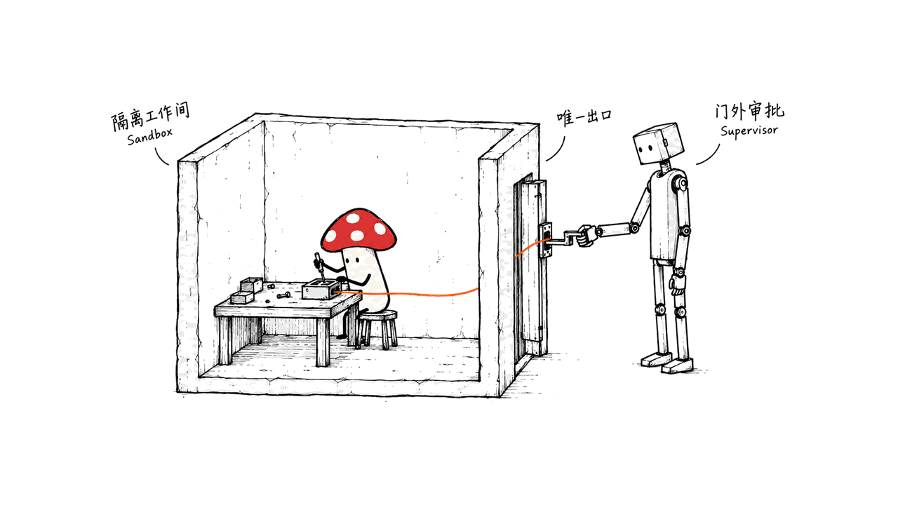
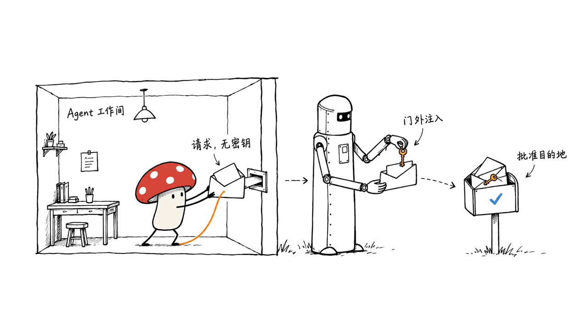

OpenShell 是约束 AI Agent 文件、网络和凭证访问的开源运行环境。你声明它能碰什么，由运行时执行限制；模型仍负责完成任务，权限边界交给模型之外的系统。

官方仓库是 NVIDIA/OpenShell，采用 Apache-2.0。核对日期为2026-10-24，GitHub最新稳定版为10月20日发布的v0.1.5。本文阅读官方文档与源码，并在Apple Silicon上运行了3组独立策略验证；没有启动完整沙箱或执行Agent任务。

## OpenShell解决的是哪一层问题？

编程Agent需要读项目、执行命令、安装依赖、访问模型API。把这些能力全部关掉，任务做不了；全部开放，则意味着一次错误的工具调用可能访问工作目录之外的文件或服务。

OpenShell将这些访问变成可管理的策略。它是Agent的执行与治理基础设施，不是新的语言模型，也不是替你规划任务的多Agent框架。CLI和核心组件主要使用Rust，另有Python、TypeScript、Go和Rust SDK；找Hugging Face权重并不是使用它的入口。

从工程角度看，它把“这个请求是否应该允许”从Agent自己的判断中拿出来。真正值得评估的不是对话表现，而是访问是否始终经过同一套控制，以及拒绝之后能否有据可查地补充权限。

## Gateway、Sandbox与Supervisor怎样分工？

| 组件 | 所在位置与职责 |
|---|---|
| Gateway | 控制面，管理身份、沙箱生命周期、策略、provider和交互会话 |
| Sandbox | 与不可信Agent同处工作负载边界内，启动进程、识别调用程序，转发受中介的网络操作 |
| Supervisor | 位于可信侧，检查策略、解析DNS、连接上游，并按规则注入provider凭证 |
| Compute driver | 创建工作负载及Supervisor，建立受保护通道和外层网络限制 |
| Policy prover | 检查策略在已建模的权限范围内是否满足指定属性 |

当前Linux后端用Landlock限制文件访问，用seccomp user notification等机制中介网络操作。外层网络边界只允许工作负载连接Supervisor，避免Agent直接绕过中介出网。

Docker和Podman通过独立Supervisor容器及认证Unix socket连接，工作负载关闭普通网络；Kubernetes使用独立pod、双向TLS和NetworkPolicy；VM后端使用vsock，guest没有网络设备。相同策略目标依赖各后端正确建立边界，不能仅凭容器“启动成功”判断隔离有效。



## 凭证隔离是否意味着数据不会离开本机？

通过provider管理的真实密钥保存在可信侧。Agent向获准服务发出请求，由Supervisor按规则附加凭证；不必把真实API key直接交给Agent进程。

但允许访问的服务仍可能接收到业务数据。若你授权云端模型接口，发送给它的提示词仍会出网；若把含密钥的文件挂进可读目录，provider机制也不能替你消除那份额外暴露。

因此要分别检查三个问题：Agent能读哪些内容、哪些程序能访问哪些目的地、凭证允许用于哪些端点。仅批准域名，也不等于批准该域名下的任意业务操作；需要结合协议和具体规则确定控制粒度。

有效策略还可能包含provider附加的网络规则。官方文档特别提醒：创建时没传`--policy`，不代表一定使用最严格的默认策略，镜像、全局配置或已有设置都可能提供策略。验收应查看最终有效策略。



## “形式化验证”究竟验证了什么？

OpenShell使用SMT求解器检查策略属性，文档区分两种问题：

- **边界检查**：候选策略是否允许了超出boundary策略的访问？独立`openshell-prover`可执行。
- **提案风险检查**：Agent提出的新网络规则，是否增加了需特别审查的能力，例如新的凭证目的地？在策略提案流程中运行。

两者不能互相替代。边界写得过宽，即使候选策略完全没越界，也可能不适合某个任务。通过策略检查，更不代表已经证明Linux内核、隔离后端、Agent或整个应用没有漏洞。

### 我们在Mac上实际运行了什么？

从官方v0.1.5 Release下载Apple Silicon版独立prover，用官方SHA-256清单核对下载文件后，执行以下三组检查。全程不需要Gateway、Docker或模型API。

| 检查 | 输入关系 | 真实输出 | 退出码 |
|---|---|---|---:|
| 收窄权限 | boundary只读`/usr`、`/etc`；candidate只读`/usr` | `within_boundary` | 0 |
| 增加写入 | 在candidate中额外允许写`/tmp` | `exceeds_boundary`，反例为写`/tmp` | 1 |
| 路径关系不确定 | boundary可写`/tmp`；candidate可写`/tmp/cache` | `unsupported`，原因`unresolved_filesystem_path` | 3 |

第一组输入可以直接复现：

```yaml
# boundary.yaml
version: 1
filesystem_policy:
  read_only: [/usr, /etc]
```

```yaml
# candidate.yaml
version: 1
filesystem_policy:
  read_only: [/usr]
```

```bash
openshell-prover check candidate.yaml --boundary boundary.yaml --output json
```

第三组尤其有价值：人看字符串会觉得子目录肯定更窄，但实际沙箱中的符号链接可能改变路径含义。验证器缺少路径解析信息时返回无法支持，而不是猜测通过。

当前边界检查覆盖filesystem、L4网络、REST、process和Landlock等已建模部分；GraphQL、MCP等未覆盖形态会报告不支持。自动化流程只能把`within_boundary`当作通过，同时检查`coverage`；错误、超时、越界与无法判定都应停止自动放行。

这3个结果证明的是独立验证器在上述输入上的行为，不能外推为我们已测试沙箱逃逸防护、真实密钥隔离或Agent端到端正确性。


## 普通开发者怎样开始？

### 第一步：选支持的平台和后端

官方支持Linux与macOS Apple Silicon，Windows WSL 2标为实验性。按后端准备Docker、Podman或主机虚拟化；Docker最低版本为28.0，Podman为5.x，Kubernetes为1.29。沙箱管理本身不要求NVIDIA显卡。

Linux隔离需要Landlock ABI 3或更新，以及相应seccomp能力；版本号达标不代表模块和运行配置一定可用，启动前还有主动探测。Mac上的Linux控制运行于相应Linux虚拟环境中。

安装入口和最小示例为：

```bash
curl -LsSf https://raw.githubusercontent.com/NVIDIA/OpenShell/main/install.sh \
  -o openshell-install.sh
# 先检查安装脚本；生产环境按官方文档固定稳定版本与制品
sh openshell-install.sh
openshell sandbox create --name demo
```

官方安装器会设置CLI和本地Gateway。默认工作负载是最小Ubuntu，不包含Agent CLI；创建出`demo`并不等于已有可用的编程助手。

### 第二步：配置provider并准备Agent镜像

官方first-agent教程以OpenCode和OpenRouter为例。先在宿主环境准备自己的`OPENROUTER_API_KEY`，再导入profile并创建provider：

```bash
openshell profile import \
  --url https://raw.githubusercontent.com/NVIDIA/OpenShell/main/providers/openrouter.yaml
openshell provider create --name openrouter --type openrouter --from-existing
```

这一步需要你自己的凭证，本文没有代为创建。启动教程中的Agent示例：

```bash
openshell sandbox create --name my-agent \
  --from ghcr.io/anomalyco/opencode:latest \
  --provider openrouter \
  -- opencode -m openrouter/nvidia/nemotron-3.5-lightning:free
```

模型名来自当前官方教程，并非永久可用承诺。生产环境应固定验证过的镜像和版本，按实际服务供应情况选模型。使用其他Agent时，将其与工具安装在满足要求的OCI镜像中，再配置对应访问策略。

### 第三步：按被拒绝的实际需求补权限

```bash
openshell rule get my-agent --status pending
openshell rule approve my-agent --chunk-id <chunk-id>
openshell rule reject my-agent --chunk-id <chunk-id> \
  --reason "Not needed for this task."
```

先理解调用程序、目的地和操作，再批准所需规则。网络策略可以在运行时更新；文件和进程层的静态控制通常需要重建沙箱。自动审批应受组织边界约束，不能把Agent提出权限申请本身当作合理授权。

## 团队落地应怎样验收？

我们的建议是先选择一个有限任务，例如在副本仓库里读文件、修改代码和运行测试，再做三类实际验证：任务所需访问能够完成；无关目录和目的地被拒绝；provider凭证没有以真实值暴露给工作负载。随后测试取消任务、断开Supervisor连接、重新审批与恢复执行，并保存策略和日志。

Kubernetes环境要确认CNI真正执行NetworkPolicy。只部署Helm chart却没有生效的网络边界，会遗漏架构中的关键前提。

此外，OpenShell默认收集有限的匿名运行类别与计数遥测。官方提供在Gateway侧设置`OPENSHELL_TELEMETRY_ENABLED=false`，Helm设置`server.telemetryEnabled=false`。这只影响OpenShell遥测，不会关闭你配置的云模型或第三方工具自己的数据处理。

## 常见问题

### 它能替代Docker吗？

不能这样理解。Docker、Podman、Kubernetes或VM提供计算与隔离后端；OpenShell在其上管理Agent、策略、访问中介和凭证。

### 开源是否意味着模型调用免费？

不是。代码Apache-2.0开源，使用哪些模型和外部服务、是否计费，由对应供应方及部署方式决定。它没有附带一套免费的模型权重。

### 策略验证通过就可以直接投产吗？

不可以。还要验证运行时执行、后端网络边界、凭证暴露面和实际任务。本文完成的是三组离线策略检查，尚未做完整沙箱验收。

## 官方入口与复核范围

- 仓库：https://github.com/NVIDIA/OpenShell
- 稳定版本：https://github.com/NVIDIA/OpenShell/releases/tag/v0.1.5
- 架构：https://docs.nvidia.com/openshell/latest/about/architecture
- 平台要求：https://docs.nvidia.com/openshell/latest/about/support-matrix
- 第一个Agent：https://docs.nvidia.com/openshell/latest/about/run-your-first-agent
- 策略验证：https://docs.nvidia.com/openshell/latest/how-it-works/policies/prover
- 遥测：https://docs.nvidia.com/openshell/latest/observability/telemetry
- 源码核对版本：f571c8e99c185804c39e837a2b70692e957de327
- 延伸阅读：NVIDIA Flare的本地推理运行时，https://blog.mushroom.cv/blog/nvidia-flare-local-inference/
- 本文原文：https://blog.mushroom.cv/blog/nvidia-openshell-agent-runtime/

---

> © 2026 Author: Mycelium Protocol. 本文采用 [CC BY 4.0](https://creativecommons.org/licenses/by/4.0/deed.zh) 授权——欢迎转载和引用，须注明作者姓名及原文链接，不得去除署名后以原创发布。

<!--EN-->

OpenShell is an open-source runtime that restricts an AI agent's file, network and credential access. The model performs the task while an external system enforces what it may touch.

NVIDIA/OpenShell is Apache-2.0 licensed. Checked on October 24, 2026, its latest stable release is v0.1.5, published October 20. We reviewed official sources and ran three standalone policy checks on Apple Silicon. We did not launch a full sandbox or agent workload.

## What problem does OpenShell solve?

Agents need to read files, execute tools, install dependencies and call services. OpenShell turns access into enforceable policy rather than relying on an agent's own judgment. It is execution and governance infrastructure, not a language model or task-planning framework. The project provides a Rust-based CLI and components plus Python, TypeScript, Go and Rust SDKs; model weights are not the entry point.

## How are responsibilities separated?

| Component | Responsibility |
|---|---|
| Gateway | Identity, sandbox lifecycle, policy, providers and sessions |
| Sandbox | Owns workload processes, identifies callers and forwards mediated operations |
| Supervisor | Trusted policy checks, upstream connections, DNS and credential injection |
| Compute driver | Builds the protected connection and workload isolation boundary |
| Policy prover | Checks specified properties within its modeled policy language |

The Linux backend uses Landlock for filesystem confinement and seccomp-mediated operations. An outer network fence permits only the protected Supervisor channel.

Docker and Podman use a separate Supervisor container and authenticated Unix socket, with ordinary workload networking disabled. Kubernetes uses separate pods, mutual TLS and NetworkPolicy. VM backends use vsock without a guest network device. Correct backend enforcement remains an operational prerequisite.


## Does credential isolation keep all data local?

Provider-managed real credentials remain on the trusted side and are added only to approved upstream requests. This reduces the need to expose keys to the workload.

Approved services can still receive business data. Cloud inference still transmits prompts; readable files containing separate secrets remain another exposure path. Review readable content, allowed calling programs and destinations, and credential endpoint bindings independently.

Inspect the effective policy, including provider-contributed rules. Omitting `--policy` does not guarantee the restrictive fallback applies: image policies and other configuration may supply a policy.


## What does formal verification prove?

The SMT-based prover distinguishes boundary checks from network-proposal risk checks. A candidate can remain within an overly broad boundary and still be unsuitable for a task. Neither check proves the entire runtime or application secure.

We downloaded the official v0.1.5 Apple Silicon prover, verified its archive against the published SHA-256 list, and ran these cases without a gateway, Docker or model API:

| Case | Actual result | Exit |
|---|---|---:|
| Candidate reads `/usr`; boundary reads `/usr` and `/etc` | `within_boundary` | 0 |
| Candidate additionally writes `/tmp` | `exceeds_boundary`, with filesystem-write counterexample | 1 |
| Candidate writes `/tmp/cache`; boundary writes `/tmp` | `unsupported`, `unresolved_filesystem_path` | 3 |

The third result avoids assuming textual path nesting proves access containment. Symlinks inside a sandbox can change path resolution. Missing information must remain an explicit inability to verify.

A minimal reproducible pair is:

```yaml
# boundary.yaml
version: 1
filesystem_policy:
  read_only: [/usr, /etc]
```

```yaml
# candidate.yaml
version: 1
filesystem_policy:
  read_only: [/usr]
```

```bash
openshell-prover check candidate.yaml --boundary boundary.yaml --output json
```

Current boundary checking covers modeled filesystem, L4 network, REST, process and Landlock semantics. Unsupported shapes such as GraphQL or MCP rules are reported explicitly. Automation should accept only `within_boundary` and verify coverage. Errors, violations, timeouts and unsupported cases must not count as approval.

These tests establish standalone checker behavior for the listed inputs. They do not test escape resistance, runtime enforcement or credential isolation.


## How do you start?

Official host support includes Linux and Apple Silicon macOS, with Windows WSL 2 experimental. Prepare the chosen compute backend: Docker 28.0+, Podman 5.x, Kubernetes 1.29+, or supported virtualization. Managing sandboxes does not require an NVIDIA GPU.

Linux workloads require Landlock ABI 3+ and the documented seccomp facilities. Active launch probes matter: a suitable kernel version alone is insufficient. Linux controls on a Mac run within the relevant Linux virtual environment.

The official installer sets up the CLI and local gateway. Download and inspect it before running; follow the installation documentation to pin stable artifacts in production:

```bash
curl -LsSf https://raw.githubusercontent.com/NVIDIA/OpenShell/main/install.sh \
  -o openshell-install.sh
sh openshell-install.sh
openshell sandbox create --name demo
```

The default image is minimal Ubuntu without an agent CLI. The first-agent tutorial configures OpenCode and OpenRouter. Set your own `OPENROUTER_API_KEY` in the host environment, then run:

```bash
openshell profile import \
  --url https://raw.githubusercontent.com/NVIDIA/OpenShell/main/providers/openrouter.yaml
openshell provider create --name openrouter --type openrouter --from-existing
openshell sandbox create --name my-agent \
  --from ghcr.io/anomalyco/opencode:latest \
  --provider openrouter \
  -- opencode -m openrouter/nvidia/nemotron-3.5-lightning:free
```

The model identifier comes from the current official tutorial and is not an availability guarantee. Pin tested images and choose an available service. We did not create credentials or execute this agent workflow.

Review newly required access with `openshell rule get my-agent --status pending`, then approve a specific proposal using `openshell rule approve my-agent --chunk-id <chunk-id>`. Network rules can update dynamically; static filesystem and process controls generally require sandbox recreation.

## What should teams validate?

Start with a limited task in a repository copy. Verify needed operations succeed, unrelated paths and destinations are denied, and real provider keys do not reach workload-visible material. Test cancellation, interrupted Supervisor connectivity, approvals and recovery. Keep policy and log evidence. Kubernetes requires a CNI that actually enforces NetworkPolicy.

OpenShell collects limited anonymous operational telemetry by default. Set `OPENSHELL_TELEMETRY_ENABLED=false` on the gateway, or `server.telemetryEnabled=false` for Helm. This does not change third-party agents, tools or model-provider data practices.

## FAQ

### Does OpenShell replace Docker?

It uses compute backends such as Docker, Podman, Kubernetes or VMs and adds agent-specific policy, mediation and credential management.

### Does open source mean free model usage?

No. The code license does not determine model-service pricing or provide free model weights.

### Is a passing prover result enough for production?

No. Runtime enforcement, network fencing, credential handling and the actual task still require validation. Our completed checks cover the standalone prover only.

## Sources

Repository: https://github.com/NVIDIA/OpenShell

Release: https://github.com/NVIDIA/OpenShell/releases/tag/v0.1.5

Architecture: https://docs.nvidia.com/openshell/latest/about/architecture

Support: https://docs.nvidia.com/openshell/latest/about/support-matrix

First agent: https://docs.nvidia.com/openshell/latest/about/run-your-first-agent

Prover: https://docs.nvidia.com/openshell/latest/how-it-works/policies/prover

Telemetry: https://docs.nvidia.com/openshell/latest/observability/telemetry

Reviewed source commit: f571c8e99c185804c39e837a2b70692e957de327

Related local inference review: https://blog.mushroom.cv/blog/nvidia-flare-local-inference/

Canonical article: https://blog.mushroom.cv/blog/nvidia-openshell-agent-runtime/

---

> © 2026 Author: Mycelium Protocol. Licensed under [CC BY 4.0](https://creativecommons.org/licenses/by/4.0/) — free to share and adapt with attribution. You must credit the author and link to the original; removing attribution and republishing as original is not permitted.
