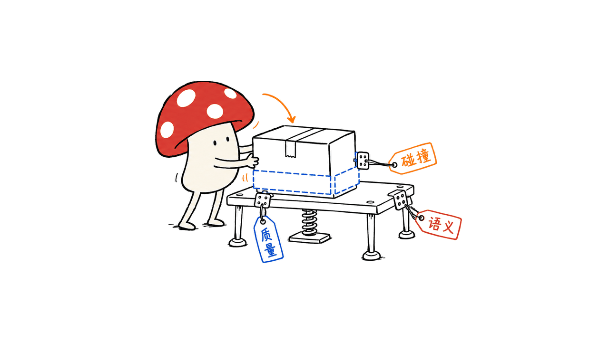

NVIDIA SimReady Assets的价值，是把3D外观、物理属性、语义和依赖组织成可供仿真系统读取的资产包。我们核实了2575个资产目录，并实际检查一个完整纸箱包；这些文件能减少接入工作，但不会自动让机器人理解真实世界。

截至2026年10月26日，Hugging Face官方页面显示总量约472GB。本文固定数据集版本`524747d9b5e1f21b5b18b56041788c01d745f1a1`，区分官方展示、我们的文件核查，以及尚未运行的物理仿真。

本文原文：https://blog.mushroom.cv/blog/nvidia-simready-assets-audit/

资产库：https://huggingface.co/datasets/nvidia/simready-assets

浏览入口：https://huggingface.co/spaces/nvidia/simready-central

官方指南：https://docs.omniverse.nvidia.com/simready/latest/simready-central.html

规范与验证工具：https://github.com/NVIDIA/simready-foundation

封面采用NVIDIA官方纸箱与V6发动机资产缩略图，做了拼接和裁剪；两个样本的许可证文件均为CC BY 4.0。图像是官方渲染，不是我们运行仿真生成的结果。来源为上述资产库的`box_corrugated_brown_b08`与`engineAssembly_v6_engine_a01`包。

## 2575个、472GB，到底在数什么？

我们通过Hugging Face目录API翻页三次，得到2576个根条目：2575个资产目录，加一个`.gitattributes`文件。目录数与官方页面标出的资产数量一致；目录内部还包含USD层、贴图、材质、缩略图和元数据，不能按文件数量重新解释成2575件物体。

472GB是网页展示的库总量，不是我们重新汇总全库字节后的结果。本次读取的通用元数据响应在100000个文件条目处截断，不能把这个不完整列表的大小相加，再声称独立核实了全库容量。

页面上的自动Dataset Viewer还显示222行纹理相关记录。这是自动预览口径，不是资产目录计数。查3D库时，应以包清单和根USD入口为准，不要把图片预览表当成完整目录。

## 为什么普通3D模型还不够？

一个漂亮纸箱，可以用于展示，却未必知道应怎样碰撞、重多大、表面有多滑。在机器人抓取、仓储搬运或合成数据场景里，仿真系统还需要能解释这些属性的结构和单位。

SimReady在OpenUSD之上定义面向用途的组织与验证要求。几何描述形状，材质影响外观及相关属性，碰撞体决定接触边界，质量、重心与惯量参与动力学，语义帮助系统识别对象。不同用途需要不同Profile与Feature，不能假设每个包都具备所有行业属性。



这些属性也不全是“使用说明”。`cardboard box`这样的类别标签，不自动包含抓取点、承重上限或最优动作策略；一个物体能被命名，也不等于机器人已经知道如何安全使用它。

官方规范说明：https://docs.omniverse.nvidia.com/simready/latest/overview/simready-spec.html

## 我们下载了什么，实际验证到了哪一步？

本次在M4 Mac、Python 3.12独立环境中安装`usd-core 26.11`，只下载一个完整包：`box_corrugated_brown_b08`。包内43个文件合计58,282,879字节，约58.3MB；没有下载472GB全库。

| 核查项目 | 实际结果 | 不能据此推导什么 |
| --- | --- | --- |
| 包内文件 | 43个，大小均与固定版本元数据匹配 | 不代表其他2574个包都已检查 |
| BOM内容清单 | 37项文件的大小和SHA-256全部匹配 | 证明文件一致性，不证明物理参数正确 |
| USD场景读取 | 根USD成功打开，找到15个依赖层与8个依赖资产 | 不等于完成材质渲染或碰撞仿真 |
| USD依赖扫描 | 没有未解析的依赖路径 | 不代表所有运行时都支持其中每一种材质和Schema |
| 运行时变体 | 分别选择PhysX、MuJoCo、Newton的Enabled分支并读取字段 | 未启动这三个物理引擎，也未验证动力学等价性 |

三个变体在切换检查时分别启用，其余先设为Disabled。原始默认选择是PhysX Enabled，另外两个Disabled；不能把多份可选数据层同时存在，误读为三个引擎正在一起运行。

这是一项文件与场景组成核查。我们没有运行Isaac Sim、机器人训练、物理接触求解或sim-to-real实验，也没有测GPU速度与显存。

## 纸箱里真的有质量、重心和摩擦参数吗？

有。OpenUSD组合后的样本中，可以读到以下已写入字段：

| 字段 | 该样本读取值 | 解释 |
| --- | --- | --- |
| `metersPerUnit` | 1 | 长度单位比例为米 |
| 质量单位比例 | 1kg/单位 | 由OpenUSD接口读取的场景单位解释 |
| `physics:mass` | 约0.656346 | 在该场景单位下约0.656kg；这是资产记录值 |
| `physics:centerOfMass` | 约(0.01898, 0.02201, 0.14574) | 目标prim局部空间的重心坐标 |
| `physics:diagonalInertia` | 约(0.03740, 0.03508, 0.02658) | 写入的对角惯量属性 |
| 纸板物理材质 | 密度689，静/动摩擦系数0.7，恢复系数0.4 | 这是该材质节点的参数，不是所有纸箱的通用常数 |
| 对象语义 | `cardboard box`、`Q1395006` | 类别及Wikidata标识 |

这些值说明“物理信息在文件里”不是空泛口号。但我们没有拿现实纸箱称重或测摩擦，无法证明记录值来自实测。重心还需要结合prim坐标、变换和几何理解，不能直接当成世界坐标中的抓取位置。

OpenUSD MassAPI定义：https://openusd.org/dev/api/class_usd_physics_mass_a_p_i.html

物理行为说明：https://docs.omniverse.nvidia.com/simready/latest/sim-needs/phys-and-behaviors.html

## 为什么不能只下载一个USD文件？

这个样本的根USD只有约23KB，却引用了独立几何、实例、材质、物理层和贴图。只把根文件拖进另一个目录，可能留下空几何、丢失材质或找不到依赖的场景。

包里的`com.nvidia.simready.packaging.json`记录包身份、许可和内容哈希，`.metadata`提供BOM、根USD列表与验收记录。它们一起让“下载了哪些内容、从哪个版本来”成为可核查的事实。


先挑少量目标物体、保留整个包的相对路径，会比一开始下载全库更适合验证自己的仿真管线。对大批场景，随后再评估贴图缓存、实例复用和存储策略。

## “校验通过”是否意味着仿真一定可信？

这里至少有三层：包文件是否完整，资产结构与字段是否满足特定规范，以及它在目标运行时和任务里是否表现合理。它们需要不同证据。

本次包级`Package@1.0.0`记录中的两项Feature都标为通过。根USD的嵌入式验证历史则包含不同日期和规范版本：2026年8月18日的18项均为通过，10月9日的25项中15项通过、10项`passed:false`，后者同时标记`blocking_failure:false`。

这不能简化成“资产坏了”，也不能忽略日期、Profile、可选要求与阻断策略，直接说“所有验证全绿”。我们读取的是资产携带的记录，没有重新执行SimReady Foundation全套规则；包级成功与目标任务的物理正确性仍是两回事。


官方FAQ同样区分规范要求、资产验证和运行时测试。对于抓取与碰撞任务，落地时应检查物体尺度、碰撞近似、质量与惯量，以及在指定求解器设置下的稳定性。

官方FAQ：https://docs.omniverse.nvidia.com/simready/latest/simready-faq.html

## “开源免费”应该怎样理解？

本次纸箱包的manifest声明`CC-BY-4.0`，许可证文本也一致；用于封面的发动机样本许可证同样是CC BY 4.0。按该许可，允许分享与改编，包括商业用途，同时需要适当署名、提供许可链接并说明修改。

这是已检查样本的结论，不是替整座库或SimReady Central中所有合作方资产作统一许可保证。官方指南要求查看具体资产的许可证、Profile与验收证据。SimReady Foundation的代码许可，也不能替代资产包自身的许可。

封面署名：NVIDIA SimReady Assets，CC BY 4.0；纸箱与V6发动机官方缩略图，经拼接、裁剪。未表示NVIDIA认可本文。

许可说明：https://creativecommons.org/licenses/by/4.0/

## 普通团队怎样开始使用？

建议从一个真实任务反推资产：例如机械臂搬一个箱子，而非先问“472GB怎么下完”。然后固定资产版本、下载完整包、检查文件依赖与物理字段，最后进入目标仿真器做小场景验收。

以下是按需获取该包的命令示例；使用独立Python环境并确认依赖支持自己的平台：

```bash
python3 -m venv .venv
source .venv/bin/activate
python -m pip install huggingface_hub usd-core==26.11
hf download nvidia/simready-assets \
  --repo-type dataset \
  --revision 524747d9b5e1f21b5b18b56041788c01d745f1a1 \
  --include "box_corrugated_brown_b08/**" \
  --local-dir ./simready-sample
```

用OpenUSD先检查能否读取根场景，注意这里仍不是物理仿真：

```python
from pxr import Usd, UsdGeom

path = "simready-sample/box_corrugated_brown_b08/simready_usd/sm_box_corrugated_brown_b08_01.usd"
stage = Usd.Stage.Open(path)
assert stage is not None
print(stage.GetDefaultPrim().GetPath())
print(UsdGeom.GetStageMetersPerUnit(stage))
```

再按运行时指南选取对应变体，加入地面、重力与任务所需机器人，测试静置、接触、搬运和失败场景。训练还需要控制器、观测、动作、奖励与评估；资产提供环境内容和参数，学习能力来自完整训练系统。

对Mac用户，本次证明的是本地CPU上的USD读取与审计，不是完整Isaac Sim在Mac上运行。选择实际仿真平台时，另查其系统与GPU要求。

几何生成、资产规范化与物理校准是不同阶段。视觉感知模型的能力边界可参看：https://blog.mushroom.cv/blog/wevisone-vl-unified-vision/

## 常见问题

### 2575个资产是否都检查过？

只枚举了全库根目录；深入检查的是一个完整纸箱包。不能把样本结果外推成全库质量保证。

### 有质量、重心字段，就说明它们都是真实测量值吗？

不能。字段存在与参数来源、精度是不同问题；本次没有现实物体测量或物理校准实验。

### 必须先下载472GB才能开始吗？

不必。可以固定版本并只下载目标包，保留该包的模型、材质、贴图和元数据依赖。

### 这些资产能直接让AI学会抓取吗？

它们帮助构建训练与测试环境，但控制、任务设计、奖励及现实验证仍需另外完成。

---

> © 2026 Author: Mycelium Protocol. 本文采用 [CC BY 4.0](https://creativecommons.org/licenses/by/4.0/deed.zh) 授权——欢迎转载和引用，须注明作者姓名及原文链接，不得去除署名后以原创发布。

<!--EN-->

NVIDIA SimReady Assets packages 3D appearance, physical properties, semantics and dependencies for simulation tools. We verified 2,575 asset directories and inspected one complete cardboard-box package. This can reduce integration work; it does not automatically teach a robot real-world interaction.

On October 26, 2026, the official Hugging Face page displayed approximately 472GB. Our review pins dataset revision `524747d9b5e1f21b5b18b56041788c01d745f1a1` and separates upstream descriptions, our file-level checks and unperformed physics experiments.

Original article: https://blog.mushroom.cv/blog/nvidia-simready-assets-audit/

Assets: https://huggingface.co/datasets/nvidia/simready-assets

Browser: https://huggingface.co/spaces/nvidia/simready-central

Guide: https://docs.omniverse.nvidia.com/simready/latest/simready-central.html

Specifications and validation tools: https://github.com/NVIDIA/simready-foundation

Cover credit: NVIDIA SimReady Assets, CC BY 4.0. Official thumbnails from `box_corrugated_brown_b08` and `engineAssembly_v6_engine_a01`, stitched and cropped. Both sample license files were checked. These are upstream renders, not our simulation output, and imply no NVIDIA endorsement.

## What do 2,575 assets and 472GB count?

Three paginated root-directory requests returned 2,576 entries: 2,575 directories and `.gitattributes`. This matches the official asset count. Each directory contains multiple USD layers, images and metadata files; package count is not file count.

The 472GB figure is the website's displayed total, not our independent full byte sum. A general metadata response stopped at 100,000 file entries, so summing that incomplete response would misrepresent the library size. The auto-generated viewer's 222 texture-related rows are also not the asset inventory.

## Why is appearance alone insufficient?

A convincing box mesh may still lack usable collision boundaries, mass, friction or semantics. Simulation needs interpretable structure and units, not only a rendered surface.

SimReady defines use-case profiles over OpenUSD. Geometry describes shape; collision geometry governs contact; mass, center of mass and inertia affect dynamics; semantics identifies objects. Required properties vary by profile and domain.


A `cardboard box` label is not a grasp-point annotation, load limit or manipulation policy. Naming an object does not specify every safe action involving it.

Specification: https://docs.omniverse.nvidia.com/simready/latest/overview/simready-spec.html

## What did we actually check?

On an M4 Mac, using an isolated Python 3.12 environment and `usd-core 26.11`, we downloaded only the complete `box_corrugated_brown_b08` package: 43 files totaling 58,282,879 bytes, about 58.3MB.

| Check | Observed result | Limit |
| --- | --- | --- |
| Downloaded files | All 43 sizes match pinned metadata | Not an audit of all remaining assets |
| Bill of materials | All 37 listed sizes and SHA-256 hashes match | Integrity, not physical accuracy |
| USD composition | Root opens with 15 dependency layers and eight dependency assets | Not rendering or contact simulation |
| Dependency discovery | No unresolved dependency paths | Not universal shader/schema support |
| Runtime variants | Read fields with PhysX, MuJoCo and Newton enabled individually | None of those engines was executed |

For variant checks, other runtime options were first disabled. The package's original default is PhysX Enabled, with MuJoCo and Newton Disabled. Having all three variants in a package does not mean they execute together.

This was a file, dependency and scene-composition audit. We did not run Isaac Sim, robot training, physics contact solving, sim-to-real transfer or GPU performance tests.

## Are mass and friction really present?

Yes, in the inspected sample. Stage length scale is one meter per unit and its mass-unit interpretation is one kilogram per unit. Authored fields include mass approximately 0.656346, local center of mass approximately `(0.01898, 0.02201, 0.14574)`, and diagonal inertia approximately `(0.03740, 0.03508, 0.02658)`.

A cardboard physics-material node specifies density 689, static/dynamic friction 0.7 and restitution 0.4. Root semantics include `cardboard box` and Wikidata `Q1395006`. These are sample attribute values, not universal constants for cardboard objects.

We did not weigh a real box or measure friction. File values are not evidence of their measurement provenance. Local center-of-mass coordinates also require the prim transform before interpretation in a world-space task.

MassAPI: https://openusd.org/dev/api/class_usd_physics_mass_a_p_i.html

Physics guide: https://docs.omniverse.nvidia.com/simready/latest/sim-needs/phys-and-behaviors.html

## Why keep the complete package?

The root USD is only about 23KB, referencing geometry, instances, materials, physics layers and textures. Copying it alone can leave missing content. The package manifest, BOM, root-USD list and conformance records make provenance and completeness checkable.


Start with a few task-relevant objects while preserving relative paths. Evaluate texture caches, instancing and storage later when scaling scenes.

## Does passing validation guarantee realistic simulation?

Package integrity, profile conformance and runtime behavior are different questions. The inspected `Package@1.0.0` receipt marks both listed features as passing.

Embedded USD validation history includes multiple dates and versions. Its August 18 entry reports 18 passing features. Its October 9 entry contains 25 features: 15 passing, ten with `passed:false`, all ten also marked `blocking_failure:false`.

These records do not establish that the asset is broken, nor justify saying every check is green. Dates, profiles, optional requirements and blocking policies matter. We read the supplied evidence; we did not rerun all Foundation validators.


For a manipulation task, validate scale, collision approximation, mass/inertia and stability under the selected solver settings. The official FAQ distinguishes specifications, asset validation and runtime testing too.

FAQ: https://docs.omniverse.nvidia.com/simready/latest/simready-faq.html

## What does the license permit?

The box manifest and license identify CC BY 4.0. The engine thumbnail's package license is also CC BY 4.0. That license permits sharing and adaptation, including commercial uses, with appropriate attribution, a license link and an indication of changes.

These are checked-sample conclusions, not a blanket license statement for every partner dataset in SimReady Central. Review each package's license, profile and evidence. Foundation code licensing does not replace content licensing.

License: https://creativecommons.org/licenses/by/4.0/

## How should a small team begin?

Pick a bounded task, pin the asset revision, download a complete package, inspect composition and physical fields, then test it in the intended simulator. The Chinese section provides a scoped `hf download` example rather than a full-library download.

A minimal OpenUSD readback is:

```python
from pxr import Usd, UsdGeom

path = "simready-sample/box_corrugated_brown_b08/simready_usd/sm_box_corrugated_brown_b08_01.usd"
stage = Usd.Stage.Open(path)
assert stage is not None
print(stage.GetDefaultPrim().GetPath())
print(UsdGeom.GetStageMetersPerUnit(stage))
```

Afterward select the correct runtime variant and add the ground, gravity, robot and task setup. Test rest, contact, transport and failure cases. Learning additionally needs observations, actions, a controller, rewards and evaluation; assets supply environment content and parameters.

Our Mac experiment establishes CPU-side USD reading and auditing, not a complete Mac Isaac Sim deployment. Check the chosen simulator's platform and GPU requirements separately.

Related visual-perception analysis: https://blog.mushroom.cv/blog/wevisone-vl-unified-vision/

## Frequently asked questions

### Did we deeply audit all 2,575 assets?

No. We enumerated root directories and examined one complete box package. Its results do not establish library-wide quality.

### Do physical fields prove real-world measurements?

No. Presence, provenance and accuracy are separate. No real-object measurement or physics calibration was performed here.

### Must I download 472GB first?

No. Download selected complete packages at a pinned revision, preserving their dependencies and metadata.

### Will these assets directly teach an agent to grasp?

They help construct environments. Control, task design, rewards and real-world validation still need implementation.

---

> © 2026 Author: Mycelium Protocol. Licensed under [CC BY 4.0](https://creativecommons.org/licenses/by/4.0/) — free to share and adapt with attribution. You must credit the author and link to the original; removing attribution and republishing as original is not permitted.
