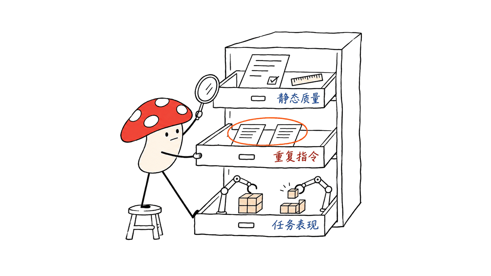
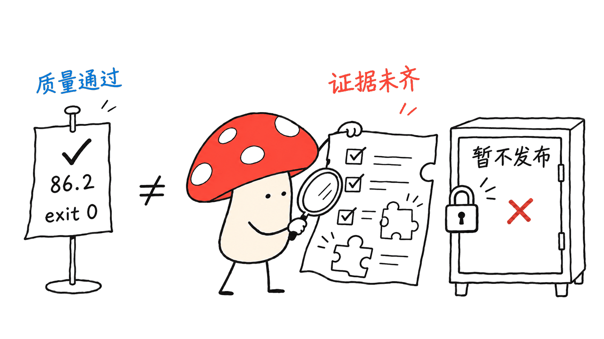

SkillEvaluator 是检查 AI 智能体技能质量、并评估技能是否改善任务结果的开源工具。它最值得借鉴的地方，是把“文档写得规范”“检查证据齐全”和“Agent 实际变强”分开处理。

项目来自 NVIDIA，采用 Apache-2.0 许可。本文核对源码提交 `3a70bb2d00272364098ef04d4c41bbdc375e42f1`，包版本 0.9.0。我们实际运行了无需模型 API 的质量检查；没有运行完整安全扫描、语义去重或有无 Skill 的真实 Agent 对照实验。

仓库：https://github.com/NVIDIA/SkillEvaluator
官方文档：https://docs.nvidia.com/skills/skillevaluator/

## 三层评估分别回答什么问题？

Skill 通常由 `SKILL.md`、脚本和参考文件组成。文件能被加载，不意味着它能在正确场景触发，更不意味着执行结果更好。

| 层级 | 主要问题 | 依赖与边界 |
| --- | --- | --- |
| Tier 1 验证 | 结构、质量、安全与宿主兼容性是否满足要求 | 部分检查可直接运行，完整静态覆盖还依赖外部扫描器 |
| Tier 2 去重 | 指令内部及技能之间是否重复或重叠 | 需要嵌入和聊天模型；跨技能比较还需提供目录 |
| Tier 3 实际执行 | 使用该技能后，Agent 的任务表现是否改善 | 需要模型、受支持的 Agent 和 Harbor 运行环境 |

不要把三层当成同一种分数的逐级升级。重复指令可能增加上下文负担，但语义相似不自动等于该删；静态评分高，也不能保证真实任务中会触发正确工具。报告必须保留每层的范围和未完成项。



## 我们本地跑出了什么？

Mycelium Protocol 在独立的 Python 3.13 环境中，从上述提交安装基础依赖，使用仓库自带 `text-analyzer` 示例运行：

```bash
skillevaluator quality-check   ./src/skillevaluator/tier3/reference_skills/text-analyzer   -r cli -r json -o reports/first-quality
```

实际结果是 86.2/100、等级 B，默认质量门槛为 70，进程退出码为 0。JSON 同时保留六条 warning，并显示 `publication_status: incomplete`、`eligible: false`。原因包括其他必需静态检查没有运行、缺少 Tier 2 证据、Tier 3 没有完整执行证据。

然后对同一份技能、同一套规则只把 `--min-score` 改成 95。分数仍是 86.2，但退出码变成 1，报告标为未通过门槛。这不是工具故障，而是门槛生效。

这个小实验验证的是 CLI 评分、门禁与证据状态的行为。86.2 不是“Agent 正确率 86.2%”，也不是安全评级。报告里静态规则的“correctness”维度，同样不能替代真实任务准确率。完整命令、日志与 JSON 随文章源材料保存。

## NVIDIA 生态中的三个组件，职责不同

NVIDIA Build API 提供托管模型访问，可以用于模型评分、嵌入及受支持的 Agent 路径。符合条件的开发者可按访问条款进行免费原型验证，不代表无限量免费生产调用。模型评估会把相应技能内容交给选定模型，运行前需要明确数据边界。

SkillSpector 是专门的技能安全扫描组件。当前 README 说明 Tier 1 在缺少工具时会获取固定并验证过的 SkillSpector、Gitleaks 版本，Semgrep 可选。因此 `--no-llm` 不等于“只有本地几个正则、完全不需要依赖或网络”。扫描器运行不了，应保留 incomplete，而不是当作零风险通过。

Harbor 则承担 Agent 试验的运行环境与执行组织。它不是另一个文档打分器。Tier 3 通过 Harbor 在选定环境中运行 Codex、Claude Code 或 OpenCode 等受支持 Agent，再保留轨迹和评估结果。模型、Agent、评估器和环境都可能影响实验，不能把接入 Harbor 等同于已经证明技能有效。

项目的基础安装没有把 Harbor 和全部模型客户端强制装进来；对应能力通过 `llm`、`tier2`、`tier3` 等 extras 扩展。仅想检查结构与质量时，不必先搭全套模型和沙箱。

## 怎样证明 Skill 帮到了 Agent？

Tier 3 的核心设计，是对同一组任务分别运行 with-skill 与 without-skill 两组。Skill Lift 表达两组得分的有符号差异，而不是“文档评分”或天然的相对百分比。跑实验时应同时记录评分单位、每组原始结果和比较范围。

工程上至少固定任务版本、模型与参数、Agent 版本、环境镜像、工具权限和尝试次数。还要记录技能是否真正激活。官方文档说明：如果所有正例的 with-skill 试验均被确认没有激活技能，结果应是 `INCONCLUSIVE: skill never activated`，不能据此给出技能质量的正负结论。

自动生成评估数据可以降低启动成本，但不能替代案例设计。当前 autopilot 可能复用已有资料，或生成一个技能相关的起步案例，覆盖面有限。应增加需要触发的正例、不应触发的负例、输入缺失、相邻技能干扰及失败恢复案例，再人工复核验收规则。

如果技能和测例都来自同一套提示词，容易形成自证循环。最好留出未参与生成的任务，结合确定性验收与人工抽查。多次尝试、完整样本与配对结果，比挑一条成功轨迹更能说明问题；小幅 lift 也可能来自评审噪声或服务波动。


## CLI、CI 和作为 Skill 加载，怎样接？

基础安装可以从 CLI 开始：

```bash
pip install skillevaluator
skillevaluator quality-check ./my-skill -r json -o reports/quality
```

正式维护建议锁定验收过的版本或提交。上面是质量检查入口；要跑完整 Tier 1，可用 `validate ./my-skill --tiers 1`，但需要准备对应扫描器。缺少模型 Key 不妨碍部分静态检查，不代表所有检查已齐备。

GitHub 可使用 `skillevaluator ci init` 创建设置 PR；GitLab 提供 CI 模板。把它作为 Agent 可加载的技能，也有官方 `npx skills add NVIDIA/SkillEvaluator` 入口。这些都是项目的接入方式，我们没有在当前博客仓库执行 CI 初始化或安装该技能。

CI 的门禁政策尤其需要分清两条路径：手工运行 `validate` 时，Tier 1 阻断，Tier 2 默认在启用时阻断，可用 `--no-block-on-dedup` 调整；Tier 3 需显式 `--block-on-agent-eval` 才阻断。官方自动化 all-tier CI 模板则仅由 Tier 1 阻断，Tier 2、Tier 3 保持 advisory，旧的 `tier3-required` 参数已弃用并忽略。

因此绿色 CI 只证明当时的阻断条件满足，不能直接写成“三层评估全部通过”。应同时上传报告，展示失败、缺失和 advisory 状态。CLI `doctor` 检查的是运行准备情况，也不能证明模型推理或真实任务执行已经成功。

## 工程团队应该怎样采用？

先把质量和结构检查放进 PR，给每项规则保留明确的修复建议。安全检查完整后，再引入技能目录的去重；不要只凭嵌入相似度自动合并职责不同的技能。

对关键技能维护版本化任务集，按成本和风险选择何时做真实配对实验。把一次评估保存成可复核证据包：技能提交、配置、任务和环境标识、模型与 Agent 版本、尝试次数、每组结果、激活记录、轨迹以及未完成原因。不要只存一个最终总分。

技能有脚本时，执行评估本身也在运行代码，应限制凭证、写权限和外网访问。沙箱减少风险，但不能把任意技能变成可信代码。公开 README 将支持等级写为 Experimental、社区尽力支持，没有 SLA 或 NVIDIA 企业支持权益，采用时应按实验性组件管理。

我的判断是：这个项目推动了 Skill 从“可分享的说明书”走向“需要证据的工程制品”。最有价值的不是单个分数，而是让团队能区分格式问题、覆盖缺口和真实效果，并对每一种结论保留恰当的证据。



## 常见问题

### 没有 GPU 或 API Key 能用吗？

可以先跑本地质量检查。完整安全扫描有额外工具需求；语义去重与真实 Agent 试验通常需要模型和相应运行环境。不能把一个质量分当作全部层级的结果。

### 分数通过就能发布技能吗？

不能直接推断。本次示例质量评分通过，但 publication 状态仍不完整；报告明确缺少其他检查及实际执行证据。CI 的阻断策略与发布资格也应分别看待。

### SkillEvaluator 会自己训练或升级模型吗？

它主要检查技能、构造或读取评估任务并比较执行效果。生成评估数据和反馈不等于更新模型权重；是否修改技能、如何训练模型，需要另行设计流程。

主要来源：
https://github.com/NVIDIA/SkillEvaluator
https://docs.nvidia.com/skills/skillevaluator/
https://github.com/NVIDIA/SkillEvaluator/blob/main/docs/tier3-live-evaluation.mdx
https://github.com/NVIDIA/SkillEvaluator/blob/main/ci/templates/all-tiers/README.md

---

> © 2026 Author: Mycelium Protocol. 本文采用 [CC BY 4.0](https://creativecommons.org/licenses/by/4.0/deed.zh) 授权——欢迎转载和引用，须注明作者姓名及原文链接，不得去除署名后以原创发布。

<!--EN-->

SkillEvaluator is an open-source tool for checking agent skills and assessing whether they improve task results. Its useful distinction is between well-written instructions, complete evaluation evidence, and actual agent improvement.

NVIDIA maintains the project under Apache-2.0. We inspected commit `3a70bb2d00272364098ef04d4c41bbdc375e42f1`, package version 0.9.0. Our local execution covered keyless quality checks, not complete security scanning, semantic deduplication, or paired live-agent trials.

Repository: https://github.com/NVIDIA/SkillEvaluator
Documentation: https://docs.nvidia.com/skills/skillevaluator/

## What do the three tiers establish?

Skills usually contain `SKILL.md`, scripts, and reference material. Loading those files does not prove correct activation or better task outcomes.

| Tier | Question | Requirements and limits |
| --- | --- | --- |
| Tier 1 validation | Are structure, quality, security, and harness compatibility acceptable? | Some checks run directly; full static coverage requires external scanners |
| Tier 2 deduplication | Does guidance repeat within or across skills? | Embeddings and chat models; a catalog for inter-skill comparison |
| Tier 3 live evaluation | Does using the skill improve the agent's task results? | Model access, a supported agent, and a Harbor environment |

These are different forms of evidence, not interchangeable grades. Semantic similarity does not automatically justify removing instructions, and static quality does not prove productive tool use. Preserve scope and incomplete stages in the report.


## What did our local check show?

Mycelium Protocol installed the base package from the pinned commit in an isolated Python 3.13 environment and ran the bundled `text-analyzer` example:

```bash
skillevaluator quality-check   ./src/skillevaluator/tier3/reference_skills/text-analyzer   -r cli -r json -o reports/first-quality
```

The actual score was 86.2/100, grade B. The default threshold was 70 and the process exited 0. The JSON retained six warnings and reported `publication_status: incomplete`, with `eligible: false`: other required static checks were absent, Tier 2 evidence was missing, and Tier 3 execution evidence was incomplete.

Running the same skill and rules with only `--min-score 95` changed the exit code to 1 without changing the 86.2 score. The gate correctly rejected the result at the higher threshold.

This checks CLI scoring, gating, and evidence status. It does not measure 86.2% agent accuracy or establish a security rating. Even the static rubric's correctness dimension is not live task accuracy. Commands, logs, and native JSON reports accompany the source materials.

## What do Build API, SkillSpector, and Harbor contribute?

NVIDIA Build provides hosted model access for rubric evaluation, embeddings, and supported agent paths. Eligible developers can prototype under its access terms; this does not imply unlimited free production use. Model-backed evaluation sends relevant skill content to the selected model, so establish data boundaries first.

SkillSpector supplies specialized skill-security scanning. The current README describes fetching pinned, verified SkillSpector and Gitleaks releases when absent; Semgrep is optional. Consequently, `--no-llm` does not mean dependency-free or necessarily offline. An unavailable scanner should remain incomplete rather than becoming a clean security result.

Harbor supplies the environment and execution framework for live trials. It runs supported agents such as Codex, Claude Code, and OpenCode and retains trial evidence. Connecting Harbor does not itself prove skill effectiveness; models, agents, graders, and environments influence outcomes.

The base package does not require Harbor and all model clients. Extras such as `llm`, `tier2`, and `tier3` add their respective capabilities, allowing a smaller starting setup.

## How should actual skill impact be measured?

Tier 3 compares the same evaluation cases with and without the skill. Skill Lift is a signed difference between arm scores, not a document grade or inherently a relative percentage. Retain score units, both raw results, and comparison scope.

Fix task versions, model settings, agent versions, environment images, permissions, and attempt budgets. Verify activation as well. The official guide states that confirmed zero activation across all positive with-skill trials produces `INCONCLUSIVE: skill never activated`, rather than a justified positive or negative skill-quality conclusion.

Synthetic evaluation lowers setup cost but does not replace case design. Autopilot may reuse existing material or create one skill-grounded starter case with limited coverage. Add positive activation cases, negative controls, missing inputs, neighboring-skill interference, and recovery scenarios, then review acceptance criteria.

Generating skills and tests from the same prompt can create circular evidence. Keep held-out cases, combine deterministic checks with human review, and retain all paired trials. Small lift estimates can reflect judge noise or provider variability. A selected successful trajectory is weak evidence of reliability.


## How do CLI, CI, and skill integration differ?

Start with a direct quality check:

```bash
pip install skillevaluator
skillevaluator quality-check ./my-skill -r json -o reports/quality
```

Pin a validated release or commit in maintained workflows. Full Tier 1 uses `validate ./my-skill --tiers 1` and requires its scanner setup. Keyless execution does not imply complete coverage.

For GitHub, `skillevaluator ci init` opens a setup PR; GitLab has CI templates. The official skill can be added through `npx skills add NVIDIA/SkillEvaluator`. We did not initialize CI or install that agent skill into this blog repository.

Gate behavior depends on the execution path. In manually invoked `validate`, Tier 1 gates, Tier 2 gates when enabled unless `--no-block-on-dedup` is selected, and Tier 3 gates only with `--block-on-agent-eval`. The automatic all-tier CI templates instead gate only on Tier 1; Tiers 2 and 3 are advisory, and the deprecated `tier3-required` setting is ignored.

A green CI run therefore proves only that its configured blocking conditions passed. It is not evidence that every tier completed successfully. Upload the reports and expose missing or advisory results. Likewise, `doctor` establishes readiness, not successful inference or task execution.

## How should an engineering team adopt it?

Begin with structural and quality checks in pull requests, preserving actionable findings. Complete security coverage before treating the result as a security gate. Add catalog deduplication without automatically merging distinct responsibilities merely because embeddings are similar.

Maintain versioned cases for important skills and schedule paired live trials according to cost and risk. Retain a reviewable evidence bundle: skill commit, configuration, task and environment identifiers, model and agent versions, attempts, arm scores, activation records, trajectories, and incomplete reasons. A final aggregate score alone is insufficient.

Evaluating a scripted skill executes code. Restrict credentials, writes, and network access. A sandbox reduces risk but does not make arbitrary code trustworthy. The repository labels support Experimental and community best-effort, without an SLA or NVIDIA enterprise support entitlement.

The useful shift is from shareable instructions to engineering artifacts that require evidence. Teams can distinguish formatting issues, coverage gaps, and measured outcomes instead of treating a single grade as all three.


## FAQ

### Can I use it without a GPU or API key?

Yes, for local quality checks. Full security coverage needs additional tools, while semantic and live-agent evaluation need their respective model and runtime setup. One quality result does not cover every tier.

### Does a passing score establish publication readiness?

No. Our example passed its quality threshold while publication evidence remained incomplete. Read the native report and distinguish CI gates from publication eligibility.

### Does SkillEvaluator train or upgrade the model automatically?

It checks skills, constructs or consumes evaluation cases, and compares execution results. Feedback and synthetic evaluation data do not update model weights. Skill changes and training need a separate workflow.

Sources:
https://github.com/NVIDIA/SkillEvaluator
https://docs.nvidia.com/skills/skillevaluator/
https://github.com/NVIDIA/SkillEvaluator/blob/main/docs/tier3-live-evaluation.mdx
https://github.com/NVIDIA/SkillEvaluator/blob/main/ci/templates/all-tiers/README.md

---

> © 2026 Author: Mycelium Protocol. Licensed under [CC BY 4.0](https://creativecommons.org/licenses/by/4.0/) — free to share and adapt with attribution. You must credit the author and link to the original; removing attribution and republishing as original is not permitted.
