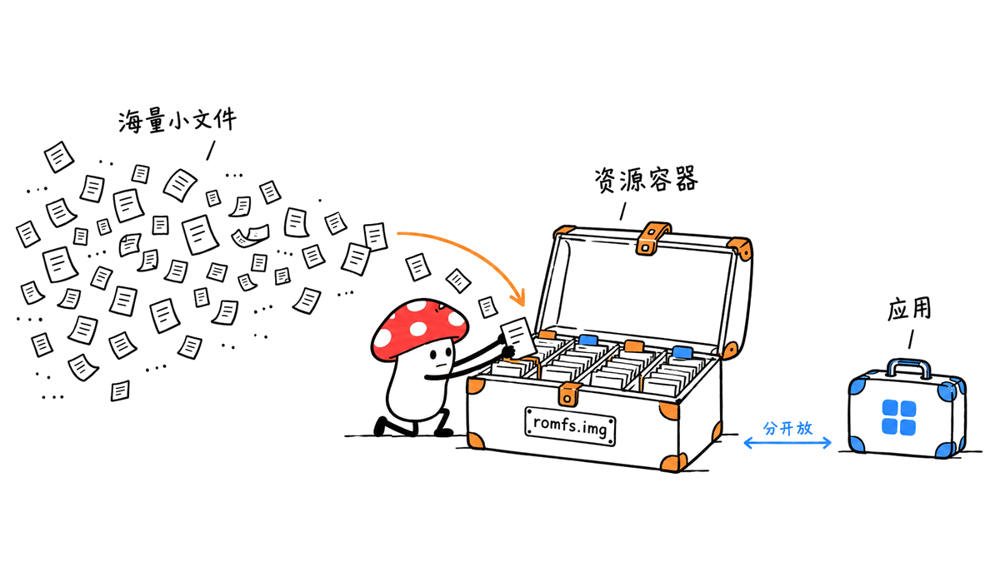

NX2Apple 把自备 Switch 游戏在苹果设备上运行所需的构建、打包与安装步骤，整理成一个图形化启动器。它的主要价值，是降低现有移植工具链的使用门槛，同时管理构建结果和每款游戏的设置。

官方仓库为 LNPANDY/NX2Apple。2026 年 10 月 29 日 GitHub API 快照显示约 1,642 星，最新发布版为 v0.6.0；“一周超 700 星”的增长区间未单独核验。根目录 LICENSE 为 MIT，底层 nxnative 及其他依赖的贡献和许可另有说明。

> 项目：https://github.com/LNPANDY/NX2Apple
> 发布：https://github.com/LNPANDY/NX2Apple/releases
> 上游：https://github.com/seedds/nxnative

## NX2Apple 与 nxnative 分别做什么？

NX2Apple 是 nxnative 的社区分支。代码重写器、Horizon 主机兼容层、NVN 到 Metal 的图形适配和游戏配置主要来自上游。这个分支增加图形化启动器、资源归档以及一组持续维护的补丁，不能把整条底层技术路线都算成启动器作者的原创成果。

它的基本路径是：读取用户准备的游戏文件，解包并叠加适配的更新，重写游戏代码，把着色器转换为苹果图形工具链可用的形式，再生成应用与资源数据，最后安装和启动。


项目将其称为原生执行，而非传统模拟器。更准确的理解是：游戏代码经过重写后在 Apple Silicon 上运行，系统接口和图形接口仍需要兼容层承接。“同为 ARM”不会自动解决系统调用、内存布局、同步和 GPU 接口差异，也不意味着任意游戏都能直接启动。

## v0.6.0 把哪些麻烦步骤收进了界面？

2026 年 10 月 28 日发布的 v0.6.0，重点是首次使用流程：选择 Mac、iPhone 或两者，检查 Xcode，再引导准备游戏与所需文件。项目代码下载、依赖检查和后续更新也进入启动器。

该版本把 Python 和多项构建工具放进应用，发布说明列出了 CPython 3.13、zstd、glslangValidator、spirv-cross 与 xcodegen 等组件；普通图形界面用户不再需要先装 Homebrew 和系统 Python。它仍需处理 .NET SDK 10，完整 Xcode 和目标平台也不能省掉。

另一个改进是将“重新构建”和“重新安装”分开。已有成功构建可以通过 Reinstall 再装回已配对设备，也能导出 IPA。免费 Apple ID 签名的剩余天数和续签入口进入游戏卡片，减少每次到期都从头编译的误操作。

这些是发布说明中的功能，本次没有安装发布包、配对手机或续签实测。源码与说明足以分析流程，但不能替代完整设备验收。

## Mac 和 iPhone 到底需要什么条件？

最容易误读的是“macOS 13+”。那是启动器本身的最低系统版本。当前 README 同时写明，NVN 游戏默认需要 Xcode 27.1，对应 macOS 26.6 或更高；仓库提供其他 Metal 工具链的覆盖选项，但不能据此推定旧环境同样稳定。

| 环节 | 当前仓库说明 | 选型时的含义 |
|---|---|---|
| 构建主机 | Apple Silicon Mac | Intel Mac 不在这条推荐路径内 |
| 启动器 | macOS 13+ | 能打开界面，不等于能完成所有构建 |
| NVN 游戏默认构建环境 | Xcode 27.1、macOS 26.6+ | 应先核对完整工具链，而非只看应用最低版本 |
| iPhone 目标 | iOS 26+、较新的设备 | 旧设备未经充分验证，不能承诺全型号可用 |
| 输入 | 自备游戏文件和所需密钥 | 仓库和应用不提供这些内容 |
| 容量 | 随游戏与中间产物变化 | 小 IPA 不代表游戏数据或构建缓存很小 |

项目没有给出适用于所有游戏的 Mac 最低内存承诺，因此不能把“8GB 可开界面”写成“8GB 能稳定构建所有大作”。处理大型游戏时，解包目录、重写结果、着色器缓存、应用和资源镜像都会占空间，应按目标游戏评估。

iPhone 还有单应用可用内存与签名 entitlement 的限制。README 指出，大型游戏若未保留 Increased Memory Limit 权限，可能在大约 3.4GB 的应用内存限制下失败。这是项目的环境说明，并非全部 iPhone 的统一可用内存；设备、系统和签名工具都可能改变结果。

## 94 个配置，等于 94 款游戏都能玩吗？

不等于。当前 README 分了三个层次：94 款游戏具有 profile；其中 3 款在这个分支完成过手机端构建、安装和游玩验证；另有 45 款由上游报告可在 iPhone 游玩。其余配置仍需实际验证，不能把配置数量直接当作兼容性成功率。

分支标注已验证的三款是《塞尔达传说：王国之泪》、Hades II 和《集合啦！动物森友会》。这些仍是维护者报告，本次没有游戏运行测试。具体游戏的更新版本、标题 ID 和已知问题，应查 GAMES.md 及对应 profile。


这种分级比一张“支持游戏”清单有用。一个 profile 描述的是让代码重写和运行时知道怎样处理某款游戏所需的信息；它不保证全部流程、所有关卡、存档、控制器与性能都没有问题。尤其应避免把截图里某个场景的帧率推广到整款游戏。

游戏清单：https://github.com/LNPANDY/NX2Apple/blob/main/GAMES.md

## RomFS 为什么是这个分支的重要工程点？

大型游戏的难点不只是算力，也可能是文件数量。项目的旧归档文档记录，《王国之泪》的 RomFS 有 304,243 个文件，约 15.9GiB。大量小文件会拖慢复制，超大 IPA 的解包安装也曾失败。

早期方案把文件树打包为索引加分片，示例为 126 个数据片加 1 个索引，共 127 个文件。这减少了搬运对象数量，并没有把十几 GB 的游戏压缩成很小的下载包。该格式文档还明确说明没有去重或压缩。

当前 README 和 BUILDING.md 已转向单个 `romfs.img`；旧 `romfs.idx` 分片的读取能力仍保留。因此，“30 万文件变 127 分片”适合解释项目演进，不能作为当前每次构建的唯一输出格式。



把应用程序和资源数据分开，也让重新签名、重新安装和资源复制可以分别处理。但 slim IPA 是减轻应用包负担，用户仍需保存和传输完整资源，手机或外部存储的空间需求不会凭空消失。

## 本次做了哪些验证？

本次以源码提交 `3384be8c8145d660dcd068df6b0a77b0320f9d26` 为核查对象，阅读 README、v0.6.0 发布说明、LICENSE、构建文档和资源归档说明，独立计数确认 94 个游戏配置目录，并用 Python 3.12.14 在本地运行仓库现有的 IPA 打包测试文件：22 项全部通过。

```bash
python3 -m unittest discover -s dm/ios/tests -p test_pack_ipa.py -v
```

测试使用临时目录与合成数据，覆盖重复打包、文件增删改、复用与新鲜打包结果的一致性等行为。这个结果支持对打包模块的有限判断，不代表已经通过游戏解包、代码重写、Metal 编译、签名安装和真机运行的端到端验证。

这一边界很关键：对复杂移植项目，最有价值的报道应该告诉读者哪一层被检查过，而不是把源码存在、单元测试通过和游戏流畅运行写成同一件事。

## 普通用户怎样开始，怎样判断值得继续？

先在 GAMES.md 找到目标游戏，核对所需更新版本和已验证层级；再检查 Mac 的系统与 Xcode 条件。条件匹配后，从官方 Release 下载 `NS-Port-Builder-macOS-arm64.zip`，按项目说明打开应用并完成引导，选择 Mac 或 iPhone 目标。

第一次宜选择资料完整、维护者已报告成功的目标，保留完整日志，先确认一条构建路径走通，再尝试更大的资源包或其他版本。反馈问题时附设备、系统、Xcode、游戏版本和诊断信息，不要提交游戏文件或密钥。

这款工具适合已有合规来源文件、愿意排查构建与兼容性问题的用户，以及希望研究原生执行和图形兼容层的开发者。它并未把实验性的逐游戏适配变成所有人都无需维护的商用游戏分发平台。

类似的本地游戏项目也可延伸阅读：https://blog.mushroom.cv/blog/macnativegames-totk-native-mac/

## 常见问题

### NX2Apple 会自动下载游戏吗？

不会。项目要求用户自备游戏文件及所需密钥，代码的 MIT 许可也不授予任何商业游戏资源的使用或分发权。

### 不用命令行，为什么还需要 Xcode？

图形界面代为调度构建工具，并没有取消编译器、Apple 平台 SDK、签名和设备安装这些环节。应用内置 Python，也不等于内置完整 Xcode。

### 游戏能在 Mac 上运行，就能在所有 iPhone 上运行吗？

不能。目标系统、可用内存、签名权限、图形实现与设备条件不同，必须分别确认；仓库中的 Mac 和 iPhone 状态不能相互替代。

### 软件开源是否意味着输出可以随意分享？

不是。开源许可约束的是项目代码，游戏内容另有权利边界。项目要求使用自备文件，并将包含游戏内容的输出限定为个人设备使用；本文不提供游戏或密钥下载渠道。

## 来源

项目 README 与代码：https://github.com/LNPANDY/NX2Apple

v0.6.0 发布说明：https://github.com/LNPANDY/NX2Apple/releases/tag/v0.6.0

构建文档：https://github.com/LNPANDY/NX2Apple/blob/main/BUILDING.md

旧分片归档设计：https://github.com/LNPANDY/NX2Apple/blob/main/docs/ROMFS_ARCHIVE.md

NX2Apple 的亮点是把多段脆弱的工程步骤变成可观察、可恢复的使用流程。评估它时，游戏版本、工具链、数据布局和真机验证，比星标增长更能决定实际体验。

---

> © 2026 Author: Mycelium Protocol. 本文采用 [CC BY 4.0](https://creativecommons.org/licenses/by/4.0/deed.zh) 授权——欢迎转载和引用，须注明作者姓名及原文链接，不得去除署名后以原创发布。

<!--EN-->

NX2Apple turns the build, packaging, and installation steps for running user-supplied Switch games on Apple devices into a graphical launcher. Its main contribution is making an existing native-execution toolchain easier to operate and managing the resulting games and settings.

The official repository is LNPANDY/NX2Apple. A GitHub API snapshot on October 29, 2026 showed approximately 1,642 stars; the latest release was v0.6.0. The claimed gain of 700 stars in one week was not independently measured. The root LICENSE contains MIT terms, alongside separate attribution and licenses for upstream components.

Repository: https://github.com/LNPANDY/NX2Apple
Releases: https://github.com/LNPANDY/NX2Apple/releases
Upstream: https://github.com/seedds/nxnative

## What belongs to NX2Apple, and what comes from nxnative?

The underlying code rewriter, Horizon host compatibility layer, NVN-to-Metal graphics implementation, and game profiles largely come from nxnative. NX2Apple adds its launcher, resource archiving work, and a maintained patch queue. The entire execution technology should not be attributed to the GUI fork alone.

The pipeline reads user-supplied game files, unpacks and applies supported updates, rewrites code, translates shaders for Apple's graphics toolchain, and packages an application and resource data before installation.


The project describes this as native execution rather than conventional emulation. Rewritten code runs on Apple silicon, while compatibility layers still implement the expected system and graphics interfaces. Sharing an ARM architecture does not resolve system calls, memory layouts, synchronization, or graphics APIs automatically.

## What does v0.6.0 change?

Released on October 28, v0.6.0 focuses on guided setup: choosing Mac, iPhone, or both; preparing Xcode; and supplying games and required files. Repository downloads, dependency checks, and updates move into the launcher.

The release bundles Python and several build tools, naming CPython 3.13, zstd, glslangValidator, spirv-cross, and xcodegen. GUI users no longer need to install Homebrew or a system Python first. The .NET SDK 10 remains a separate tool that setup handles; full Xcode and target platforms are still required.

Reinstalling is separated from rebuilding. Existing builds can be installed again on a paired device or exported as an IPA. Signature expiry and renewal for free Apple IDs appear in the game card, avoiding unnecessary recompilation when only signing needs to change.

These are release-note features. This review did not install the release app, pair a phone, or test renewal, so those workflows are not reported as independently exercised.

## Which Mac and iPhone requirements matter?

The launcher opening on macOS 13+ does not establish the requirements of every game build. The current README specifies Xcode 27.1, requiring macOS 26.6+, for NVN games by default. An alternate Metal-toolchain override exists, but it does not prove equivalent reliability on older environments.

| Stage | Repository requirement | Practical interpretation |
|---|---|---|
| Build host | Apple Silicon Mac | Intel Macs are outside the documented recommended path |
| Launcher | macOS 13+ | Opening the GUI does not guarantee a complete build |
| Default NVN build | Xcode 27.1 and macOS 26.6+ | Check the entire toolchain |
| iPhone target | iOS 26+ and a recent phone | Older devices are insufficiently tested |
| Inputs | User-supplied games and keys | Neither comes with the tool |
| Storage | Depends on game and intermediates | A slim IPA does not make game data small |

The project gives no universal Mac memory minimum for every title. Extraction, rewritten binaries, shader caches, applications, and resource images all consume storage; requirements should be evaluated for the intended game.

On iPhone, app memory entitlements also matter. The README reports failures for large games under an approximately 3.4GB application limit when Increased Memory Limit is not retained. This is a project environment observation, not a universal memory specification for every phone. Devices, operating systems, and signing tools can change the outcome.

## Do 94 profiles mean 94 verified games?

No. The current README lists 94 games with profiles, three verified through phone build, install, and play by this fork, and 45 additional games reported playable upstream. Remaining profiles require device validation.

The fork's three reported verified titles are Tears of the Kingdom, Hades II, and Animal Crossing: New Horizons. These remain maintainer reports; this review did not run them. Required game updates, title IDs, and known issues belong in GAMES.md and each game's profile.


A profile provides information needed for rewriting and runtime behavior. It does not prove complete playthroughs, saves, controllers, or performance across all scenes. A screenshot frame rate should not become a whole-game performance promise.

Game list: https://github.com/LNPANDY/NX2Apple/blob/main/GAMES.md

## Why does RomFS packaging matter?

File counts can be an obstacle independently of GPU performance. The older archive design records 304,243 files and approximately 15.9GiB for Tears of the Kingdom's RomFS. Moving so many small files was slow, and a large IPA could fail extraction during installation.

The earlier solution used 126 data shards plus one index. Reducing the count to 127 files reduced transfer and extraction overhead; it did not compress a large game into a small download. That archive format explicitly performs neither deduplication nor compression.

The current README and BUILDING.md describe a single `romfs.img`. Support for older `romfs.idx` shard archives remains. The 127-file example explains the project's evolution rather than defining every current build output.


Separating application and resources also separates signing, reinstalling, and data transfer. A slim IPA reduces application-package burden; users still need storage and transfer capacity for the full resources.

## What was actually verified?

This review inspected commit 3384be8c8145d660dcd068df6b0a77b0320f9d26, its README, v0.6.0 release notes, LICENSE, build documentation, and archive design. An independent directory count confirmed 94 game profiles. The repository's existing IPA packing test file was run locally with Python 3.12.14: all 22 tests passed.

```bash
python3 -m unittest discover -s dm/ios/tests -p test_pack_ipa.py -v
```

Those tests use temporary files and synthetic data to check repeated packing, file changes, reuse, and consistency with fresh output. They do not validate the entire game extraction, code rewriting, Metal compilation, signing, installation, and gameplay chain.

For this class of project, source availability, passing unit tests, and smooth gameplay are different levels of evidence. Reporting those boundaries makes the evaluation useful.

## How can a new user start?

First find the intended title in GAMES.md and check its update version and verification tier. Then check the Mac operating system and Xcode requirements. Download `NS-Port-Builder-macOS-arm64.zip` from the official release and follow setup for the desired target.

Start with a documented, maintainer-verified case and keep complete logs. Establish one successful build path before trying larger packages or different versions. Reports should include device, OS, Xcode, game version, and diagnostics, without attaching game data or keys.

The project suits users who have appropriate source files and are prepared to troubleshoot compatibility, as well as developers studying native execution. Per-game bring-up remains engineering work rather than a universal consumer game-distribution service.

Related local game project: https://blog.mushroom.cv/blog/macnativegames-totk-native-mac/

## Frequently asked questions

### Does the launcher download games?

No. Users supply their own game files and required keys. The code's MIT license does not grant rights over commercial game assets.

### Why is Xcode required if no terminal is needed?

The GUI runs the tools rather than removing the compiler, platform SDKs, signing, and installation steps. Bundling Python does not bundle all of Xcode.

### Does a working Mac build establish iPhone compatibility?

No. Operating systems, app memory, entitlements, graphics implementations, and device capabilities differ. Each target needs its own validation.

### Can generated game packages be freely shared?

The software license and the rights to game content are separate. The project describes outputs as personal-use packages for the user's own hardware. No game or key download sources are provided here.

## Sources

Repository and README: https://github.com/LNPANDY/NX2Apple

Release: https://github.com/LNPANDY/NX2Apple/releases/tag/v0.6.0

Build guide: https://github.com/LNPANDY/NX2Apple/blob/main/BUILDING.md

Legacy archive design: https://github.com/LNPANDY/NX2Apple/blob/main/docs/ROMFS_ARCHIVE.md

NX2Apple's useful contribution is turning fragile engineering steps into an observable, resumable workflow. Game versions, toolchain compatibility, resource layout, and real-device evidence matter more to that experience than star growth.

---

> © 2026 Author: Mycelium Protocol. Licensed under [CC BY 4.0](https://creativecommons.org/licenses/by/4.0/) — free to share and adapt with attribution. You must credit the author and link to the original; removing attribution and republishing as original is not permitted.
