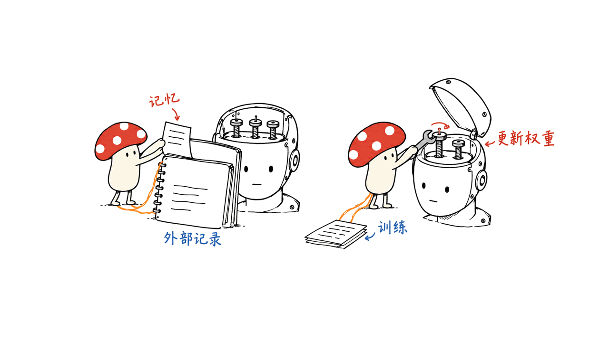
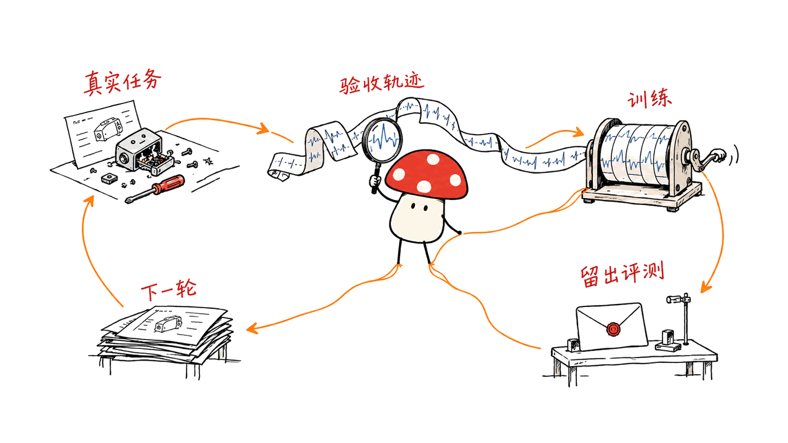
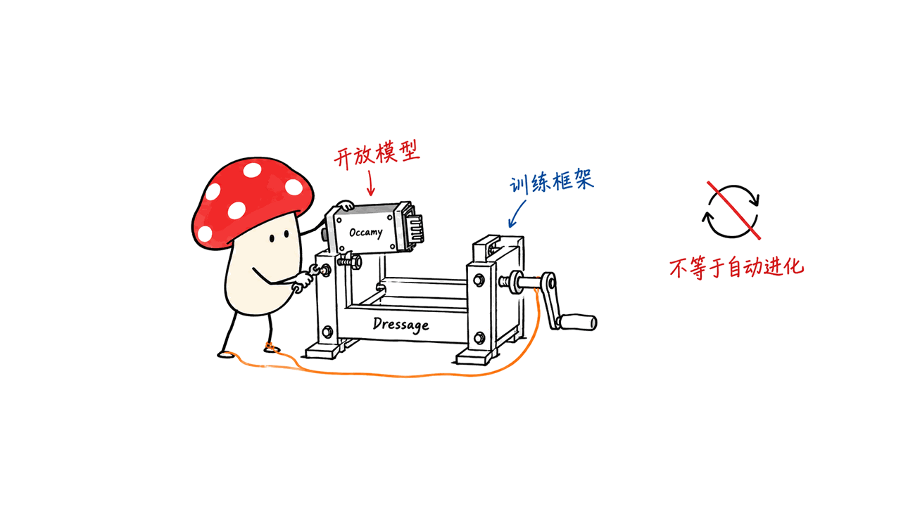

Occamy 1.0 是面向长流程工作的开放模型，Dressage 是配套的 Agent 强化学习框架。两者让“从执行经验训练模型”更具体，但不是安装后就会自动变强的自进化系统。

> 核对日期：2026-10-23。本文检查官方模型卡、数据页与源码，运行了4个后端就绪及暂停恢复相关测试函数；未运行模型推理或RL训练。

## 官方开源入口在哪里？

| 开放物 | 官方入口 | 应怎样理解 |
|---|---|---|
| 模型说明仓库 | https://github.com/Accio-Lab/occamy | 模型介绍、报告与部署参考 |
| 原始模型权重 | https://huggingface.co/Accio-Lab/occamy-1.0 | 已训练好的Occamy 1.0 |
| Agentic RL框架 | https://github.com/Accio-Lab/Dressage | 基于slime的训练与执行桥接层，不是另一个模型 |
| 公开训练数据子集 | https://huggingface.co/datasets/Accio-Lab/occamy-data-1.0 | 数据卡明确写的是released subset，并非完整训练集 |
| 论文 | https://arxiv.org/abs/2609.11977 | 训练与评测的方法说明 |
| 项目官网 | https://accio-lab.github.io/occamy/ | 研究展示与相关入口 |

模型卡标注Apache-2.0，两个代码仓库也有相应许可证。数据授权应单独检查，不能因框架开源，就推断所有训练材料都以同一方式开放。

## Co-work 模型到底优化什么？

Occamy从已经后训练的Qwen3.6-35B-A3B继续训练，总参数约35B、每token激活约3B。它强调搜索、文件、代码、结构化API等多次调用中的状态追踪、错误恢复与收尾，而非只把单题推理分数做高。

作者公开的部分结果如下，均为开发方评测，本文没有复测：

| 指标 | Occamy 1.0 | Qwen3.6-35B-A3B |
|---|---:|---:|
| Claw-Eval平均分 | 82.2 | 69.5 |
| WildClawBench | 49.16 | 40.4 |
| AutomationBench Pass¹ | 27.6 | 7.5 |

不同基准的环境、harness和验收规则不同，不能把这些分数平均后称为通用智能提升比例。论文的成本优势也建立在其评测和计价协议下，不是所有私有部署的成本承诺。

模型有视觉编码器，并不等于这次训练覆盖原生桌面操作。官方明确说明，当前Co-work训练接口不包含原生浏览器或桌面视觉交互。这与“模型能接收图片”是两个层面。

## 从执行经验到权重更新，中间缺了哪些步骤？

我们建议把四件事分开：

1. **记忆**：把任务结果存进文件、数据库或向量库，下次检索；模型权重不一定变化。
2. **上下文适应**：Agent在同一任务里依据工具反馈改计划，属于推理期行为。
3. **后训练**：把经过验收的轨迹变成样本，通过SFT或RL更新权重。
4. **递归自我改进**：系统还能改造自己的学习或研究过程，并证明下一轮继续获得可靠收益。

Occamy和Dressage主要为第三层提供模型、方法及基础设施，不能据此声称第四层已完整实现。把一次成功经验写进memory，也不等于模型获得了一次梯度更新。

Occamy公开的训练路线包含全参数SFT、HDPO、互补专家合并与最后的SAO阶段。Marathon与Sprint专家最终在参数空间合并，不是部署时再起两个模型来路由。官方列出的SFT去重并集有14,998条轨迹、403.3M token；这是训练描述，不是公开数据子集的条数。

## Dressage 怎样把真实工具轨迹接到 RL？

框架在slime之上，把几类原本容易混在一起的问题拆开：Agent怎样交互，任务在哪里执行，以及轨迹如何转换成训练样本。

白盒可以是Python工具循环；黑盒可以通过HTTP接入OpenClaw、OpenCode等harness。黑盒指运行方式，不意味着能够训练任意第三方闭源模型；要更新权重，仍需要自己可训练的策略模型和后端。

代理层记录token级证据，包含logprob、loss mask、策略版本等；工具返回文本不能直接当成模型应学习生成的动作。上下文压缩把一次任务拆成多段时，还要处理片段之间的奖励与样本权重，避免“切得越碎，梯度权重越大”。

Dressage提供这条桥接链路，底层训练与推理由slime、Megatron、Ray、SGLang等承担。它不是一个普通聊天应用的“开启自动学习”按钮。

源码与训练说明：
https://github.com/Accio-Lab/Dressage
https://github.com/Accio-Lab/Dressage/blob/main/docs/training.md

## 我们实际验证了什么？

在Dressage源码修订 `3e3142fe8ea07e4504c3b20a936a4c201a3de44c` 上，直接调用上游测试文件中4个不需要pytest fixture的测试函数：检查后端就绪；后端未准备好时保持暂停；准备好后释放暂停；处理零输出抢占的路由专家信息。

四项均通过，使用的是模拟HTTP后端。测试环境没有pytest，因此没有声称跑过完整测试套件；也没有连接真实SGLang、GPU、沙箱或训练集群。这个验证只覆盖控制逻辑，不证明训练吞吐或模型学习效果。

## 开发者应该先部署模型，还是先搭训练集群？

若只是想找一个能干活的Agent模型，先部署权重、接入harness，再评估任务完成率，通常比立即搭RL更合理。

模型卡提供多种官方格式：BF16约70.22GB，GGUF约11.66—36.90GB；这些是权重体积，不是峰值内存。还要加KV缓存、视觉投影与运行时开销。本机16GiB且磁盘余量不足，本文未下载权重。

特别留意两个当前状态：官方MLX模型卡仍注明Mac Metal验收待完成；实验MTP头需要对应运行时补丁，最终三步MTP速度尚未测量。不能把“有MLX文件”和“已验证Mac性能”划等号。

正式服务可参照仓库SGLang/vLLM示例，保留完整assistant消息、reasoning和tool calls，再追加工具结果。仓库的8卡、262,144上下文命令是参考配置，不是所有用户的最低硬件需求。应根据选定格式、显存与并发重新配置。

## 如果真想让自己的 Agent 持续改进，怎样落地？

下面是我们的工程建议，不是项目现成功能承诺：先选一个结果可验证的小任务族，例如修复有测试的Bug、生成能重算的报表。

给每次任务记录输入、环境版本、工具版本、初始状态与验收器；保留成功、失败和接近成功但不合格的样本。验收器要检查产物，不能只看Agent自己宣称“完成”。

之后再把可重放轨迹交给训练流程，留一批从未参与训练的任务做对照。除了成功率，还看工具费用、总时延与回归。最后以版本化、可回退的方式发布新策略；只有这一轮闭环可信，才值得讨论让模型进一步参与设计下一轮实验。

## 常见问题

### Dressage 是另一个大模型吗？

不是。它是Agentic RL框架，需要模型、执行环境、奖励和训练后端共同工作。

### 用 Occamy 做任务，会自动更新本地权重吗？

普通推理不会自动完成这件事。轨迹采集、评分、训练与模型发布需要另外组织。

### 开源了训练框架，就能完整复现 Occamy 吗？

不能直接推出。公开数据页是子集，完整复现还涉及数据、环境、配方、算力和版本条件。

---

本文原文：https://blog.mushroom.cv/blog/occamy-dressage-agent-learning/

> © 2026 Author: Mycelium Protocol. 本文采用 [CC BY 4.0](https://creativecommons.org/licenses/by/4.0/deed.zh) 授权——欢迎转载和引用，须注明作者姓名及原文链接，不得去除署名后以原创发布。

<!--EN-->

Occamy 1.0 is an open co-work model; Dressage is an agentic reinforcement-learning framework. Together they make learning from execution traces more concrete, but they do not constitute a deployed agent that automatically improves its own weights.

Sources checked October 23, 2026. We inspected model/data cards and code and ran four upstream control-logic test functions. No model inference or RL training was performed.

## Where are the official releases?

| Artifact | Official location |
|---|---|
| Model repository | https://github.com/Accio-Lab/occamy |
| Weights | https://huggingface.co/Accio-Lab/occamy-1.0 |
| Training framework | https://github.com/Accio-Lab/Dressage |
| Released data subset | https://huggingface.co/datasets/Accio-Lab/occamy-data-1.0 |
| Paper | https://arxiv.org/abs/2609.11977 |
| Project | https://accio-lab.github.io/occamy/ |

The model card and code repositories identify Apache-2.0. Review data terms separately rather than inferring that every training asset has the same release scope.

## What does co-work specialization mean?

Occamy further trains Qwen3.6-35B-A3B, with about 35B total and 3B active parameters. It targets state tracking, recovery and completion across search, files, coding and APIs.

Developer-reported scores include Claw-Eval average 82.2 versus 69.5 for the starting checkpoint, WildClawBench 49.16 versus 40.4, and AutomationBench Pass¹ 27.6 versus 7.5. These are not our reproduction. Different environments and grading rules cannot be compressed into a universal improvement percentage; the paper's cost frontier also depends on its stated evaluation and pricing protocol.

A vision encoder is not evidence of native desktop training. The release explicitly excludes native browser/desktop visual interaction from the current co-work training interface.

## Is memory the same as self-improvement?

No. A useful distinction is between storing experience, adapting within context, updating weights through post-training, and recursively improving the learning process itself. The released work primarily supports the post-training layer. Saving a successful trace does not automatically apply a gradient update.

The documented recipe includes full-parameter SFT, HDPO, merging complementary Marathon/Sprint experts and final SAO. The merge produces one checkpoint rather than an inference-time ensemble. The described SFT union has 14,998 trajectories and 403.3M tokens; those figures do not describe the size of the public data subset.

## What does Dressage connect?

Dressage separates agent semantics, sandbox placement and the conversion from trajectories to training samples. Python tool loops and HTTP harnesses converge on a shared proxy path. Blackbox integration describes how a harness runs; it does not let developers update an arbitrary proprietary model's weights.

Token-level evidence distinguishes generated actions from tool observations. Version and mask information matter, as does keeping reward and sample weighting coherent when context compaction splits one task into several segments. Otherwise more segments can accidentally mean more gradient weight.

The underlying training substrate remains slime with Megatron, Ray and SGLang. This is infrastructure, not an automatic-learning toggle for a chatbot.

Training documentation: https://github.com/Accio-Lab/Dressage/blob/main/docs/training.md

## What did we verify locally?

At revision `3e3142fe8ea07e4504c3b20a936a4c201a3de44c`, we directly ran four upstream functions covering backend readiness, remaining paused when unavailable, resuming when ready, and zero-output preemption routing information. All passed against mock HTTP behavior.

pytest was absent, so this was not a full-suite run. No live inference server, GPU, sandbox or training cluster was exercised. The result supports those control paths, not training throughput or model learning claims.

## Should you start with inference or RL?

For most deployment teams, first serve the model, connect a harness and establish task acceptance. The card offers BF16 files around 70.22GB and GGUF variants around 11.66–36.90GB. Weight size excludes cache, runtime allocations and vision components. We did not download weights on this 16GiB, storage-constrained host.

The official MLX cards still mark Mac Metal acceptance pending. The experimental MTP head requires matching runtime patches, and final three-step speed is unmeasured. File availability is not validated Mac performance.

Use the documented SGLang/vLLM path for your chosen format. Preserve full assistant messages, reasoning and tool calls across turns. The repository's eight-GPU, 262,144-context examples are reference configurations, not universal minimum requirements.

## How would an engineering team build a learning loop?

Our proposed rollout starts with one verifiable task family, such as tested bug fixes or recalculable reports. Record task inputs, initial state, environment/tool versions and the grader. Retain failures and near misses, not just successful-looking transcripts.

Replay admitted traces, train a candidate, and compare it on held-out tasks. Include total latency, tool cost and regressions. Publish a versioned policy with rollback. Only after this loop is reliable does it make sense to let models help design subsequent experiments.

## FAQ

### Is Dressage another model?

No. It needs a policy model, execution environments, rewards and training infrastructure.

### Does ordinary Occamy inference update its weights?

No. Data collection, grading, optimization and deployment must be organized separately.

### Can the framework alone reproduce Occamy?

No such conclusion follows. The public dataset is a subset; environments, recipes, compute and versions also matter.

---

Original article: https://blog.mushroom.cv/blog/occamy-dressage-agent-learning/

> © 2026 Author: Mycelium Protocol. Licensed under [CC BY 4.0](https://creativecommons.org/licenses/by/4.0/) — free to share and adapt with attribution. You must credit the author and link to the original; removing attribution and republishing as original is not permitted.
