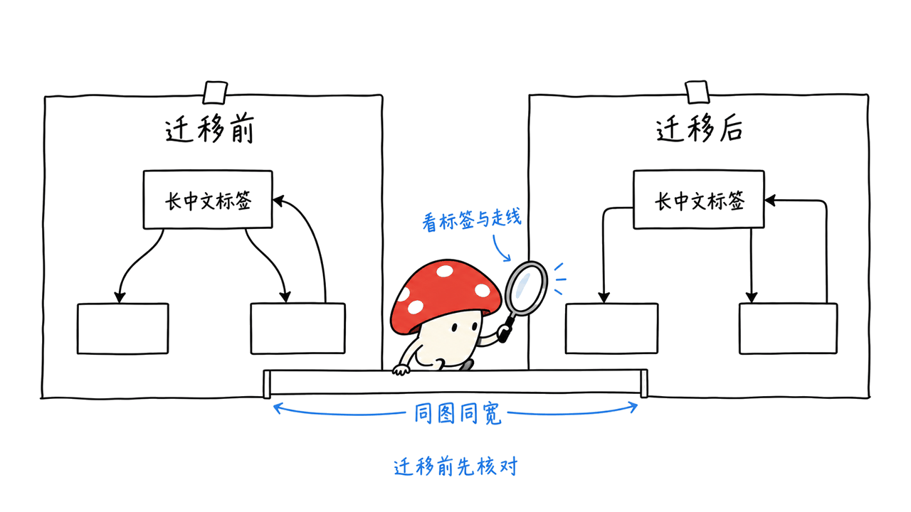

Ondine 把 Mermaid 文本编译成 SVG，让文档网站可以在构建阶段完成画图，浏览器只接收结果。对读者而言，它仍然是熟悉的图表语法；对网站而言，解析和布局不必随每次页面访问重新执行。

项目仓库是 wevm/ondine，采用 MIT 许可。本文以 2026 年 10 月 22 日的提交 `0b589ec34481856b4153526f10a0a35558a201a8` 为准，核对 README、Node/浏览器接入文档与完整 benchmark 报告，没有复跑性能测试。

仓库：https://github.com/wevm/ondine

官网与体验：https://ondine.sh/playground

## Rust 重写，究竟换掉哪一段？

Rust 编译器负责预处理、解析、图模型、布局与 SVG 输出。TypeScript 负责公开接口、WebAssembly 加载和把 SVG 放入 DOM。因而“Rust 写的”并不等于调用方必须用 Rust，也不等于完全没有 JavaScript。

它提供两条不同路径：已知图表在构建阶段编译，然后直接发布 SVG；用户现场输入内容时，额外加载按图类型拆分的 WASM 编译模块。后一种仍要下载编译器，不能套用前一种极小的挂载代码数字。


## 210 字节，为什么不是完整 Mermaid 的替代包大小？

README 写的是 210 bytes gzip 的挂载 runtime；固定版本的完整比较报告中，对应构建产物写的是 127 bytes gzip。两个文件的数字并不一致，本次没有重新打包追溯差异，因此不把任一数字说成统一的安装体积。

更关键的是，它们都指向同一类工作：把预先生成的 SVG 插入页面。它们不包含 Rust/WASM 编译器，也不包含每张图的 SVG 数据。Mermaid 和 Pele 的对照大小则包含图表 renderer。对静态网站，这种“工作提前做”的架构有意义；对在线 Mermaid 编辑器，应该比较包含编译器的冷启动、下载与渲染总成本。

| 使用场景 | Ondine 的合理路径 | 应计入的成本 |
| --- | --- | --- |
| 博客、开发文档 | 构建时生成 SVG | 构建耗时、SVG 大小与页面挂载 |
| 在线编辑器 | 浏览器加载 WASM 后编译 | 模块下载、编译器初始化、布局与 DOM |
| 服务端批量生成图 | Node compiler | 进程冷启动、热调用、资源限制 |

## 官方“快几百倍”该看哪张表？

完整报告比较 Ondine、Pele 1.6.0 和 Mermaid 12.1.0，使用 33 类图、612 个向量，标注运行提交 `1c9f5d6`。机器是 4 核 2.10GHz Intel Xeon、16GB 内存，浏览器为 headless Chromium 141。

报告给出的 Chrome 热调用几何平均比值，是小体积按类型模块相对 Mermaid 约 327.86 倍，全类型速度模块约 562.99 倍。Chrome 按类型冷启动则约 7.89 倍。热调用和新页面首次显示显然不是同一个指标。

简介页另有 54.9µs 对 36.8ms 等平均值。不要把这张平均耗时表、完整报告的几何平均倍率以及不同模块模式混成一个承诺。完整报告还说明，小体积模块在 Chrome 的 14 类小图上慢于 Pele；速度模块的成绩不能直接替它背书。

这些都是项目发布的结果，并非独立评测。我的结论是：把图表工作提前到构建阶段，能降低页面端负担；至于自己的几十张复杂图能省多少时间，仍需按真实输入检查。

完整报告：https://github.com/wevm/ondine/blob/0b589ec34481856b4153526f10a0a35558a201a8/bench/comparison.md


## 比速度更重要的布局，它解决了吗？

“使用同样的语法”与“得到同样的布局”是两个承诺。Ondine 的设计追求清晰边框与圆角正交连线，文档也说明可以按 `maxWidth` 调整可用宽度，并用 `autoDirection` 控制方向适配。但这不能证明它在所有复杂图上都更美观。

我建议用自己的五类图验收：长中文标签、多层子图、密集回边、窄屏长链和复杂时序。逐一检查文字是否重叠、连线是否穿节点、箭头方向是否明确、颜色对比与缩放后的可读性。再检查已有 Mermaid 的配置、主题、链接与指令是否兼容。

612 个测试向量覆盖很多已知输入，不能证明任意用户文档都兼容。把原图截图与新 SVG 放在相同宽度下看，往往比争论语言或某个倍率更快发现迁移风险。上述清单是我的迁移建议，本次未完成全库视觉对照。

## 文档网站如何接入？

官方 Node 示例是同步编译，不需要浏览器或 DOM：

```js
import { writeFileSync } from 'node:fs';
import { render } from 'ondine/compiler';

const diagram = render('flowchart LR\n  Draft --> Review --> Publish');
writeFileSync('workflow.svg', diagram.svg);
```

这里的包安装与版本选择请按官方指南完成；该示例用于解释接入接口，本次未执行。Markdown/MDX 项目可以使用 `ondine/remark` 替换 mermaid 围栏，Vite 项目可以在构建时编译 `.mmd` 文件。一个页面放多张图时，应使用独立 `idPrefix` 避免内部 ID 冲突。

推荐先迁移一个文档页面，并保留源码、固定包版本、旧图截图与新 SVG。构建遇到不支持的语法时明确报错或走既定回退路径；不要让一张图失败后整页悄悄消失。



Node 指南：https://github.com/wevm/ondine/blob/0b589ec34481856b4153526f10a0a35558a201a8/site/src/content/docs/guides/node.mdx

Markdown 接口：https://github.com/wevm/ondine/blob/0b589ec34481856b4153526f10a0a35558a201a8/site/src/content/docs/api/remark.mdx

如果你需要的是会动的架构讲解视频，可看 live-panel 的不同路线：https://blog.mushroom.cv/blog/live-panel-skill-animated-architecture/

## 常见问题

### Ondine 就是 Mermaid 官方的 Rust 版本吗？

它是 wevm 的独立 MIT 项目，以兼容 Mermaid 输入为目标。不能把它的发布说成 Mermaid 官方重写。

### 210 字节包含在线编辑所需的一切吗？

不包含。它指挂载预编译 SVG 的代码，编译器与 SVG 数据需要单独计算；固定报告中还出现 127 字节的另一个构建数字。

### 它肯定比 Mermaid 排版更好吗？

没有足够证据作普遍保证。应使用实际图表检查布局、字体和语法兼容性，本次没有运行视觉对照评测。

---

> © 2026 Author: Mycelium Protocol. 本文采用 [CC BY 4.0](https://creativecommons.org/licenses/by/4.0/deed.zh) 授权——欢迎转载和引用，须注明作者姓名及原文链接，不得去除署名后以原创发布。

<!--EN-->

Ondine compiles Mermaid text into SVG so documentation sites can perform diagram work during the build. Readers keep a familiar syntax while pages can ship the result instead of a complete renderer.

The MIT project is wevm/ondine. This review pins commit `0b589ec34481856b4153526f10a0a35558a201a8` on October 22, 2026. We read its README, integration guides and detailed comparison report, without rerunning performance or layout benchmarks.

Repository: https://github.com/wevm/ondine

Playground: https://ondine.sh/playground

## What does Rust own?

Rust owns preprocessing, parsing, diagram models, layout and SVG emission. TypeScript supplies the public API, WebAssembly loading and DOM mounting. Callers do not need to write Rust.

There are two distinct delivery paths. Static content can be compiled before deployment, leaving SVG to display. An interactive editor instead loads compiler WASM modules, split by diagram type or bundled together. The latter must include compiler download and initialization costs.


## What does the tiny runtime number exclude?

The README says 210 gzip bytes for the mounting runtime. The pinned detailed report lists a 127-byte gzip artifact. We did not rebuild the bundles to reconcile those figures and do not present either as a universal package size.

Both describe mounting already compiled SVG. Neither includes the compiler nor per-diagram SVG data. The comparison rows for Mermaid and Pele include their renderers. Moving work to the build can benefit static sites, but it is not the same workload as a browser editor compiling fresh input.

| Scenario | Sensible route | Relevant costs |
| --- | --- | --- |
| Blog or docs | Compile SVG during build | Build work, SVG payload and mounting |
| Interactive editor | Load browser WASM compiler | Download, initialization, layout and DOM |
| Batch service | Node compiler | Cold process start, warm calls and resource limits |

## How should we read the published speed claims?

The detailed report compares Pele 1.6.0 and Mermaid 12.1.0 across 612 vectors of 33 types at benchmark commit `1c9f5d6`. It specifies a four-core 2.10GHz Intel Xeon, 16GB memory and headless Chromium 141.

Its geometric-mean Chrome warm ratios versus Mermaid are 327.86× for per-type size modules and 562.99× for the all-types speed module. Per-type Chrome cold start is 7.89×. These are different lanes, not interchangeable promises about first-page display.

The introduction page also lists arithmetic averages such as 54.9µs versus 36.8ms. Do not combine those averages, geometric ratios and module choices into one headline. The detailed report explicitly notes that size modules lose to Pele on 14 small diagram types in Chrome.

These are upstream results. Our inference is that ahead-of-time compilation can reduce browser work; the benefit for a particular document collection still needs measurement.

Report: https://github.com/wevm/ondine/blob/0b589ec34481856b4153526f10a0a35558a201a8/bench/comparison.md


## Does it solve bad layout?

Syntax compatibility does not guarantee identical layout or better aesthetics. Ondine favors square outlines and rounded orthogonal edges. Its Node guide describes width constraints and automatic direction changes, but these features do not prove every complex graph will look better.

Before migration, compare long multilingual labels, nested subgraphs, dense back edges, narrow-screen chains and complex sequences at the same width. Check overlap, routing, arrow direction, contrast and readability. Also test existing themes, configuration, links and directives. Passing the known vectors is not a proof for every private input.

This is a proposed migration checklist, not a completed visual evaluation.

## How would a documentation site adopt it?

The official Node interface imports `render` from `ondine/compiler` and returns SVG, dimensions and a detected type synchronously without a DOM. The Chinese section shows the call pattern; we did not execute that example.

`ondine/remark` replaces Mermaid fences in Markdown/MDX, while the Vite plugin compiles `.mmd` imports. Use distinct `idPrefix` values for multiple diagrams on one page. Start with one page, pin the package version, retain source and before/after artifacts, and define an explicit error or fallback policy.


Node guide: https://github.com/wevm/ondine/blob/0b589ec34481856b4153526f10a0a35558a201a8/site/src/content/docs/guides/node.mdx

Markdown integration: https://github.com/wevm/ondine/blob/0b589ec34481856b4153526f10a0a35558a201a8/site/src/content/docs/api/remark.mdx

For animated architecture explanations, see the separate live-panel approach: https://blog.mushroom.cv/blog/live-panel-skill-animated-architecture/

## Frequently asked questions

### Is this an official Mermaid rewrite?

No. It is an independent MIT project from wevm that targets Mermaid-compatible input.

### Does 210 bytes include the interactive compiler?

No. It describes mounting precompiled SVG. Compiler code and SVG payload are separate; the pinned report also lists a different 127-byte build artifact.

### Is its layout always better?

That has not been established. Evaluate actual inputs, fonts and integration behavior; we did not run a comparative visual test.

---

> © 2026 Author: Mycelium Protocol. Licensed under [CC BY 4.0](https://creativecommons.org/licenses/by/4.0/) — free to share and adapt with attribution. You must credit the author and link to the original; removing attribution and republishing as original is not permitted.
