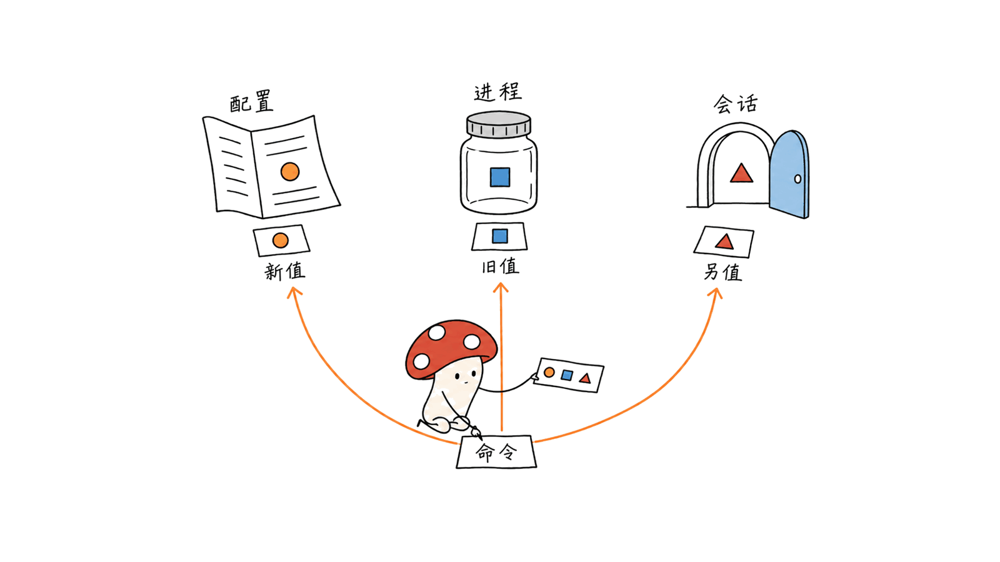

onetake 用代码智能体制作连贯的产品动效视频，EnvManage 用原生 Mac 界面查看和管理环境变量。两者是独立项目：一个服务内容制作，一个服务开发环境维护，下载入口与使用许可也不同。

此次核对发现，笔记里的 onetake 作者账号少了一处正确拼写：`feilangyuan/onetake` 返回 404，实际仓库是 `feitangyuan/onetake`。与 SwiftUI 环境变量管理描述匹配的另一个仓库是 `wbbk/envmanage`；不能把两个名字当成同一应用。

还有一处更影响使用决策的区别：onetake 免费版明确限制非商业用途；EnvManage 当前源码树未见 LICENSE。公开能看到代码，不能直接推导为可任意商用或再分发。

| 项目 | 已确认入口 | 主要用途 | 核对的使用边界 |
| --- | --- | --- | --- |
| onetake | https://github.com/feitangyuan/onetake | 产品发布片、预告片、功能演示的一镜到底动效 | PolyForm Noncommercial 1.0.0；Pro 提供商业授权 |
| onetake Pro | https://onetakemotion.com | 扩展素材、源码与商业使用 | 官网说明可购买；本次未购买或验证交付包 |
| EnvManage | https://github.com/wbbk/envmanage | SwiftUI 环境变量、PATH 与运行时管理 | macOS 13+；固定版本未找到 LICENSE，未确认商店上架 |

核对日期为 2026 年 10 月 11 日。onetake 的固定 commit 是 `2f5fbd363a0aec22055fbf62489380065737c91d`，EnvManage 是 `f0dbb7f5785a30adf6a21d42ae08d4942556aa0d`。本文将官方功能描述与实际执行过的检查分开。

## onetake 怎样把动效串成一条镜头？

普通动效片常依次展示标题、截图、功能卡片和 Logo。onetake 的规则要求相邻段落之间留下可辨认的承接物：输入框展开为窗口，窗口重排为手机界面，或者一条线延续成下一段画面的网格。


它交付的是 Agent Skill、JavaScript 动作库和渲染检查脚本。智能体按参考分析、概念选择、节拍表、HTML 场景、渲染、声音与验收的顺序工作；并不是下载一个独立的文本生视频模型权重。

官方方法要求每个节拍边界说明“什么东西保留下来”，同时安排移动与停顿。动作库把位置、缩放、弹簧和镜头变化写成时间函数，便于跳转到指定时刻检查同一帧。HTML 界面按截图重建，因此应把它称为界面复刻动效，不能等同于真实应用操作录像。

README 给出的早期片子 carry score 为 0.00、0.40 和 0.75，项目发布片为 0.83。这是作者对其样片的报告，不是本次重新测得的数据，也不是跨工具统一质量排行榜。检查脚本能发现一些结构问题，仍需人判断节奏、表达与产品细节。

草稿 1080p30、成片 4K60 是官方渲染配置。运动模糊通过快门时间内多次取样合成，声音依据场景事件安排；高分辨率、更多采样和配音都增加依赖与运行成本，不能由“一个提示词”推导出即时完成。

## 免费版与 Pro 到底差在哪里？

免费仓库包含方法、动作库、脚本、成片与拆解资料；官方 README 明确说案例成片的源码不包含在免费版中。仓库当前有 11 个案例目录，而中文说明仍写“10 条”，这种数字差异应按版本和目录实际内容解释。

官网将 Pro 的差异列为更完整的镜头控制、各片源码、五个起始方案、被否版本的判断说明，以及商业授权。官网说明覆盖 1.x 更新，未来 2.0 对已有购买者提供折扣；这属于当前销售页承诺，本次没有购买或测试这些付费资产。

免费的许可是 PolyForm Noncommercial 1.0.0。README 明确写出“不允许商用”，所以给客户做广告或产品推广时，应先取得对应商业许可。本文自己的 CC BY 声明只覆盖文章，不改变所介绍软件与素材的许可。

安装示例为：

```bash
# Claude Code 的技能目录
git clone https://github.com/feitangyuan/onetake.git ~/.claude/skills/onetake
# 其他读取 Agent Skills 的工具，可采用其支持的技能目录
git clone https://github.com/feitangyuan/onetake.git ~/.agents/skills/onetake
```

运行依赖包括 Python 3、Playwright/Chromium、NumPy、SciPy、Pillow、Matplotlib、Node 和 FFmpeg；参考分析与配音还有可选依赖。目录安装并不自动解决这些依赖，也不保证每一种客户端都完全兼容。本次只在临时研究目录运行库检查，没有安装为常驻技能。

## EnvManage 解决的是哪类环境问题？

EnvManage 把 shell 文件定义、当前进程环境与 GUI 会话环境放到可以检查的界面中。最常见的使用场景是：机器装了多个 Python 或 Node，终端找到一个版本，应用启动后却找到另一个版本。

按官方 README，它支持查看变量来源和同名覆盖链、管理受管 PATH 区块、查找命令的多个命中位置，以及识别 Python、Java、Node.js、Go 和 C++ 运行时。它还提供项目环境文件识别、Profile 方案、差异诊断和操作日志。

不同来源不会天然同步。修改 shell 配置后，已有进程通常仍持有启动时的环境；GUI 的 `launchctl setenv` 路径又不同于 shell 文件。不能把界面里的“已修改”理解为所有已经运行的应用即时生效，应在实际目标进程中复查。



项目说明将 `.envrc` 作为只读信息展示，不自动执行；Fish 配置也是只读识别。运行时安装主要调用本机已有的版本管理器，工具链检测也不等同于负责安装所有依赖的独立包管理器。

源码构建入口为：

```bash
git clone https://github.com/wbbk/envmanage.git
cd envmanage
bash build.sh
./dist/EnvManage.app/Contents/MacOS/EnvManage --selftest
```

构建脚本直接调用 Swift 工具链，并生成 `.app` 与 DMG，不要求建立 Xcode 工程。README 标注 macOS 13+；本次是在更新的 macOS 上构建，不能据此声称已测过所有支持版本。脚本采用本地 ad-hoc 签名，这不等于 Apple 公证或 App Store 发布。

## 写入保护有哪些，哪些仍需复查？

官方设计把修改拆成两步：先生成内存中的文件计划，展示 diff；确认后才经过统一写入层。写入层包含基线哈希检查、shell 语法预检、备份、撤销记录和审计。系统写入采用白名单，`/etc/paths*` 按文档保持只读。

我们的源码核对发现，备份服务发生复制失败时会返回空结果，而且源码注释明确说明不会因此阻断主流程。因此，“有备份机制”与“每次写入都必定产生可用备份”不同。涉及正在使用的环境时，仍应检查变更预览与备份结果，并在操作后确认目标 shell 或应用的实际值。


另一个容易误判的地方是自检出口：`SelfTest.swift` 在打印通过与失败统计后，仍会输出 `SELFTEST_OK`，应用入口会退出 0。验证时应同时检查失败计数，不能只看退出码或最后一行。

关于下载，仓库确实有源码构建方式。本次中国区 Apple 搜索接口以 `EnvManage`、`macSoftware` 查询返回零结果，仓库 README 也没有可核对的商店链接。这不足以证明所有地区都不存在同名应用，但当前不能把笔记中的“应用商店搜索同名即可下载”写成已确认路径。

## 本地检查实际覆盖了什么？

我们使用 Apple Silicon Mac、macOS 26.6.2 和 Node.js 26.10.0，以固定源码版本进行检查。

| 项目 | 检查方式 | 结果与边界 |
| --- | --- | --- |
| onetake | 原仓库 `scripts/test_motion.js`，配套固定版 `motion.js` 和 `ui_kit.js` | 58 项 PASS，结束为 ALL PASS；覆盖缓动、弹簧、几何、确定性和 UI 数学，不是完整视频生成或观感验收 |
| EnvManage | 官方 `build.sh` 与 `--selftest` | 构建与自检结果见下方实测记录；不改真实 shell 配置，不激活、安装或卸载运行时 |
| 来源 | Jina Reader、GitHub API 与固定版本文件 | 错误账号返回 404；正确仓库、官网和另一工具分别确认 |
| 商店与许可 | 固定源码树及中国区 Apple 搜索 | EnvManage 未见 LICENSE；本次商店查询零结果，不推断全球发行状态 |

EnvManage 成功生成 `.app` 与 DMG，自检通过 14 项、失败 0 项。本次扫描到 70 条变量、8 个运行时和 31 项 PATH，其中 6 项目录不存在；这些是本机环境状态，不是工具质量评分。执行前后核对的七个用户 shell 配置文件内容哈希均未变化。

这些检查证明若干部件可以在本机运行，不能证明从一个提示词到可商用成片的完整交付，也不能替代 EnvManage 的 GUI 写入、恢复和并发修改测试。17 张官方 README 配图已下载保留，用于素材核对；封面另按两款工具共同的创作与开发主题生成。

如果你要选工具，可以先确定目的：做连贯动效，试 onetake 的非商业案例和动作库；整理 Mac 环境，先在 EnvManage 里只读查看来源与 PATH。两者都应从范围小、容易验证的任务开始。

相关交互解释图工具：https://blog.mushroom.cv/blog/anatomy-claude-interactive-isometric-figures/

## 常见问题

### onetake 与 EnvManage 是同一个项目吗？

不是。onetake 的真实仓库作者账号为 feitangyuan，负责动效制作；EnvManage 的匹配仓库为 wbbk/envmanage，负责原生 Mac 环境管理。它们的技术栈和许可也不同。

### 公开仓库是否都能直接商用？

不能据此判断。onetake 免费版明确采用非商业许可，Pro 提供商业授权；EnvManage 当前未见 LICENSE，不能自行补成 MIT 或无限制授权。

### 免费版是否包含案例成片的全部源码？

onetake README 明确说免费案例不包含成片源码。Pro 官网提供源码属于付费版本说明，本次未验证购买后的交付内容。

### EnvManage 是否能让所有应用立即得到新变量？

不能这样理解。shell 定义、进程采样和 GUI 会话是不同层次，已有进程可能需要重新启动或重新加载相应配置；应在实际应用中验证效果。

一手来源：https://github.com/feitangyuan/onetake
Pro 官网：https://onetakemotion.com
EnvManage：https://github.com/wbbk/envmanage

---

> © 2026 Author: Mycelium Protocol. 本文采用 [CC BY 4.0](https://creativecommons.org/licenses/by/4.0/deed.zh) 授权——欢迎转载和引用，须注明作者姓名及原文链接，不得去除署名后以原创发布。

<!--EN-->

onetake uses a coding agent to build continuous product motion films. EnvManage provides a native Mac interface for inspecting and managing environment variables. They are separate tools serving creative production and developer environment maintenance, with different download paths and licensing boundaries.

The supplied `feilangyuan/onetake` URL returns 404. The actual repository is `feitangyuan/onetake`, linked to onetakemotion.com. The SwiftUI description matches `wbbk/envmanage`; these names do not identify one application.

Public code visibility is not an unrestricted-use license. onetake's free edition explicitly restricts use to noncommercial purposes. We found no LICENSE in the pinned EnvManage source tree.

| Project | Confirmed source | Purpose | Boundary |
| --- | --- | --- | --- |
| onetake | https://github.com/feitangyuan/onetake | Continuous launch films, teasers and demos | PolyForm Noncommercial 1.0.0; Pro adds commercial licensing |
| onetake Pro | https://onetakemotion.com | Expanded assets, sources and commercial use | Purchase offered; we did not buy or inspect the paid delivery |
| EnvManage | https://github.com/wbbk/envmanage | Native variable, PATH and runtime management | macOS 13+; no license or verified store listing found |

Checked October 11, 2026: onetake commit `2f5fbd363a0aec22055fbf62489380065737c91d`; EnvManage commit `f0dbb7f5785a30adf6a21d42ae08d4942556aa0d`. Official descriptions and our actual checks are distinguished below.

## How does onetake connect its beats?

A conventional motion film may replace titles with screenshots, feature cards and a logo. onetake requires an identifiable object to carry each boundary: a prompt becomes a window, a window becomes a phone layout, or a line survives as the next scene's grid.


The package combines an Agent Skill, JavaScript motion libraries and rendering/checking scripts. Its workflow moves through reference analysis, concept selection, a beat sheet, an HTML scene, rendering, sound and verification. It is not a newly released text-to-video model checkpoint.

The method specifies what survives each boundary and schedules motion alongside rests. Time-dependent functions support seeking to a reproducible frame. Interfaces are rebuilt from screenshots in HTML, so the result is a reconstructed interface animation rather than a recording of live product operation.

The README reports carry scores of 0.00, 0.40 and 0.75 for earlier iterations, and 0.83 for the launch film. These are author-reported sample results, not our measurements or a common benchmark against other tools. Automated checks can flag structural issues; human review still judges expression, timing and product accuracy.

1080p30 drafts and 4K60 finals are documented rendering configurations. Shutter-time sampling produces motion blur; event-based scoring arranges sound. Resolution, samples and narration increase dependencies and workload. A single prompt is an entry point, not evidence of instant finished delivery.

## What differs between the free edition and Pro?

The free repository includes the method, libraries, scripts, finished films and breakdowns. It explicitly excludes the finished examples' source code. The pinned tree has 11 case directories, while the Chinese README still says ten; treat this as documentation drift rather than one unchanging count.

The sales page lists expanded camera control, film sources, five starters, notes explaining rejected cuts and commercial licensing. It says 1.x updates are included and existing buyers receive a discount for a future 2.0. These are current seller statements; we did not purchase or test the paid assets.

The free edition uses PolyForm Noncommercial 1.0.0. Its README prohibits commercial use and directs commercial users to Pro. Our article's CC BY license does not change the software or media licenses.

The documented installation paths are:

```bash
git clone https://github.com/feitangyuan/onetake.git ~/.claude/skills/onetake
git clone https://github.com/feitangyuan/onetake.git ~/.agents/skills/onetake
```

Use the directory supported by your agent. Dependencies include Python 3, Playwright/Chromium, NumPy, SciPy, Pillow, Matplotlib, Node and FFmpeg, with additional reference-analysis and narration dependencies. Copying a skill does not install that stack or establish complete client compatibility. We tested library components in a temporary research directory, not a persistent skill installation.

## Which environment problems does EnvManage address?

EnvManage exposes shell-file definitions, current process variables and GUI-session environment information. One useful case is a Mac with multiple Python or Node installations where a terminal and a GUI application resolve different versions.

Official features include variable-source and override-chain inspection, managed PATH blocks, command shadowing detection and discovery of Python, Java, Node.js, Go and C++ runtimes. It also describes project-file recognition, profiles, environment differences and audit logs.

These scopes do not automatically synchronize. Existing processes usually retain the environment inherited at launch. GUI `launchctl setenv` routes differ from shell configuration. A changed setting therefore needs verification in the actual target process.


The README describes `.envrc` as information to inspect without executing it, and Fish configurations as read-only recognition. Runtime installation calls existing version managers. Toolchain discovery is not a promise to supply every dependency itself.

Source-build commands are:

```bash
git clone https://github.com/wbbk/envmanage.git
cd envmanage
bash build.sh
./dist/EnvManage.app/Contents/MacOS/EnvManage --selftest
```

The build script directly invokes Swift and packages an app and DMG without requiring an Xcode project. macOS 13+ is the declared target; building on newer macOS does not test every supported version. Local ad-hoc signing is not Apple notarization or App Store distribution.

## What do the write protections actually establish?

The documented design plans changes in memory and presents a diff before applying them. The write layer includes baseline hashes, shell syntax checks, backup, undo records and auditing. System writes use an allowlist; `/etc/paths*` remains read-only according to the documentation.

Our source inspection found that backup copy failure returns an empty result and is explicitly documented as nonblocking. A backup mechanism is therefore different from a guarantee that every write has a usable backup. Inspect the preview and backup outcome, then verify the effective value in the target shell or application.


The self-test exit is another important limitation. It prints passed/failed counts but still emits `SELFTEST_OK`; the app entry exits zero. Validation should inspect the failure count rather than accepting exit status or the final line alone.

An Apple search API query for `EnvManage` and `macSoftware` in China returned zero results, and the README supplied no verifiable store link. This does not establish that every region lacks a matching app. It does mean the supplied claim of a confirmed same-name App Store download is currently unsupported.

## What did the local checks cover?

We used an Apple Silicon Mac, macOS 26.6.2 and Node.js 26.10.0, with fixed source revisions.

| Check | Observed scope |
| --- | --- |
| onetake original `test_motion.js` | 58 PASS checks and ALL PASS; curves, springs, geometry, determinism and UI math, not complete video generation |
| EnvManage official build and self-test | Results below; no real shell configuration edits or runtime activation, installation or removal |
| Sources | Wrong account 404; corrected repository, website and separate environment tool identified |
| Licensing and store search | No EnvManage LICENSE in pinned tree; China query returned zero, without a global distribution inference |

EnvManage produced both an app and DMG. Its self-test reported 14 passed checks and zero failures. It scanned 70 variables, eight runtimes and 31 PATH entries, six missing on this machine. These are local environment observations, not quality scores. Content hashes for seven user shell configuration paths were unchanged before and after the run.

Component checks do not prove complete commercial film delivery or validate GUI edits, restoration and concurrent modifications. We retained 17 official README images for source inspection. The cover separately illustrates the combined creative/developer workstation theme.

Start with a small, observable task: examine noncommercial onetake examples and motion math, or inspect EnvManage's source and PATH information before editing. They solve different problems and should be evaluated separately.

Related interactive explainer tools: https://blog.mushroom.cv/blog/anatomy-claude-interactive-isometric-figures/

## Frequently asked questions

### Are onetake and EnvManage the same project?

No. feitangyuan/onetake addresses motion films; wbbk/envmanage matches the native Mac environment-manager description. Their stacks and licenses differ.

### Does a public repository permit commercial use?

Not automatically. onetake's free edition has a noncommercial license and Pro adds commercial licensing. We found no EnvManage LICENSE and cannot assume MIT or unrestricted rights.

### Does the free edition contain every example's source?

No. The onetake README explicitly excludes film source code from the free examples. Pro's source delivery is a seller claim we did not test.

### Do edited variables instantly reach every application?

No. Shell definitions, process snapshots and GUI sessions are different scopes. Existing applications may need restarting or configuration reloading; verify the actual target.

Primary repository: https://github.com/feitangyuan/onetake
Pro website: https://onetakemotion.com
EnvManage: https://github.com/wbbk/envmanage

---

> © 2026 Author: Mycelium Protocol. Licensed under [CC BY 4.0](https://creativecommons.org/licenses/by/4.0/) — free to share and adapt with attribution. You must credit the author and link to the original; removing attribution and republishing as original is not permitted.
