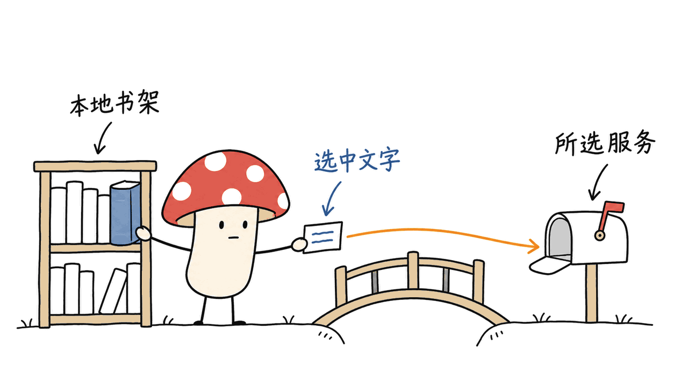

OnlyTranslate（只译）是一款把网页、字幕、EPUB 和 PDF 做成双语阅读界面的浏览器扩展。它不要求注册只译账号，也不绑定插件订阅；翻译服务由使用者选择，服务商的账号、额度和费用仍需另外看。

核查版本为 1.15.0，仓库采用 GPLv3，技术栈为 WXT、Vue 3 与 TypeScript。本文实际完成类型检查、上游测试和 Chrome 生产构建；没有使用真实 API Key、调用收费翻译服务或评测译文质量。

仓库：https://github.com/airhunter/OnlyTranslate
官网：https://onlytranslate.top/

## 不用注册，为什么不等于所有翻译都免费？

“不注册账号”指无需向插件项目方开通账号。README 提供微软、Google 等免配置服务，也允许填写自己的 AI 服务密钥或兼容网关。具体可用性、配额和计费仍由所选服务决定。

因此可以把成本拆成三层：扩展本身、翻译服务、自己的运行环境。只译不绑定订阅，不能推出任意服务都无限免费；换一个提供商，也可能改变译文表现、限流和数据处理规则。

Chrome 内置翻译提供本地处理路线，但是否可用取决于浏览器、语言组合和模型状态。本次没有实际验证这项浏览器能力，不应把所有模式都写成离线翻译。


## 它解决的是哪些阅读问题？

识文模式优先寻找主要正文与评论，全页模式覆盖更多可见文本。双语对照便于检查原文，也可切换仅译文。选择范围是产品设计的一部分：导航、按钮和正文并不总应该接受相同处理。

视频功能依赖站点提供可读取的原字幕。没有字幕轨道的音频，不会因为装上插件就自动变成可翻译的字幕；本文没有验证语音转写能力。

EPUB 与 PDF 阅读处于 Beta。它们支持本地文件与阅读管理，但可选 PDF 版面模型改善的是布局分析，不提供 OCR。纯扫描页没有可提取文字时，仍可能无法翻译。

这是一个值得借鉴的结构：先处理内容单位、阅读顺序和插入位置，再接翻译服务。接口能返回译文，还不够；译文必须出现在正确位置，且能恢复原文、应对动态页面与取消操作。

## 本地图书，文字会不会出设备？

README 和隐私文档说明：导入的 EPUB/PDF 原文件、进度、书签及可选版面模型保存在当前浏览器中；开始在线翻译后，提取的待翻译文字会发送给所选服务。文件留在本地，与内容完全不出设备，是不同条件。

配置与密钥使用扩展本地存储。插件清除数据或卸载后，本地书架也可能丢失，迁移前应使用其备份功能。不要把本地保存理解成跨设备同步或可靠的异地备份。

隐私政策还区分了主动操作：选择 Edge 在线语音朗读会向 Microsoft 发送对应文本；用户确认提交的私下反馈也会向项目方发送所选内容。它声明不自动收集日常使用数据，不代表所有功能永远没有网络请求。



## 本次构建与测试结果怎样？

在临时源码副本中，以冻结的锁文件安装依赖，跳过自动安装脚本，再显式运行 WXT prepare。类型检查通过，Chrome Manifest V3 生产构建也通过。没有修改上游业务源码。

测试结果存在运行环境差异：Node 26 下完整测试得到 1,406 项通过、18 项失败，并报告一个未处理错误；换到 Node 22 后，同一源码的 143 个测试文件、1,424 项测试全部通过。前一次失败涉及本地存储访问和异步错误等，我们没有定位全部根因，因此不把差异简单归为某一个产品缺陷。

这些上游测试使用 DOM 测试环境及模拟网络响应，验证代码行为，不等于真实 Chrome 已加载扩展并成功翻译任意网页。也不能据此推出 EPUB/PDF 全流程、所有字幕平台或在线服务的翻译质量都已验证。

供开发者参考的本次构建顺序：

```bash
pnpm install --frozen-lockfile --ignore-scripts
pnpm exec wxt prepare
pnpm verify
pnpm build
```

仓库要求 Node 22.12.0 及以上，并声明了包管理器版本。建议先采用自己已验证的 Node 22 环境；Chrome 生产目录为 .output/chrome-mv3，开发目录不同，手动加载时别混用。

生成的 manifest 包含 storage、scripting、unlimitedStorage 等权限，host_permissions 为 all_urls 范围。权限服务于跨站翻译和本地阅读功能，但并不是对隐私的独立保证，部署时仍需检查实际版本、设置和服务目的地。


## 工程师可以借鉴什么？

把“识别要翻什么”“如何调用服务”“如何插入和恢复译文”“缓存与取消”分开处理，更容易定位漏翻、重复请求与过期结果。对电子书和 PDF，内容顺序和格式保留往往与翻译接口同样重要。

对日常使用者，建议先用普通网页、小段文本和不敏感文件试用，确认服务、目标语言和阅读模式，再导入长文档。需要离线时，应单独核验本地翻译路线，不能只看书架保存在本地。

## 常见问题

### 插件不收费，AI API 也不收费吗？

不一定。插件不管理服务商的账单。是否需要密钥、免费额度和超额计费，都应按所选服务核实。

### 能翻译任何视频和扫描 PDF 吗？

不能这样承诺。字幕需要可读取的原轨道；PDF 翻译依赖可提取文字，可选版面模型不是 OCR。

### 能拿源码做闭源分发吗？

项目采用 GPLv3，不是 MIT。再分发和修改分发前，应按 GPLv3 及依赖许可检查相应义务，不能把“免费使用”理解为无条件闭源再分发。

隐私政策：https://github.com/airhunter/OnlyTranslate/blob/main/PRIVACY.md
相关网页工具分析：https://blog.mushroom.cv/blog/deepseek-chat-demo-static-frontend-api-storage-guide/

核查日期：2026-11-17。本文没有实际商店安装、真实 API 翻译、内置本地翻译或生产隐私审计；截图是厂商说明，封面与正文为概念示意。测试记录与源码版本已保留。

---

> © 2026 Author: Mycelium Protocol. 本文采用 [CC BY 4.0](https://creativecommons.org/licenses/by/4.0/deed.zh) 授权——欢迎转载和引用，须注明作者姓名及原文链接，不得去除署名后以原创发布。

<!--EN-->

OnlyTranslate is a browser extension for bilingual webpages, subtitles, EPUBs and PDFs. It requires no OnlyTranslate account or extension subscription. Users select the translation service; provider accounts, quotas and charges remain separate.

We reviewed version 1.15.0, GPLv3, built with WXT, Vue 3 and TypeScript. We completed type checks, upstream tests and a Chrome production build. No real API key, paid translation request or translation-quality evaluation was used.

Repository: https://github.com/airhunter/OnlyTranslate
Website: https://onlytranslate.top/

## Why does no registration not mean every translation is free?

The claim concerns the extension’s own account system. Its README offers no-configuration services and separately supports user-provided AI credentials and compatible gateways. Availability, quotas and billing depend on the selected provider.

Separate extension cost, service cost and local environment. Choosing another provider can also change quality, limits and data handling.

Chrome’s built-in translation offers a local route, subject to browser, language and model availability. We did not exercise that capability, and do not describe every mode as offline.


## Which reading problems does it address?

Smart detection prioritizes primary reading content; full-page mode covers more visible text. Bilingual and translation-only views serve different reading needs. Correct target selection matters alongside the translation response.

Video translation needs an accessible original subtitle track. Installing the extension does not automatically transcribe subtitle-free audio.

EPUB and PDF readers are Beta. Optional PDF layout analysis is not OCR, so scanned pages without extractable text may remain untranslatable.

Our engineering takeaway is to separate content units, reading order and insertion from provider calls. A successful API response is useful only when the right text is translated and safely inserted, restored or canceled.

## Does a local book imply local translation?

No. The README and privacy policy describe local files, progress, bookmarks and optional layout models. Online translation sends extracted text to the chosen provider. Keeping the original file local does not mean none of its text leaves the device.

Settings and keys use extension-local storage. Clearing data or uninstalling can remove the bookshelf; local storage is not cross-device synchronization or an off-device backup.

The policy also documents optional outbound actions: Edge online speech sends selected text to Microsoft, while explicitly submitted private feedback sends selected information to the project. Its no-automatic-collection statement is not a claim that every feature makes zero network requests.


## What did the build and tests establish?

In an isolated source copy, we installed from the frozen lockfile with automatic scripts disabled, then explicitly ran WXT prepare. Type checking and the Chrome Manifest V3 production build passed without changing application source.

Node 26 produced 1,406 passing and 18 failing tests plus an unhandled error. On Node 22, the same source passed all 1,424 tests across 143 files. The first run included storage-access and asynchronous-error failures; we did not establish every root cause and do not assign the difference to a single product bug.

These are DOM-environment tests with simulated network behavior. They are not proof of a real installed Chrome extension, every website or subtitle platform, ebook/PDF end-to-end success, or translation quality.

The tested build sequence was:

```bash
pnpm install --frozen-lockfile --ignore-scripts
pnpm exec wxt prepare
pnpm verify
pnpm build
```

The project requires Node 22.12.0+ and declares a package-manager version. Start with a validated Node 22 environment. Load the production .output/chrome-mv3 directory rather than confusing it with the development build.

The generated manifest includes storage, scripting and unlimitedStorage, with broad host access. These support cross-site reading features but do not independently certify privacy. Review the actual version, settings and destinations.


## What should developers borrow?

Keep target detection, provider adaptation, insertion/restoration, caching and cancellation distinct. This helps explain missed content, duplicate requests and stale results. Document order and formatting can matter as much as the translation endpoint.

For everyday evaluation, begin with a short ordinary page and nonsensitive sample documents. If offline operation matters, verify the local translation path independently of local bookshelf storage.

## FAQ

### Does a free extension make AI APIs free?

No. It does not manage provider billing. Check credentials, allowances and charges separately.

### Can it translate every video or scanned PDF?

That is unsupported. It needs readable subtitles or extractable PDF text; the optional layout model does not perform OCR.

### Is the code MIT licensed?

No: GPLv3. Review redistribution obligations and dependency terms before repackaging or distributing modified versions.

Privacy: https://github.com/airhunter/OnlyTranslate/blob/main/PRIVACY.md
Related web tool review: https://blog.mushroom.cv/blog/deepseek-chat-demo-static-frontend-api-storage-guide/

Reviewed November 17, 2026. No real store installation, provider translation, built-in local translation or production privacy audit was performed. Vendor screenshots are illustrative; article images are conceptual. Source and test evidence are retained.

---

> © 2026 Author: Mycelium Protocol. Licensed under [CC BY 4.0](https://creativecommons.org/licenses/by/4.0/) — free to share and adapt with attribution. You must credit the author and link to the original; removing attribution and republishing as original is not permitted.
