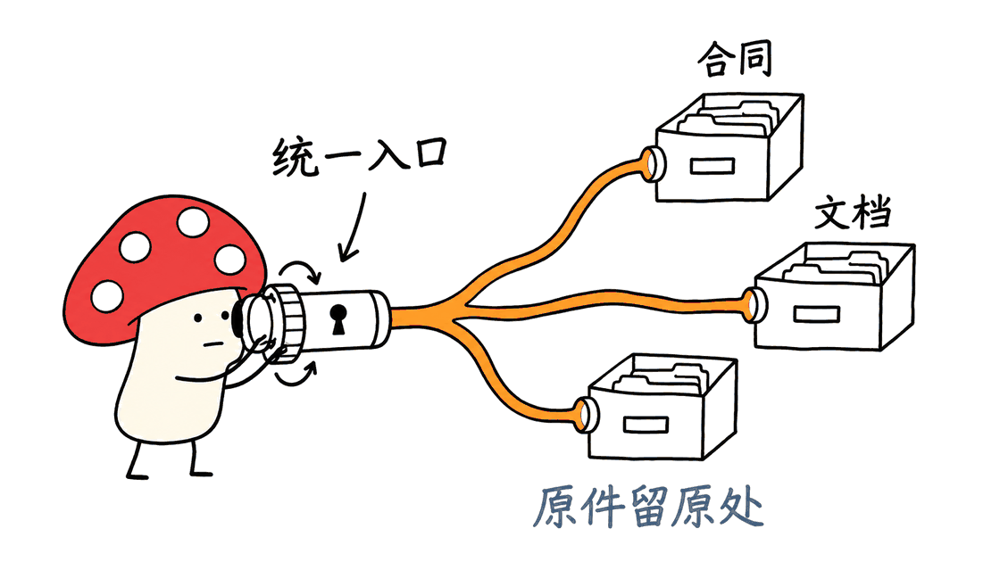
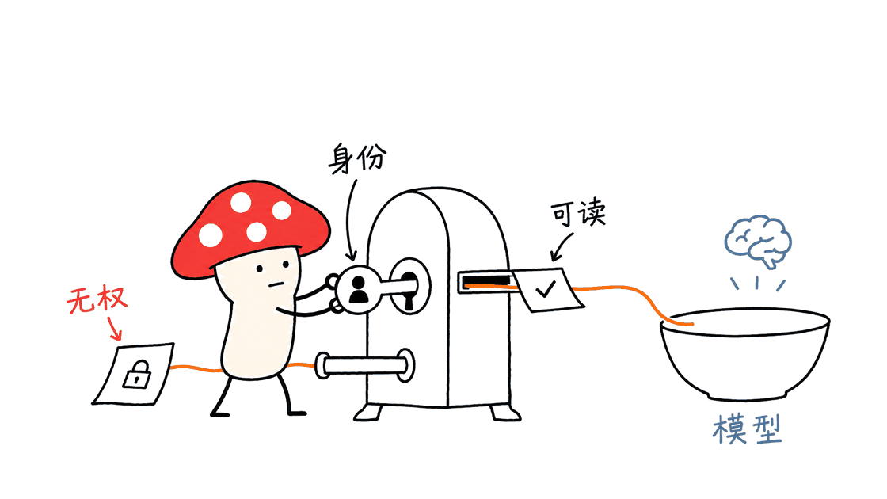
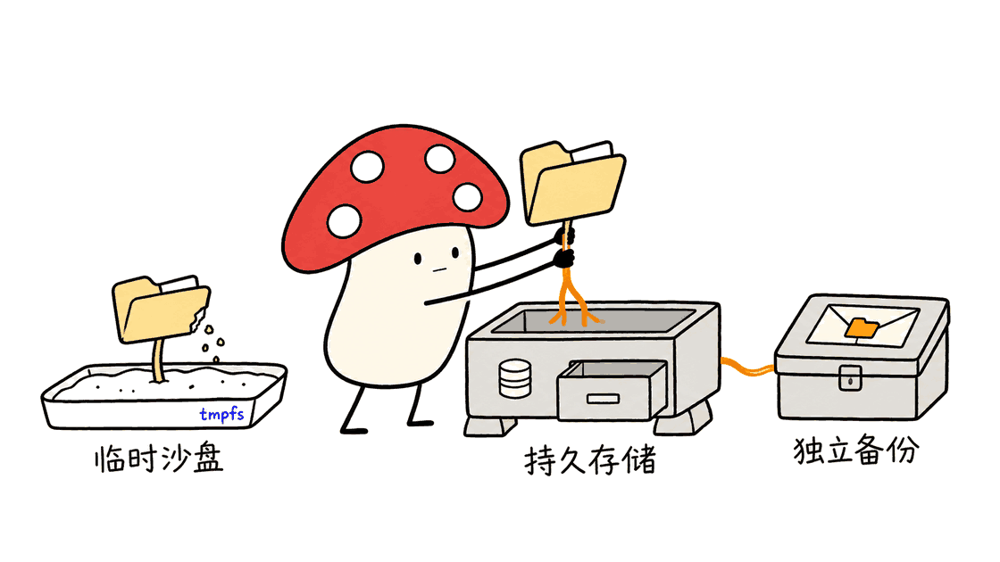

OpenArch 为企业 AI 提供统一的文档检索入口，把内容、元数据和访问权限一起交给上层应用。

Hyland 已把代码放在 Hyland/OpenArch，采用 Apache 2.0。它适合补齐企业 RAG 的数据底座：文件散在多个系统，员工能看的内容又各不相同，不能简单把所有材料塞进同一个向量库。

Mycelium Protocol 本次核对了仓库源码、Compose、默认用户配置和检索 API，固定提交为 `2b007aef651d67bdf6d84646cc4d7e4e9e36e108`。结论是：架构值得研究，但默认启动配置只适合开发验证。本文没有运行完整服务，也没有测出吞吐或权限隔离成绩。

## OpenArch 到底解决哪一层问题？

把企业问答拆开看，一边是原始内容系统，中间是解析、分块、索引和授权，另一边才是 Agent 与模型。OpenArch 主要处在中间的数据访问层。

例如，采购合同留在原业务系统，搜索层记录标题、分类、来源标识、分块、向量和权限信息。员工提问后，应用以其身份检索，拿到可访问的证据，再交给自选模型组织回答。

它提供存储和 API，而不是自动完成整套知识工程。解析器如何处理扫描件、分块如何保留表格语义、embedding 由哪个模型生成，都需要接入的数据流水线负责。安装后也不会自动拥有企业所有系统的连接凭据。



README 提到 Alfresco、Nuxeo、SharePoint 等内容来源，并链接了独立的集成演示。不能据此认为根目录 Compose 启动后，这些连接器、抓取任务和身份映射已经全部配置好。落地时应逐个确认连接器所在仓库、可用功能、许可及授权方式。

## 技术栈如何把文档和向量接起来？

源码以 Java 为主，当前父 POM 指定 Java 25、Spring Boot 4.1.2。容器路线使用预构建镜像，源码开发才需要匹配这些构建依赖。

| 层次 | 仓库中的实现 | 工程上的意义 |
|---|---|---|
| 接口 | Spring REST、Swagger/OpenAPI | 上层应用通过标准 HTTP 接入 |
| 文档核心 | Schema、文档类型、会话与安全策略 | 保存结构化元数据及内容治理语义 |
| 数据存储 | MongoDB | 保存文档相关状态，开发栈启用副本集 |
| 搜索 | OpenSearch | 全文、过滤、向量及混合检索 |
| 调用方 | 自选 AI 服务或 Agent | 负责推理、回答、引用与工具编排 |

`/api/query` 查询文档，`/api/query/advanced` 提供高级查询；`/api/query/embeddings` 接收向量，并可携带 `chunkFTS` 与文档过滤条件。检索实现包含混合查询与 RRF 管线支持，实际使用还需要匹配索引配置和已有数据。

一个容易误解的细节是：向量 API 要求调用方传入 `vector`。它不是“把自然语言问题发进去就自动完成 embedding、检索和生成回答”的聊天接口。向量维度、embedding 类型、模型版本与索引数据要保持一致。

默认文档查询走搜索索引，`sync=true` 切到仓库查询管理器；仓库还提供等待全文索引的接口。刚写入后查不到，首先要检查索引延迟和查询路径，不能立即归因于模型能力。

## 权限控制为什么比多接一个模型更难？

只在网页上隐藏按钮远远不够。用户搜不到的文档，其正文分块、摘要、向量检索结果和后续缓存也不能成为绕路出口。

我们在 `HXQLQueryConverter` 看到查询基于当前会话主体添加安全策略，并限制非管理员查询安全属性；向量索引也存在父文档数据的反规范化处理。这说明权限已经进入查询构建与索引设计，而非单独的前端功能。

不过，“代码里有权限过滤”与“已证明所有来源撤权立即生效”是两种证据。官网强调查询时向源系统解析权限；本次检查没有复现跨系统在线鉴权链路。README 同时描述复制 ACL，不能把营销描述直接当作所有连接方式的实测保证。

实际验收应关注三个时间点：来源系统何时撤权、索引何时更新、问答缓存何时失效。如果使用同步 ACL，必须测同步窗口；如果查询时回源鉴权，必须测来源不可用时是否拒绝访问，以及额外延迟。



建议用甲、乙两个普通账号验收：甲可读文档、乙不可读；再覆盖全文、向量、聚合、直接读取与缓存命中。最后在源系统撤销甲的权限并重复查询。不要用管理员账号通过测试后，就宣布多用户隔离已经完成。

Agent 也不能统一拿管理员凭据代所有人检索。身份透传、组映射、服务账号授权范围和结果缓存的用户隔离，都是集成层必须完成的工作。

## 怎样用 Docker Compose 跑第一轮验证？

先安装并启动 Docker。使用支持顶层 `include` 的新版 Docker Compose，避免旧版 `docker-compose` 无法解析组合配置。

```bash
git clone https://github.com/Hyland/OpenArch.git
cd OpenArch
export OPENARCH_VERSION=latest
docker compose config
docker compose up -d
docker compose logs -f openarch-app
```

README 使用 `latest` 演示，也给出显式版本示例。团队验证后应固定已确认可拉取的镜像标签或 digest；根目录 `VERSION` 和 Maven 的开发版本，不能直接推导成可下载的镜像版本。

启动完成后，打开：

```text
http://localhost:8080/swagger-ui/index.html
```

按照默认用户文档，本地开发账号为 `admin`，密码为 `password`。下面是创建测试文件夹的官方 API 用法，仅用于隔离的本地开发环境：

```bash
curl --user admin:password \
  --request POST \
  --url http://localhost:8080/api/documents/00000000-0000-0000-0000-000000000000 \
  --header 'Content-Type: application/json' \
  --data '{"sys_primaryType":"SysFolder","sys_title":"My Test Folder"}'
```

得到返回的文档 ID 后，再用 GET `/api/documents/<ID>` 确认能够读取。文件夹创建成功只证明基础 API 连通，不证明 PDF 已解析、向量已生成或来源权限同步成功。

## 默认 Compose 哪些地方必须改？

本次静态核对发现，启动栈包含应用、MongoDB、MongoDB 初始化任务、OpenSearch 和 Dashboards。MongoDB 初始化任务负责单节点副本集，这是事务与会话的运行前提之一。

更关键的是数据与网络配置：

- MongoDB 虽然挂了命名卷，但卷的驱动选项明确是 **tmpfs、大小 1GB**。它是内存文件系统配置，不能承担需要跨重启保证的持久数据。
- OpenSearch 服务没有显式的数据卷，不能依赖容器可写层保存长期索引。
- OpenSearch 安全插件被关闭；示例用户采用 `{noop}` 明文密码，文档明确只用于开发。
- Compose 发布了应用 8080、调试 5005、MongoDB 27017、OpenSearch 9200/9600，以及 Dashboards 5601。默认映射未限制为仅本机访问。

因此生产部署需要逐项配置持久磁盘、应用数据目录、备份恢复、身份认证、TLS、内部网络和最小端口暴露。单机试验也建议限制到 loopback；不需要的调试与数据库端口应删除，而不是直接把开发栈放到公网。



只备份 MongoDB 还不够。还应盘点二进制内容或外部来源引用、索引重建方式、schema、身份配置、连接凭据与 embedding 模型版本。索引是否可丢弃，取决于团队能否从可靠数据源重建，而不是“搜索引擎天然不需要备份”。

## 我们验证到了什么，谁值得投入？

Mycelium Protocol 保存了一份可重跑的源码检查脚本，14 项断言覆盖许可声明、Compose 依赖、tmpfs、安全插件、端口、向量输入、查询路由及安全策略注入，全部通过。它们证明本文对所读配置的描述一致，不等于 14 项功能测试或安全测试通过。

本机没有可用的 `docker` 命令，所以没有启动容器、验证镜像架构、执行 Bruno 集成测试，也没有测量内存占用、P95 延迟、召回率和撤权窗口。OpenSearch 的 512MB JVM 堆是配置值，不能当成整套系统最低内存需求。

如果团队已有多个内容库，希望为多个 AI 应用共享检索和权限能力，OpenArch 值得做小范围 PoC。若需求只是个人上传几份 PDF 问答，它会引入额外的文档治理和运维成本。

第一轮 PoC 应限制为一个来源、两种身份、一组真实问题：先验正确内容可检索、无权限内容不可见，再验撤权与删除，最后测索引延迟和成本。官方“优先索引、减少内容复制”的方向有价值，但元数据、分块和向量依然消耗存储；数据不整体迁移，也不代表没有任何数据副本。

相关背景可参考本站的企业 AI 平台介绍：https://blog.mushroom.cv/blog/bisheng-enterprise-agent-rag-workflow-deployment/ 。选型时应区分上层应用编排与底层授权检索，按各自实际能力组合，而不是只比较项目星数。

## 常见问题

### OpenArch 是模型或完整聊天产品吗？

它是企业内容与 AI 之间的数据访问和检索组件。模型推理、embedding 生成、对话界面与业务 Agent 需要另外接入。

### Apache 2.0 是否意味着部署零成本？

不意味着。代码许可与计算、存储、运维、模型 API 和连接服务费用是不同事项；还需核对具体依赖与附加组件的许可。

### Docker Compose 能直接用于生产吗？

默认文件体现开发配置，尤其包括 MongoDB tmpfs、开放端口和弱开发凭据。生产前必须替换持久化与认证配置，并完成恢复和权限验收。

### 是否已经证明权限变更实时生效？

没有。本文确认查询代码包含安全策略，但未复现来源连接与撤权链路。团队需按自己的连接器、身份系统和缓存架构进行验证。

## 一手资料

- 开源仓库：https://github.com/Hyland/OpenArch
- 本次固定源码：https://github.com/Hyland/OpenArch/tree/2b007aef651d67bdf6d84646cc4d7e4e9e36e108
- 默认用户：https://github.com/Hyland/OpenArch/blob/2b007aef651d67bdf6d84646cc4d7e4e9e36e108/docs/DEFAULT_USERS.md
- 官方文档：https://docs.hyland.com/r/Current/Hyland-Content-REST-API
- 官方集成演示入口：https://github.com/aborroy/content-lake-app-deployment
- 产品说明：https://www.hyland.com/en/solutions/products/openarch

---

> © 2026 Author: Mycelium Protocol. 本文采用 [CC BY 4.0](https://creativecommons.org/licenses/by/4.0/deed.zh) 授权——欢迎转载和引用，须注明作者姓名及原文链接，不得去除署名后以原创发布。

<!--EN-->

OpenArch gives enterprise AI applications a shared document retrieval layer that carries metadata and access controls alongside content.

Hyland publishes the code under Apache 2.0. Its useful position is between existing content repositories and the applications that use them: organizations need to retrieve relevant evidence without granting every employee access to every document.

Mycelium Protocol inspected commit `2b007aef651d67bdf6d84646cc4d7e4e9e36e108`. The architecture deserves a focused proof of concept, while the supplied Compose stack requires substantial configuration changes before production. We did not run the service or benchmark it.

## Where does OpenArch fit?

A typical enterprise AI pipeline connects source repositories, extraction and chunking, indexing and authorization, then agents and language models. OpenArch primarily serves the data access and retrieval part of that pipeline.

A purchasing contract can remain in its authoritative repository while the retrieval layer stores metadata, source references, chunks, vectors and permission information. The application retrieves evidence under an appropriate user identity and sends authorized results to its chosen model.

The repository provides storage and APIs. It does not configure every connector, extract every scanned PDF, choose chunk boundaries or generate all embeddings automatically. These remain ingestion and integration responsibilities.


The README names Alfresco, Nuxeo and SharePoint as content sources and links a separate integration demonstration. This does not establish that cloning the repository and starting its root Compose file provisions all connectors, credentials and synchronization jobs. Verify each connector's location, capabilities, license and authentication requirements.

## How does the implementation work?

The inspected parent POM targets Java 25 and Spring Boot 4.1.2. Those requirements matter for source development; the container route uses a prebuilt image.

| Component | Implementation | Responsibility |
|---|---|---|
| API | Spring REST and Swagger/OpenAPI | HTTP integration for applications |
| Document core | Schemas, document types, sessions, policies | Metadata and content governance |
| Storage | MongoDB | Document state and related persistence |
| Search | OpenSearch | Text, filters, vectors and hybrid retrieval |
| AI application | Your selected services and agents | Reasoning, responses and citations |

Document queries use `/api/query`; advanced queries use `/api/query/advanced`. Vector queries use `/api/query/embeddings`, accepting a vector, optional `chunkFTS` terms and document filters. The implementation includes hybrid retrieval and an RRF pipeline; using it requires compatible indexing configuration and populated data.

The vector endpoint expects the caller to supply `vector`. It is not a chat endpoint that automatically embeds a question and generates an answer. Keep embedding dimensions, types and model versions consistent with indexed data.

Default document queries use the search index. The `sync=true` option selects the repository query manager, and an endpoint can wait for full-text indexing. Distinguish indexing lag from application or model errors when newly written documents are not immediately visible.

## What does the permission implementation establish?

Authorization must cover document reads, chunks, semantic results, aggregations and application caches. Hiding UI elements alone cannot enforce those boundaries.

In `HXQLQueryConverter`, the current session principal contributes security policies during query construction; nonadministrators face restrictions on security-property queries. The vector indexing path also denormalizes parent document data. Access control therefore participates in backend query and indexing design.

This source evidence does not prove that every connector immediately reflects every source-system revocation. The product page describes query-time permission resolution against source repositories, whereas the README also discusses replicated ACLs. We did not reproduce the complete cross-repository authorization chain, so we do not treat the broad product claim as a verified guarantee for every integration mode.


Measure source revocation time, index refresh time and answer-cache invalidation time separately. For synchronized ACLs, test the synchronization window. For query-time source authorization, test source outages, fail-closed behavior and additional latency.

Use two ordinary identities: one authorized and one unauthorized. Exercise text search, vector retrieval, aggregations, direct reads and cached answers. Revoke access at the source and repeat. An administrator-only demonstration does not validate user isolation.

Agents should not use an unrestricted administrator account to retrieve on everyone's behalf. Identity propagation, group mapping, narrowly scoped service accounts and user-aware caches remain application integration work.

## How can you start a local Compose experiment?

Install and start Docker. Use a current Compose implementation supporting top-level `include`, because older standalone implementations may not parse this stack.

```bash
git clone https://github.com/Hyland/OpenArch.git
cd OpenArch
export OPENARCH_VERSION=latest
docker compose config
docker compose up -d
docker compose logs -f openarch-app
```

The README illustrates `latest` and an explicit version example. After validating a real downloadable image, pin a known tag or digest. Do not infer a published container tag from the root `VERSION` file or Maven development version.

Open `http://localhost:8080/swagger-ui/index.html` after startup. The documented development credentials are `admin:password`.

For an isolated local exercise, create a folder:

```bash
curl --user admin:password \
  --request POST \
  --url http://localhost:8080/api/documents/00000000-0000-0000-0000-000000000000 \
  --header 'Content-Type: application/json' \
  --data '{"sys_primaryType":"SysFolder","sys_title":"My Test Folder"}'
```

Read the returned identifier with GET `/api/documents/<ID>`. This checks basic API connectivity, not PDF extraction, embedding generation or source-permission synchronization.

## Which defaults need attention before production?

The stack includes the application, MongoDB, a MongoDB initialization job, OpenSearch and Dashboards. The initializer configures a single-node replica set needed for transaction and session support.

The inspected persistence and network settings are explicitly important:

- The MongoDB named volume uses **tmpfs with a 1GB limit**. A named volume does not make this memory filesystem suitable for durable production storage.
- OpenSearch has no explicit data-volume mount. Its container writable layer is not a long-term persistence strategy.
- OpenSearch security is disabled. Bundled user credentials use `{noop}` plaintext passwords, documented for development only.
- Published ports include 8080, debugger 5005, MongoDB 27017, OpenSearch 9200/9600 and Dashboards 5601. The default mappings do not restrict them to loopback.

Configure durable storage, application data paths, backups, authentication, TLS, private networking and minimal exposed ports. Even for local experiments, bind necessary ports to loopback and remove unnecessary database and debugging exposure.


A backup plan must account for more than MongoDB: binary content or external references, index rebuild procedures, schemas, identity configuration, connector credentials and embedding versions all matter. Whether an index is disposable depends on a tested reconstruction path.

## What did we actually verify?

Our saved source-audit script passed 14 static assertions covering the license declaration, Compose structure, tmpfs, security defaults, ports, vector input requirements, query routing and security-policy injection. These checks establish consistency with the inspected source; they are not 14 runtime or security tests.

No `docker` executable was available locally. We did not start containers, confirm image architecture support, run Bruno integration tests or measure memory, P95 latency, recall or revocation timing. The configured 512MB OpenSearch JVM heap is not a minimum-memory estimate for the whole deployment.

OpenArch is relevant to teams with several content repositories and several AI applications needing shared retrieval and permission handling. A personal PDF chatbot may not justify its additional governance and operational complexity.

Start with one source, two identities and a small set of real questions. Validate useful retrieval and denied access, then revocation and deletion, then indexing latency and cost. Index-first federation can reduce wholesale content copying, but metadata, chunks and vectors still require storage.

For related platform context, see our BiSheng coverage: https://blog.mushroom.cv/blog/bisheng-enterprise-agent-rag-workflow-deployment/ . Compare application orchestration separately from the authorized retrieval layer instead of treating repository popularity as an engineering benchmark.

## FAQ

### Is OpenArch a model or a complete chatbot?

It is a content access and retrieval component. Model inference, embedding generation, the conversation UI and business agents require separate integration.

### Does Apache 2.0 make deployment free?

The code license does not cover infrastructure, storage, operations, model API usage or third-party services. Check dependency and connector licenses separately.

### Is the default Compose stack production-ready?

Its defaults include MongoDB tmpfs, exposed infrastructure ports and development credentials. Replace persistence and authentication settings, then validate restoration and access controls.

### Have immediate permission updates been independently verified?

No. This inspection confirmed backend security-policy logic but did not reproduce a source connector's authorization and revocation behavior. Test the actual identity, connector and caching configuration you deploy.

## Primary sources

- Repository: https://github.com/Hyland/OpenArch
- Inspected commit: https://github.com/Hyland/OpenArch/tree/2b007aef651d67bdf6d84646cc4d7e4e9e36e108
- Default users: https://github.com/Hyland/OpenArch/blob/2b007aef651d67bdf6d84646cc4d7e4e9e36e108/docs/DEFAULT_USERS.md
- API documentation: https://docs.hyland.com/r/Current/Hyland-Content-REST-API
- Integration demonstration: https://github.com/aborroy/content-lake-app-deployment
- Product page: https://www.hyland.com/en/solutions/products/openarch

---

> © 2026 Author: Mycelium Protocol. Licensed under [CC BY 4.0](https://creativecommons.org/licenses/by/4.0/) — free to share and adapt with attribution. You must credit the author and link to the original; removing attribution and republishing as original is not permitted.
