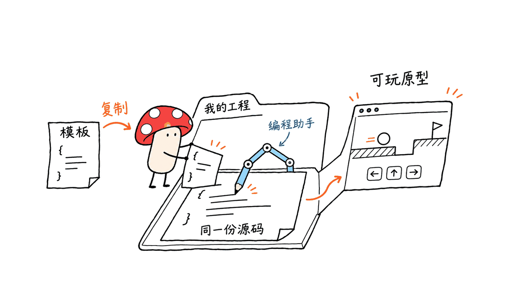
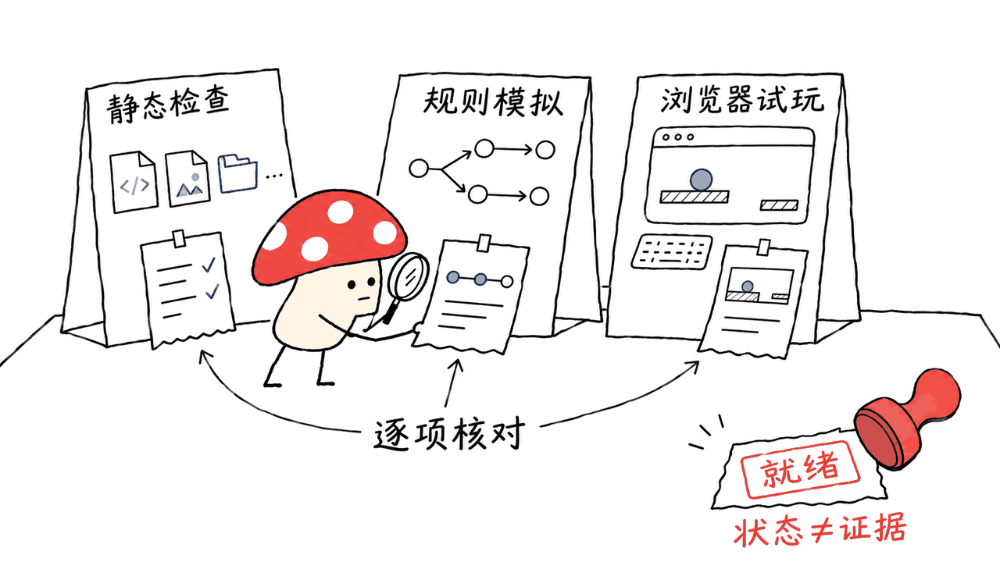
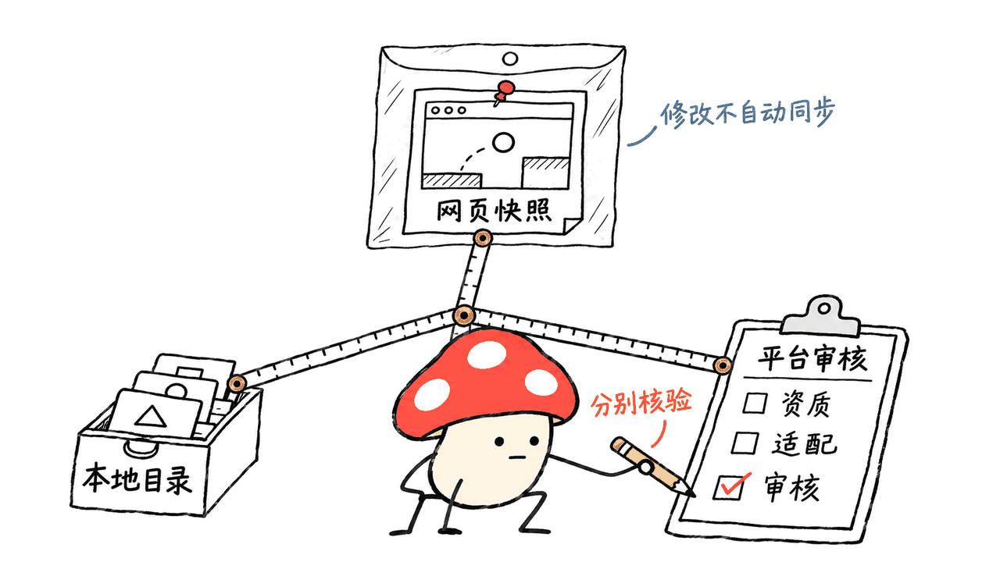

OpenGame 把游戏模板、编程 Agent、素材生成和试玩检查接成一个工作台。“一键复刻完整 GTA6、黑神话”目前缺少可复核证据，更值得看的是它怎样缩短游戏原型的迭代过程。

这次定位到的项目是 nexu-io/opengame，代码采用 Apache-2.0；它与另一个同名的 OpenGame 研究框架不同。我们核对了官方文档和固定版本源码，并在真实无头 Chrome 中运行了一个自带游戏，完成 9 项交互检查。

官方仓库：https://github.com/nexu-io/opengame
架构说明：https://github.com/nexu-io/opengame/blob/main/docs/opengame-architecture.md
本地安装：https://github.com/nexu-io/opengame/blob/main/docs/opengame-setup.md

## OpenGame 到底替你做哪一段？

它不是新训练的游戏生成模型。工作台把已有的 Claude Code、Codex、DeepSeek 等编程客户端接进来，让 Agent 在与 Studio 相同的工程文件上工作，再调用素材、检查、截图和导出工具。

一个典型路径是：挑选模板，Remix 到自己的工程目录，告诉 Agent 要改什么，修改玩法与素材，试玩并修复，再形成可分享的结果。官方架构文档明确说明，创建草稿这一步本身不会执行 Agent、完成游戏或发布作品。

这让“一键改编”的边界更清楚：模板复制、工程交接可以一键启动，改完之后是否可玩、是否符合要求，需要后续执行与验证。社区展示里的参考作品也不等于仓库包含了那些作者的源代码；官方说明它们可能只是指向创作者原帖的灵感链接。

## 免费的是工作台，哪些环节仍有成本？

本地开源软件不收订阅费，模板试玩不必先连接 Agent。采用代码绘图、程序化场景与 Web Audio 音效时，可以减少外部素材生成调用。但这不代表所有创作链路都没有成本。

| 环节 | 需要区分的内容 |
| --- | --- |
| 编程 Agent | 可以使用已有客户端，其模型额度或订阅由对应服务决定 |
| 图像、视频、音乐、语音 | BYOK 即自带服务密钥；配置完成不等于调用免费 |
| 本地试玩 | 依赖浏览器和本机资源，部分模板资产首次需要下载 |
| 自动预告片 | 除 Chrome 外，还需要 FFmpeg 和准备好的导出运行时 |
| 云端分享及平台发布 | 与本地目录发布分开，可能涉及账号、托管、打包与审核 |

文档要求 Node.js 22.18+，安装指南推荐与 CI 一致的 26.11.1。工程数据目录 MOTION_DATA_DIR 应与源码目录分开，并让 Studio 与 MCP 使用同一个绝对路径，否则容易出现“Agent 改了，但界面看的不是那一份”的问题。

部分二进制素材使用 Git LFS 或按需模板包。架构文档描述了长度、SHA-256 与归档条目检查，下载完成后可复用缓存。真正需要离线运行时，应先准备目标模板的全部依赖，不能把打开目录页当作离线试玩已经成功。

## 25 个模板和上百款游戏，应该怎么理解？

README 选了 25 款内置游戏作重点介绍，介绍文字另有“100+”等宣传口径。本次固定提交下，我们在 templates/games 目录找到 277 个 game.json 路径。

这个数字只证明存在相应的元数据文件，不证明 277 个游戏都在本次环境完成了资源下载、启动和通关测试。目录条目数、README 精选数、社区参考数与实际可玩的模板数，是不同概念。选型时直接验收你要用的那一款，比追逐总数有用。

本次选择 Tidebreaker，是因为官方称它包含完整的离线运行材料。我们提取了原始 HTML、封面、两张游戏图片和设计／元数据文件，保持游戏源码不变；没有下载整个大型素材库，也没有安装完整 Studio。

## 一个标为 3D 的示例，实际怎样运行？

Tidebreaker 在 README 里被标为“3D · Racing · Three.js”，但固定版本的实际 HTML 调用 canvas.getContext('2d')，用透视计算与图片绘制营造纵深。本次浏览器读到的运行对象也是 CanvasRenderingContext2D。

这不影响它作为一个可玩竞速原型，也不说明 OpenGame 无法生成 Three.js 工程。它说明的是：封面、分类标签和底层渲染实现需要分别核对，不能从一个“3D”标签推出大型开放世界、复杂物理和完整商业内容已经存在。

在 Node.js 26.10.0 与真实无头 Chrome 中，我们通过鼠标点击和键盘事件检查了以下行为：

| 检查组 | 实际观察 |
| --- | --- |
| 页面及资源 | 游戏进入标题状态，两张场景图片加载完成 |
| 渲染器 | 运行时确认为 Canvas 2D |
| 开始游戏 | 点击开始后，帧数与赛道进度增长 |
| 转向与跳跃 | 按键改变横向位置，空格触发跳跃冷却 |
| 暂停与继续 | 暂停时赛道距离不变，继续后恢复增长 |
| 重开 | 重开按键将赛道进度重置 |
| 错误与网络 | 观察期间无页面异常、控制台错误、加载失败或外部游戏请求 |

脚本共记录 9 项通过，截图和状态快照保留在研究记录中。这是一个模板的短程交互验证，不是整套工作台验收；没有运行 Agent 生成或 Remix，没有验证全部关卡胜负、移动端、多人同步、平台上传，也没有做帧率或性能比较。

## 自动检查通过，是否就代表游戏好玩？

OpenGame 把检查拆成不同工具：validate 检查入口和资源、支持的脚本契约；simulate 针对符合规则接口的确定性逻辑跑路线；playtest 在浏览器中执行真实输入，并可记录截图和状态断言。

这些设计比只交一张好看的图更接近工程交付，但覆盖范围不同。源码中的 50 tick 检查是有条件执行的逻辑冒烟，不等于完整通关；独立的模拟和浏览器检查也不能自动替代关卡平衡与人类试玩。

还要区分文档要求和硬门禁。当前 validate 会把缺少设计／验证文档等情况记为 warning，passed 取决于 diagnostics 是否为空；设置 ready 状态本身只是状态更新。发布到本地目录会调用 validate，但这段路径没有把所有模拟、试玩、预告片结果汇总成不可绕过的统一验收。

因此，应读取每项检查的实际报告和剩余缺口，而不是把一个 ready 标记理解为已经跑完全部质量流程。官方架构文档也明确提醒：ready 标记不是检查通过的证据，人仍然要判断操控手感与可玩性。

## 本地发布、网页分享、微信小游戏，是同一步吗？

不是。openmotion_game_publish 的直接结果，是把工程注册到本地游戏目录。网页分享会形成一个静态快照；后续修改源文件，不会自动更新先前的分享版本。

README 的部分平台分发项目仍列在路线图中，但源码已包含微信小游戏的本地预览、上传和状态记录模块。因此也不宜笼统说“所有平台发布都还没实现”。更准确的做法，是逐条检查对应平台的当前实现。

微信模块仍需要 AppID、上传密钥、IP 配置和适配工程，并分别记录体验成员、类目、审核、备案及发布确认。把代码上传成开发版本，不等于已经完成平台审核和正式发布。本次没有填写真实平台凭据，也没有执行游戏上传或外部分享。

同样，做出 9:16 可玩广告、导出 HTML 或生成宣传片，都不构成收入证据。素材质量、用户留存、平台接入和实际分发还需要单独验证。

## 我的建议：从一个可验证的小循环开始

Mycelium Protocol 更看重 OpenGame 的工程组织方式：模板给出起点，Agent 处理修改，工作台保留源码和素材，工具把试玩与交付证据接回来。它能降低搭建原型的摩擦，但规模、内容量和最终质量仍要逐项证明。

第一次使用，先选一个单人模板，只改一条规则或一个关卡。要求保留源模板，记录修改前后行为，跑真实输入、输赢路线与资源检查，再考虑换美术或接广告。对外说明时，用“完成了什么可玩原型”描述结果，比“复刻了某款大作”更准确。

## 常见问题

### 它和另一款同名 OpenGame 是同一个项目吗？

本文研究 nexu-io/opengame。搜索结果中还有其他同名框架，不能混用它们的论文、代码和评测结论。

### 不连接云端模型能做什么？

可以浏览、运行已准备好资源的模板和手工编辑工程。AI 编程和素材生成是否离线，取决于选择的 Agent、模型与服务；本地工作台并不自动提供全部模型。

### 本文是否验证了“一键复刻 GTA6、黑神话”？

没有。本文验证了一个自带模板的 9 项浏览器交互，并审查了改编、验证和发布的实现边界，没有运行完整的 AI 游戏生成流程。

相关阅读：https://blog.mushroom.cv/blog/raea-native-gpu-react-video-game-engine-guide/
源码与安装指南：https://github.com/nexu-io/opengame

---

> © 2026 Author: Mycelium Protocol. 本文采用 [CC BY 4.0](https://creativecommons.org/licenses/by/4.0/deed.zh) 授权——欢迎转载和引用，须注明作者姓名及原文链接，不得去除署名后以原创发布。

<!--EN-->

OpenGame connects game templates, coding agents, media generation and playtesting in one workspace. A reproducible demonstration of one-click reconstruction of a complete GTA6 or Black Myth-scale commercial game is still missing; the more useful question is how it reduces prototype iteration work.

We identified nexu-io/opengame, an Apache-2.0 project distinct from the similarly named research framework. We reviewed official documents and pinned source and completed nine real headless-Chrome interaction checks on one bundled game.

Repository: https://github.com/nexu-io/opengame
Architecture: https://github.com/nexu-io/opengame/blob/main/docs/opengame-architecture.md
Setup: https://github.com/nexu-io/opengame/blob/main/docs/opengame-setup.md

## What work does OpenGame coordinate?

OpenGame is not a newly trained game-generation model. Studio connects existing coding clients such as Claude Code, Codex and DeepSeek to shared project files and media, verification, capture and delivery tools.

A typical loop selects a template, creates an owned Remix draft, hands requirements to an agent, changes rules and assets, tests and repairs the result, then delivers it. The architecture guide explicitly says draft creation alone neither executes an agent nor completes or publishes a game.

One click can start a copy and handoff. Completion and fidelity require later work and evidence. Community showcase references can link to creators' original posts; they are not evidence that those creators' source code is bundled.

## What is free, and what still has costs?

The local open-source stack has no software subscription. Browsing and playing prepared templates does not require an agent connection. Procedural geometry, code-generated art and Web Audio effects can reduce external media calls.

Coding-agent model quotas, subscriptions and BYOK image/video/music/voice providers are separate. Browser play uses local resources; some assets need a first download. Trailers require Chrome, FFmpeg and a prepared export runtime. Hosting, platform packaging, accounts and reviews are separate from local publication.

The package requires Node.js 22.18+, while the setup guide recommends the CI version, 26.11.1. Keep MOTION_DATA_DIR outside the checkout and point Studio and MCP at the same absolute workspace so both operate on the same files.

Some binary assets use Git LFS or downloaded template bundles. The architecture describes length, SHA-256 and archive-entry validation, followed by reusable caching. Preparing an offline template requires its full dependency set; opening a gallery is not an offline-play test.

## How should template counts be read?

The README highlights 25 games and separately uses broader “100+” promotional wording. At our pinned revision, the tracked templates/games tree contains 277 game.json paths.

That count establishes metadata files, not 277 successfully downloaded, launched and completed games in our environment. Featured selections, directory entries, community references and tested playable templates are different measures. Inspect the actual template you intend to adopt.

We selected Tidebreaker because the official guide identifies it as fully bundled for offline play. We extracted its original HTML, cover, two game images, design document and metadata without modifying game source. We did not download the entire asset catalog or install the full Studio.

## What did a template labelled 3D actually run?

The README labels Tidebreaker “3D · Racing · Three.js”. Its pinned HTML instead requests canvas.getContext('2d') and uses perspective calculations and images for visual depth. The browser reported CanvasRenderingContext2D.

This does not make the racing prototype unplayable or establish that OpenGame cannot create Three.js projects. It shows why covers, labels and runtime implementations require separate checks. A 3D label does not demonstrate a large open world, complex physics or commercial-scale content.

Using Node.js 26.10.0 and real headless Chrome, we checked page and image readiness, actual renderer type, mouse-started course progression, keyboard steering, jump cooldown, pause, resume, restart and observed runtime/network errors. All nine checks passed. During the observed interaction, the game requested only its local page, cover and two images, without external game requests.

Screenshots and state snapshots are preserved. This is a short interaction slice of one original template. We did not run AI generation or Remix, complete every win/lose route, validate mobile or multiplayer behavior, upload to a platform, or benchmark frame rate and performance.

## Does automated QA establish a good game?

OpenGame separates validation of entries/assets/contracts, deterministic-rule simulation and browser playtests with real inputs, screenshots and state assertions. These are useful delivery tools with different coverage.

A conditional 50-tick logic smoke check is not a complete game route. Simulation and browser assertions do not automatically establish balance, feel or enjoyment.

Source review also distinguishes guidance from enforced gates. Missing design/verification documents can produce warnings; validate passes when diagnostics are empty. Setting ready only updates status. Local publication invokes validate, but that path does not aggregate every simulation, playtest and trailer result into one mandatory acceptance record.

Read actual reports and remaining gaps instead of interpreting a ready label as completion of every QA step. The official architecture guide makes the same distinction and leaves human evaluation of controls and release readiness necessary.

## Are local publication, web sharing and platform release the same?

No. openmotion_game_publish registers a game in the local catalog. Web sharing creates a static snapshot; later source edits do not automatically update that published snapshot.

Some distribution paths remain on the README roadmap, while current code already contains a local WeChat Mini Game preview/upload/state module. It would therefore also be inaccurate to say every platform integration is absent.

The WeChat path still needs an AppID, upload key, IP setup and an adapted project. It tracks tester access, category, review, filing and release confirmations separately. Uploading a development version is not the same as a reviewed public release. We supplied no platform credentials and performed no game upload or external sharing.

A portrait playable ad, exported HTML or promotional trailer is likewise not revenue evidence. Asset quality, retention, platform integration and distribution require their own validation.

## Where should a first experiment start?

Mycelium Protocol values the organization of the development loop: templates provide a starting point, agents change code, the workspace retains source/assets, and tools return playtest evidence. Scale, content breadth and final quality still need separate proof.

Start with one single-player template and one rule or level change. Preserve the original, record before/after behavior, exercise actual controls and win/lose routes, and check assets before replacing art or adding ads. Describe the playable result you delivered rather than equating it with an entire commercial title.

## FAQ

### Is this the other OpenGame research framework?

No. This article studies nexu-io/opengame. Same-name search results should not be used interchangeably for papers, code or evaluations.

### What works without a cloud model?

Prepared templates can be browsed, played and edited manually. Whether AI coding and asset generation run offline depends on the chosen clients, models and providers. The local workspace does not supply all models itself.

### Did we reproduce GTA6 or Black Myth in one click?

No. We verified nine browser interaction checks on one bundled template and audited Remix, QA and publication boundaries. We did not run a complete AI game-generation workflow.

Related: https://blog.mushroom.cv/blog/raea-native-gpu-react-video-game-engine-guide/
Source and setup: https://github.com/nexu-io/opengame

---

> © 2026 Author: Mycelium Protocol. Licensed under [CC BY 4.0](https://creativecommons.org/licenses/by/4.0/) — free to share and adapt with attribution. You must credit the author and link to the original; removing attribution and republishing as original is not permitted.
