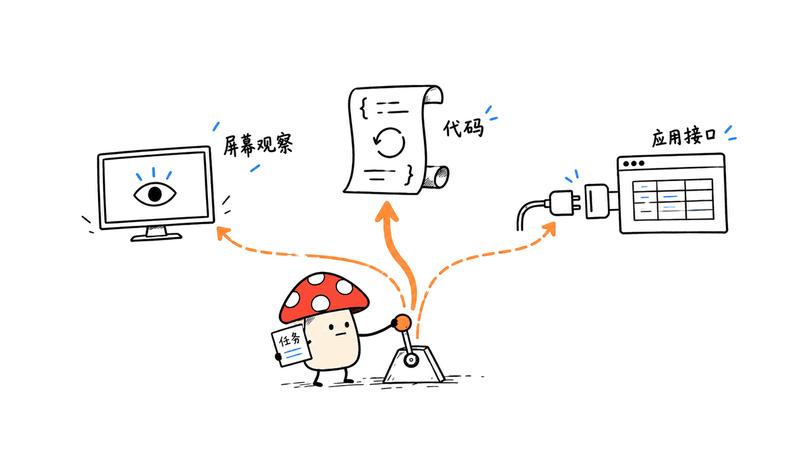
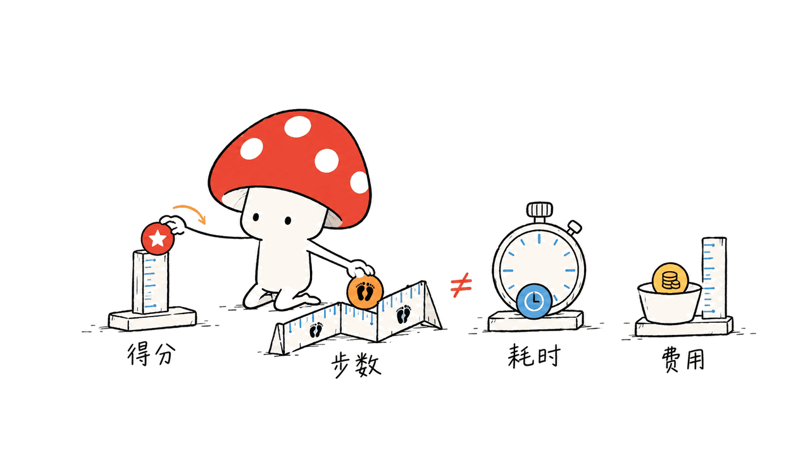
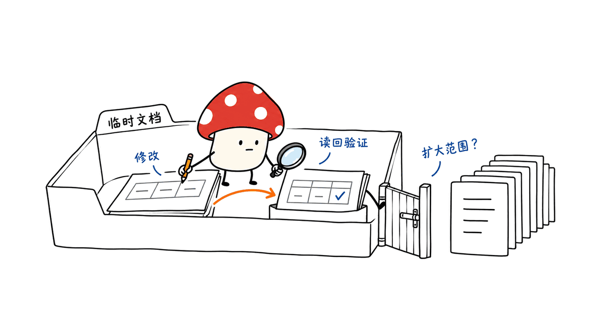

OpenGCUA 是一套让 AI 同时使用屏幕、代码、系统接口和应用 API 来操作电脑的开源技术栈。阿里巴巴 MAI-UI 团队发布的首版，开放了参考 Agent、评测轨迹、真实 Mac 操作框架和跨设备 SDK；当前尚不包含自训模型权重。

这点也回应了“去 Hugging Face 找模型”：2026-10-17 我们查询 HF 的 models、datasets、spaces 搜索 API，`OpenGCUA` 精确项目名均无结果；Tongyi-MAI 官方组织主页有项目介绍，但不等于已提供可下载 checkpoint。模型仍在项目路线图上。代码采用 Apache-2.0，本文固定源码 `625b1cebde1f772328a238881121b76691b8895b`。

## 为什么电脑 Agent 要超出点鼠标？

纯 GUI 流程常常需要截图、推理、点一下，再截图。OpenGCUA 的主张是让模型决定观察什么、怎样行动和如何组织工作：能读结构化信息时读取，能调用应用接口时调用，需要视觉判断时再看屏幕。

代码执行把这些动作放进一个带循环、条件和检查的程序。例如批量更新表格，先读取目标范围，逐项变更，再读取结果核对；比把所有中间状态都交给固定截图循环更灵活。它与“增加一个终端工具”也不同：程序的中间返回值可以决定下一步分支。

另一项设计是 harness-to-model decision transfer：把部分原本由框架写死的观察与任务状态决策交给模型。好处是可适应任务，代价是更依赖模型判断与停止条件，需要把错误恢复、预算和验证同时设计好。



## 首版具体开放了什么？

| 部分 | 可获取内容 | 阶段 |
| --- | --- | --- |
| OSWorld 集成 | 截图动作与代码动作参考 Agent、提示词 | 已开放 |
| 执行轨迹 | 8 个前沿模型的评测过程 | 已开放，可供分析 |
| 真实设备 harness | Mac 菜单栏应用与运行时 | 初步版本 |
| 跨设备 SDK | 电脑、浏览器和手机的统一编程接口 | 初步版本 |
| 自训 GCUA 模型 | 统一电脑与浏览器操作的模型 | 后续计划，首版没有权重 |

“全栈开源”在这里是持续项目的目标，不能写成所有层今天都成熟可用了。轨迹可公开也不代表其中闭源模型的权重开放，更不能据此推断这些轨迹可不受条件地用于训练；实际再利用需查看数据与服务条款。

## 19.6 分提升和 53% 步数下降说明什么？

团队报告在 OSWorld-v2 离线集合上，8 个模型平均 partial score 从 45.3 到 64.9，增加 19.6 个百分点；平均每任务报告步数下降 53%。对照为支持批量动作的 GUI-only 基线。它不是完整任务成功率，也不是壁钟耗时减少 53%。一次代码动作可以包含许多底层操作，步数定义本身要一起看。

额外消融中，在同样有 GUI 与 shell 访问时，代码执行相对 GUI+CLI 基线，三模型均值再提升 6.1 分，步数减少 14.8%。这支持研究“组织执行的方式”，而不仅是给模型更多按钮。

真实 Mac 方面只有四个案例任务。团队给出 Qwen3.8-Max 的报告 reasoning token 用量约为 GPT-6 Astra 的 19.4 倍，完成任务数分别为 3/4、4/4。它是小样本、特定运行设置下的观察，不能变成所有任务的成本或质量排名。我们没有复现这些评测。



## 想在自己的 Mac 上研究，怎么开始？

官方源码路线要求 macOS 14+、Python 3.11–3.14，推荐 3.12；源码构建 SDK 还需 Rust/Cargo 1.89+ 和 Xcode Command Line Tools。预构建 SDK wheel 可省去 Rust，但要核对平台版本。

```bash
git clone https://github.com/Tongyi-MAI/OpenGCUA.git
cd OpenGCUA
uv venv --python 3.12
source .venv/bin/activate
uv pip install -e ./packages/sdk -e ./packages/harness/runtime
mu setup macos
mu doctor macos
```

这些是官方安装步骤，本文只做下述离线验证，未执行设备安装。真正运行时还要给 CuaDriver 辅助功能和录屏权限、配置模型端点，再按官方文档启动 Agent。先复制默认 `macos_demo.json` 为本地配置，修改模型名称、服务地址、密钥与协议，保留其他默认字段；不能用只含四个字段的演示对象覆盖完整配置。

协议也要对应：Chat Completions 兼容服务、Responses 推理服务、Anthropic Messages 有不同配置。界面隐藏推理过程并不表示模型没有使用推理 token；任务费用要记录真实 usage。官方说明 Ctrl-C 只能中止当前回合，已经发往应用或 shell 的操作不会回滚。

## 工程上先验证什么？

先放在测试账号、临时文档或虚拟环境里，用一个可恢复的小任务验收“观察—修改—读回验证”。给批量写入、外部发送、购买等动作设置明确批准点；保留任务材料、模型与版本、工具日志、最终产物及花费，不能只保存视频。

我更看重它公开执行轨迹和观察决策的研究价值。模型更会写程序，未必天然更会在真实桌面停下来；成功判据最好是目标文件或系统状态，而不是模型自报“完成”。前端对话入口与业务执行的分工也可参见：https://blog.mushroom.cv/blog/opentiny-tinyrobot-agent-ui/

本地验证：我们在隔离 Python 3.12 环境运行上游两组模型传输与状态测试，14 项通过，使用模拟响应。没有安装原生驱动、授予权限、调用真实模型、控制桌面或复现 OSWorld。早期环境缺依赖及 Python 版本不符的收集失败已保留，最终测试使用符合要求的 3.12。



## 常见问题

### Hugging Face 上为什么搜不到同名权重？

首版明确没有自训模型。本文核对日的同名模型、数据集和 Space 搜索均为空，不能用其他 MAI-UI 模型代替它冒充本次权重。

### 开源框架是否意味着调用模型免费？

不意味着。所接模型服务、运行设备和工具各有成本，需按请求、token、耗时和任务结果一起评估。

### 它是成熟的无人值守电脑管家吗？

官方将真实设备 harness 和 SDK 标为初步版本。适合研究和受控试用，不能由演示直接推出生产稳定性。

## 一手入口

- 源码：https://github.com/Tongyi-MAI/OpenGCUA
- 项目与轨迹：https://tongyi-mai.github.io/OpenGCUA/
- 论文：https://arxiv.org/abs/2610.22200
- 官方 HF 组织：https://huggingface.co/Tongyi-MAI
- 配置与入门：https://github.com/Tongyi-MAI/OpenGCUA/blob/625b1cebde1f772328a238881121b76691b8895b/QUICKSTART.md

---

> © 2026 Author: Mycelium Protocol. 本文采用 [CC BY 4.0](https://creativecommons.org/licenses/by/4.0/deed.zh) 授权——欢迎转载和引用，须注明作者姓名及原文链接，不得去除署名后以原创发布。

<!--EN-->

OpenGCUA is an open stack for computer-use agents that combine screenshots, code, accessibility interfaces and application APIs. Alibaba’s MAI-UI team has released reference agents, evaluation trajectories, a preliminary Mac harness and a cross-device SDK. The first release does not include a trained model.

On October 17, 2026, our Hugging Face API searches for OpenGCUA returned no models, datasets or Spaces. The official Tongyi-MAI organization introduces the project, but that is not a downloadable checkpoint. The code uses Apache-2.0; this review pins `625b1cebde1f772328a238881121b76691b8895b`.

## Why go beyond clicking a GUI?

OpenGCUA lets the model decide what to observe, how to act and how to organize work. It can read structured state, call application APIs, run shell operations or inspect a screenshot as needed.

Code execution combines these operations in programs with loops, conditions and checks. Intermediate results can determine subsequent actions. This is more flexible than adding a terminal tool to an otherwise fixed screenshot-action loop.

Harness-to-model decision transfer moves selected observation and task-state choices from fixed framework rules to the model. That flexibility also makes stopping conditions, error recovery, budgets and validation important parts of the design.


## What is available in the first release?

| Component | Contents | Stage |
| --- | --- | --- |
| OSWorld integration | Screenshot-action and code-action reference agents and prompts | Released |
| Trajectories | Evaluation runs from eight frontier models | Released |
| Real-device harness | Mac menu-bar application and runtime | Preliminary |
| Cross-device SDK | Shared interface for computers, browsers and phones | Preliminary |
| Trained GCUA model | Unified computer/browser model | Future release |

An open full-stack ambition does not mean every layer is complete today. Released trajectories also do not open the underlying proprietary model weights. Check applicable data and service terms before reusing trajectories for training.

## What do the reported improvements mean?

On the OSWorld-v2 offline set, the authors report mean partial score rising from 45.3 to 64.9 across eight models, a 19.6-point gain, with 53% fewer reported steps per task relative to a batched GUI-only baseline. Partial score is not full-task success rate; fewer steps are not equivalent to the same percentage less wall-clock time. A code step can include many underlying operations.

With GUI and shell access held constant, a three-model ablation reports another 6.1-point gain and 14.8% fewer steps from code execution versus GUI+CLI. This supports studying execution organization alongside tool availability.

The real-Mac comparison covers only four tasks. Selected Qwen3.8-Max runs used 19.4 times the reported reasoning tokens of GPT-6 Astra, completing 3/4 versus 4/4 tasks. That small sample does not establish a universal cost or quality ranking. We reproduced none of these benchmarks.


## How can a Mac developer start?

The source route requires macOS 14+, Python 3.11–3.14, Rust/Cargo 1.89+ and Xcode Command Line Tools; Python 3.12 is recommended. Compatible prebuilt SDK wheels avoid a Rust build.

```bash
git clone https://github.com/Tongyi-MAI/OpenGCUA.git
cd OpenGCUA
uv venv --python 3.12
source .venv/bin/activate
uv pip install -e ./packages/sdk -e ./packages/harness/runtime
mu setup macos
mu doctor macos
```

These are documented installation steps, not steps we executed against our desktop. Real use requires CuaDriver permissions and a model endpoint. Copy the entire default configuration, then edit provider fields; do not replace it with a truncated demonstration object.

Chat Completions, reasoning-oriented Responses and Anthropic Messages require their corresponding settings. Hidden reasoning in the UI does not mean zero reasoning-token usage. The official guide also notes that interrupting a turn cannot undo actions already dispatched to applications or the shell.

Start with recoverable tasks in a test account, temporary documents or an isolated environment. Verify actual outputs, require approval for consequential external actions, and retain model versions, tool logs, artifacts and usage. A recorded demo or the model saying “done” is insufficient evidence of success.

Our local checks used an isolated Python 3.12 environment: 14 upstream transport/status tests passed with simulated responses. Initial dependency and Python-version collection failures were retained and resolved for this limited test selection. We installed no native driver, granted no permissions, made no real model calls and ran no desktop tasks or OSWorld evaluation.

Related UI/execution separation: https://blog.mushroom.cv/blog/opentiny-tinyrobot-agent-ui/


## FAQ

### Why are there no same-name Hugging Face weights?

The first release explicitly has no trained model. Do not substitute another MAI-UI checkpoint and label it OpenGCUA.

### Does an open framework make model calls free?

No. Provider, hardware and tool costs remain. Measure usage, time and completed outcomes together.

### Is it a production-ready unattended desktop assistant?

The real-device harness and SDK are preliminary. They support research and controlled exploration, not an inferred reliability guarantee.

## Primary sources

- Code: https://github.com/Tongyi-MAI/OpenGCUA
- Project and trajectories: https://tongyi-mai.github.io/OpenGCUA/
- Paper: https://arxiv.org/abs/2610.22200
- Official HF organization: https://huggingface.co/Tongyi-MAI
- Pinned setup guide: https://github.com/Tongyi-MAI/OpenGCUA/blob/625b1cebde1f772328a238881121b76691b8895b/QUICKSTART.md

---

> © 2026 Author: Mycelium Protocol. Licensed under [CC BY 4.0](https://creativecommons.org/licenses/by/4.0/) — free to share and adapt with attribution. You must credit the author and link to the original; removing attribution and republishing as original is not permitted.
