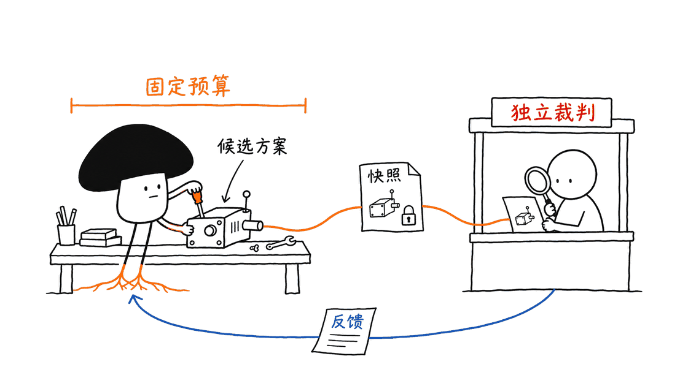
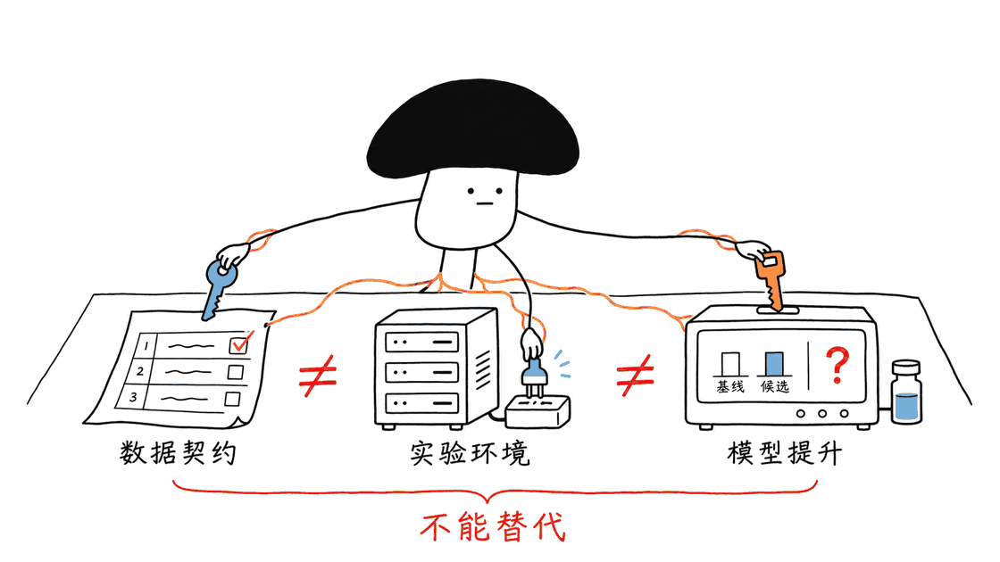
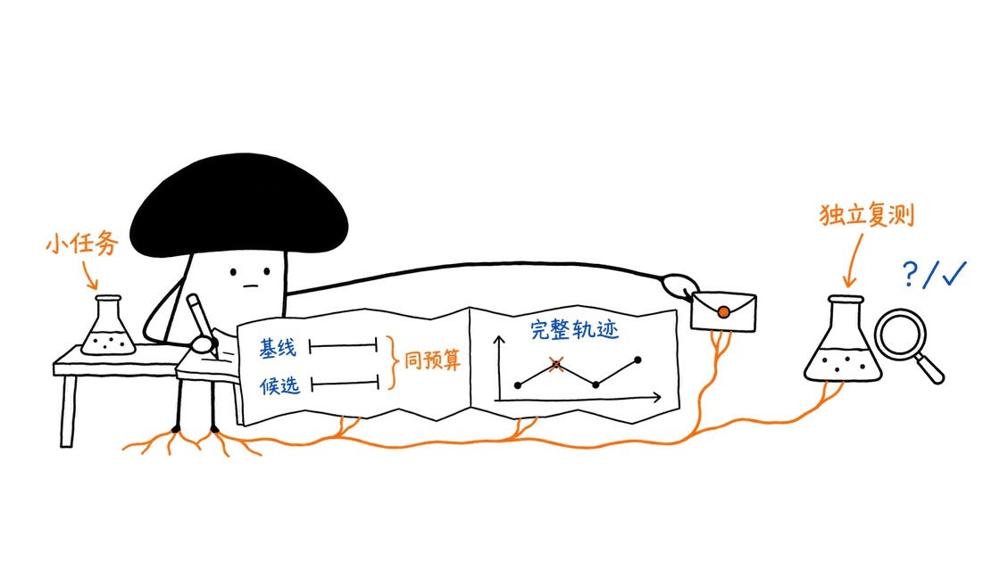

OpenRSI Index 是给科研智能体用的一套开放考场：让 Agent 在规定资源与规则内提出、实现和验证改进，再由独立运行的裁判评分。它关心的是模型研发和系统优化有没有真正进步，而不只是 Agent 能否回答一道题。

官方仓库为 OpenRSI-Foundation/OpenRSI-Index，采用 Apache-2.0。2026年11月10日 API 快照约323 Star；本次固定源码提交为 `8d170deed4591fc7e4306f2d86ff4d9bcffd1288`。它同时提供任务集合、RSI Harness 执行框架与独立发布的实验日志，不是一份可以直接下载部署的“自我进化模型权重”。
https://github.com/OpenRSI-Foundation/OpenRSI-Index
https://index.openrsi.foundation/
https://huggingface.co/datasets/OpenRSI-Foundation/OpenRSI-Index-Logs

## 它到底在测什么，为什么不只是编程题？

普通代码评测常要求实现一个功能，通过一组测试即可。科研任务还要回答：改进是否超过合理的人类基线，是否在相同数据和算力下成立，是否换个规模就失效，以及提升能否由可解释的机制支持。

OpenRSI 的题目覆盖预训练、后训练、视觉、MLSys、Agent 和机器人方向。比如设计能跨规模工作的优化器、调整固定预算下的训练数据、优化 CUDA 算子，或改进冻结模型使用的操作知识。它将“研究方法”本身作为 Agent 的工作对象。

这里的 RSI 是递归自我改进这一研究愿景。但运行框架主要管理科研外循环，内循环仍由现成 Agent 执行。Agent 改进一个优化器、数据集或推理流程，不意味着执行研究的那个基础模型已经自动更新了自己的权重，更不是无限递归能力增长的证明。

我们需要分清三件事：能否完成一次受约束的优化，收益是否能迁移到独立实验，以及改进后的系统能否持续产生更好的下一轮研究。前两项有进展，也不能直接跳到第三项。

## 从这些任务能看出什么设计思路？

| 任务方向 | Agent 能改变什么 | 关键约束或复现条件 |
| --- | --- | --- |
| Marin 优化器 | 优化器更新机制 | 跨550M至2.545B规模；历史运行依赖准备好的集群环境 |
| Qwen-122B 合成RL数据 | 五个领域的干预数据 | 当前公开可执行包检查2,560条记录的数据契约，不执行122B训练 |
| GPIC 图像生成 | 共享起点后的续训目标与配方 | 日志描述固定约10M图像子集、单候选最多一遍、每作业4张H100 |
| GEMM H100 | 手写FP16 CUDA内核 | 正确性约束、固定协议下重复测量吞吐，1张H100 |
| 稀疏预填充 | Triton注意力实现 | 固定任务评价，1张H100 |
| ACE操作知识修复 | 冻结Qwen使用的playbook | 改知识与流程，不是重新训练底座 |

GPU 数量是任务文档描述的资源条件，不能直接换算成已经消耗的 GPU-hours，也不保证所有相关资源都随仓库发布。本次在 `rsi-tasks/` 找到26份 `task.toml`，其中包含集合内的不同任务版本；文件数量不等于26个都能在任意机器上一键复现的独立研究任务。

研究型评测的价值恰恰在这些约束中。训练更久、偷偷换数据或放宽采样预算，都可能让分数变好，却没有回答原来的科学问题。



## RSI Harness 怎样组织一次长时间研究？

Harness 接受受支持的 Harbor 格式任务目录，主要包含 `task.toml`、`instruction.md`、`environment/` 与 `tests/test.sh`。任务描述资源、网络、工作目录和超时；代码负责落实运行生命周期。

一个典型回路是：

1. 创建持续存在的 Work 容器，Agent 在里面编辑代码、记录实验和准备候选。
2. Agent 调用 `rsi-submit`，Harness 暂停 Work 并制作文件系统快照。不是让 Agent 自己打包一个随意选择的提交文件夹。
3. 创建新的 Judge。常见的分离工作目录模式下，它从干净镜像启动，并只读接收工作目录快照，注入裁判测试后执行评分。
4. 保存反馈与 reward，销毁本轮 Judge，恢复同一个 Work，直到提交次数或时间预算耗尽。
5. 按配置的主要指标与最大化或最小化方向，选择有效提交中的最好快照。

不同快照模式会改变 Judge 接收哪些状态，不能把所有任务都描述成“只复制几个代码文件”。例如全根目录模式或 `clean_image = false` 有单独规则，应检查实际任务配置。

Work 保留研究过程，Judge 每轮重建，解决的是“实验可以继续，但计分环境不能被候选随意改写”的问题。它比让 Agent 在同一个可写目录里修改答案和测试更有约束力。

默认隐藏裁判时，私有 `tests/` 不挂载给 Work。任务也可以声明公开 Judge，让 Work 只读看到测试；框架记录并检查对应摘要。公开规则可用于开放科研的评审，但不能再宣传成从未向 Agent 暴露的隐藏测试集。

Harness 文档：
https://github.com/OpenRSI-Foundation/OpenRSI-Index/tree/8d170deed4591fc7e4306f2d86ff4d9bcffd1288/RSI-Harness

## 独立裁判能解决什么，还解决不了什么？

快照、只读挂载、独立身份、网络策略和分数解析，是降低评测被污染风险的工程机制。它们不能自动证明任务定义正确、训练数据无泄漏、裁判无法绕过，或者实验结论能泛化。

频繁获得反馈，也可能逐步拟合裁判。如果最终分数取多次尝试中的最好值，应同时保留提交次数、筛选算力、失败轨迹和随机种子。否则比较的可能是试错机会，不是研究能力。

GEMM 任务很直观：当前包要求在正确性门槛下，取五次完整协议重复的吞吐中位数作为 reward，并明确存在候选无效与基础设施失败的不同处理。它也说明还没有报告或复现转换后固定协议下的匹配基线，不能把旧文档不同版本的吞吐拼成官方提升倍数。

因此，“能跑 Judge”和“科学结论成立”是两层验收。前者验证执行系统，后者还需要匹配基线、消融、足够规模和独立复测。
https://github.com/OpenRSI-Foundation/OpenRSI-Index/tree/8d170deed4591fc7e4306f2d86ff4d9bcffd1288/rsi-tasks/gemm-h100-refined

## 三个标志性任务，最容易误读在哪里？

### Qwen-122B：数据通过不等于模型变强

当前公开 README 写得很明确：可执行范围是 data-only wrapper，检查生成数据是否满足契约。它不运行122B模型训练，也不运行后续五项模型评测。我们实际调用任务编译器，得到的这个包 GPU 需求为0；这与首页“256张H100”的完整科学实验资源描述不是同一个执行范围。

包装器检查2,560条干预记录、每领域512条，以及标识符、重复和字段约束。数据格式正确，只能说明候选可进入后续流程，不说明难度合适、奖励信号有效或训练后性能提升。

任务保留 Anchor 71.7089% 与历史 Research Agent 71.9123% 的参考宏平均值，但也明确提示历史候选使用了不同训练配方，存在协议不匹配。这些数字不是当前 wrapper 的 reward，更不能直接当作严格匹配实验的因果收益。公开来源缺少部分私有训练实现与运行资源，复制脚本不能补齐这些缺口。
https://github.com/OpenRSI-Foundation/OpenRSI-Index/tree/8d170deed4591fc7e4306f2d86ff4d9bcffd1288/rsi-tasks/signature-tasks/post-training-qwen-122B-rl

### Marin：公开了研究证据，不代表已经打包好集群

Marin 的优化器任务考查同一个更新机制是否跨模型规模有效，比只挑一个小模型做参数扫描更有说服力。但当前目录是历史实验环境的脱敏保留版，README 明确说它不是可直接构建的 Harbor 任务，没有 Dockerfile、Judge 或 solution；`task.toml` 只是元数据。

复现还需要256-GPU资源分配、准备好的运行镜像、预分词数据、Paloma评测资产以及对应调度代理。源码修订号、基线文件和轨迹提高了可审计性，但没有把外部部署条件变成不存在。
https://github.com/OpenRSI-Foundation/OpenRSI-Index/tree/8d170deed4591fc7e4306f2d86ff4d9bcffd1288/rsi-tasks/signature-tasks/pre-training-optimizer-update-geometry

### GPIC：筛选进展、最终成绩与旧任务不是一回事

公开续训轨迹从共同 PixelGen 起点出发，在约10M图像子集上探索训练配方。HF轨迹摘要给出起点筛选 FD 1286.4504，以及 Codex 1043.3926、Claude 729.3343 的最好观察值；FD越低越好。

但任务 README 进一步说明两条轨迹使用了不同的 caption 集合与样本数量，摘要中的18.89%和43.31%也基于所列起点做计算，不能当作条件统一的跨 Agent 排名。公开快照包含筛选结果和仍在运行的完整训练，不是封存的最终50k测试分数。

更容易踩坑的是，目录里的旧 Harbor 实现仍对应100M图像、从零训练和8张H100；新的日志描述10M续训、每作业4张H100。说明文档的更新不等于运行包已经迁移。当前复现还需要共同checkpoint、子集manifest、启动器及匹配评价设置。

公开摘要与任务说明应一起读：
https://huggingface.co/datasets/OpenRSI-Foundation/OpenRSI-Index-Logs/blob/main/signature-tasks/gpic-10m-autoresearch/summary/traj_progress_summary.md
https://github.com/OpenRSI-Foundation/OpenRSI-Index/tree/8d170deed4591fc7e4306f2d86ff4d9bcffd1288/rsi-tasks/signature-tasks/gpic_generation



## 本次在本机实际验证了什么？

我们在独立临时 Python 3.12 环境安装固定提交的 Harness，运行 reward解析、任务目录摘要、任务编译、提交服务四个测试文件，共183项通过。它们覆盖非有限分数拒绝、主指标选择、文件变化影响摘要、越界符号链接处理，以及提交认证等局部行为。

另外实际调用 `HarborTaskCompiler` 编译 GEMM、稀疏预填充和 Qwen 数据包，得到 GPU 需求分别为1、1、0。读取 Qwen 两份公开 JSONL，各有2,560条，文件字节数与 SHA-256 均与任务文档一致。

这些检查没有创建容器、修改主机防火墙、调用真实模型或启动训练；也没有跑完整测试集、GPU吞吐、Mac控制器或长时间集群实验。183项通过是所选模块的证据，不是研究收益或整套安全性的认证。

复核测试命令如下，须先安装项目依赖和 pytest：

```bash
cd OpenRSI-Index/RSI-Harness
python -m pytest   tests/runtime/test_reward.py   tests/task/test_digest.py   tests/task/test_compiler.py   tests/runtime/test_submissions.py -q
```

## 工程上怎么开始，才不会一上来烧大集群？

先读一个具体任务的 README、instruction 和 task.toml，确认可编辑范围、指标、预算、数据来源与外部资产；再检查包是否真的与日志协议一致。不要直接从首页显卡数量推断安装条件。

标准执行路径是 Linux Docker，GPU任务还需要 NVIDIA驱动、Container Toolkit与对应GPU。Harness要求 Python 3.12或3.13。它支持本地Docker和受支持的Slurm/LSF环境，集群路径仍有站点配置与存储、网络要求。

先固定版本安装：

```bash
git clone https://github.com/OpenRSI-Foundation/OpenRSI-Index.git
cd OpenRSI-Index
git checkout 8d170deed4591fc7e4306f2d86ff4d9bcffd1288
uv tool install --python 3.12 ./RSI-Harness
```

下面是准备好Linux/H100环境后的读者示例，本次未执行；`RSI_MODEL`填入自己账号实际可用、并受当前Agent支持的模型。先完成对应登录，再运行：

```bash
export RSI_TASK="$PWD/rsi-tasks/gemm-h100-refined"
export RSI_GPU_POOL="0"
export RSI_MODEL="your-supported-model-id"
sudo -E "$(command -v rsi-harness)" run "$RSI_TASK"   --agent codex --agent-auth local   --model "$RSI_MODEL"   --gpus "$RSI_GPU_POOL"   --primary-reward reward --score-direction maximize   --max-submissions 3 --verbose
```

这里沿用官方 Linux root 控制器路线，它会管理评测网络策略。项目也有无需root的支持路径，条件不同，应按对应文档配置，不能靠删除检查来迁就环境。Agent的模型API费用、GPU时长、数据准备、存储与筛选实验都应纳入成本。

Mac用户可以先阅读、编译和运行选定CPU单元测试。实验性的原生macOS控制器使用Docker Desktop里的Linux容器，当前限定CPU、非sandbox、分离工作目录等范围；它不是把H100任务迁移到Apple GPU的方案。本次没有执行会创建真实容器和防火墙规则的Mac验收测试。

安装和平台边界：
https://github.com/OpenRSI-Foundation/OpenRSI-Index/blob/8d170deed4591fc7e4306f2d86ff4d9bcffd1288/assets/docs/quick-start.md
https://github.com/OpenRSI-Foundation/OpenRSI-Index/blob/8d170deed4591fc7e4306f2d86ff4d9bcffd1288/RSI-Harness/docs/macos-docker-desktop.md

## 谁值得投入时间，应该产出什么？

如果在做科研Agent、训练平台、算子优化或评测基础设施，这个项目值得研究。最可复用的资产，是把一个科学问题变成可编辑边界、资源预算、匹配基线与可信评价的任务设计方法。

小团队可以先贡献一个资源可控、失败可解释的任务，而不是追求一次性覆盖所有方向。验收至少保留版本、环境和数据摘要、实际算力、完整轨迹、候选与基线同协议结果，并用额外种子或规模做独立确认。若裁判公开，就明确标记；若最终结果还没有封存，就按进展报告发布。

代码Apache许可也不自动覆盖任务依赖的每个模型、数据集和外部服务。Qwen任务文档明确保留上游数据条款，使用前仍要分别确认。

对“已经证明递归自我改进”的判断，本文保持谨慎。OpenRSI的现实价值，是让这种判断开始有实验契约和可审计证据，而不是让宣传语替代科学验证。



## 常见问题

### 这是模型、排行榜，还是开发框架？

它是持续建设中的评测项目，包含任务集合、RSI Harness与公开实验轨迹。不要把Index理解为一份已发布的自我训练模型，也不要假定目前所有结果都能组成统一排名。

### 只有一台Mac，可以复现什么？

可以研究源码、运行适合CPU的局部测试并检查任务契约。Mac控制器仍是实验性有限支持，不能复现H100训练和CUDA吞吐结果。

### 拿到reward为1，能说模型提升了吗？

需要先看reward含义。Qwen公开包装器的二元reward表示数据契约是否通过，不代表执行训练或提升模型分数。

### 能否用这些结果比较不同科研Agent？

只有预算、数据、模型起点、采样、评价与选择规则匹配时，才适合做对应范围的比较。GPIC当前公开轨迹尤其需要保留筛选协议差异，不能只按最好FD给Agent排位。

延伸阅读：如何区分训练数据、训练成本与评测协议：
https://blog.mushroom.cv/blog/axion-agent-training-data-cost-review/

---

> © 2026 Author: Mycelium Protocol. 本文采用 [CC BY 4.0](https://creativecommons.org/licenses/by/4.0/deed.zh) 授权——欢迎转载和引用，须注明作者姓名及原文链接，不得去除署名后以原创发布。

<!--EN-->

OpenRSI Index is an open evaluation environment for research agents: an agent proposes, implements and tests improvements under a defined resource budget, while a separate Judge scores submissions. It asks whether foundation-model development or systems research improves, rather than only whether an agent can answer a question.

The official repository is OpenRSI-Foundation/OpenRSI-Index, licensed Apache-2.0. Our November 10, 2026 API snapshot showed about 323 stars. This review pins commit `8d170deed4591fc7e4306f2d86ff4d9bcffd1288`. The project includes tasks, RSI Harness and separately published research logs; it is not a downloadable self-evolving model checkpoint.
https://github.com/OpenRSI-Foundation/OpenRSI-Index
https://index.openrsi.foundation/
https://huggingface.co/datasets/OpenRSI-Foundation/OpenRSI-Index-Logs

## What does research-agent evaluation add?

A coding benchmark may ask for an implementation that passes tests. Research also needs a credible baseline, equal data and compute, a mechanism worth testing, and evidence that the result survives another scale or independent experiment.

OpenRSI covers pretraining, post-training, vision, MLSys, agents and robotics. Tasks include optimizer design, synthetic training data, CUDA kernels and repairing operating knowledge for a frozen model. The object being improved is a research method or workflow.

Recursive self-improvement is the broader research ambition. The Harness manages the outer experimental loop, while an existing agent supplies the inner loop. Improving an optimizer, dataset or inference pipeline does not establish that the researching model updated its own weights or entered indefinitely accelerating recursion.

Completing one constrained optimization, transferring its benefit to independent experiments, and making the resulting system a better researcher are distinct claims.

## What kinds of tasks are present?

| Direction | Editable target | Important boundary |
| --- | --- | --- |
| Marin optimizer | Update mechanism across 550M–2.545B models | Historical experiment requires prepared cluster assets |
| Qwen-122B RL data | Intervention data in five domains | Public executable wrapper validates 2,560 records; no 122B training |
| GPIC generation | Continuation objective and training recipe | Logged protocol uses a shared approximately 10M subset and four H100s per job |
| H100 GEMM | Hand-written FP16 CUDA kernel | Correctness gates and repeated fixed-protocol throughput measurements |
| Sparse prefill | Triton attention implementation | Task-specific evaluation on one H100 |
| ACE playbook repair | Knowledge used by a frozen Qwen model | Workflow/knowledge change, not base-model retraining |

GPU counts are documented requirements, not consumed GPU-hours. Our inventory found 26 task.toml files under rsi-tasks, including collection variants. That does not establish 26 independent, universally portable experiments.

The constraints define the scientific question. More training, a different dataset or a larger sampling budget can improve a score without answering that question.


## How does RSI Harness manage a long research run?

A supported Harbor task contains task.toml, instruction.md, environment/ and tests/test.sh. Configuration specifies resources, networking, working directories and timeouts.

1. A persistent Work container gives the agent a place to edit code and record experiments.
2. rsi-submit asks the controller to pause Work and snapshot filesystem state. The agent does not package its own arbitrary submission archive.
3. A fresh Judge starts for the round. In the common split-workdir mode, it starts from the clean image, mounts the workspace snapshot read-only and receives task-owned tests.
4. The controller records feedback and reward, removes the Judge and resumes the same Work container.
5. At the submission or time limit, the best valid snapshot is selected according to the configured primary metric and score direction.

Full-rootfs and clean_image=false cases follow different snapshot rules; not every task transfers only a few source files. Work continuity and Judge freshness separate ongoing experimentation from the authority that assigns scores.

Hidden tests are not mounted into Work by default. A task may instead declare a public Judge, exposing its tests read-only while checking their digest. That can fit an open scientific rubric, but it must not be described as an unseen holdout.
https://github.com/OpenRSI-Foundation/OpenRSI-Index/tree/8d170deed4591fc7e4306f2d86ff4d9bcffd1288/RSI-Harness

## What does isolation establish, and what does it leave unresolved?

Snapshots, read-only mounts, separate identities, network policy and reward parsing reduce opportunities to contaminate evaluation. They do not automatically prove that the task is scientifically sound, data is uncontaminated, isolation is unbreakable or improvements generalize.

Repeated feedback can also encourage fitting the evaluator. A best-of-many result needs submission counts, screening compute, failed trajectories and random seeds. Otherwise it may measure opportunity to search rather than research capability.

The GEMM task makes this concrete: reward is median throughput over five complete fixed-protocol repeats after correctness gates. Invalid candidates and infrastructure failures receive different treatment. Its README explicitly says a matched result under the converted protocol has not been reported or reproduced. Historical numbers from different evaluators must not be assembled into an official speedup.
https://github.com/OpenRSI-Foundation/OpenRSI-Index/tree/8d170deed4591fc7e4306f2d86ff4d9bcffd1288/rsi-tasks/gemm-h100-refined

## Where do the signature-task claims need extra care?

### Qwen-122B: passing a data contract is not model improvement

The public executable package is a data-only wrapper. It does not perform 122B training or the subsequent five-benchmark model evaluation. Our real task-compiler call reported zero required GPUs for this wrapper; the homepage's 256-H100 scientific experiment describes a different execution scope.

The wrapper checks 2,560 intervention records, 512 per domain, along with identifiers, duplicates and schema constraints. Valid data may be usable input; it does not establish appropriate difficulty, useful rewards or improved model quality.

The README preserves reference macro scores of 71.7089% for Anchor and 71.9123% for a historical Research Agent, while explicitly documenting that the candidate used a different training recipe. They are not reward operands or matched baseline measurements. Private training implementations and runtime assets are missing from the public release.
https://github.com/OpenRSI-Foundation/OpenRSI-Index/tree/8d170deed4591fc7e4306f2d86ff4d9bcffd1288/rsi-tasks/signature-tasks/post-training-qwen-122B-rl

### Marin: auditable evidence is not a packaged cluster

Testing one optimizer mechanism across model scales is stronger than selecting a favorable small-model sweep. However, the current directory is a sanitized historical environment, explicitly not a Harbor-buildable task. It has no Dockerfile, Judge or solution; task.toml is metadata.

Reproduction requires a 256-GPU allocation, prepared runtime image, pretokenized data, Paloma assets and the relevant scheduling proxy. Pinned revisions, baseline files and trajectories improve auditability without removing external infrastructure requirements.
https://github.com/OpenRSI-Foundation/OpenRSI-Index/tree/8d170deed4591fc7e4306f2d86ff4d9bcffd1288/rsi-tasks/signature-tasks/pre-training-optimizer-update-geometry

### GPIC: screening, final evaluation and the old package differ

The published continuation trajectories start from a shared PixelGen checkpoint and approximately 10M-image subset. The HF summary lists a screening anchor FD of 1286.4504, with best observed values of 1043.3926 for Codex and 729.3343 for Claude. Lower FD is better.

The task README explains that the two trajectories use different caption sets and sample counts. The summary's 18.89% and 43.31% reductions are calculations against its listed anchor, not a protocol-matched cross-agent ranking. The published snapshot contains screening results and ongoing full runs, not a sealed final 50k test score.

The packaged legacy Harbor implementation still describes 100M images, training from scratch and eight H100s. The logged continuation uses 10M and four H100s per job. Updating the task description did not migrate that runtime. Reproduction also needs the common checkpoint, subset manifest, launchers and matching evaluation settings.
https://huggingface.co/datasets/OpenRSI-Foundation/OpenRSI-Index-Logs/blob/main/signature-tasks/gpic-10m-autoresearch/summary/traj_progress_summary.md
https://github.com/OpenRSI-Foundation/OpenRSI-Index/tree/8d170deed4591fc7e4306f2d86ff4d9bcffd1288/rsi-tasks/signature-tasks/gpic_generation


## What did we verify locally?

We installed the pinned Harness in a temporary Python 3.12 environment and ran four existing test files for reward parsing, task digests, compilation and submission services: 183 checks passed. These exercise such behaviors as rejecting non-finite rewards, choosing a primary metric, digest sensitivity, escaping symlink handling and submission authentication.

We also called HarborTaskCompiler on GEMM, sparse prefill and the Qwen data wrapper, obtaining GPU requirements of one, one and zero. Both released Qwen JSONL files contained 2,560 records; their byte counts and SHA-256 values matched the task documentation.

No containers, firewall modifications, real model calls or training were involved. We did not run the full suite, GPU throughput, the Mac controller or cluster experiments. These results support selected module behavior, not the scientific gains or complete system security.

After installing the project and pytest, reproduce the targeted tests with:

```bash
cd OpenRSI-Index/RSI-Harness
python -m pytest   tests/runtime/test_reward.py   tests/task/test_digest.py   tests/task/test_compiler.py   tests/runtime/test_submissions.py -q
```

## How should an engineer start?

Read the chosen task's README, instruction and task.toml first. Establish editable boundaries, metric, budget, data provenance and external assets, then check that the executable package matches the logged protocol.

The standard path uses Linux Docker; GPU tasks additionally need NVIDIA drivers, Container Toolkit and the required hardware. Harness requires Python 3.12 or 3.13 and supports local Docker and supported Slurm/LSF allocations, with site-specific configuration.

```bash
git clone https://github.com/OpenRSI-Foundation/OpenRSI-Index.git
cd OpenRSI-Index
git checkout 8d170deed4591fc7e4306f2d86ff4d9bcffd1288
uv tool install --python 3.12 ./RSI-Harness
```

The following is an unexecuted reader example for a prepared Linux/H100 host. Replace RSI_MODEL with an actually available model supported by the selected agent and complete the corresponding login first:

```bash
export RSI_TASK="$PWD/rsi-tasks/gemm-h100-refined"
export RSI_GPU_POOL="0"
export RSI_MODEL="your-supported-model-id"
sudo -E "$(command -v rsi-harness)" run "$RSI_TASK"   --agent codex --agent-auth local   --model "$RSI_MODEL"   --gpus "$RSI_GPU_POOL"   --primary-reward reward --score-direction maximize   --max-submissions 3 --verbose
```

This follows the documented Linux root-controller path, which manages evaluation networking. A separate no-root path has different prerequisites. Follow those instructions rather than disabling checks. Count model calls, GPU time, data preparation, storage and screening experiments in the budget.

On a Mac, source review, compilation and selected CPU tests are useful starting points. The experimental native macOS controller uses Linux containers inside Docker Desktop and has limited CPU-only, non-sandbox, split-workdir support. It does not move H100 training onto Apple GPUs. We did not run the real Mac acceptance tests that create containers and firewall rules.
https://github.com/OpenRSI-Foundation/OpenRSI-Index/blob/8d170deed4591fc7e4306f2d86ff4d9bcffd1288/assets/docs/quick-start.md
https://github.com/OpenRSI-Foundation/OpenRSI-Index/blob/8d170deed4591fc7e4306f2d86ff4d9bcffd1288/RSI-Harness/docs/macos-docker-desktop.md

## Who should study it, and what should they produce?

Research-agent teams, training-platform engineers, kernel developers and evaluation builders can reuse its approach to converting a scientific question into editable boundaries, resource limits, a matched baseline and trustworthy evaluation.

Start with a manageable task and interpretable failures. Preserve revisions, environment and data digests, actual compute, full trajectories and protocol-matched candidate/control results. Confirm gains with another seed or scale. Label public rubrics and unfinished final runs clearly.

Apache licensing for the repository does not automatically cover every model, dataset or external service used by its tasks. The Qwen package explicitly preserves upstream data terms.

The defensible conclusion is that OpenRSI helps make research-agent claims auditable. Whether a system demonstrates recursive self-improvement still requires evidence beyond a successful task or attractive headline.


## FAQ

### Is this a model, a leaderboard or a framework?

It is an evolving evaluation project with tasks, RSI Harness and research trajectories. It is not a released self-training checkpoint, and the current results do not automatically form one unified ranking.

### What can a Mac-only developer reproduce?

Source inspection, suitable CPU tests and task-contract checks. The Mac controller is experimental and limited; H100 training and CUDA throughput results remain outside that scope.

### Does reward=1 mean the model improved?

Inspect the reward definition. In the public Qwen wrapper, the binary reward indicates a valid data contract, not completed training or improved benchmark scores.

### Can the published results rank research agents?

Only within matched budgets, data, initialization, sampling, evaluation and selection rules. The GPIC screening protocols currently differ and must not be reduced to a best-FD agent ranking.

Related background on training data, compute costs and evaluation protocols:
https://blog.mushroom.cv/blog/axion-agent-training-data-cost-review/

---

> © 2026 Author: Mycelium Protocol. Licensed under [CC BY 4.0](https://creativecommons.org/licenses/by/4.0/) — free to share and adapt with attribution. You must credit the author and link to the original; removing attribution and republishing as original is not permitted.
