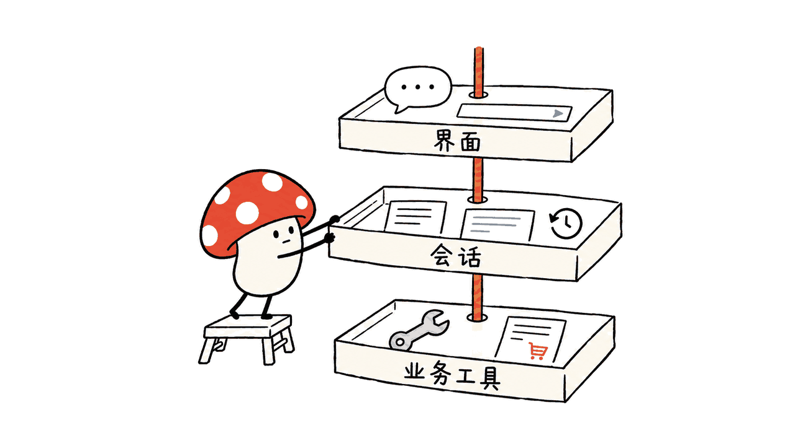
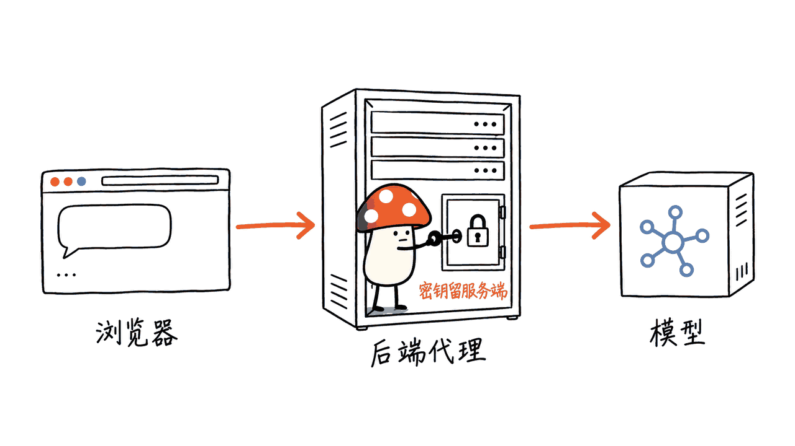
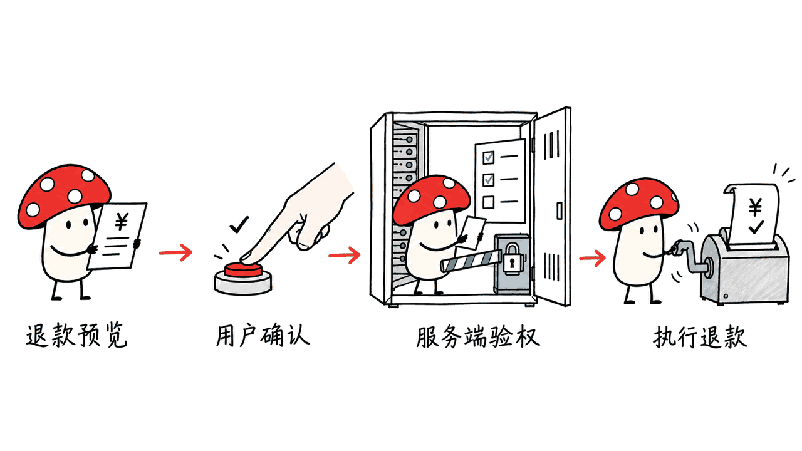

TinyRobot 是一套给 AI 助手搭建对话界面的 Vue 3 组件与工具：输入框、消息气泡、流式输出、会话列表和工具执行展示，都有现成积木。它属于华为云开源的 OpenTiny 生态；想给已有业务系统加一个 Agent 入口，可以从它入手。

先把名字说准：**OpenTiny 是生态，TinyRobot 才是这里具体的 AI 对话组件库。** 仓库为 `opentiny/tiny-robot`，MIT 许可证明确列有 OpenTiny Authors 和 Huawei Cloud Computing Technologies 的版权。华为背景有一手依据，但这不等于安装一个包，就得到完整的企业 Agent 平台。

本文核对日期为 2026-10-17，源码固定在 `7a5b22ccaa9cafd0a2ad14dce526d79c03e90070`。以下区分官方能力、源码观察与本地验证。

## 它解决的究竟是哪一层问题？

一个业务助手，至少有三份工作：把交互呈现给用户，管理消息与请求生命周期，再去调用真正的业务系统。TinyRobot 已经超出纯气泡皮肤，但这些工作仍有边界。

| 层次 | 对应项目或包 | 主要职责 |
| --- | --- | --- |
| 基础交互 | `@opentiny/tiny-robot` | 气泡、输入、附件、历史、工具消息等界面组件 |
| 消息与会话 | `@opentiny/tiny-robot-kit` | 模型请求、消息与会话管理、存储策略、技能能力 |
| 页面装配 | `@opentiny/tiny-robot-chat` | `TrChat`、`useChatRuntime`，把布局和会话运行逻辑接起来 |
| 业务能力连接 | WebMCP SDK / Web Agent 等生态项目 | 将应用功能连接为可调用工具，按项目架构接入 |
| 动态业务界面 | GenUI SDK | 根据任务生成可交互的界面；需要另外集成 |

这里的价值是把反复出现的前端状态管理和交互工作抽出来。模型、业务 API、用户权限、服务端审计仍然要由应用团队接好。GenUI、WebMCP 是关联项目，不能算作安装基础 UI 包自动获得的全部能力。



## 组件之外，哪些能力值得关注？

源码和文档已经提供流式响应、发送与取消、会话切换，以及模型选择的接入方式。Kit 提供 LocalStorage、IndexedDB 和自定义会话存储策略，让试做一个浏览器内助手更省事。它们解决的是存取会话的机制，跨设备同步、租户隔离和保留期限仍取决于后端实现。

更接近 Agent 产品的部分是工具和技能：当前 Chat 运行时允许配置 MCP 服务，文档明确要求默认接入的服务支持 Streamable HTTP，并且浏览器可访问；已有连接也可以通过自定义适配接入。技能有加载和存储等模块。把这些模块接通之后，界面才有机会展示“准备执行—调用工具—返回结果”的过程。

要注意一处更新痕迹：仓库顶层 README 的包表主要列出基础组件、Kit 和 SVG；实际源码和新版套件文档还包含独立 Chat 装配包。只读 README 容易漏掉更完整的入口，也容易抄到已标记 deprecated 的旧 `AIClient` 用法。新项目应优先查当前 `TrChat` 与 `useChatRuntime` 文档。

## 怎样开始，才不容易被版本绊倒？

2026-10-17 直接查询 npm registry，得到下面的分发标签。这是当天快照，不是永久兼容承诺。

| 包 | `latest` | `rc` |
| --- | --- | --- |
| `@opentiny/tiny-robot` | 0.5.1 | 1.0.0-rc.1 |
| `@opentiny/tiny-robot-kit` | 0.5.1 | 1.0.0-rc.1 |
| `@opentiny/tiny-robot-chat` | 0.4.1 | 1.0.0-rc.1 |

所查看源码中这三个包的版本字段均为 0.5.1，和 npm 的 Chat `latest` 并不相同。**不要把 develop 分支文档、不同包的 latest 和预发布示例随意混用。** 需要完整 Chat 新接口时，先在隔离项目核对对应 tag、包内容和 peer dependencies，再固定同一发布线及应用 lockfile；RC 需要自行验收。

如果只是先验证视觉接入，从基础气泡开始更容易定位问题。在兼容的 Vue 3 项目中安装基础组件，并处理其 peer dependencies：

```bash
pnpm add @opentiny/tiny-robot@0.5.1
```

```vue
<script setup>
import { TrBubble } from '@opentiny/tiny-robot'
import '@opentiny/tiny-robot/dist/style.css'
</script>

<template>
  <TrBubble role="ai" content="我可以帮你查询工单进度。" />
</template>
```

这个片段只展示 UI，不会自动请求模型。随后再接 Chat 套件。所核对的新套件文档要求 Vue 3.3.11 及以上，顶层 README 写的 Vue 3.2 起步不宜直接当作所有套件的要求。

接模型的顺序则是：浏览器请求你自己的后端代理，代理保管模型密钥并调用服务，流式结果返回 TinyRobot。当前 Chat 文档提供 OpenAI-compatible `/chat/completions` 地址配置，并有 DeepSeek、Qwen 预设。具体模型是否支持工具、流式与特定参数，要按接口逐项验收；不要由一个兼容地址推导出所有能力通用。



## 真正落到企业业务，差的是什么？

拿“查询工单，必要时退款”举例，第一版只开放查询工具：服务端根据当前登录身份限制可见工单，模型只返回查询结果。第二版再做退款预览，把订单、金额与理由展示给人确认，确认后由服务端重新检查权限、额度与幂等键，再执行写操作。

TinyRobot 的 `beforeSend` 可以阻止发送、允许继续，或把流程交给业务自行处理；文档也明确默认不执行自定义检查。这个钩子适合做交互门槛和输入检查。**业务授权必须在服务端执行。** 浏览器按钮禁用、模型回答“已确认”，都不能替代退款接口的权限校验。

同样，MCP 工具能连上，只证明连接路径成立。还要补齐超时、取消、失败重试、重复提交保护、工具结果的用户可读解释，以及审计记录。权限与密钥由服务端管理也正是官方 Chat 文档给出的生产建议。

我的判断是：TinyRobot 最适合已有 Vue 业务系统、后端服务与身份体系的团队。它能减少搭建 AI 交互入口的重复劳动；如果后台接口和数据权限尚未理清，先把那一层收紧，前端组件不会自动解决这些问题。关于工具执行与外部通信的另一类边界，可参见我们对 UseChat 的拆解：https://blog.mushroom.cv/blog/usechat-wechat-agent-runtime/



## 我们验证到了哪一步？

本次在 Apple M4 / macOS 上拉取上述固定源码，检查包结构、运行时文档、许可证和 npm 分发标签，完成组件和 Chat 套件构建；Kit 上游测试 191 项通过、1 项跳过，Chat 上游测试 18 项通过，发布脚本测试 13 项通过。它们检查会话、存储、技能、错误状态及发布校验等代码行为，不证明真实模型或 MCP 业务链路已跑通。

仓库将 pnpm lockfile 列入忽略项，首次 frozen 安装未成功；随后使用 `--no-frozen-lockfile --ignore-scripts` 在隔离副本安装依赖，源码未修改，保留了解析记录。Kit 首次直接运行有 4 项因缺少 fixture 失败；运行上游 `pretest` 下载固定版本素材后，最终得到上述结果。本文没有进行真实模型调用、真实 MCP 业务操作、生产权限测试或性能测量，不把源码能力当成完整应用实测。

## 常见问题

### OpenTiny 是华为开源的吗？

华为云官方资料将 OpenTiny 描述为其开源前端开发套件，TinyRobot 仓库的 MIT 许可证也明确列有华为云计算技术公司的版权。准确说法是：华为云开源生态 OpenTiny 中，TinyRobot 提供 AI 对话组件与工具。

### 能直接用于 React 或 Vue 2 吗？

TinyRobot 当前定位是 Vue 3。OpenTiny 其他产品覆盖多技术栈，不代表 TinyRobot 本身支持 React 或 Vue 2。新 Chat 套件文档要求 Vue 3.3.11 及以上。

### MIT 就意味着模型和调用也免费吗？

MIT 允许按许可证条件使用、修改和分发代码。模型服务、MCP 服务与部署资源各有成本和条款，不能把代码许可证理解成所有上游服务免费。

## 一手资料

- 源码与 MIT 许可证：https://github.com/opentiny/tiny-robot/tree/7a5b22ccaa9cafd0a2ad14dce526d79c03e90070
- 当前套件接入文档：https://github.com/opentiny/tiny-robot/blob/7a5b22ccaa9cafd0a2ad14dce526d79c03e90070/docs/src/suites/quick-start.md
- 运行时、认证与 MCP 配置：https://github.com/opentiny/tiny-robot/blob/7a5b22ccaa9cafd0a2ad14dce526d79c03e90070/docs/src/suites/chat-runtime.md
- 华为云 OpenTiny 项目介绍：https://bbs.huaweicloud.com/blogs/405316
- 官方文档入口：https://opentiny.design/tiny-robot
- npm 版本标签：https://registry.npmjs.org/@opentiny/tiny-robot-chat
- 生态关联：https://github.com/opentiny/webmcp-sdk ，https://github.com/opentiny/genui-sdk

---

> © 2026 Author: Mycelium Protocol. 本文采用 [CC BY 4.0](https://creativecommons.org/licenses/by/4.0/deed.zh) 授权——欢迎转载和引用，须注明作者姓名及原文链接，不得去除署名后以原创发布。

<!--EN-->

TinyRobot supplies Vue 3 components and tools for an AI assistant’s conversation interface: input, message bubbles, streaming replies, conversation history, and tool interaction displays. It belongs to Huawei Cloud’s OpenTiny ecosystem and is useful when an existing application needs an agent entry point.

OpenTiny is the broader ecosystem; TinyRobot is the specific conversational UI project. Its MIT license names both OpenTiny Authors and Huawei Cloud Computing Technologies. That establishes the Huawei connection, while leaving the application team responsible for the backend and business controls.

This review was checked on 2026-10-17 against commit `7a5b22ccaa9cafd0a2ad14dce526d79c03e90070`. We distinguish documented features, source observations, and our limited local checks.

## Which layer does TinyRobot cover?

| Layer | Package or project | Responsibility |
| --- | --- | --- |
| UI primitives | `@opentiny/tiny-robot` | Bubbles, input, attachments, history and tool messages |
| Messages and conversations | `@opentiny/tiny-robot-kit` | Model requests, lifecycle management, storage strategies and skills |
| Chat assembly | `@opentiny/tiny-robot-chat` | `TrChat` and `useChatRuntime` connect layout to conversation behavior |
| Business tool connections | WebMCP SDK / Web Agent ecosystem | Connect application operations as callable tools |
| Generated interfaces | GenUI SDK | Add task-specific interactive views through separate integration |

TinyRobot reduces repeated frontend work. Models, business APIs, identity, authorization and audit records still require application infrastructure. Related ecosystem projects are separate integrations, rather than capabilities installed automatically with the base UI package.


## What matters beyond chat bubbles?

The inspected source and documentation support streaming, sending and cancellation, conversation switching and model selection. Kit offers LocalStorage, IndexedDB and custom conversation storage strategies. These provide persistence mechanisms; cross-device synchronization, tenant isolation and retention depend on the backend design.

The Chat runtime also accepts MCP configuration. Its documented default connection requires Streamable HTTP services reachable from the browser; custom adapters can reuse existing connections. Skill loading and storage modules provide additional building blocks for agent interactions.

There is a documentation transition to watch. The root README mainly lists the components, Kit and SVG packages, whereas newer source documentation also describes the separate Chat assembly package. The older `AIClient` class is marked deprecated. New integrations should inspect the applicable `TrChat` and `useChatRuntime` documentation.

## How should a team start without mixing versions?

Direct npm registry queries on 2026-10-17 returned:

| Package | latest | rc |
| --- | --- | --- |
| `@opentiny/tiny-robot` | 0.5.1 | 1.0.0-rc.1 |
| `@opentiny/tiny-robot-kit` | 0.5.1 | 1.0.0-rc.1 |
| `@opentiny/tiny-robot-chat` | 0.4.1 | 1.0.0-rc.1 |

All three inspected source package manifests say 0.5.1. The Chat npm latest tag therefore differs from the source snapshot. Avoid combining develop-branch documentation, independent latest tags and prerelease examples. Inspect matching tags, published contents and peer dependencies, then pin one release line and an application lockfile. An RC requires separate acceptance testing.

For a small visual integration, install the base package in a compatible Vue 3 application and satisfy its peer dependencies:

```bash
pnpm add @opentiny/tiny-robot@0.5.1
```

```vue
<script setup>
import { TrBubble } from '@opentiny/tiny-robot'
import '@opentiny/tiny-robot/dist/style.css'
</script>

<template>
  <TrBubble role="ai" content="I can help you check a support ticket." />
</template>
```

This displays UI only. It sends no model request. Add the Chat assembly after checking its corresponding package documentation. The inspected Chat guide requires Vue 3.3.11 or later; the root README’s Vue 3.2 minimum should not be generalized to every package.

For model access, send browser requests through an application backend that holds provider credentials and forwards streaming responses. The current Chat guide accepts an OpenAI-compatible `/chat/completions` service and includes DeepSeek and Qwen presets. Verify streaming, tools and model-specific parameters separately.


## What remains before business deployment?

Consider an assistant that checks tickets and issues refunds. Start with read-only queries constrained by the authenticated user’s server-side permissions. Add a refund preview next, showing the order, amount and reason. After human confirmation, the backend must recheck authorization, limits and an idempotency key before executing the write.

The `beforeSend` hook can continue, reject or hand control to application code. Without configuration, it performs no custom check. It is useful for interaction and input checks; business authorization belongs on the server. A disabled browser button or a model’s confirmation cannot authorize a refund.

An MCP connection also needs operational handling: timeouts, cancellation, retries, duplicate submission protection, readable results and audit records. The official runtime guide explicitly recommends server-managed credentials and permissions for production.

Our assessment: TinyRobot fits teams that already have a Vue application, backend services and identity controls. It can save interface work. Teams with unresolved data permissions should address those before exposing business tools. A related discussion of execution and external messaging boundaries is available here: https://blog.mushroom.cv/blog/usechat-wechat-agent-runtime/


## What did we actually verify?

On Apple M4 / macOS, we inspected the pinned source, runtime documentation, license, package structure and npm distribution tags. Components and Chat assembly built successfully. Upstream Kit tests finished with 191 passed and 1 skipped; Chat tests passed all 18; release-script tests passed all 13. These cover code behavior such as conversations, storage, skills, error state and release validation. They do not establish real model or business-tool integration.

The repository ignores its pnpm lockfile, and the initial frozen installation did not succeed. We then installed dependencies in an isolated checkout using `--no-frozen-lockfile --ignore-scripts`, retaining the resolution record without changing source. Four initial Kit failures were missing fixtures; running the upstream pretest downloaded pinned fixtures and produced the final results above. We made no real model requests or MCP business calls, and performed no production authorization or performance testing. These are source-review findings, not an end-to-end application benchmark.

## FAQ

### Is OpenTiny a Huawei open-source project?

Huawei Cloud describes OpenTiny as its open-source frontend toolkit. TinyRobot’s MIT license also names Huawei Cloud Computing Technologies. TinyRobot is the conversational component and tooling project within that ecosystem.

### Does TinyRobot support React or Vue 2?

The inspected TinyRobot targets Vue 3. Other OpenTiny products cover additional stacks, but that does not establish React or Vue 2 support for TinyRobot. The current Chat guide requires Vue 3.3.11 or later.

### Does MIT make model use free?

MIT licenses the code under its stated terms. Model providers, MCP services and infrastructure retain their own costs and conditions.

## Primary sources

- Pinned source and license: https://github.com/opentiny/tiny-robot/tree/7a5b22ccaa9cafd0a2ad14dce526d79c03e90070
- Pinned Chat guide: https://github.com/opentiny/tiny-robot/blob/7a5b22ccaa9cafd0a2ad14dce526d79c03e90070/docs/src/suites/quick-start.md
- Runtime and MCP configuration: https://github.com/opentiny/tiny-robot/blob/7a5b22ccaa9cafd0a2ad14dce526d79c03e90070/docs/src/suites/chat-runtime.md
- Huawei Cloud project announcement: https://bbs.huaweicloud.com/blogs/405316
- Documentation: https://opentiny.design/tiny-robot
- npm Chat metadata: https://registry.npmjs.org/@opentiny/tiny-robot-chat
- Related projects: https://github.com/opentiny/webmcp-sdk and https://github.com/opentiny/genui-sdk

---

> © 2026 Author: Mycelium Protocol. Licensed under [CC BY 4.0](https://creativecommons.org/licenses/by/4.0/) — free to share and adapt with attribution. You must credit the author and link to the original; removing attribution and republishing as original is not permitted.
