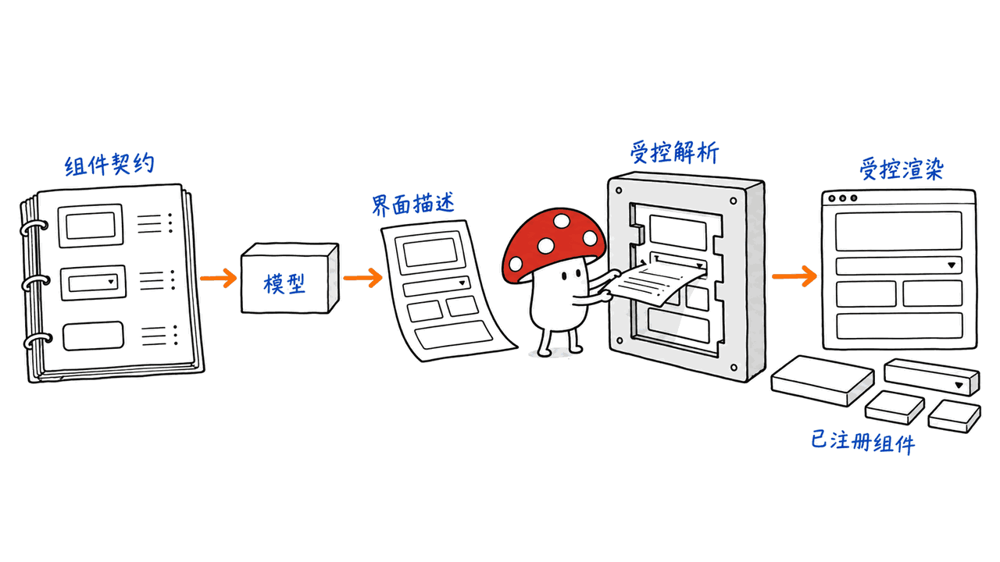
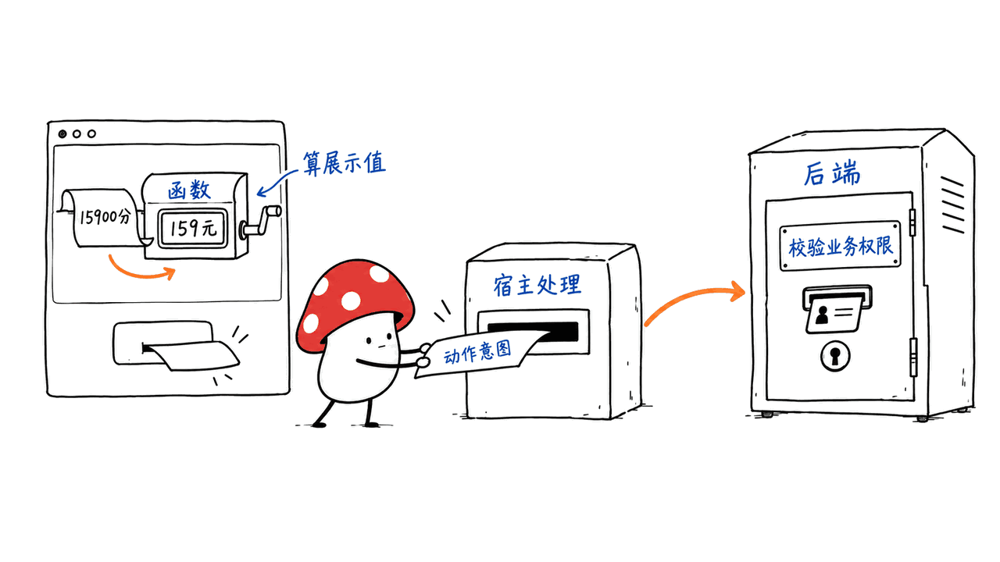
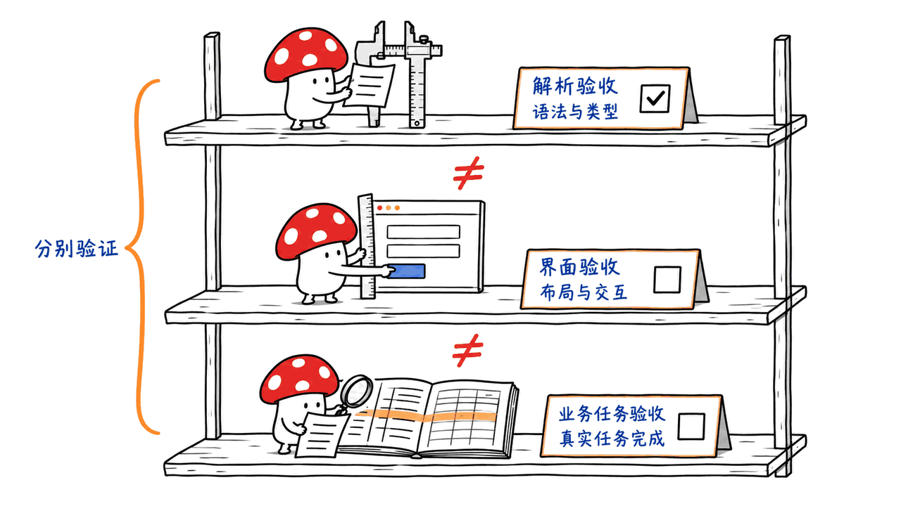

OpenUI 让 Agent 根据任务，把你已经实现的组件组合成流式界面。1.0 的重点是自定义函数和动作：界面可以计算展示值，也能把用户操作交回宿主应用，形成业务交互。

准确的项目是 Thesys 的 `thesysdev/openui`，采用 MIT 许可，官网为 openui.com。它与同名或近似名的其他 UI 项目需要区分。截至2026年10月20日，我们固定源码提交检查了文档和包版本，并实际执行了已发布核心包的解析检查。

**新能力的范围需要先说明：1.0 的自定义函数、动作和简化动作语法，目前需要 React 渲染器。** 官方文档要求 Vue、Svelte、Angular 继续使用0.4系列及匹配的 `lang-core ^0.4`，不能把“支持多框架”理解成所有框架已同步升级。

## 它生成的到底是什么？

传统聊天只把结果显示成文字；让模型输出完整前端代码，又会引入代码执行、样式和依赖管理问题。OpenUI 选择让应用先定义组件及其属性，再由模型输出一种紧凑的界面描述语言 OpenUI Lang。

整个过程是：产品组件库 → 从组件契约生成提示词 → 模型输出 OpenUI Lang → 解析与校验 → 渲染器调用已注册组件。组件的真实代码仍由开发者控制。

例如订单系统已有状态卡、费用表和操作按钮，Agent 可以按用户问题选择组合：问“这个订单怎样了”时展示卡片；问“比较本月渠道”时展示表格和图表。地图也必须先有合适的地图组件、数据和工具，并非框架凭空提供所有业务功能。



这种方式把主要适配工作放在组件契约上。它可以复用设计系统，但不会自动接管旧站全部页面：开发者仍要注册组件，说明属性、插槽、动作和数据来源，并把模型流接入应用。

## 1.0的函数与动作，分别解决什么？

| 能力 | 解决的问题 | 谁负责执行 |
|---|---|---|
| 自定义函数 `defineFunction` | 金额格式、比例计算等确定性展示逻辑 | 客户端运行已注册实现 |
| 自定义动作 `defineAction` | 把按钮等交互转成带类型参数的事件 | 宿主应用的 `onAction` |
| `library.extend` | 扩展、替换、移除组件，加入函数和动作 | 开发者配置组件库 |
| 消息格式 | 保存界面内容和上下文，便于会话恢复 | `buildMessage`、`parseMessage`及应用持久化 |

函数用于求值，动作表达意图。比如“把15900分显示成159元”适合函数；“申请退款”应是动作，让宿主应用校验身份和订单状态后决定是否执行。不要把支付、删除或修改权限藏进一个看起来只负责格式化的函数。

1.0 允许单个动作不再套 `Action([...])`，多个动作仍需包装。`@ToAssistant` 也能携带上下文，便于将订单ID等结构化信息随交互带回 Agent。消息协议则为内容与表单状态提供明确分段，但不会代替数据库、会话隔离和敏感字段管理。

另一个容易忽略的细节：官方明确说，属性中限定动作种类的 schema 目前主要用于提示词和 JSON Schema，运行时尚未强制执行这一特定约束。因此“有类型”不能直接当作完整权限边界。



## 从一个只读订单卡片开始，怎么接入？

第一步先让工具返回真实、最小必要的数据，例如订单ID、状态、金额和更新时间。让工具负责查数据，让组件负责显示，避免让模型编造交易数值，再被一个漂亮图表放大成“可信数据”。

第二步注册少量组件。起步只暴露订单摘要、项目列表和一个“查看详情”动作，比一次性塞入全部设计系统更容易检验。每个属性需要类型和说明，数量、文本长度、URL范围等业务约束仍由应用设计。

第三步建立语言与版本契约。当前源码中 `@openuidev/lang-core` 为1.0.1，Vue绑定为0.4.2并依赖 `lang-core ^0.4.1`。React 新功能链路和 Vue 现有链路应分别锁依赖、提示词和测试样例。

可以先创建官方脚手架：

```bash
npx @openuidev/cli@latest create --name order-assistant
```

这是启动官方入门项目的命令，不代表完全离线安装。当前 Quick Start 是 Gateway 路线，会引导登录并连接相关服务。若使用自选模型和自建后端，可从 `react-lang`、`react-ui`、`lang-core` 等底层包按需接入，把工具、鉴权和流式传输留在自己的服务里。

第四步只接读取动作，再增加写操作。下面是宿主处理逻辑的伪代码，不是 OpenUI 自带的退款 API：

```text
收到 InspectOrder(orderId)
→ 用当前用户身份向自己的后端请求订单
→ 后端检查此用户能否读取该订单
→ 返回允许展示的字段
→ 将结果交给已注册组件
```

若扩展到退款，还应由后端检查订单最新状态、金额、幂等键和操作者权限，并按产品流程确认。按钮出现，不等于业务已经执行成功；重复点击、断线重试和重放历史消息，都不能重复产生交易。

第五步处理流式失败。应区分正在补齐的局部输出、未知组件、无效属性与完成后仍无可渲染根节点。给用户保留文字降级结果，给开发者保留诊断；不要为了不报错而把任意模型输出直接塞进可执行 JavaScript。

## “任何模型、任何框架”应该怎样理解？

模型中立指 UI 描述层不必与某一家模型绑定。实际效果还取决于模型能否遵守组件契约、输出正确语法、在流式过程中维持结构，并正确使用工具。一个模型“能接API”与“能稳定生成业务UI”是不同验收项。

框架中立核心主要负责语言、解析和提示生成，各框架绑定负责实际渲染。React额外提供现成聊天界面和内置组件库。Vue等已有绑定，不代表它们同时具备React全套UI组件或1.0新功能。

这也意味着，切换模型不应只看宣传中的兼容列表。用你的真实组件和问题集，记录可渲染率、属性错误率、动作参数正确率、首个可用组件时间，以及任务完成情况，才知道模型是否适合。

## 省67% Token、百万下载，能说明多少？

仓库的公开 Token 对比覆盖七个固定 UI 场景，用 `tiktoken` 的 GPT-5 编码器统计序列化长度。表中 OpenUI Lang 合计4,800 tokens，对比两种JSON格式的10,180和9,948，分别约少52.8%与51.7%；“最高67%”对应某个场景，不是七项总平均。

这不是生成质量测试，也不是所有模型、所有组件库和所有任务都省同样比例。更短的输出可能减少传输和生成开销，但端到端延迟还包含模型思考、工具调用、数据查询和客户端渲染。README 中另一个倍率对比表也不应直接当作你应用的计费或延迟保证。

本次只核对这张公开表的数值含义，没有重新运行 Token 基准或模型生成。GitHub星标是时点数据，包下载还可能包含自动安装与CI；素材提到的“600万+下载”没有在本次复核中形成可追溯的统一统计口径，因此不作为技术成熟度证据。

## 我们实际检查了什么？

我们在临时目录安装已发布的 `@openuidev/lang-core@1.0.1` 和 Zod 4，禁用安装生命周期脚本，并执行了以下检查：已注册组件可解析；自定义函数调用语法可解析；未注册组件会报告 `unknown-component`；自定义动作可注册；带表单上下文的消息可写入并读回；一个本地比例函数返回预期的 `75.0%`。

这些是实际核心包运行记录。它们没有调用大模型、渲染浏览器DOM、点击按钮或执行订单后端，因此不能当成完整产品的UI质量、吞吐或安全测试。解析接受函数调用，也不等于我们已验证React运行时对所有函数失败场景的处理。



这次检查的价值，是把“生成式UI”拆成可以分别定位问题的层次：语言解析有问题，修语法和契约；界面显示有问题，查渲染器和组件；业务动作失败，查宿主与后端。把三者都归因给“模型不够聪明”，很难改善系统。

## 部署前还要决定哪些事情？

MIT开源包、官方Gateway和你接入的模型服务，是三个不同成本与数据边界。使用开源渲染器不代表模型免费，也不代表数据留在本机。先画出提示词、工具结果、界面内容和动作事件分别流向哪里。

还有一个与安装相关的具体细节：官方文档说明安装遥测默认启用，运行时遥测默认关闭、需要显式开启。需要关闭时，可以在依赖安装前设置：

```bash
OPENUI_TELEMETRY_DISABLED=1 npm install
```

这是项目提供的选项，不是对其遥测内容或后端服务做出的独立审计。生产接入还应固定依赖锁文件、保存组件库版本、做好会话持久化，并让旧消息能用对应版本的契约重新打开。

如果你关注Agent界面层，也可以结合本站OpenTiny的组件路线阅读；OpenUI在这里提供的是语言、模型输出与组件渲染之间的接入方式，而不是替换所有产品设计工作。
https://blog.mushroom.cv/blog/opentiny-tinyrobot-agent-ui/

## 常见问题

### Vue项目能直接升级到1.0新函数和动作吗？

当前官方答案是否定的。Vue、Svelte、Angular绑定仍在0.4系列，需要匹配 `lang-core ^0.4`。要用1.0新功能，应遵循React当前支持范围，或等待对应绑定升级。

### 它会让模型直接执行任意前端代码吗？

常规集成是解析OpenUI Lang并调用开发者注册的组件与函数。宿主仍负责动作处理、URL及数据校验，后端仍负责业务权限。不要额外接入未经审核的任意代码执行。

### 有了动作定义，是否就能自动完成退款？

不能。动作定义描述事件和参数。真正的退款服务、权限验证、用户确认、幂等与审计，需要产品和后端实现。

## 来源与复核范围

复核日期：2026年10月20日。源码固定为 `9823ec05d4b29bc78d101676dc16b44fe17f1830`。本次执行范围为已发布核心包的解析与消息检查，不是完整Agent应用实测；封面是概念图。

- 官方仓库：https://github.com/thesysdev/openui
- 1.0更新：https://www.openui.com/docs/openui-lang/whats-new
- 函数：https://www.openui.com/docs/openui-lang/functions
- 动作：https://www.openui.com/docs/openui-lang/actions
- 入门路径：https://www.openui.com/docs/openui-lang/quickstart
- 可靠性：https://www.openui.com/docs/openui-lang/reliability
- 遥测说明：https://www.openui.com/docs/openui-lang/telemetry
- Token测试：https://github.com/thesysdev/openui/tree/9823ec05d4b29bc78d101676dc16b44fe17f1830/benchmarks

---

> © 2026 Author: Mycelium Protocol. 本文采用 [CC BY 4.0](https://creativecommons.org/licenses/by/4.0/deed.zh) 授权——欢迎转载和引用，须注明作者姓名及原文链接，不得去除署名后以原创发布。

<!--EN-->

OpenUI lets an agent compose your existing components into a streamed interface. Version 1.0 adds custom functions and actions so a UI can calculate presentation values and return user intent to the host application.

The project is Thesys's MIT-licensed `thesysdev/openui`. A key qualification comes first: the new 1.0 function/action features currently need the React renderer. Official documentation keeps Vue, Svelte and Angular on their 0.4 bindings with matching `lang-core ^0.4`.

## What does the model generate?

The application defines a component library and typed props. OpenUI generates model instructions from those contracts, parses the model's OpenUI Lang stream, and renders registered components. The model describes a UI; developers retain the component implementations.

An order assistant might choose a status card, cost table or comparison chart depending on the task. A map still requires a suitable registered component and real geographic data. Existing design systems can be reused, but exposing their contracts and connecting data remains integration work.


## What changes in 1.0?

| Feature | Purpose | Execution owner |
|---|---|---|
| `defineFunction` | Deterministic formatting and calculations | Registered client implementation |
| `defineAction` | Typed interaction intent | Host `onAction` handler |
| `library.extend` | Add, override or remove library capabilities | Application configuration |
| Message protocol | Store content and context together | Library helpers plus app persistence |

Use a function for presentation, such as formatting an amount. Use an action for requesting a business operation. Identity, authorization and current order state still belong in the service handling that operation.

Single actions no longer require an `Action([...])` wrapper; multiple actions still do. `@ToAssistant` can carry structured context. The message helpers preserve content and context, but do not supply your database or session isolation.

The documentation also explicitly says that restricting which actions a prop accepts currently shapes prompts and JSON Schema without enforcing that particular restriction at runtime. Typed events should not be mistaken for an authorization system.


## How should an existing product integrate it?

Start with a read-only order card. Let a tool return authorized order data and let the component display it. Do not use generated numbers as a substitute for actual transaction records.

Register a small component set with clear props and behavior. Lock language, prompt and renderer versions together. At the reviewed commit, core is 1.0.1, while Vue is 0.4.2 and depends on core `^0.4.1`. These are distinct supported combinations.

The official scaffold command is:

```bash
npx @openuidev/cli@latest create --name order-assistant
```

The current Quick Start follows a Gateway-backed route that includes sign-in and connected services. It is not an offline-install promise. A self-hosted application can integrate the lower-level packages with its chosen backend and model instead.

First route a read-only `InspectOrder` intent to your backend. Have that backend verify the current user's access and return only permitted fields. Add writes later. Refunds need current-state checks, authorization, confirmation where appropriate, idempotency and an audit trail. A rendered button is not proof that the operation completed.

Handle incomplete streaming output separately from invalid completed output. Retain parser diagnostics and a text fallback. Do not work around rendering errors by evaluating arbitrary model-generated JavaScript.

## Does model independence mean every model works equally well?

No. Provider independence does not guarantee that every model follows the syntax, component contracts and tool protocol reliably. Evaluate your actual tasks and library: renderable response rate, prop errors, action parameters, time to the first usable component and completed user tasks.

Similarly, a framework-neutral core does not make every runtime feature-identical. React includes additional built-in components and chat surfaces. Existing Vue bindings do not imply that React's full library and new language features are already available there.

## What do the token and popularity claims establish?

The published serialization benchmark covers seven fixed UI scenarios using the stated GPT-5 tokenizer. OpenUI Lang totals 4,800 tokens, versus 10,180 and 9,948 for two JSON formats: approximately 52.8% and 51.7% less. The headline near 67% is a scenario maximum, not the overall reduction.

This is not an evaluation of generated UI quality or a universal latency/cost result. Model reasoning, tool calls, data fetching and rendering all contribute to application latency. We inspected the reported figures, not reran the token benchmark.

Stars are a dated snapshot, while package downloads can include automated installs and CI. We did not establish a traceable aggregate for the supplied six-million-download claim and do not use it as evidence of production maturity.

## What did we actually run?

In a temporary directory, we installed published `@openuidev/lang-core@1.0.1` and Zod 4 with npm lifecycle scripts disabled. We checked parsing of a registered component and custom-function syntax, an `unknown-component` diagnostic for an unregistered widget, typed custom-action registration, a content/context/end message roundtrip and a local percentage function returning `75.0%`.

These are real core-package checks. They do not include a model request, browser DOM rendering, a button click or an order backend. Parser acceptance of a function call is not a test of every React evaluator error path.


Separating these layers helps diagnosis: syntax failures, component failures and backend failures require different fixes. A larger model cannot replace missing permissions or a broken renderer integration.

## What remains a deployment decision?

The MIT packages, hosted Gateway and chosen model provider have separate costs and data boundaries. Document where prompts, tool results, UI content and action events go.

Official documentation says installation telemetry is enabled by default and runtime telemetry is opt-in. Set `OPENUI_TELEMETRY_DISABLED=1` before dependency installation if needed. This is a documented control, not an independent audit of all telemetry or hosted services.

Preserve lockfiles, component-library versions and stored-message compatibility. Begin with a working read-only flow, then add business mutations and recovery behavior. That is a more measurable engineering milestone than promising that any model can generate any production interface.

## FAQ

### Can Vue applications immediately use the new 1.0 functions and actions?

Not under the current documented support matrix. Vue, Svelte and Angular remain on 0.4 with matching core. The new features currently need React.

### Does it run arbitrary frontend code from the model?

The standard integration parses OpenUI Lang and invokes registered components/functions. Host validation and backend authorization remain necessary. Do not add unreviewed arbitrary-code execution as a shortcut.

### Does defining a refund action implement refunds?

No. It defines intent and parameters. The actual service, permissions, state checks, confirmation, idempotency and audit behavior are application responsibilities.

## Sources and scope

Reviewed October 20, 2026, at source commit `9823ec05d4b29bc78d101676dc16b44fe17f1830`. Our executable checks cover the published core package, not a complete agent application or model benchmark. The cover is conceptual.

- Repository: https://github.com/thesysdev/openui
- Version 1.0: https://www.openui.com/docs/openui-lang/whats-new
- Functions: https://www.openui.com/docs/openui-lang/functions
- Actions: https://www.openui.com/docs/openui-lang/actions
- Quick Start: https://www.openui.com/docs/openui-lang/quickstart
- Reliability: https://www.openui.com/docs/openui-lang/reliability
- Telemetry: https://www.openui.com/docs/openui-lang/telemetry
- Token benchmark: https://github.com/thesysdev/openui/tree/9823ec05d4b29bc78d101676dc16b44fe17f1830/benchmarks
- Related OpenTiny article: https://blog.mushroom.cv/blog/opentiny-tinyrobot-agent-ui/

---

> © 2026 Author: Mycelium Protocol. Licensed under [CC BY 4.0](https://creativecommons.org/licenses/by/4.0/) — free to share and adapt with attribution. You must credit the author and link to the original; removing attribution and republishing as original is not permitted.
