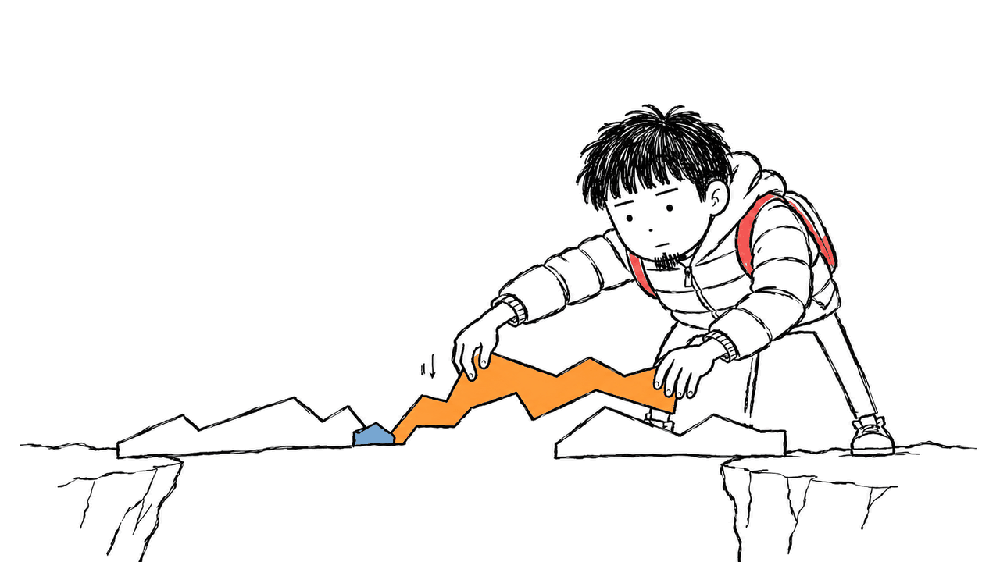
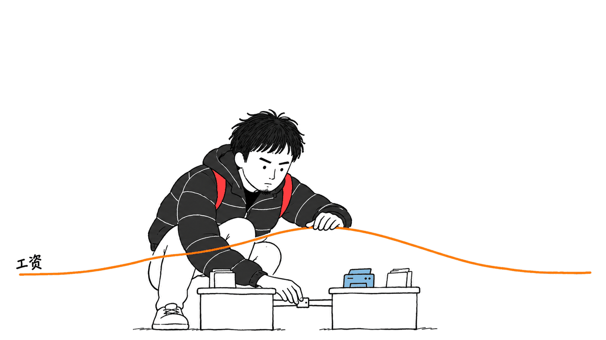
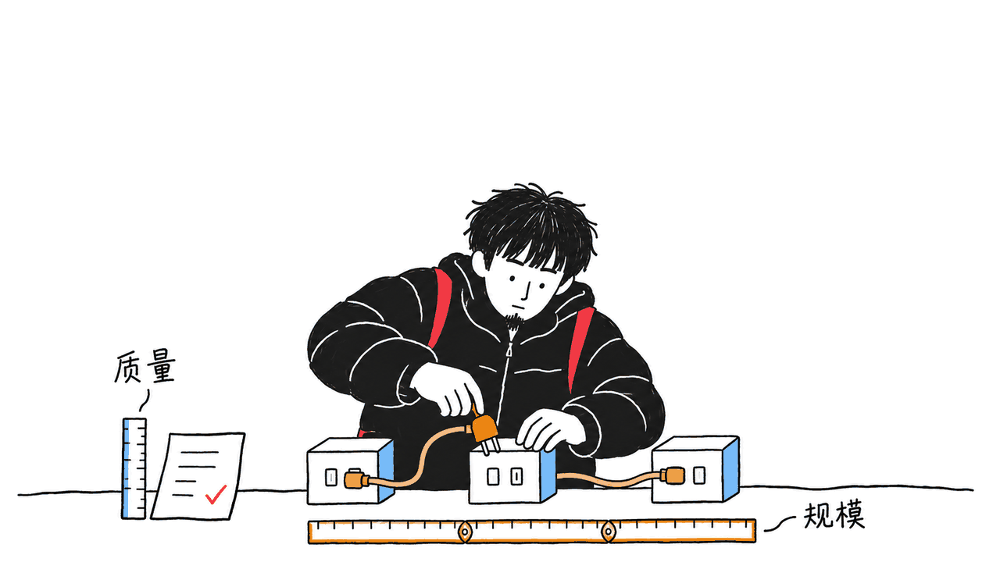

《Organizing Intelligence》解释了AI如何改变组织与工资：部分人可能因协调价值而涨薪，也有人会失业。它没有保证“就业不会归零”，更没有保证某类人必然暴富。

论文作者为Alex Imas、Andrew Koh与Shane Legg，其中前两位为共同主要作者。本文核对的是108页的arXiv v1，日期为2026年10月31日；DeepMind Institute配套解读发布于10月29日。网页元数据虽显示11月19日更新，也不能据此称论文“今天刚发布”。

这是一篇理论工作论文，研究结果取决于模型设定。作者明确说明，它不代表Google的企业预测或产品路线图。本文区分论文正式模型、配套文章的延伸讨论，以及我们的实践推论。

## 为什么AI赢过一个人，还可能输给一家公司？

论文把能力分成两部分：competence是写作、编程等具体任务能力；coordination是让成员有效协作的能力。前者影响一定规模下的生产效率，后者影响组织扩大后，效率还能不能维持或提升。

在作者的示例里，程序员两项技能为`(9,1)`，写作者为`(1,9)`。单人都有明显短板。按照示例采用的调和平均公式，两者单独的综合能力都是1.8；等比例组合后，平均技能为`(5,5)`，综合能力变为5。

没有谁突然学会另一门专业，改变的是互补成员的组合。作者把这种现象称为mosaic intelligence。它提醒我们：单人排行榜和整家公司之间，隔着分工、交接、质量控制与组织方式。

这个数字是模型算例，不是“组队就能提升2.8倍”的现实定律。相同模型的多个副本也未必填补彼此相似的短板；是否互补，需要观察实际错误与能力分布。

## AI越强，谁的工资可能上涨？

论文有一个值得重视的机制：当AI擅长执行任务，却仍不擅长协调时，能让AI队伍更有效工作的人，可能贡献更大。他的价值来自减少返工、解决依赖、维持共同目标，未必来自亲手完成最多任务。

但“协调者更有价值”不能直接改写成“经理都会涨薪”。先看论文第2.3节的早期AI情景：14名人类仍全部就业，专家工资却从4.15降到2.90，协调者从2.41降到1.30。按这些示例数字计算，分别下降约30.1%和46.1%。

这些是模型中的归一化工资，绝不是现实薪资降幅预测。它们证明的是：即使工作岗位保住，AI扩充供给、压低产品价格，也可能侵蚀人的稀缺性收入。

第6.3节进一步把工资变化拆成两部分：技术本身的作用，以及企业调整规模、AI占比和人类技能组合的“重组效应”。图25展示了一条协调者工资先升后降的路径，重组能阶段性改变直接技术效应的方向。

这条曲线也有技术边界。附录D.7说明，图25使用有限候选企业集合的数值计算，相关搜索没有给出所有可行企业的全局利润界；固定企业曲线与实际调整曲线的差距，是描述性比较，不能在整条路径上都当成正式导数分解的直接应用。

因此，合理的结论是：某种稀缺的协调能力可能阶段性获得更高回报，回报也会随着AI和企业结构继续变化。论文没有给出一份永久赢家职业清单。

## 论文真的说就业不会归零吗？

没有。第2.4节明确展示了两条替代路径。

第一条发生在企业内部：固定AI协调能力，提高任务能力，示例混合企业里的专家就业从4.58连续降到零。这里的4.58是连续规模模型中的人数单位，不是调查中的实际雇员数。

第二条发生在企业之间：AI企业成本下降到足以淘汰人类企业时，示例中的12名专家就业突然降到零。企业内部裁员平缓，不代表行业竞争带来的替代也会平缓。第6.2节还正式给出了特定条件下完全失业的结果。

论文也确实讨论了人类继续就业的条件。小众市场对巨大规模的需求有限，在接近其定义的ASI门槛时，一些人仍可凭相对生产率、工资与算力价格的组合保持成本竞争力。原文同时明确：这个情景不研究ASI继续大幅进步之后的人类就业。

配套解读对ASI下小众市场的保护更悲观，又提出关系型部门可能扩张，例如消费者重视真人参与的教育、照护或体验服务。这是值得讨论的需求机制；它并没有在这篇论文的正式模型中被量化为“足以吸纳全部劳动力”的保证。

## 真正需要留意的是哪种AI进步？

作者用任务能力与协调能力两条轴，划分四种情景。它们是模型分类，不是带日期的技术路线图。

| 情景 | 能力特征 | 需要关注的条件性结果 |
|---|---|---|
| Minimal AGI | 达到或超过平均人类的独立能力，协调仍受限 | 团队互补仍可能保有人类价值，工资可先受压 |
| Supercompetent AI | 任务能力超过所有人类，协调仍受限 | 协调优势可能支持人的岗位，但不保证工资上涨 |
| Supercooperative AI | 协调跨过规模收益门槛，任务能力未必全面领先 | 足够大的市场可能向大型AI企业集中 |
| ASI | 任务与协调都跨过相应门槛 | 人类就业取决于需求、成本和具体市场，不能作永久保证 |

这里的协调门槛不是“开了几个Agent”或者“多发了几条消息”。它描述的是组织继续扩大时，单位投入的产出还能如何变化。相同单体能力的系统，也可能因为交接和纠错方式不同，产生不同的经济效果。

大型企业集中也不能直接推导为所有者拿走巨额垄断利润。模型采用竞争、进入约束和活跃企业盈亏平衡等设定。市场集中、企业利润、个人工资与财富分配是不同问题，需要分别研究。

## 对年轻人和工程团队，有什么实际启发？

以下是我们的实践推论，不能当成论文验证过的职业建议。

先保留一项能判断好坏的专业能力。协调不是转发任务；如果无法识别错误、定义完成条件，就很难知道AI队伍是在扩大产出，还是扩大返工。刚入行的人需要可检验的专业作品，才能逐步承担跨环节责任。

再练习把完整问题交付出去。找一个真实小项目，明确用户目标、输入边界、任务依赖、验收标准和失败时谁接手。记录你减少了哪些等待与返工，别只记录生成了多少文字或代码。这比给自己贴“AI指挥官”的标签更有说服力。

工程团队可以在相同任务与验收标准下，比较单Agent、多Agent和人机协作。既报告相同总算力预算下的质量，也报告相同单副本资源下扩容的变化；把人工复核、重试、延迟和费用算进去。否则增加预算带来的进步，很容易被误认为协调进步。

还要观察价值由谁获得：效率提高后，是客户降价、企业增加利润，还是员工涨薪？论文恰好提醒我们，生产率提高与个人收入提高之间，需要竞争、稀缺性和组织分配机制来连接。

## 这套账本有哪些适用边界？

正式模型允许人类与AI选择进入不同企业，但人类能力和供给给定，AI只有一种类型，可按固定租金无限复制；人类还有最低可接受收入。现实中技能会学习，AI有多种类型，算力、数据、制度和责任约束也会影响采用成本。

论文的深市场极限分析尤其需要小心：当市场规模趋于无穷时的跳变，不等于任意有限行业都会在同一点突然变成一家企业。作者对部分有限市场曲线也注明，只在选定参数点做了额外进入搜索。

Mycelium Protocol核对了论文相关正文、图8、图25和附录D.7，并复算了团队能力、最优规模公式与上述工资变化的简单算术。我们没有复现完整均衡求解器、证明全部定理或估计真实就业影响。更有用的读法，是用模型找出需要测量的机制，再用实际数据判断它是否存在。

## FAQ

### 管理岗位天然更安全吗？

没有这样的保证。协调优势的价值取决于能否改善团队产出，以及AI的协调能力如何变化。论文既有协调者保留岗位的例子，也有协调者失业和工资回落的例子。

### 人类比AI便宜，就一定还有工作吗？

还要比较生产率、协调影响、需求和最低可接受收入。相对成本可能支持某些岗位，也可能意味着工资承压；不能把“可以低价就业”当成普遍繁荣。

### 现在最该监测什么？

可以同时跟踪完整任务质量、交接失败、人工复核时间、工资与算力支出，以及不同企业的进入退出。单个模型的榜单成绩无法独立回答这些组织问题。

来源：

论文v1及完整PDF：https://arxiv.org/abs/2611.05417v1

作者配套解读：https://institute.deepmind.com/essays/the-economics-of-intelligence/

相关实践阅读，逐项验收AI产物：https://blog.mushroom.cv/blog/brief2mp4-agent-motion-graphics-verification-guide/

---

> © 2026 Author: Mycelium Protocol. 本文采用 [CC BY 4.0](https://creativecommons.org/licenses/by/4.0/deed.zh) 授权——欢迎转载和引用，须注明作者姓名及原文链接，不得去除署名后以原创发布。

<!--EN-->

Organizing Intelligence explains how AI can change organizations and wages. Some workers may earn more because coordination becomes valuable; others can lose employment. It does not guarantee that jobs will survive or that a particular profession will become wealthy.

Alex Imas and Andrew Koh are the equal-contribution lead authors, with Shane Legg. We examine the 108-page arXiv v1 dated October 31, 2026. The DeepMind Institute companion essay was published on October 29. Its metadata records a November 19 update, which does not make the paper a new release today.

This is a theoretical working paper whose outcomes depend on its assumptions. The authors explicitly separate their views from Google's corporate forecasts and product plans. Below we distinguish formal results, companion-essay discussion and our practical inferences.

## Why can AI beat an individual and still lose to a firm?

The framework distinguishes task competence, such as coding or writing, from coordination. Competence affects productivity at a given organizational scale. Coordination affects how productivity changes as the organization grows.

In the illustrative economy, a coder has skills `(9,1)` and a writer `(1,9)`. Each has a major weakness. Under the example's harmonic-mean aggregator, each person's competence is 1.8. An equal-share team has mean skills `(5,5)` and competence 5.

Neither person learned the other's profession. Complementary composition produces what the authors call mosaic intelligence. An individual benchmark and a competitive organization measure different things because the latter includes specialization, handoffs and quality control.

These are model numbers, not an empirical promise of a 2.8-fold teamwork improvement. Copies of the same model may also share weaknesses. Actual error and capability distributions determine whether adding members creates useful complementarity.

## Who might earn more as AI improves?

When AI becomes good at execution but remains poor at coordination, someone who improves the team's organization can become more valuable. Reducing rework, resolving dependencies and preserving a shared objective can raise the output of increasingly capable agents.

This mechanism does not imply that managers generally receive raises. In the early-AI example in Section 2.3, all 14 humans remain employed, yet specialist wages fall from 4.15 to 2.90 and coordinator wages from 2.41 to 1.30. Arithmetic on those illustrative values gives declines of approximately 30.1% and 46.1%.

These are normalized model wages, not forecasts of real salary cuts. They show that continued employment can coexist with lower scarcity rents as reproducible AI expands supply and lowers output prices.

Section 6.3 separates direct technology effects from reorganization: firms change size, machine share and the mix of human capabilities. Figure 25 illustrates a coordinator wage that first rises and later falls. Reorganization can temporarily change the direction suggested by the direct technology effect.

Appendix D.7 qualifies that illustration. Figure 25 uses a finite menu of candidate firms; the searches do not bound profits across every feasible firm. Its fixed-firm comparison is descriptive and does not apply the formal interior-match derivative decomposition throughout the entire path.

A defensible interpretation is that scarce coordination can receive a temporary premium, which can change again as AI and organizations improve. The paper provides no permanent list of winning occupations.

## Does the paper establish that employment cannot reach zero?

No. Section 2.4 explicitly illustrates two displacement paths.

Within a mixed firm, improving AI task skills at fixed coordination reduces specialist employment continuously from 4.58 to zero. The fractional count belongs to a continuous-scale model, not a survey of actual employees.

Across firms, AI production becomes cheap enough to eliminate human-only employers, and the illustrative 12 specialists lose employment abruptly. Gradual adjustment inside a firm does not imply gradual industry displacement. Section 6.2 also gives formal conditions for full unemployment.

The paper discusses conditions for continued human employment too. Finite niche demand limits scale advantages. Near the model's ASI threshold, some specialists remain competitive through relative productivity, wages and compute costs. The authors explicitly do not analyze human employment after ASI improves substantially further in that scenario.

The companion essay uses stronger language about ASI eroding niche protection and suggests that sectors valuing human involvement could expand, including care, education and experiences. That demand mechanism deserves investigation. The formal paper does not quantify it as a guarantee that every displaced worker finds a high-paying replacement job.

## Which kind of AI progress matters for organization?

The authors classify four regimes using separate competence and coordination dimensions. These are conditional model categories, not a dated technology roadmap.

| Regime | Capability distinction | Conditional implication to watch |
|---|---|---|
| Minimal AGI | Matches or exceeds average individual human capabilities, with limited coordination | Complementary human teams can retain value while wages face pressure |
| Supercompetent AI | Exceeds every human in task skills, with limited coordination | Human coordination can preserve roles without guaranteeing higher pay |
| Supercooperative AI | Crosses the scale-return threshold without necessarily dominating every task | Sufficiently large markets can concentrate around large AI firms |
| ASI | Crosses both task and coordination thresholds | Human employment depends on demand, costs and the market, with no permanent guarantee |

The coordination threshold measures how output per input changes with organizational scale. It is not a count of agents or messages. Systems with similar individual abilities can have different economic effects because they share context, resolve conflicts and catch errors differently.

Concentration also does not by itself establish large monopoly rents for owners. The framework uses competitive conditions, entry constraints and break-even active firms. Market concentration, profits, wages and wealth distribution require separate analysis.

## What can younger workers and engineering teams take from it?

The following are practical inferences, not career recommendations validated by this paper.

Retain a professional skill that lets you judge output. Coordination requires recognizing errors and defining completion. Without that foundation, more agents can mean more rework. Early-career workers need inspectable work that demonstrates competence before taking responsibility across stages.

Practice delivering a complete small project. Define the user's objective, input boundaries, dependencies, acceptance criteria and failure ownership. Record reductions in waiting and rework, alongside output. That evidence is more useful than an “AI orchestrator” title.

Teams can compare a single agent, multiple agents and human–AI collaboration on the same task and acceptance standard. Report both fixed-total-compute comparisons and scaling with fixed resources per copy. Include human review, retries, delay and cost so a larger budget is not mistaken for better coordination.

Track who captures the value as well. Higher productivity can become lower customer prices, higher firm profits or higher pay. Competition, scarcity and organizational arrangements connect productivity to individual income.

## What are the model's limits?

The formal model holds human capabilities and supply fixed, uses a single AI type reproducible without limit at a fixed rental rate, and includes reservation wages. Real workers learn; AI systems differ; compute, data, institutions and accountability affect adoption costs.

Large-market limits require particular care. A discontinuity as market size tends to infinity does not prove the same jump in every finite industry. For some finite-market curves, additional entry checks cover selected parameter points rather than entire equilibrium paths.

Mycelium Protocol checked the relevant main-text arguments, Figures 8 and 25, and Appendix D.7, and recalculated the simple competence, preferred-scale and wage-change arithmetic. We did not reproduce the complete equilibrium solver, verify every theorem or estimate actual employment effects. The framework helps identify mechanisms to measure; evidence must establish whether they apply.

## FAQ

### Are management jobs inherently safer?

The paper offers no such guarantee. Coordination is valuable when it improves production relative to alternatives. Its examples include surviving coordinators, falling coordinator wages and coordinator unemployment.

### Does being cheaper than AI guarantee a job?

Productivity, coordination effects, demand and reservation wages also matter. Relative costs can support some jobs while putting pay under pressure. Low-cost employment is not equivalent to broadly shared prosperity.

### What should teams monitor now?

Track complete-task quality, failed handoffs, human review time, payroll versus compute spending, and firm entry and exit. An individual model leaderboard cannot independently answer these organizational questions.

Sources:

Paper v1 and full PDF: https://arxiv.org/abs/2611.05417v1

Authors' companion essay: https://institute.deepmind.com/essays/the-economics-of-intelligence/

Related practice, checking AI outputs against requirements: https://blog.mushroom.cv/blog/brief2mp4-agent-motion-graphics-verification-guide/

---

> © 2026 Author: Mycelium Protocol. Licensed under [CC BY 4.0](https://creativecommons.org/licenses/by/4.0/) — free to share and adapt with attribution. You must credit the author and link to the original; removing attribution and republishing as original is not permitted.
