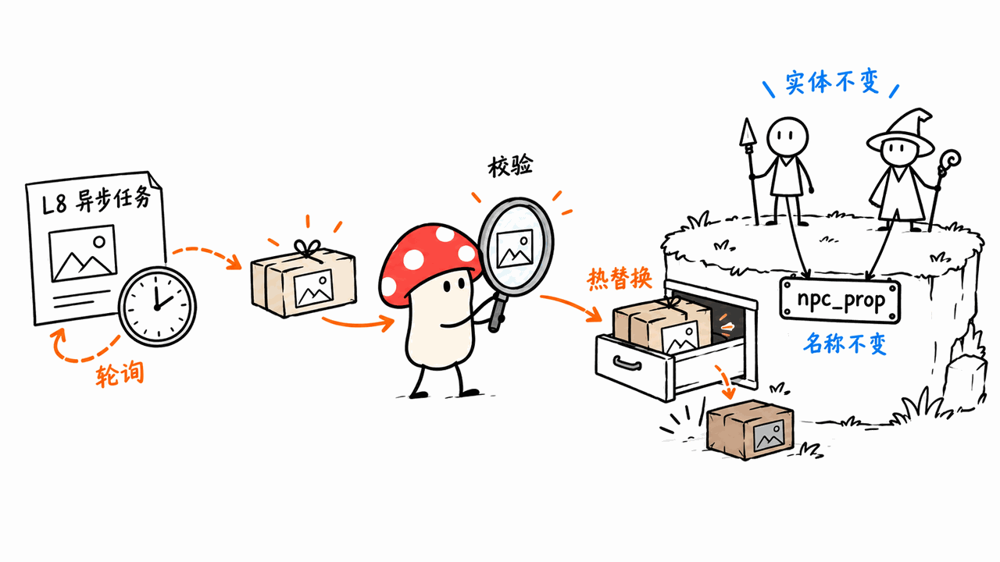
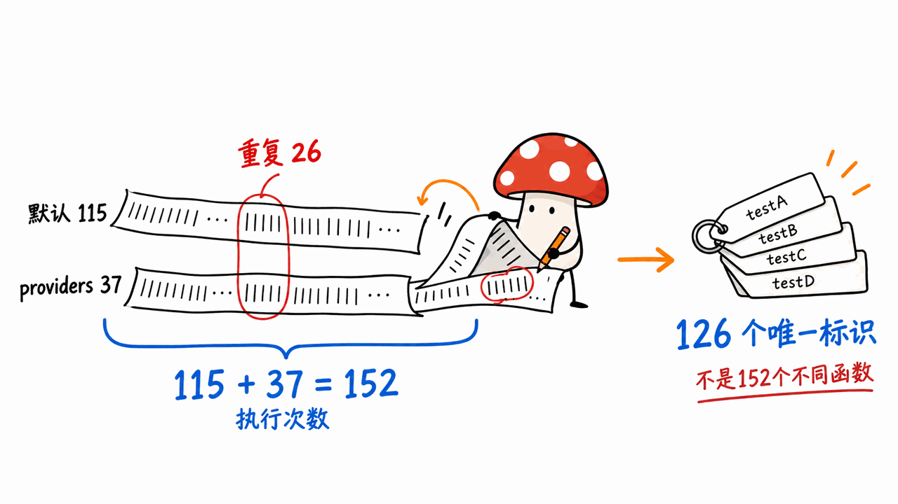
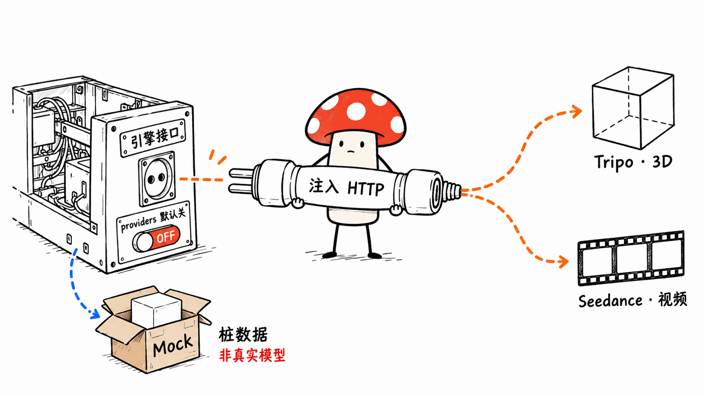

OriEra Engine v0.3.0 把 AI 资产生成的接口、校验和热替换流程接进了实时世界运行时。项目由 OriEra-engine 开源，采用 Apache-2.0；本次核验的正式版本发布于 2026 年 10 月 16 日。

这次更新最值得关注的是一条可以验证的工程链路：提交生成任务、轮询结果、检查资产、发送落地事件，再替换世界里的命名资源。它还没有把真实模型调用、完整资产解码和所有平台适配一并交付。

我们固定 v0.3.0 源码，在本机运行了 workspace 测试、providers 特性测试及官方离线热替换示例。结果支持“152 次通过记录”，但需要把重复配置和 Mock 输出解释清楚。

仓库：https://github.com/OriEra-engine/engine
发布：https://github.com/OriEra-engine/engine/releases/tag/v0.3.0
固定源码：14b4e42d4972239eb86adfdc036ed78508d7ec30

## 它想解决什么问题？

传统三维应用通常先准备资产，再让引擎加载和显示。AI 原生世界则会在运行时不断产生内容：玩家说一句话，NPC 发起请求，服务稍后返回模型或视频。生成任务的延迟、失败、格式和体积都不稳定，不能把它们直接塞进每帧执行的游戏逻辑。

OriEra 将责任拆成两条边界：L7 负责推理相关命令，L8 负责任务式资产生成。v0.3.0 的 `oriera-genai` 通过 `GenerationProvider` 抽象服务商，调用方使用统一的提交和轮询接口。

任务可以处于 Queued、Running、Succeeded 或 Failed。上层不必因为换供应商就重新编写世界逻辑，而平台壳负责接入网络和凭证。这里建立的是清晰的接口与生命周期，不是引擎自己拥有一个三维生成模型。



## 11个crate与十一层架构有什么区别？

v0.3.0 的 Cargo workspace 确实有 11 个成员：10 个库 crate，加一个 PC 平台壳。其中包含 L0 公共类型，因此不能把这个数字直接映射成 L1 到 L11 每层各有一个成熟实现。

| 模块 | 当前职责 | 需要区分的边界 |
| --- | --- | --- |
| common、pal、core | 公共类型、平台能力、调度 | 平台接口不等于设备全部适配完成 |
| ecs、asset | 世界对象与资源注册 | 序列化、深度资产管线仍有规划项 |
| render、subsys | 渲染调度、物理等系统骨架 | 不能据此推导完整商业引擎能力 |
| infer、genai、agent | 推理、生成任务、意图处理 | 规则与 Mock 路径区别于真实模型服务 |
| PC 平台壳 | 组织和连接各模块 | 不是已验证的全平台编辑器 |

架构文档将 L10 交互层列为后续计划，L11 由应用壳和 examples 承担，完整 UGC 编辑器仍在规划中。理解这层差异，才能把当前可读、可测的实现与长期架构愿景放在各自的位置。

README 提供浏览器 demo，包括粒子、物理、自然语言交互和咖啡馆 NPC。但浏览器侧的 JavaScript／Three.js 参考演示，不能自动证明同样功能已经由 Rust 核心完整覆盖。v0.3.0 标签下 README 列 11 个 demo，当前 main 已继续演进；本文固定发布标签，不混用两个版本的数量。

## L8 怎样把生成结果换进世界？

核心链路如下：`GenerationRequest` 提交任务，`GenAiSystem` 在帧循环中限量轮询，成功结果经过 `validate_asset`，再进入 `PendingSwaps` 并发出 `AssetLanded`。平台壳调用 `hot_swap::apply_pending`，通过 L4 命名资源入口落地。

命名资产是这里的重要连接点。已有实体可以引用同一个逻辑名字，生成完成后替换名字背后的资源，而不必把所有关联对象删掉重建。生成尚未完成或不可用时，也能保留明确的占位与降级路径。

校验当前主要检查体积上限、格式签名和部分容器一致性，默认单资产上限为 64 MiB。它不等于网格拓扑、贴图、动画、解压风险和视觉质量的完整检查。真实下载时仍要在 transport 层限制流量，不能先无上限下载到内存，再期待事后体积检查保护系统。

## “152个测试全绿”具体指什么？

我们使用未经修改的 v0.3.0 Rust 源码，实际执行了两条与 CI 对应的测试命令：

```bash
cargo test --workspace
cargo test -p oriera-genai --features providers
```

| 命令 | 本机结果 | 统计说明 |
| --- | --- | --- |
| workspace 默认配置 | 115通过、0失败 | 112项单元测试加3项文档测试 |
| genai providers配置 | 37通过、0失败 | 包含默认genai的26项重复执行 |
| 两轮相加 | 152次通过记录 | 不是152个不同测试标识 |

按 crate／文档测试类别和测试名去重，我们得到 126 个检查标识。两个配置都值得跑，因为可选协议适配器需要额外覆盖；只是把“执行次数”和“不同用例数”写清楚，读者才知道这个数字证明了什么。



这些结果表明当前被测契约通过，包括状态转换、资源替换和协议解析等。它们不证明模型生成质量、GPU 帧率、真实供应商可用性或五种设备都已通过验收。我们没有执行全套 fmt／clippy，也不把自己的测试结果替代为完整 CI 门禁复验。

## 离线热替换示例跑出了什么？

官方示例不需要 API key，使用 `MockProvider`：

```bash
cargo run -p oriera-genai --example hotswap
```

本机结果是提交 2 项、成功 2 项、失败 0 项、降级 0 项，总输入资产字节数 168。示例里的 `npc_prop` 从 24 字节的旧占位资源替换成 84 字节的 GLB 容器，事件队列驱动生成了两个实体，资源库最终有两项。

这是实际运行的管线验证，但不是 AI 生成了一把吉他。Mock 接收请求文本后返回极简容器或签名有效的桩数据；容器通过检查，不代表里面已有可展示的真实三维资产。示例输出的微小耗时也不应被用作真实生成速度或渲染性能成绩。

## Tripo、Seedance是否已经可以直接联网用？

v0.3.0 提供的是受 `providers` feature 控制的协议适配器，默认不开启。它们定义 JSON 请求和响应格式，HTTP transport 由外层注入；引擎内部没有附带 HTTP 客户端。

因此，打开 feature 不会自动得到可投产的远程生成服务。工程接入仍需处理凭证、端点、超时、重试、轮询节奏、下载与失败恢复，并对照供应商当前接口确认协议。此次测试验证的是本地协议与注入式测试路径，没有发起付费生成请求。



Tripo 在这里对应三维生成，Seedance 对应视频生成；不能因为二者都在 L8，就把视频输出直接当成三维网格。不同输出格式需要各自的接入和消费方式。

## 普通开发者怎样开始？

先固定版本，再验证离线链路，比一开始就接入真实模型更容易定位问题：

```bash
git clone https://github.com/OriEra-engine/engine.git
cd engine
git checkout v0.3.0
cargo test --workspace
cargo test -p oriera-genai --features providers
cargo run -p oriera-genai --example hotswap
```

这次使用 Rust 1.98.1 在 macOS 上完成上述验证；README 标注 Rust 1.80+，我们没有复测最低版本兼容性。仓库没有以本次环境锁住所有后续依赖解析，因此复现时应记录 Rust 版本与 Cargo.lock。

接下来只接一个生成供应商，用小资产验证“提交、超时、失败、重复轮询、校验拒绝、替换、释放旧资源”完整链路。最后才把它接到 NPC 意图和真实场景中，并测量主线程阻塞、资产内存和帧预算。

多端方面，发布标签下的 PC 是骨架，Mobile 为规划，AR 是重点适配方向，BCI 只预留能力位和协议，不接硬件。没有理由把“五端架构”写成“五端已交付”。

## 常见问题

### 它开源了文生三维模型权重吗？

这次关注的是引擎接口、协议适配、资产校验与热替换，不是一个模型权重发布。真实生成能力来自接入的供应商或你实现的 provider。

### 测试通过能证明三维资产一定可用吗？

不能。测试覆盖的是具体契约；当前 Mock 输出及浅层格式检查都不能替代真实资产解码、显示和内容质量验收。

### “自演化世界”是否意味着引擎会自行训练升级模型？

本文验证的是运行时内容生成与世界状态更新链路，没有验证递归自改进、模型训练或自主修改引擎代码。应把项目定位与已经实现的机制分别描述。

## 一手来源与延伸阅读

v0.3.0说明：https://github.com/OriEra-engine/engine/blob/14b4e42d4972239eb86adfdc036ed78508d7ec30/docs/release-notes/v0.3.0-genai.md
架构状态：https://github.com/OriEra-engine/engine/blob/14b4e42d4972239eb86adfdc036ed78508d7ec30/docs/ARCHITECTURE.md
工作区：https://github.com/OriEra-engine/engine/blob/14b4e42d4972239eb86adfdc036ed78508d7ec30/Cargo.toml
Mock实现：https://github.com/OriEra-engine/engine/blob/14b4e42d4972239eb86adfdc036ed78508d7ec30/crates/oriera-genai/src/mock.rs
示例：https://github.com/OriEra-engine/engine/blob/14b4e42d4972239eb86adfdc036ed78508d7ec30/crates/oriera-genai/examples/hotswap.rs
相关工程阅读：https://blog.mushroom.cv/blog/openui-1-generative-ui-engineering/

封面是可替换微缩场景的原创概念图，正文配图用于解释机制，不是引擎实际画面。核验日期：2026-10-20；未测试真实生成服务、GPU渲染或移动、AR、BCI设备。

---

> © 2026 Author: Mycelium Protocol. 本文采用 [CC BY 4.0](https://creativecommons.org/licenses/by/4.0/deed.zh) 授权——欢迎转载和引用，须注明作者姓名及原文链接，不得去除署名后以原创发布。

<!--EN-->

OriEra Engine v0.3.0 connects generative-asset interfaces, validation, and hot replacement to a real-time world runtime. The project is published by OriEra-engine under Apache-2.0. This release was published on October 16, 2026.

The concrete advance is a testable pipeline: submit a generation task, poll its state, validate the returned asset, emit a landing event, and replace a named resource. Real model transport, deep asset decoding, and complete device support are separate responsibilities.

We ran the pinned workspace tests, optional provider tests, and official offline hot-swap example. The results support 152 passing executions, with an important overlap between configurations.

Repository: https://github.com/OriEra-engine/engine
Release: https://github.com/OriEra-engine/engine/releases/tag/v0.3.0
Pinned source: 14b4e42d4972239eb86adfdc036ed78508d7ec30

## What problem does L8 address?

A runtime that accepts generated content must handle unpredictable latency, failure, asset size, and formats. Those concerns should not become unbounded work inside the frame loop.

OriEra separates L7 inference-related commands from L8 task-shaped asset generation. The new `oriera-genai` library exposes a `GenerationProvider` boundary with submission and polling methods. Tasks move through Queued, Running, Succeeded, and Failed states. Platform shells supply transport and credentials.

This creates a common lifecycle around providers. It does not place a proprietary generation model inside the engine.


## Do 11 crates mean 11 completed layers?

The release has 11 Cargo workspace members: ten libraries and a PC host. That count includes L0 shared types, so it does not map directly to a completed implementation of every layer from L1 to L11.

| Modules | Current responsibility | Limit |
| --- | --- | --- |
| common, pal, core | Types, platform capabilities, scheduling | Abstractions are not complete device certification |
| ecs, asset | World objects and resources | Deeper pipeline and serialization work remains |
| render, subsys | Render scheduling and subsystem skeletons | Not full commercial-engine parity |
| infer, genai, agent | Inference, generation tasks, intent handling | Rules and mocks differ from real model services |
| PC host | Integrate the modules | Not a finished cross-platform editor |

The architecture lists L10 interaction as future work. Application shells and examples carry L11, while a complete UGC editor remains planned.

The release README lists eleven browser demos; current main has continued evolving. JavaScript/Three.js browser references do not establish that every visible feature already has a complete Rust-core implementation. This article keeps its claims pinned to v0.3.0.

## How does a generated asset enter the world?

A `GenerationRequest` enters the provider. `GenAiSystem` polls a limited amount of work per frame. Successful results pass `validate_asset`, enter `PendingSwaps`, and emit `AssetLanded`. The host applies pending replacements through the L4 named-asset path.

A stable logical name lets existing objects continue referring to the same resource while its backing content changes. Pending or unavailable generation can have an explicit placeholder and degradation path.

Current validation covers size limits, signatures, and some container consistency. The default asset ceiling is 64 MiB. This is not full mesh, texture, animation, decompression-risk, or quality validation. A real transport must also bound downloads before buffering them, rather than relying only on a post-download size check.

## What does “152 green tests” mean?

We executed the unmodified tagged Rust source with the two test configurations used by CI:

```bash
cargo test --workspace
cargo test -p oriera-genai --features providers
```

| Configuration | Our result | Counting rule |
| --- | --- | --- |
| Default workspace | 115 passed, zero failed | 112 unit tests and three doctests |
| genai with providers | 37 passed, zero failed | Includes 26 default genai tests executed again |
| Combined executions | 152 passes | Not 152 distinct test identifiers |

Deduplicating crate/doc-test categories and names gives 126 check identifiers. Both configurations remain useful because optional adapters need coverage. The distinction is between passing executions and different named checks.


These results validate the exercised contracts, including state transitions, replacement behavior, and protocol parsing. They do not establish model quality, GPU frame rate, live-provider reliability, or hardware support. We did not rerun the complete fmt/clippy gate and do not present these tests as a reproduction of every CI step.

## What did the offline example produce?

The official example uses `MockProvider`, without a model key:

```bash
cargo run -p oriera-genai --example hotswap
```

Our run submitted two tasks, succeeded twice, failed zero times, and degraded zero times. Total asset bytes were 168. The `npc_prop` resource changed from a 24-byte old placeholder to an 84-byte GLB container. Landing events created two entities, and the store ended with two assets.

This is a real pipeline execution, not a generated guitar. The mock returns minimal containers or signature-valid stubs. Passing a container check does not establish that useful geometry exists inside it. The tiny reported mock timings are not generation-speed or rendering benchmarks.

## Are Tripo and Seedance already wired to the network?

Their optional adapters define JSON request/response shapes behind the `providers` feature, which is disabled by default. The engine includes no HTTP client; the shell injects transport.

Enabling the feature therefore does not create a production service integration. You still need credentials, current endpoint verification, timeouts, retries, polling limits, downloads, and failure recovery. Our adapter tests use local injected paths and make no paid generation calls.


Tripo represents 3D generation here; Seedance represents video generation. Sharing L8 does not make a video container interchangeable with a mesh. Each output needs its own consumer.

## How should developers begin?

Pin the release and verify the offline path first:

```bash
git clone https://github.com/OriEra-engine/engine.git
cd engine
git checkout v0.3.0
cargo test --workspace
cargo test -p oriera-genai --features providers
cargo run -p oriera-genai --example hotswap
```

We used Rust 1.98.1 on macOS. The README states Rust 1.80+, but we did not verify minimum-version compatibility. Record the compiler and Cargo.lock for reproducibility; dependency resolution can otherwise change.

Next, integrate one provider and test submission, timeout, failure, repeated polling, rejected assets, replacement, and old-resource release. Only then connect NPC intents and real scenes, measuring main-thread blocking, memory, and frame budgets.

At this tag, the PC host is a skeleton, Mobile is planned, AR is an adaptation direction, and BCI reserves capability bits and messages without hardware integration. Five-platform architecture is not five delivered products.

## Frequently asked questions

### Does this release include text-to-3D model weights?

The release concerns engine interfaces, protocol adapters, validation, and hot swap. Actual generation comes from a connected provider, not newly published model weights.

### Do passing tests guarantee usable 3D output?

No. Tests cover particular contracts. Mock payloads and shallow format checks cannot replace asset decoding, display, and quality acceptance.

### Does a self-evolving world train or rewrite its own model?

We verified runtime content and state updates, not recursive self-improvement, model training, or autonomous engine-source modification. Project positioning and implemented mechanisms must remain separate claims.

## Primary sources

Release notes: https://github.com/OriEra-engine/engine/blob/14b4e42d4972239eb86adfdc036ed78508d7ec30/docs/release-notes/v0.3.0-genai.md
Architecture: https://github.com/OriEra-engine/engine/blob/14b4e42d4972239eb86adfdc036ed78508d7ec30/docs/ARCHITECTURE.md
Workspace: https://github.com/OriEra-engine/engine/blob/14b4e42d4972239eb86adfdc036ed78508d7ec30/Cargo.toml
Mock implementation: https://github.com/OriEra-engine/engine/blob/14b4e42d4972239eb86adfdc036ed78508d7ec30/crates/oriera-genai/src/mock.rs
Example: https://github.com/OriEra-engine/engine/blob/14b4e42d4972239eb86adfdc036ed78508d7ec30/crates/oriera-genai/examples/hotswap.rs
Related engineering reading: https://blog.mushroom.cv/blog/openui-1-generative-ui-engineering/

The cover is an original miniature-scene concept. Body figures explain mechanisms rather than show engine output. Checked October 20, 2026. We did not test live generation services, GPU rendering, or Mobile, AR, and BCI devices.

---

> © 2026 Author: Mycelium Protocol. Licensed under [CC BY 4.0](https://creativecommons.org/licenses/by/4.0/) — free to share and adapt with attribution. You must credit the author and link to the original; removing attribution and republishing as original is not permitted.
