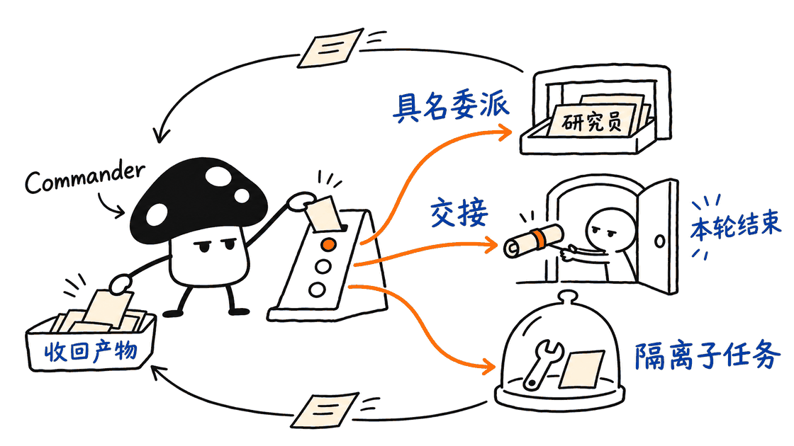
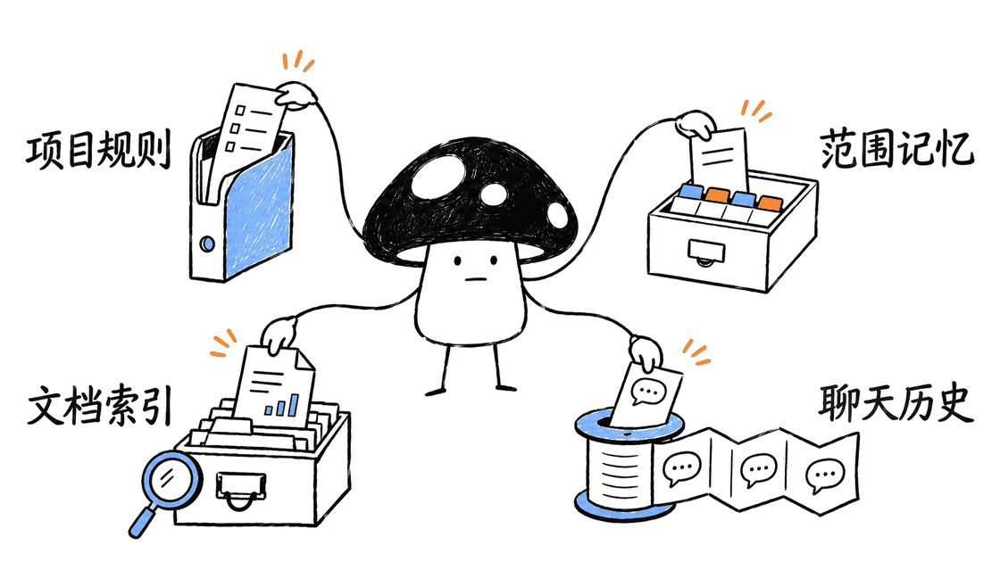
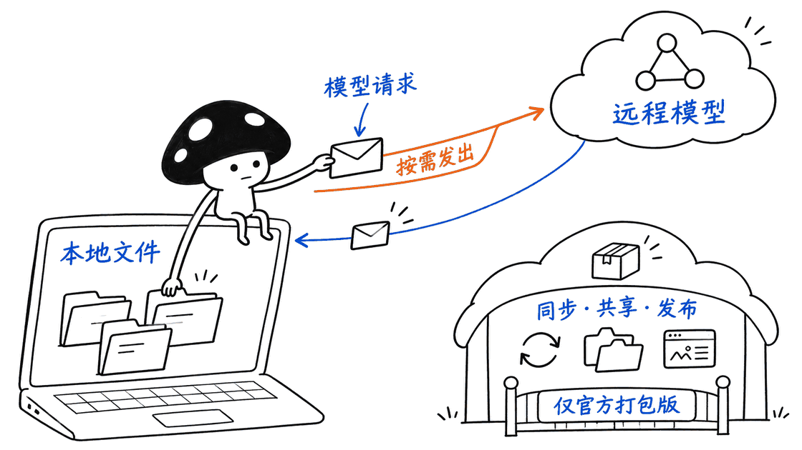

Orkas 是一款把任务规划、专业 Agent、编程助手和项目资料放进同一界面的桌面工作台。它适合需要持续推进研究、内容或产品项目的人：Commander 接收目标，自己处理通用任务，再把适合拆分的部分交给专业角色，最终收回文件和结果。

正确仓库地址是 `Orkas-AI/Orkas`，素材中的 `Orkas-Al` 混淆了字母 I 与小写 l。本次审阅的源码使用 MIT 许可证，`package.json` 版本为 `2026.11.4`。**它的价值在于管理工作如何持续，而不是增加更多聊天窗口。**

## Orkas 如何把目标变成协作？

项目自带 16 个专业 Agent，覆盖研究、内容、图像、视频、语音、界面、软件、办公和电商。DeepResearcher、ContentWriter、PptMaker 可以分别承担资料、文稿和演示文档；ProductDeveloper 与 OfficeWorker 则面向代码和办公文件。市场角色和自定义角色是额外扩展，不应与这 16 个内置角色混为同一个数量。

Commander 也会直接执行通用工作，而不是每句话都交给另一个模型。源码和说明列出三种不同的协作动作：

| 动作 | 作用 | 适用场景 |
| --- | --- | --- |
| `dispatch_to` | 调用指定 Agent，等待或异步接收结果后继续 | 研究交给专员，主任务随后整合 |
| `hand_off_to` | 把剩余工作交给指定 Agent，结束当前 Commander 回合 | 后续交付适合由某个专业角色接手 |
| `run_worker` | 运行匿名、隔离的子任务，返回私有结果 | 明确、短小且不需要角色完整背景的工作 |

这里的隔离描述的是任务上下文与结果边界，不能仅据此认定存在操作系统级沙箱。匿名 worker 不自动获得完整对话历史，也不继承某个具名 Agent 的技能包。这一差别有实际意义：委派需要明确提供任务、输入、约束和验收标准，不能假设每个执行者都知道所有上下文。

调度实现位于 `src/main/features/group_chat/bus.ts`，包含同一角色串行和具名任务准入等规则。它不是所有 Agent 无限制地同时开工；嵌套调度与顶层任务还存在不同的并发边界。



## 项目、记忆和资料库，分别保存什么？

项目把目标、规则、文件和待办放在一起，减少每次新对话都从零介绍背景的成本。Auto-advance 可以继续领取后续待办，定时任务则覆盖一次性、小时、日、周和月等节奏。

记忆并不是把全部聊天原文不断塞进提示词。`memory.ts` 区分共享事实、用户偏好、Agent 知识与项目事实，并给不同范围设置条目和字符预算。当前源码中，共享及项目事实各为 2,500 字符、用户偏好 1,500、Agent 知识 2,000；这些是提示注入预算，不是整个本地数据库容量。

Library 是另一条路径：文档提取为片段，建立本地 SQLite 向量索引，嵌入模型在本机执行；需要时搜索并读取来源。历史对话通过独立的 `chat_history` 工具检索。偏好记忆、文档检索、聊天记录各有用途，不能简单理解成一种无限记忆。

长任务还会受模型可用输入容量约束，系统利用近期历史窗口、过程检查点及文件操作记录管理上下文。这些机制有助于继续工作，但压缩摘要仍可能遗漏信息。关键决定最好进入项目规则或可检查的产物，而不是仅留在一段长对话里。



## 本地优先，为什么仍然可能联网？

本地优先描述的是工作台运行和默认数据存放的位置。选择云端模型时，相关提示与上下文仍需发往模型服务；使用内置 Orkas 模型时走其托管服务。只有同时选择本地模型端点、完成必要资源准备，并避免依赖联网工具，才有讨论离线工作流的基础。

官方说明自带模型密钥在本地加密且不进入云同步；这属于产品的数据处理说明，本次没有对密钥存储完成独立安全审计。连接 Gmail、Slack、商店或其他远程服务，也会引入各自的数据传输与授权范围。

还必须区分两个版本：

| 项目 | 开源源码版 | 官方打包版 |
| --- | --- | --- |
| 账号 | 无账号层，直接启动 | 首次使用需要登录 |
| 模型 | 自备 API/OAuth 或本地兼容端点 | 内置模型额度，也可自备模型 |
| 本地项目与桌面工作流 | 仓库可审阅的核心能力 | 提供相应桌面体验 |
| 共享项目、云同步、公开发布 Web App | README 明确尚不支持 | 提供相关服务；公开发布涉及付费方案 |
| 平台 | macOS、Windows、符合要求的 Linux | 提供 macOS 与 Windows 安装包 |

官方说明安装包有 500 个初始模型 credits，它不是“全部模型永久免费”的承诺。源码 MIT 授权也不意味着获得全部商业后台功能。

默认对外发送、发布、删除会要求确认，是项目描述的交互策略。它不能替代对具体工具、权限和执行结果的检查，更不能被当作已通过安全认证。初次试用时，给任务一个独立工作目录和有限连接权限，更容易判断它做了什么。



## 能把现有编程助手接进来吗？

Orkas 支持把已经安装的 Claude Code、Codex、OpenCode、OpenClaw、Hermes-Agent 作为本地子进程会话接入，统一安排任务。这与把这些产品的全部能力直接内置进 Orkas 是两回事：外部 CLI 的安装、登录、版本与模型费用仍需分别处理。

一个合适的实践是把“完成产品发布”拆成代码修复、独立复核、变更说明和发布素材。代码任务交给熟悉仓库的 CLI，研究和文稿交给相应专业角色，Commander 汇总。但仍应明确产物路径、允许改动的文件、测试命令和是否允许对外操作。

角色数量并不直接决定效果。拆得过细会增加模型调用、重复读取和沟通成本；需要共享细密上下文的工作，也可能更适合同一个执行者连续完成。更有价值的指标是产物通过率、返工次数和总费用，而不是同时亮起多少 Agent 状态。

## 如何开始，首次启动会准备哪些东西？

官方推荐普通用户使用安装包。希望审阅或修改源码的用户，可以按仓库说明运行：

```bash
git clone https://github.com/Orkas-AI/Orkas.git
cd Orkas
./run.sh
```

Windows 使用 `run.cmd`。源码要求 Node.js 22.12 以上；原生模块无兼容预编译产物时，还需 Python 3 与 C/C++ 构建工具。Linux 需要 glibc 2.34 以上，不支持 Alpine 等 musl 系统。

这不是一个只下载几段 JavaScript 的启动过程。脚本会准备锁定的依赖、运行时、约 95MB 嵌入模型、OfficeCLI、FFmpeg、whisper.cpp 与语音模型等资源；OCR 和部分技能依赖会在首次使用时进入独立环境。准备好网络和磁盘空间，再判断启动是否异常。

macOS/Linux 首次启动会建立 `~/.orkas/` 工作区。模型设置里可以配置兼容端点，但“能填写本地模型地址”不证明某个小模型足以可靠完成复杂工具任务，需要单独验证。

定时任务运行在本机，电脑需要保持唤醒且 Orkas 正在运行。README 描述从 v1.9 起会在唤醒或启动后补最近一次、12 小时内错过的运行；不要把它理解成云端常驻，也不要假设所有漏掉的周期都会逐个重放。

## 本次核验到了什么程度？

本次抓取了正确仓库正文，审阅 README、任务总线、角色预算、记忆范围和资源校验脚本，固定源码提交 `c7c0e21fad7ff55f5a72a575b7a464f3cf9bc3a1`。原素材的查重主要由通用词 GitHub 误触发；修正 URL 并按 Orkas 精确查重后，仅命中原始 KB 素材，没有旧文章或草稿创建凭证。

本机实际运行了项目现有的内置资源清单检查：400 个文件与当前清单一致，命令成功退出。这只能验证该源码快照的资源清单一致性，不是 400 个功能测试，也不证明每个 Agent 都能交付。

本次没有安装完整 Electron 运行环境，没有启动 GUI、调用付费模型、连接账号或执行外部 CLI 协作。README 展示的交付截图属于官方示例，不是本次实测结果。

对于正在尝试桌面多 Agent 的开发者，Orkas 最值得读的是调度、范围记忆和上下文恢复的组织方式。对于内容和运营团队，更好的试用方法是挑一个有明确输入文件、验收结果和费用上限的重复任务，先验证一条完整链路，再决定扩展多少角色和连接器。

## FAQ

### Orkas 本身是一个本地大模型吗？
不是。它是协调模型、工具与任务的桌面应用，可以接本地模型，也可以接云端服务。

### 源码版能直接使用云同步和共享项目吗？
README 明确说明源码构建尚不支持这些功能；官方安装包的服务范围需要单独查看。

### 定时任务能在关机后继续执行吗？
不能。本机执行依赖电脑和应用处于运行状态，唤醒后的有限补跑也不是云端持续执行。

## 一手资料

源码：https://github.com/Orkas-AI/Orkas

中文说明：https://github.com/Orkas-AI/Orkas/blob/main/README.zh-CN.md

任务总线：https://github.com/Orkas-AI/Orkas/blob/main/src/main/features/group_chat/bus.ts

范围记忆：https://github.com/Orkas-AI/Orkas/blob/main/src/main/features/memory.ts

官网：https://orkas.ai/

---

> © 2026 Author: Mycelium Protocol. 本文采用 [CC BY 4.0](https://creativecommons.org/licenses/by/4.0/deed.zh) 授权——欢迎转载和引用，须注明作者姓名及原文链接，不得去除署名后以原创发布。

<!--EN-->

Orkas is a desktop workspace that combines task planning, specialist agents, coding assistants and persistent project material. Its Commander handles general work directly and delegates suitable parts to specialists, bringing results and files back into one project.

The correct repository is `Orkas-AI/Orkas`, correcting the ambiguous “Al” in the supplied URL. The inspected source is MIT licensed, with package version `2026.11.4`. Its practical appeal is continuity across tasks, rather than simply opening more chats.

## How does delegation work?

The app ships 16 specialists covering research, writing, presentations, images, video, voice, software, office work and e-commerce. Marketplace and custom roles are additional extensions, not part of the same built-in count.

Three operations have different semantics. `dispatch_to` invokes a named agent and returns its result, synchronously or asynchronously. `hand_off_to` transfers the remaining work and ends the current Commander turn, with an optional continuation. `run_worker` creates an isolated anonymous subtask whose private result returns to the caller.

Isolation here describes task context and result boundaries; it does not by itself establish an operating-system sandbox. Anonymous workers do not automatically receive the conversation history or a named agent’s skill set. A useful delegation therefore needs explicit inputs, constraints, output paths and acceptance criteria. The message bus also applies same-actor serialization and task-admission rules; top-level tasks and nested dispatch do not share a single unlimited concurrency pool.


## Projects, memory and document retrieval are different

Projects hold goals, rules, files and to-dos. Auto-advance can continue to the next item, while scheduled automations support recurring work.

The memory implementation separates shared facts, user preferences, agent knowledge and project facts. Current character budgets include 2,500 for shared and project notes, 1,500 for user preferences and 2,000 for agent notes. These limit injected notes, not total database capacity.

The Library extracts documents into passages and builds a local SQLite vector index with embeddings computed on the machine. Conversation history is retrieved separately through `chat_history`. Durable preferences, document retrieval and historical messages solve different problems; none should be described as unlimited memory.

The runtime also budgets context, keeps recent dialogue and uses checkpoints plus structured workspace records for long tasks. Summaries can lose information, so essential decisions belong in explicit project rules or reviewable artifacts.


## Does local-first mean no data leaves the computer?

No. It describes where the workspace runs and where data is stored by default. Cloud model requests still transmit relevant context to the chosen provider; the built-in model uses Orkas’s managed service. An offline workflow requires a local endpoint, prepared resources and tools that do not depend on remote services.

The project states that provider keys are locally encrypted and excluded from sync. That is its documented data-handling policy, not an independent security audit performed here. Remote connectors introduce their own transmission and authorization boundaries.

Source and packaged editions also differ. The source build has no account layer and uses your own credentials or a local endpoint. The packaged application requires sign-in and advertises initial credits for its built-in model. Shared projects, cloud sync and public web-app publishing are explicitly unavailable in the open-source build at this snapshot; some packaged services require paid plans. MIT licensing does not grant all commercial backend features or free model usage.

The README describes confirmation before outbound sends, posts and deletion by default. Treat that as a documented interaction policy, not a blanket security guarantee. A limited workspace and narrowly authorized connectors make first trials easier to inspect.


## Can existing coding agents join?

Orkas can run installed Claude Code, Codex, OpenCode, OpenClaw and Hermes-Agent tools as local subprocess sessions. Their installation, authentication, versions and model costs remain separate responsibilities.

A release workflow could assign implementation to a coding CLI, review to another executor, and documentation to a writing specialist. Specify permitted files, tests, output paths and publication authority. More agents can also mean more calls, duplicated context and coordination overhead. Measure accepted deliverables, rework and total cost rather than the number of concurrent roles.

## Starting from source

The repository documents:

```bash
git clone https://github.com/Orkas-AI/Orkas.git
cd Orkas
./run.sh
```

Windows uses `run.cmd`. Source bootstrap requires Node.js 22.12 or newer; Python and C/C++ tools may be needed for native-module fallback builds. Linux requires glibc 2.34 or newer and does not support musl-based distributions such as Alpine.

The first launch prepares locked dependencies, runtimes, an approximately 95MB embedding model, OfficeCLI, FFmpeg, whisper.cpp and speech-model resources. OCR and skill-specific packages may be installed later in isolated environments. This involves more preparation than fetching a small JavaScript client.

On macOS and Linux, first launch creates `~/.orkas/`. A configurable model endpoint does not establish that every small local model can reliably operate the tools.

Automations require an awake computer and a running application. The README describes catching up the most recent missed run within 12 hours after waking or starting. That is neither cloud execution nor replay of every missed interval.

## What was verified here?

The correct repository was fetched and its README, task bus, actor budgets, memory scopes and resource checker inspected at commit `c7c0e21fad7ff55f5a72a575b7a464f3cf9bc3a1`. Exact deduplication found only the raw KB source, with no existing article or draft receipt.

The existing built-in manifest check passed for 400 files. This verifies resource-manifest consistency at the snapshot; it is not 400 functional tests and does not prove successful delivery by every specialist.

No full Electron installation, GUI session, paid model request, connected account or external-agent workflow was executed. Official deliverable screenshots remain examples supplied by the project. A useful next evaluation would select one repeatable task with fixed inputs, acceptance criteria and a cost ceiling, then validate the complete path before adding more roles.

## FAQ

### Is Orkas a local language model?
No. It is a desktop orchestration application that can call local or cloud models.

### Does the source build include shared projects and cloud sync?
The README explicitly excludes those packaged services from the current source edition.

### Can scheduled work run while the computer is off?
No. Local execution and limited catch-up behavior do not provide an always-on cloud worker.

## Primary sources

Repository: https://github.com/Orkas-AI/Orkas

Task bus: https://github.com/Orkas-AI/Orkas/blob/main/src/main/features/group_chat/bus.ts

Scoped memory: https://github.com/Orkas-AI/Orkas/blob/main/src/main/features/memory.ts

Website: https://orkas.ai/

---

> © 2026 Author: Mycelium Protocol. Licensed under [CC BY 4.0](https://creativecommons.org/licenses/by/4.0/) — free to share and adapt with attribution. You must credit the author and link to the original; removing attribution and republishing as original is not permitted.
