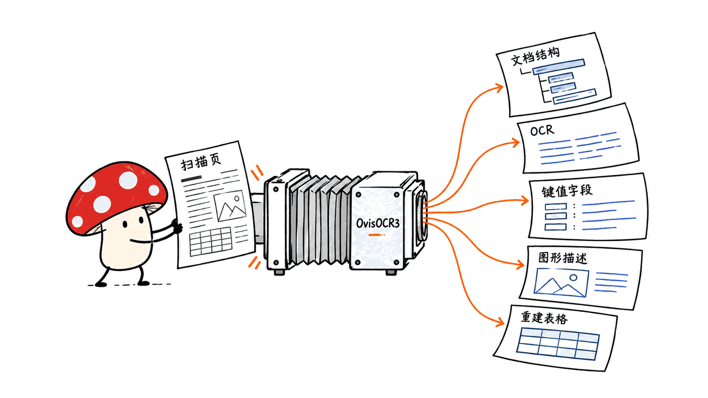
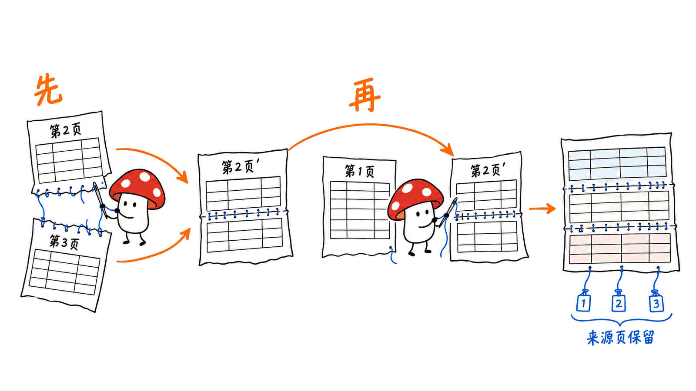

OvisOCR3 是用一个小模型处理扫描文档、票据和跨页表格的开源文档理解工具。它把文档解析、通用 OCR、字段抽取、文档图片描述和跨页表格重建放进同一个 0.8B 模型，通过不同任务提示词选择输出。

模型由阿里巴巴 ATH-MaaS 团队发布，基于 Qwen3.5-0.8B，采用 Apache 2.0 许可。截至 2026 年 10 月 27 日，本文核对了模型卡、18 份任务模板、跨页处理脚本和在线演示源码。技术报告已于 10 月 20 日提交，因此本文不把素材中的“今天发布”当作确定发布日期。

最值得关注的变化是，小模型可以同时承担识别、抽取和结构恢复。但接入业务前要分清：官方分数是作者报告，“Schema”是输出模板约定，跨页拼表是多步流程；公开在线体验也不等于文档留在本地。

本文原文：https://blog.mushroom.cv/blog/ovisocr3-unified-document-model/

## 五类能力分别解决什么问题？

| 能力 | 典型输入 | 适合的输出与场景 |
|---|---|---|
| 文档解析 | 一页扫描图和解析模式 | Markdown、带区域坐标的结构化 JSON，或仅版面结构 |
| 通用 OCR | 图片，按需附区域、问题或候选标签 | 文字、框、公式、图表数据、翻译、分类与问答 |
| 关键信息抽取 KIE | 票据或证件，按需指定字段/模板 | 可送入业务系统的字段对象 |
| 文档图片理解 | 含图片、图表或流程图的整页文档 | 定位后的图片描述，流程图可含 Mermaid |
| 跨页表格重建 | 相邻两页图片及各自解析结果 | 连续关系判断、合并后的 HTML 表格及来源页信息 |

“五类能力”不意味着只有五条提示词。模型仓库提供 18 份模板：文档解析 3 类、通用 OCR 10 类、KIE 3 类，再加图片描述和跨页重建各 1 类。接入时应使用对应模板，而不是只给模型一句“帮我看看这张图”。

模型卡将训练分为继续预训练、中期训练、on-policy 蒸馏和强化学习。技术报告进一步说明，蒸馏会从五个领域的 4B 教师转移能力，并使用不同领域的奖励。这是作者披露的训练过程，不能推导出已经开放完整训练数据与训练流水线。



## 官方成绩该怎样读，哪些不是第一？

下面是模型卡中的作者报告值，本文未复现这些数据集。不同指标分别评价文字、结构、关系或描述质量，不能统一解释成“准确率”。

| 评测与指标 | OvisOCR3 | 解读 |
|---|---:|---|
| OmniDocBench v1.6 综合分 | 96.74 | 高于 OvisOCR2 的 96.58，但表内 Xiaomi-OCR-0 为 96.83 |
| PureDocBench | 82.31 | 模型卡所列对比中最高 |
| MDPBench | 88.80 | OvisOCR2 为 69.00，相差 19.80 分 |
| OCRBench | 88.8 | 不等于对任意业务文档有 88.8% 识别准确率 |
| OCRBench v2 英文 / 中文 | 65.9 / 61.3 | 应分别报告语言切分与版本 |
| DocFigCapBench 图片定位 F1 | 90.97 | 定位指标，不是描述文本质量评分 |
| CrossTabBench 跨页关系 F1 | 97.07 | 衡量是否连续，不是完整表格恢复质量 |
| MPDocBench-Parse 截断表格 TEDS | 92.04 | 面向跨页表格结构恢复的指标 |

KIE 四项分数分别为 90.50、83.01、88.69 和 77.73，在模型卡所列基线中均最高；其中包含内部测试集，不能假定全部数据都能公开下载并复现。

还有两个重要反例：DocFigCapBench 的描述评分为 6.93，低于表内 Qwen3.8-Max 的 7.30；CrossTabBench 的重建 TEDS 为 89.66，也低于它的 91.71。**判断连续关系、定位图片和生成准确内容，是不同的能力。**“五类能力统一”成立，并不意味着每个子指标都已经领先。

论文还披露了内部评测口径：DocFigCapBench 有 182 页、372 个图片目标，描述分数由 Qwen3.8-Max 按 0–10 分评价；CrossTabBench 有 890 对相邻页，其中 491 对需要合并，399 对不应合并。描述分数带有模型裁判的评价口径，跨页测试则同时考查避免误合并，不能只挑成功案例展示。

## KIE 的 Schema 为什么还需要自己校验？

素材说“给定 JSON Schema 返回结果”，官方模型卡的表述更精确：`kie_schema.txt` 接受的是期望 JSON 输出的示例模板，并非正式的 JSON Schema 声明。空字符串表示待填值，嵌套对象和数组表达目标结构。

例如，一张票据只需要编号、日期和金额，可以使用字段抽取模板；需要明细数组时，再传入模板对象。模板替换用 `.replace()`，不要直接用 `.format()`，因为提示词中可能包含 JSON 与 LaTeX 的花括号。

```python
import json
from pathlib import Path

keys = ["invoice_number", "date", "total"]
prompt = Path("prompts/kie_fields.txt").read_text().replace(
    "{keys_json}", json.dumps(keys, ensure_ascii=False)
)
# 将 prompt 与原始图片一起交给模型；保留原始生成文本。
```

官方示例没有用约束解码强制输出符合模板。下游仍需检查 JSON 是否有效、字段是否齐全、金额能否按业务规则转换、日期格式是否符合要求。缺失字段的空字符串不能直接转换为零，也不能用模型猜测的值补齐。

图表解析还有另一套契约：数值以字符串表达，缺少标题或坐标轴信息时用字符串 `"None"`；带定位的问答中，`bbox` 又是字符串形式。不要因为都叫“JSON”就共用一个宽松解析器。

## 跨三页、五页的表格怎么接起来？

OvisOCR3 的跨页路线分两阶段。第一阶段逐页解析；第二阶段同时输入相邻两页图片及各自 Markdown，判断是否连续，再返回合并 HTML。不是把整份 PDF 一次丢进模型后等待一张完整表。

三页连续表格从后往前处理：先合并第 2、3 页，把新表写入较早的第 2 页，并重新渲染更新后的内容；再将更新后的第 2 页与第 1 页配对。这样每一步的图片和 Markdown 保持一致，并保留原始来源页关联。



模型输出的 `source_pages: [1, 2]` 指当前输入对内的局部页码，不一定是整份文档的第 1、2 页。仓库的 `document_crosspage.py` 负责文档级重映射、结果保存、重新渲染和失败记录。

源码还给出一个保守限制：默认将较早页的最后一张表与较晚页的第一张表绑定，一对相邻页默认处理一张合并表。多个合并结果需要显式片段绑定；嵌套或不完整表格会被拒绝写回。它不是任意复杂版面中的通用表格匹配器。

如果没有连续关系，标准返回是带空 `source_pages` 的否定结果。业务流程必须允许“不合并”，不能因为两页都含表格，就强行接在一起。

## 如何部署，Mac 上需要注意什么？

主要发布物在 Hugging Face：模型权重、配置、分词器、18 份提示词，以及文档级跨页脚本。Space 另外开放了 Gradio 应用代码。体验页链接的 GitHub 项目是 Ovis 总仓库；本次读取其 README 仍主要介绍 Ovis2.5，因此不要把旧版安装步骤当成 OCR3 的完整教程。

官方模型卡的主示例使用 `vllm==0.22.1`，要求受支持的 GPU 环境，指定 `gdn_prefill_backend="triton"`，每个请求最多两张图。官方像素范围为 448² 到 2880²，最大输出 16384 token；这些是用法配置，不是统一的评测复现协议。

```bash
# 在独立、受支持的 GPU 环境执行
python -m pip install "vllm==0.22.1" pillow
hf download ATH-MaaS/OvisOCR3 --local-dir ./OvisOCR3
cd OvisOCR3
# 依照模型卡的 LLM / infer 示例加载模型及 prompts/
```

注意：下载命令依赖 Hugging Face CLI，需另行安装与环境匹配的 `huggingface_hub`。部署时最好固定模型 revision、提示词、预处理和生成参数，而不是长期追随 `main`。

跨页脚本还需要 BeautifulSoup、Markdown 渲染和 Playwright Chromium。每次使用新的输出目录，原始响应、中间 Markdown、重建结果及错误信息才不会被覆盖。

```bash
python -m pip install beautifulsoup4 markdown-it-py playwright
python -m playwright install --with-deps chromium
python document_crosspage.py \
  --model . --stage1-prompt document_structured.txt \
  --output crosspage_run_001 page1.jpg page2.jpg page3.jpg
```

参数小不代表整个流程没有开销。本文下载的权重文件为 1,706,030,528 字节，约 1.71GB；它不是最低运行内存。视觉编码、长输出缓存、页面渲染器和并发数都会增加资源需求。

Mac 的 Apple GPU 使用 Metal/MPS，不能直接套用 CUDA/Triton 的官方 vLLM 命令。本文另行尝试 Transformers 的有限本地路线，结果与限制见下一节。没有经过核验的 GGUF、MLX 或 Ollama 方案，本文不作现成支持承诺。

## 本机究竟验证了什么？

我们在 Apple M4 / 16GB、macOS 26.6.2 上完成了有限的真实本地生成：Python 3.12.15、PyTorch 2.14.0、Transformers 5.16.1，另在隔离目录补入 torchvision 0.29.1，没有修改原有机器学习环境。模型以 float32 放在 MPS 设备上，开启不支持算子的 CPU fallback；推理时设置 Hugging Face 离线模式。它不能证明全部算子都在 GPU 上运行。

输入是我们绘制的一张 640×480、四行清晰英文票据。KIE 按指定字段输出了合法 JSON，票号 `INV-1042`、金额 `USD 128.50` 正确，图中不存在的 `Purchase Order` 返回空字符串。

全文 OCR 的首轮结果不完整：设置 120 秒软时间限制时，仅返回标题、票号和日期，缺少金额行。该轮没有记录结束 token，不能确定遗漏完全来自时间限制。将软时限放宽到 300 秒后单独补验，模型输出了全部四行，并确认以 EOS 结束；初轮漏行结果也保留在证据中。这说明简单案例能跑通，不代表这条实验路径足够快或适合生产。

我们还直接运行了发布脚本的 5 项合成后处理检查：否定结果不改页、合并保留表外文字、拒绝错误的局部页码、拒绝无绑定的多表合并，以及裁切图片的来源页映射。5 项均通过，但没有调用模型进行跨页视觉识别。

这些结果不构成吞吐、峰值内存或最低硬件评测，也没有验证全新 Mac 的完整安装流程。原始输出、测试图、参数和脚本均已存档。

本次固定模型提交 `4833d5d2afa6e769ee933f024504d67ace80a24c`，Space 提交 `72851f1a4d49e480527a2dc05c920356c9e3d581`。本机验证与官方评测完全分开，不据此判断多语言、褶皱、低光、复杂公式或金融跨页表格的实际准确率。

## 在线体验为什么不能直接用来测速？

Space 的 README 披露，内置跨页示例可以命中预计算的第一阶段解析缓存，第二阶段合并始终实时生成。其他输入则逐页解析并执行合并。点击演示后很快出结果，可能有缓存参与，不能直接换算成模型完整处理新文档的速度。

演示运行在 ZeroGPU；加载、排队、预填充和生成是不同阶段。它接受图片或 PDF，标明每文件 30MB、图片 3200 万像素、PDF 100 页等输入限制。100 页是上传限制，不代表一次模型推理会同时读取 100 页。

隐私方面也应区分：文档会上传到公开 Space 处理。官方说明 Gradio 临时上传 24 小时后过期，但生成的结果压缩包可能一直留在服务器，直到运营者删除或临时存储重置。真实发票、证件和内部金融材料应使用受控部署，不适合直接送进公共演示。

## 中小团队如何接进真实业务？

先选一个边界清晰的工作流，例如“读取供应商发票的编号、日期、币种和金额”，准备一组业务代表样本，覆盖重复票号、缺字段、旋转、模糊和格式变更。不要一开始同时承诺所有文件类型、所有语言和所有跨页版式。

保存原图、原始响应、模型版本和提示词；将 JSON 校验、金额核对、去重与人工复核放在模型之外。对于表格，额外保留片段来源与页码，检查列对齐、重复表头、合计行和跨页顺序。遇到截断输出应转入重试或人工队列，不能仅靠清除重复尾部就当作内容完整。


Markdown 中的图片路径也不是实际已生成的图片文件。模型返回的是需要从输入页裁切的区域引用，应用需要自己换算坐标、生成裁切图并保存。坐标是相对当前输入图的 `[0,1000)` 归一化值；裁过图后，要按裁切图尺寸解释，不能继续使用原页坐标。

对于图片描述、Mermaid 和 HTML 表格，应检查是否符合原图，并在浏览器端清理或隔离渲染。文档文字抽取是证据，模型生成的解释则需要额外核对。这与本站统一视觉模型分析中的边界相通：https://blog.mushroom.cv/blog/wevisone-vl-unified-vision/

## 常见问题

### 0.8B 是否意味着普通 Mac 一定能流畅处理整份财报？

不能这样推导。权重大小、运行内存、页面分辨率、输出长度和浏览器渲染开销不同。本文只报告明确限定的本机测试，不提供未经测量的最低内存或整份文档速度。

### 给 JSON 模板是否就能保证字段正确？

不能。模板约束输出意图，官方示例没有强制结构解码；合法 JSON 也可能包含错误内容。应同时校验结构、业务规则和原图证据。

### 跨页关系 F1 97.07 是否等于恢复表格准确率 97.07%？

不是。连续关系判断与结构恢复是不同指标，CrossTabBench 另列重建 TEDS 89.66。模型卡分数是作者在对应评测上的报告，不是业务保证。

## 一手资料与复核版本

- 模型、权重和任务模板：https://huggingface.co/ATH-MaaS/OvisOCR3
- 体验与应用源码：https://huggingface.co/spaces/ATH-MaaS/OvisOCR3
- 技术报告：https://arxiv.org/abs/2610.33066
- Ovis 总仓库：https://github.com/ATH-MaaS/Ovis
- 模型版本：`4833d5d2afa6e769ee933f024504d67ace80a24c`；Space 版本：`72851f1a4d49e480527a2dc05c920356c9e3d581`。

封面为文档扫描主题示意，三张手绘图用于解释工程流程，不是识别结果截图。代码与模型许可为 Apache 2.0；示例文档和第三方资源仍须遵循各自条款。

---

> © 2026 Author: Mycelium Protocol. 本文采用 [CC BY 4.0](https://creativecommons.org/licenses/by/4.0/deed.zh) 授权——欢迎转载和引用，须注明作者姓名及原文链接，不得去除署名后以原创发布。

<!--EN-->

OvisOCR3 is a compact document-understanding model that combines parsing, general OCR, key-information extraction, figure captioning and cross-page table reconstruction. Task prompts select the required output from a shared 0.8B checkpoint.

Alibaba's ATH-MaaS team releases the Qwen3.5-0.8B-based model under Apache 2.0. This review checks the model card, 18 prompt templates, document-level reconstruction code and the public demo as of October 27, 2026. The technical report was submitted on October 20; the source note's relative word “today” is not treated as a verified release date.

The practical opportunity is one compact model for several document operations. The boundaries matter: a JSON template is not strict schema enforcement, cross-page reconstruction requires a pipeline, and a public demo does not keep uploads on your machine.

Original article: https://blog.mushroom.cv/blog/ovisocr3-unified-document-model/

## What do the five capabilities provide?

Document parsing supports Markdown, structured region JSON and layout-only JSON. General OCR includes ten tasks such as spotting, region transcription, formula recognition, chart extraction, translation and visual questions. KIE supports open, specified-field and template-based extraction. Figure captioning locates and describes visual regions within a full page, with Mermaid representations for flowcharts. Cross-page reconstruction combines adjacent table fragments while recording source associations.

These operations use 18 task templates: three parsing modes, ten general OCR tasks, three KIE modes, figure captioning and table reconstruction. Use the corresponding prompt rather than assuming one generic question activates the correct output contract.

The authors describe continued pretraining, domain-balanced mid-training, on-policy distillation from five domain-specific 4B teachers, and reinforcement learning. This disclosure does not by itself establish that the entire training dataset and pipeline are released.


## How should the benchmark numbers be interpreted?

All following values are author-reported; we did not reproduce those datasets. OvisOCR3 reports 96.74 on OmniDocBench v1.6, 82.31 on PureDocBench, 88.80 on MDPBench and 88.8 on OCRBench. OCRBench v2 English and Chinese scores are 65.9 and 61.3. The four listed KIE scores are 90.50, 83.01, 88.69 and 77.73, highest among the card's compared baselines; one is an in-house benchmark.

Not every column is a win. Xiaomi-OCR-0 scores 96.83 on OmniDocBench v1.6. OvisOCR3's figure localization F1 is 90.97, but its caption score of 6.93 trails the listed Qwen3.8-Max score of 7.30. Its CrossTabBench relation F1 is 97.07, while reconstruction TEDS is 89.66 versus Qwen3.8-Max's 91.71. MPDocBench-Parse truncated-table TEDS is a separate 92.04 result.

Localization, continuation detection and content reconstruction measure different properties. None of these aggregate scores guarantees an equivalent accuracy rate for your invoices.

The in-house protocols also matter. DocFigCapBench contains 182 pages and 372 figure targets; Qwen3.8-Max judges captions on a 0–10 scale. CrossTabBench contains 890 page pairs: 491 positives and 399 negatives. Caption scores depend on the model-judge protocol, and avoiding false merges is part of the table task.

## Does template-based KIE enforce JSON Schema?

No. The official `kie_schema` prompt accepts an example of the desired JSON output, with empty string placeholders and nested objects or arrays. It is not a formal JSON Schema declaration. The supplied example does not enforce the structure through constrained decoding.

Use literal placeholder replacement, preserving JSON and LaTeX braces. Validate generated syntax, expected keys, missing values and business rules independently. A missing value expressed as an empty string must not silently become zero.

Output contracts also vary across tasks. Chart values are strings and missing chart metadata uses the literal string `"None"`; position-aware VQA encodes its box as a string, unlike numeric spotting arrays. A single permissive JSON parser is insufficient as a business integration contract.

## How are tables spanning several pages reconstructed?

First parse each page independently. Then send two adjacent page images and their current Markdown to the same checkpoint to predict a continued table or a negative result.

For three pages, combine pages 2 and 3, write the result into the earlier page and render its updated content. Then pair that updated page with page 1. Processing proceeds backward through consecutive table-bearing pages, preserving original source associations.


A prediction's `source_pages: [1, 2]` refers to the current pair, not necessarily document pages one and two. The released `document_crosspage.py` handles document-level mapping, rendering, provenance and partial failures.

Its default binding is conservative: the earlier page's last table and later page's first table, with one merged table per adjacent pair. Multiple merges need explicit fragment bindings; nested or incomplete tables are rejected on writeback. This is not a general matching algorithm for arbitrary table layouts. Two pages containing tables may still correctly produce “no continuation.”

## What does deployment require, including on a Mac?

The Hugging Face repository supplies weights, configuration, tokenizer, prompts and the reconstruction script. The Space publishes a separate Gradio application. Its GitHub link redirects to the Ovis umbrella repository, whose inspected README focuses on Ovis2.5; do not treat that older model's installation instructions as the complete OCR3 path.

The main card uses `vllm==0.22.1` in a supported GPU environment, with Triton prefill and at most two images per request. Example inputs range from 448² to 2880² pixels, with a maximum output of 16,384 tokens. These usage settings are not a benchmark reproduction protocol.

```bash
# Separate supported GPU environment; install Hugging Face CLI separately.
python -m pip install "vllm==0.22.1" pillow
hf download ATH-MaaS/OvisOCR3 --local-dir ./OvisOCR3
cd OvisOCR3
# Follow the model card's LLM/infer example and task prompts.
```

Document-level reconstruction additionally requires BeautifulSoup, Markdown tooling and Playwright Chromium. Use a fresh output directory to retain raw predictions, intermediate Markdown, provenance and errors.

The downloaded weight file is 1,706,030,528 bytes, approximately 1.71GB, not a minimum RAM requirement. Vision processing, long outputs, rendering and concurrency require additional resources.

Apple GPUs use Metal/MPS rather than CUDA/Triton. The official vLLM command therefore cannot simply be reused as a native Mac installation. We separately attempted a bounded Transformers route below; this does not establish an official optimized Mac package or verified GGUF, MLX or Ollama support.

## What did our local checks establish?

We completed bounded local generation on an Apple M4 with16GB memory and macOS26.6.2, using Python3.12.15, PyTorch2.14.0 and Transformers5.16.1. A private torchvision0.29.1 overlay supplied the missing dependency without changing the existing ML environment. The model used float32 on MPS with unsupported-operation CPU fallback enabled and Hugging Face offline mode. This does not prove all-GPU execution.

The input was a synthetic640×480 image with four lines of clear English invoice text. Specified-field KIE returned valid JSON with the exact invoice number `INV-1042`, total `USD 128.50` and an empty value for the absent `Purchase Order` field.

Initial plain OCR was incomplete under a120-second soft time limit, returning the heading, invoice number and date but omitting the total. That attempt did not record its final token, so we do not attribute the omission conclusively to the time limit. A separate follow-up with a300-second soft limit returned all four lines and ended with EOS. The initial incomplete response remains in the evidence. This establishes a simple functional path, not production-ready Mac speed.

Five synthetic checks of the released table postprocessor also passed: unchanged negative cases, preservation of non-table text, rejection of invalid pair-local pages, rejection of ambiguous multiple merges, and source-page remapping for image crops. These checks did not run visual table inference.

We did not benchmark throughput, peak memory or minimum hardware, and did not verify a fresh-Mac installation. Raw responses, the test image, parameters and scripts are archived.

The model revision is `4833d5d2afa6e769ee933f024504d67ace80a24c`; the Space revision is `72851f1a4d49e480527a2dc05c920356c9e3d581`. Local checks do not establish multilingual, damaged-document, dense-formula or financial-table accuracy.

## Why is the public demo unsuitable for simple speed claims?

The bundled cross-page example can use cached Stage 1 parses when images and prompts match exactly; Stage 2 is always generated live. Other inputs require live page parsing and reconstruction. A fast example result may therefore exclude part of the processing pipeline.

The app distinguishes GPU queueing, preparation, prefill and generation. Its 100-page PDF limit is an upload limit, not the number of pages read by a single model request. Other documented limits include 30MB per file and 32 megapixels per image.

Uploads are processed by the public Space. Gradio temporary uploads expire after 24 hours, but generated result archives can remain until deleted by the operator or an ephemeral storage reset. Use controlled deployments for confidential documents.

## What should a small team implement first?

Start with a narrow workflow such as supplier invoice number, date, currency and total extraction. Assemble representative examples with missing fields, duplicate identifiers, rotation, blur and layout changes.

Retain source images, raw model outputs, model revisions and prompts. Keep JSON validation, amount reconciliation, duplicate detection and manual review outside the model. For tables, preserve page and fragment provenance, then check column alignment, repeated headers, totals and page order. Repetition cleanup does not restore content missing from truncated generations.


Generated image references describe crops the application must create; the model does not write those image files. Coordinates are normalized to `[0,1000)` relative to the actual supplied image, including cropped inputs. Render HTML and Mermaid only after appropriate validation or isolation, and verify descriptions against the source page.

Related unified-vision analysis: https://blog.mushroom.cv/blog/wevisone-vl-unified-vision/

## FAQ

### Does 0.8B guarantee fast full-report processing on a Mac?

No. Weight size, runtime memory, image resolution, output length and browser rendering are separate costs. This review does not claim an unmeasured minimum RAM requirement or full-document throughput.

### Does valid JSON prove the extracted values are correct?

No. A valid structure may still contain incorrect text. Validate syntax, business rules and source evidence separately; the template example does not provide constrained decoding.

### Is relation F1 of 97.07 a table-reconstruction accuracy of 97.07%?

No. Continuation detection differs from structural reconstruction. CrossTabBench separately reports reconstruction TEDS of 89.66; both are author-reported benchmark results.

## Primary sources

Model and task templates: https://huggingface.co/ATH-MaaS/OvisOCR3

Demo and application source: https://huggingface.co/spaces/ATH-MaaS/OvisOCR3

Technical report: https://arxiv.org/abs/2610.33066

Umbrella repository: https://github.com/ATH-MaaS/Ovis

The cover is thematic artwork and the drawings explain workflow rather than showing recognition results. Code and model licensing is Apache 2.0; example documents and third-party resources retain their own terms.

---

> © 2026 Author: Mycelium Protocol. Licensed under [CC BY 4.0](https://creativecommons.org/licenses/by/4.0/) — free to share and adapt with attribution. You must credit the author and link to the original; removing attribution and republishing as original is not permitted.
