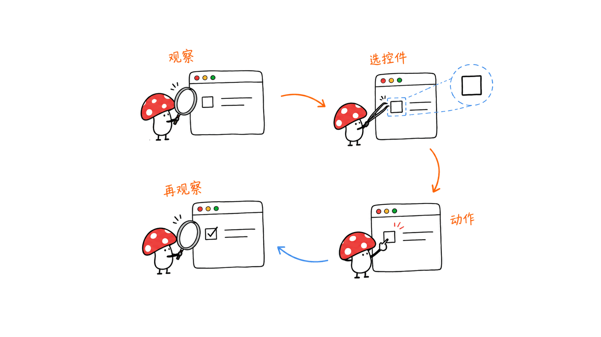
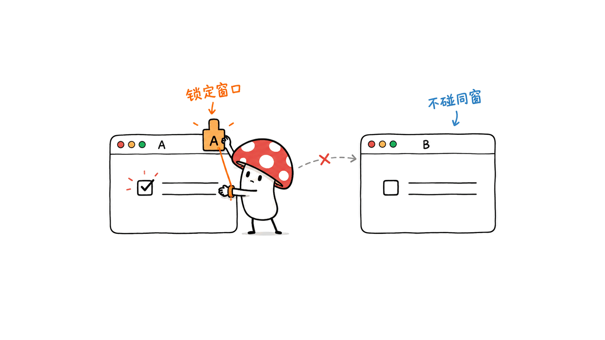
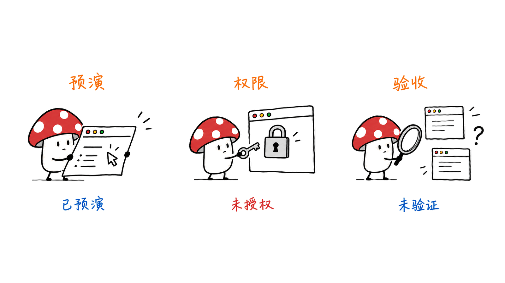

Peekaboo 是一套让 AI 查看并操作 Mac 应用界面的工具，适合给只有命令行能力的助手补上桌面观察与动作入口。它同时提供 CLI、菜单栏应用和可选 MCP 服务，支持截图、辅助功能检查以及点击、输入、菜单和窗口操作。

代码库位于 `openclaw/Peekaboo`，采用 MIT 许可。2026 年 10 月 11 日拉取的 GitHub API 快照为 5,282 Star，与约 5.3k 的说法一致；最新发布版为 4.9.0。Star 只说明关注度，不能证明某个工作流的成功率。

我们在本机跑通了固定版本 CLI 的版本检查、权限查询和 Agent 预演。当前环境没有桌面操作所需授权，因此没有实测截图、点击和完整任务成功率。这个限制决定了本文对能力的表述：功能以官方文档为依据，本地结果只覆盖实际执行过的检查。

官方仓库：https://github.com/openclaw/Peekaboo
发布版本：https://github.com/openclaw/Peekaboo/releases/tag/v4.9.0
文档核对 commit：`509f12ce7958f220b693608106a135a7ac163775`。下文标明的 main 文档细节可能包含发布版之后的更新，应结合本地帮助确认。

## Peekaboo 到底补上了哪一层？

传统脚本擅长处理文件、调用 API 和运行命令，却通常无法解释某个 Mac 应用里弹出的保存窗口。Peekaboo 把这些界面变成工具输入：先读屏幕与辅助功能树，再选目标执行动作，随后重新观察结果。



| 层次 | 入口 | 作用与边界 |
| --- | --- | --- |
| 观察 | `see`、`screen list`、`window list` | 截图、识别应用窗口与可访问控件；界面树可能为空或不完整 |
| 动作 | `click`、`type`、`press`、`scroll`、`set-value`、`action` | 按元素、语义或坐标操作；发出动作后仍需确认效果 |
| 系统表面 | `app`、`window`、`menu`、`menubar`、`dialog` | 处理应用、菜单和弹窗，支持明确目标约束 |
| 编排 | `agent` | 由配置的模型规划多步操作；需要模型提供方，成本另计 |
| 接入 | `mcp` | 将工具提供给外部助手；内置服务器使用 stdio |

CLI 不要求每一步都由模型规划。已知窗口和菜单路径的固定任务，可以先写确定性脚本；自然语言任务再使用 Agent，或让已有 MCP 客户端负责规划。这三种入口共享工具，但成功条件仍要由应用状态或输出产物来定义。

原生自动化也有自己的盲区。绘图画布、某些游戏和自定义控件可能只暴露像素，缺少稳定的辅助功能节点。OCR 看见一个词，不等于发现了可以调用 `AXPress` 的按钮。

## 怎样安装和接入 MCP？

官方发布的 CLI 和应用要求 macOS 15 或更高版本；npm 包要求 Node.js 22 或更高版本。Homebrew 安装命令为：

```bash
brew install openclaw/tap/peekaboo
peekaboo --version
peekaboo permissions status --all-sources
```

无需立即修改客户端配置，也可以先检查固定版本包：

```bash
npx -y @steipete/peekaboo@4.9.0 --version
npx -y @steipete/peekaboo@4.9.0 mcp --help
```

npm 名称仍为 `@steipete/peekaboo`，不要由 GitHub 组织名推导出一个不存在的包名。菜单栏应用可从官方 Release 下载，提供权限引导、可视化反馈和 Agent 会话；安装应用与把 CLI 放进 PATH 是不同步骤。

对于采用 `mcpServers` 格式的客户端，可按官方配置使用固定版本：

```json
{
  "mcpServers": {
    "peekaboo": {
      "command": "npx",
      "args": ["-y", "@steipete/peekaboo@4.9.0", "mcp"]
    }
  }
}
```

客户端配置格式可能不同，应在对应客户端中映射 command 与 args。本次 CLI 帮助明确注明：HTTP/SSE 参数是保留项，服务器尚未实现这些传输方式。不能因为帮助中出现 `--port` 就把它当成可部署的 HTTP MCP 服务。

官方 MCP 文档：https://github.com/openclaw/Peekaboo/blob/509f12ce7958f220b693608106a135a7ac163775/docs/MCP.md

## 为什么窗口和快照比点击坐标更重要？

桌面自动化常见的故障是操作了同一应用的另一个窗口。官方示例先列出 Safari 窗口，再把动作固定到实际的 `window_id`。在本地脚本里，目标窗口要从本次列表中取得，不能照抄示例数字。



辅助功能元素 ID 也应来自刚获取的观察结果，并按原样传回。页面滚动、窗口重建或应用重启后，应重新观察。当前 main 文档进一步将快照绑定到产生它的执行进程；缺失或失效的持有者会导致拒绝，而不是自动换个进程重放。

建议按如下优先级设计操作：先用明确的菜单或元素动作，再用语义查询；实在没有可访问控件时，才使用绑定到截图与窗口的坐标。截图缩放、Retina 像素与逻辑点不同，直接拿缩小图片的像素坐标点击屏幕很容易偏移。

4.9.0 发布说明特别强调应用/PID 范围内的菜单栏点击，以及文件对话框从聚焦到保存回执的父窗口绑定。相关流程需要匹配版本的 Peekaboo.app 作为 Bridge 主机；只更新 CLI 可能不足。

这里的工程价值在于收紧“操作谁”的歧义。它不能替代最终验收：保存文件要检查路径及内容，切换标签要重新查看选中状态，提交表单要核对应用回执。动作分发成功和业务成功是两种证据。

## 后台运行意味着完全不打扰用户吗？

官方工具优先使用明确目标的后台操作，但不是任意鼠标键盘动作都能后台执行。直接 CLI 与 Agent/MCP 的策略也不同：直接 CLI 支持文档规定的精确窗口按键路径；后台 Agent/MCP 对原始按键和输入要求新鲜的精确窗口快照，不能用只有应用名的请求替代。

需要全局输入、焦点切换或共享物理指针的操作，要显式选择前台权限，例如 Agent 的 `--allow-foreground`。某次运行允许前台操作，也不意味着后续恢复会话可以永久沿用；官方策略要求新调用再次明确选择。

部分滚动、拖动或键盘事件只能证明已经分发，系统无法确认应用的语义效果。遇到 `indeterminate` 或不可安全重试的返回值，正确做法是重新观察目标，确认是否已产生部分效果，避免重复输入或重复提交。

我们的判断是：Peekaboo 更适合有人可以检查的本地工作流，尤其是缺少 API 的原生应用。若存在稳定 API、批量导出命令或可维护的网页 DOM 自动化，优先使用那些接口通常更容易记录和复现；在剩余桌面步骤使用 Peekaboo，能减少不必要的界面操作。

## 本机实际验证到了什么？

本次环境为 Apple Silicon Mac、macOS 26.6.2、Node.js 26.10.0。以下检查使用 `@steipete/peekaboo@4.9.0`，日志和官方文档快照保存在研究目录中。

| 检查 | 实际结果 | 能说明什么 |
| --- | --- | --- |
| `--version` | 返回 Peekaboo 4.9.0，构建标识 `release/4.9.0/7020aedd3` | npm 分发入口与本机二进制可启动 |
| `mcp --help` | 显示 stdio 默认入口及未实现的 HTTP/SSE 提示 | 入口说明与文档一致；不是 MCP 握手实测 |
| `permissions status --all-sources --json` | 查询成功；Bridge 与 local 的 Screen Recording、Accessibility 均未授予，Event Synthesizing 也未授予 | 查询命令成功不等于操作权限齐备 |
| `agent ... --dry-run --no-desktop-context --json` | `modelName: not_invoked`、`toolCallCount: 0`、`backgroundOnly: true` | 参数与策略预演可运行；没有调用模型、截图或操作界面 |



预演命令如下，可在安装包后复查：

```bash
npx -y @steipete/peekaboo@4.9.0 agent \
  "Inspect a disposable local test window without changing it" \
  --dry-run --no-desktop-context --json
```

我们没有启动权限申请、读取剪贴板、捕获用户屏幕或自动点击现有应用，也没有运行自然语言 Agent 完整任务。因此不能给出延迟、桌面任务成功率或“替代人工”的实测结论。

权限应授予实际执行宿主。官方文档建议先看 `permissions status` 的 Source；若由 Bridge 执行，单独授权发起命令的终端可能没有用。合成输入另需对应发送者的 Event Synthesizing 权限；剪贴板读取还有独立策略。

此外，本地执行工具不等于图像只留本地。外部助手可能把截图发送给其视觉模型，内置 Agent 也取决于配置的模型提供方。`--no-desktop-context` 只是关闭新的自动桌面上下文采集，不会收回工具能力，也不是应用级隔离。

复核资料：https://github.com/MushroomDAO/blog/tree/main/source/20261011-peekaboo
权限文档：https://github.com/openclaw/Peekaboo/blob/509f12ce7958f220b693608106a135a7ac163775/docs/permissions.md

## 一个值得先做的小实验

完成实际宿主授权后，先选择一个没有真实客户数据的测试窗口。定义三步任务：观察一个可访问控件、改变一次可逆状态、再次观察并核对变化。保存版本号、窗口标识、动作返回值与最终状态，重复若干次后再扩大任务范围。

评估时记录每次是否完成、失败原因、重试次数和总耗时，单独区分找不到目标、权限拒绝、动作效果不明与业务验收失败。这比只贴一段 Agent 的流畅叙述更能帮助团队判断适用性。

若要和更广泛的桌面智能体方案对照，可以阅读本站 Cua 文章：
https://blog.mushroom.cv/blog/cua-computer-use-2-0-desktop-agent-benchmark-trajectory-cua-s1/

## 常见问题

### 它是一个新的视觉模型吗？

Peekaboo 是桌面工具与编排软件，不是本篇介绍的新模型权重。它可以接入本地或远程模型，视觉理解和多步规划能力依赖实际配置。

### MIT 是否意味着使用完全免费？

MIT 是软件许可。模型 API、机器运行和维护可能产生费用；选用本地模型也需要算力和适配，不能由许可推导总成本为零。

### 能直接用于 Windows 和 Linux 吗？

官方 Peekaboo 发布要求 macOS 15+。README 列出的 PeekabooWin 和 PeekabooX 是社区重写项目，不能据此认定本仓库具有原生跨平台兼容性。

### 截图成功就能证明任务完成吗？

截图是观察证据。任务完成需要确认目标状态或产物，并在必要时核对动作前后的差异；不完整的辅助功能树与未确认的输入都应保留为测量限制。

源码及官方功能说明：https://github.com/openclaw/Peekaboo

---

> © 2026 Author: Mycelium Protocol. 本文采用 [CC BY 4.0](https://creativecommons.org/licenses/by/4.0/deed.zh) 授权——欢迎转载和引用，须注明作者姓名及原文链接，不得去除署名后以原创发布。

<!--EN-->

Peekaboo gives AI assistants a way to inspect and operate native Mac application interfaces. Its CLI, menu-bar app and optional MCP server expose screenshots, Accessibility inspection, clicks, typing, menus and window operations.

The MIT-licensed project lives at `openclaw/Peekaboo`. Our October 11, 2026 GitHub API snapshot recorded 5,282 stars, consistent with the rounded 5.3k figure. The latest release was 4.9.0. Popularity is a discovery signal, not evidence of workflow reliability.

We checked the pinned CLI locally, including version output, permission diagnosis and an Agent dry run. The execution hosts lacked desktop permissions, so we did not measure screenshots, clicks or complete task success. Features below come from official documentation; local findings cover only the commands actually run.

Repository: https://github.com/openclaw/Peekaboo
Release: https://github.com/openclaw/Peekaboo/releases/tag/v4.9.0
Documentation commit: `509f12ce7958f220b693608106a135a7ac163775`. Some main-branch documentation may describe changes after the packaged release; check installed help before relying on those details.

## What layer does Peekaboo add?

Shell tools can process files and call APIs, yet frequently cannot interpret a native save dialog. Peekaboo turns the desktop into tool inputs and actions: observe pixels and the Accessibility tree, choose a target, act, then inspect the result.


| Layer | Tools | Role and limitation |
| --- | --- | --- |
| Observation | `see`, `screen list`, `window list` | Capture screens and identify controls; trees can be empty or incomplete |
| Actions | `click`, `type`, `press`, `scroll`, `set-value`, `action` | Target elements, semantics or coordinates; effects still require verification |
| Native surfaces | `app`, `window`, `menu`, `menubar`, `dialog` | Operate application and system interfaces with explicit targeting |
| Planning | `agent` | A configured model plans multiple steps; provider costs are separate |
| Integration | `mcp` | Expose native tools to an external assistant over stdio |

Known workflows can use deterministic CLI scripts. Natural-language tasks can use the built-in Agent or an existing MCP client. These interfaces share tools; application state and output artifacts still define success.

Custom controls, canvases and some games may provide pixels without useful Accessibility nodes. Recognizing a word through OCR does not establish an actionable button or an `AXPress` target.

## How do installation and MCP work?

Released binaries require macOS 15+. The npm package requires Node.js 22+. Homebrew installation is:

```bash
brew install openclaw/tap/peekaboo
peekaboo --version
peekaboo permissions status --all-sources
```

For a pinned package check:

```bash
npx -y @steipete/peekaboo@4.9.0 --version
npx -y @steipete/peekaboo@4.9.0 mcp --help
```

The npm scope remains `@steipete`; do not infer a different package name from the GitHub organization. The signed menu-bar app provides onboarding, feedback and sessions. Installing it and putting the CLI on PATH are separate steps.

Clients using the `mcpServers` configuration format can use:

```json
{
  "mcpServers": {
    "peekaboo": {
      "command": "npx",
      "args": ["-y", "@steipete/peekaboo@4.9.0", "mcp"]
    }
  }
}
```

Map these command and argument fields to your client's own format. Installed help explicitly says HTTP/SSE transports are reserved and unimplemented. A `--port` option is not evidence of a working HTTP MCP endpoint.

Official MCP guide: https://github.com/openclaw/Peekaboo/blob/509f12ce7958f220b693608106a135a7ac163775/docs/MCP.md

## Why do exact windows and snapshots matter?

A frequent automation failure is writing into a sibling window of the correct app. Official examples list Safari windows first, then bind actions to the actual `window_id`. Resolve that identifier from a current inventory rather than copying an example number.


Element IDs should come from a fresh observation and remain opaque. Reobserve after scrolling, rebuilding windows or restarting an app. Current main documentation further binds snapshots to their producer process; an unavailable owner causes refusal rather than silent replay elsewhere.

Prefer exact menu or element actions, then semantic queries, and finally coordinates tied to a screenshot and window. Retina pixels, logical points and resized image coordinates differ. An unadjusted point from a resized screenshot may target the wrong control.

Release 4.9.0 highlights app/PID-scoped menu-bar clicks and parent-window binding throughout foreground file dialogs. These routes require the matching Peekaboo.app Bridge host. Updating only the CLI may not provide the needed host capabilities.

This targeting reduces ambiguity about which object receives an action. It does not establish business success. Verify saved files and contents, selected tabs or application receipts after acting. Dispatch and completion are different evidence.

## Does background execution avoid all interruption?

Targeted operations favor background delivery, but arbitrary input cannot always stay in the background. Direct CLI rules also differ from Agent/MCP policy: the CLI supports documented exact-window raw keys, while background Agent/MCP typing and raw keys require fresh exact-window snapshots.

Global input, focus changes and shared-pointer operations need an explicit foreground choice, such as `--allow-foreground` for an Agent invocation. A previous foreground-capable session does not grant every future resume the same authority automatically.

Some keyboard, scroll and drag operations only prove dispatch. An indeterminate or retry-unsafe outcome should trigger new observation, not blind replay that might duplicate a partial input or submission.

Our assessment is that Peekaboo is most useful for inspectable local workflows in native apps without suitable APIs. Stable APIs, export commands or maintainable browser DOM automation usually provide easier reproducibility where available. Use native UI actions for the remaining desktop steps.

## What did our local checks establish?

We used an Apple Silicon Mac running macOS 26.6.2 and Node.js 26.10.0, with npm package version 4.9.0 pinned.

| Check | Observed result | Interpretation |
| --- | --- | --- |
| Version | 4.9.0, build `release/4.9.0/7020aedd3` | Package entry and binary start locally |
| MCP help | stdio default; HTTP/SSE unimplemented | Entry documentation agrees; no protocol handshake was tested |
| Permission query | Query succeeded; both Bridge and local hosts lacked Screen Recording, Accessibility and Event Synthesizing | Diagnostic success does not mean desktop access exists |
| Agent dry run | `not_invoked`, zero tool calls, background-only | Policy preview works; no model or desktop action ran |


The reproducible preview command is:

```bash
npx -y @steipete/peekaboo@4.9.0 agent \
  "Inspect a disposable local test window without changing it" \
  --dry-run --no-desktop-context --json
```

We did not request permissions, read the clipboard, capture the user's screen or click existing applications. No latency or end-to-end task-success claim follows from this check.

Grant permissions to the actual execution host, identified by the permission command's Source field. If Bridge performs the operation, authorizing the initiating terminal alone may not help. Synthetic input and clipboard reads have additional, separate policies.

Local tool execution also does not guarantee local-only image processing. An external assistant can send returned screenshots to its model provider. The built-in Agent depends on its configured provider. `--no-desktop-context` disables new automatic context collection; it does not remove tools or isolate an application.

Evidence: https://github.com/MushroomDAO/blog/tree/main/source/20261011-peekaboo
Permissions: https://github.com/openclaw/Peekaboo/blob/509f12ce7958f220b693608106a135a7ac163775/docs/permissions.md

## A useful first experiment

After authorizing the real host, use a disposable window without customer data. Observe a control, change one reversible state, then inspect and confirm the change. Save versions, window identity, action outcomes and final state before expanding the workflow.

Measure completion, failure cause, retries and elapsed time. Separate target resolution, permissions, indeterminate delivery and business verification failures. An eloquent Agent narrative is not a substitute for these records.

Related Cua analysis: https://blog.mushroom.cv/blog/cua-computer-use-2-0-desktop-agent-benchmark-trajectory-cua-s1/

## Frequently asked questions

### Is this a new vision model?

Peekaboo is desktop tooling and orchestration software. Understanding and planning depend on the local or remote models configured for the task.

### Does MIT mean zero operating cost?

MIT governs the software license. Model APIs, hardware and maintenance can incur costs; local models still need resources and integration.

### Does the official release support Windows and Linux?

The official release requires macOS 15+. PeekabooWin and PeekabooX are community rewrites mentioned by the README, not proof of native cross-platform support in this repository.

### Does a screenshot prove completion?

A screenshot provides observation evidence. Completion requires the intended state or artifact, with before/after checks when needed. Incomplete trees and unconfirmed input remain measurement limitations.

Source: https://github.com/openclaw/Peekaboo

---

> © 2026 Author: Mycelium Protocol. Licensed under [CC BY 4.0](https://creativecommons.org/licenses/by/4.0/) — free to share and adapt with attribution. You must credit the author and link to the original; removing attribution and republishing as original is not permitted.
